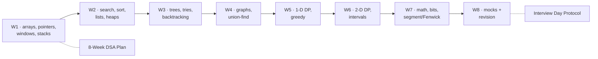

# DSA Dashboard

> [!abstract] What this page answers
> **What do I solve today? What is due for revision? How far through the 150 am I, and how are the scary topics going?** Every table is a live view over note properties (native Bases — no plugin). Update `status`, `attempts`, `last_solved`, `confidence` and `next_review` inside a note and the dashboard follows. New here? Read [[Start Here]].

> [!info] Quick navigation
> **Learn** [[Start Here]] · [[Topics MOC]] — **Solve** [[NeetCode 150 MOC]] · [[Pattern Recognition Table]] — **Java** [[Java Collections Cheat Sheet]] · [[DSA Patterns in Java]] · [[Java Pitfalls in Interviews]] — **Plan** [[8-Week DSA Plan]] · [[Spaced Repetition Protocol]] · [[Interview Day Protocol]] · [[Mistakes Log]] — **Review** [[Reviews MOC]] · [[Workspace Guide]] — **Setup** [[Plugins to Install]] — **Canvases** [[DSA Topic Map.excalidraw|Topic map]] · [[NeetCode 150 Map.excalidraw|Problem map]]

**On this page:** [[#1. Today|Today]] · [[#2. Revision queue|Revision]] · [[#3. Topics|Topics]] · [[#4. Problems|Problems]] · [[#5. Weekly progress|Weekly]] · [[#6. Progress overview|Progress]]

> [!todo] Today's three moves *(edit by hand, keep it to three)*
> 1.
> 2.
> 3.

## Where you are in the plan

*Eight weeks; click a box to open the plan. The `week` property on every problem and topic note drives the tables below.*



> [!example]- Excalidraw version — the same diagram as an editable canvas
> ![[DSA Dashboard — Where you are in the plan.excalidraw]]
> [[DSA Dashboard — Where you are in the plan.excalidraw|Open in Excalidraw]] — needs the Excalidraw plugin (see [[Plugins to Install]]).

---

## 1. Today

### Problems not yet started, in plan order
*Pick the first row of the current week; solve timed, then log the attempt in the note.*

![[Problems.base#Not started]]

### Problems in progress — attempted or flagged
*Retry these before new ones; `next_review` tells you when.*

![[Problems.base#In progress]]

---

## 2. Revision queue

### Due now (topics and problems)
*Flagged `needs-revision`, `next_review` passed, confidence ≤ 2, or untouched for 30 days. Clear this before new work ([[Spaced Repetition Protocol]]).*

![[Revision Queue.base#Due now]]

### Scheduled

![[Revision Queue.base#Scheduled]]

---

## 3. Topics

### The scared six — and the two stretch structures
*[[Tries]], [[Graphs]], [[Advanced Graphs]], [[Union-Find]], [[Dynamic Programming]], [[2-D Dynamic Programming]], [[DP Pattern Catalogue]], [[Segment Trees]], [[Fenwick Trees]]. Two reading passes each before their first problem.*

![[Topics.base#Scared six]]

### Topics being studied

![[Topics.base#Studying]]

### Topics not yet read, in week order

![[Topics.base#Not started]]

### Low confidence

![[Topics.base#Low confidence]]

---

## 4. Problems

### Solved — most recent first

![[Problems.base#Solved]]

### Hard problems — one per week is enough

![[Problems.base#Hard]]

### Needs another go

![[Problems.base#Needs revision]]

### By category — count and average confidence

![[Problems.base#All]]

---

## 5. Weekly progress

### Latest weekly reviews

![[Reviews.base#Latest]]

### Solved in the last 7 days

![[Problems.base#Solved this week]]

> [!tip] Create the weekly review from `Templates/Weekly Review Template.md` every Sunday — [[Reviews MOC]] explains the routine, [[Interview Day Protocol]] the mock.

---

## 6. Progress overview

### By week

![[Problems.base#By week]]

### Numbers (Dataview)

> [!example]- Problems by status and difficulty
> ```dataviewjs
> const ps = dv.pages('"02 NeetCode 150"').where(p => p.type == "problem");
> const total = ps.length;
> const bar = n => "█".repeat(Math.round(30 * n / Math.max(total, 1))) + " " + n;
> dv.header(4, `${total} problem notes`);
> dv.table(["Status", "Count", ""], ["not-started", "attempted", "solved", "needs-revision", "mastered"].map(s => { const n = ps.where(p => p.status == s).length; return [s, n, bar(n)]; }));
> dv.table(["Difficulty", "Total", "Solved or mastered", "Avg confidence"], ["Easy", "Medium", "Hard"].map(d => { const q = ps.where(p => p.difficulty == d); const done = q.where(p => p.status == "solved" || p.status == "mastered").length; const avg = (q.map(p => p.confidence ?? 1).array().reduce((a, b) => a + b, 0) / Math.max(q.length, 1)).toFixed(1); return [d, q.length, done, avg]; }));
> const attempts = ps.map(p => p.attempts ?? 0).array().reduce((a, b) => a + b, 0);
> dv.paragraph(`**Total attempts logged:** ${attempts} · **Solved or mastered:** ${ps.where(p => p.status == "solved" || p.status == "mastered").length} / ${total}`);
> ```

> [!example]- Per-category progress
> ```dataviewjs
> const ps = dv.pages('"02 NeetCode 150"').where(p => p.type == "problem");
> const cats = [...new Set(ps.map(p => p.category))].sort();
> dv.table(["Category", "Problems", "Started", "Solved+", "Avg confidence"], cats.map(c => { const q = ps.where(p => p.category == c); const started = q.where(p => p.status != "not-started").length; const done = q.where(p => p.status == "solved" || p.status == "mastered").length; const avg = (q.map(p => p.confidence ?? 1).array().reduce((a, b) => a + b, 0) / Math.max(q.length, 1)).toFixed(1); return [c, q.length, started, done, avg]; }));
> ```

> [!example]- Topics and the scared six
> ```dataviewjs
> const ts = dv.pages('"01 Topics"').where(p => p.type == "topic");
> const scared = ts.where(p => p.scared == true);
> const line = q => `${q.where(p => p.status != "not-started").length} started · ${q.where(p => (p.confidence ?? 1) >= 3).length} at confidence ≥ 3 · of ${q.length}`;
> dv.paragraph(`**All topics:** ${line(ts)}`);
> dv.paragraph(`**Scared topics:** ${line(scared)}`);
> dv.table(["Scared topic", "Status", "Confidence", "Next review"], scared.sort(p => p.week).map(p => [p.file.link, p.status, p.confidence, p.next_review]));
> ```

> [!example]- Time per solve (last 20)
> ```dataviewjs
> const ps = dv.pages('"02 NeetCode 150"').where(p => p.type == "problem" && p.last_solved).sort(p => p.last_solved, "desc").array().slice(0, 20);
> dv.table(["Problem", "Difficulty", "Minutes", "Attempts", "Solved"], ps.map(p => [p.file.link, p.difficulty, p.time_minutes, p.attempts, p.last_solved]));
> ```
