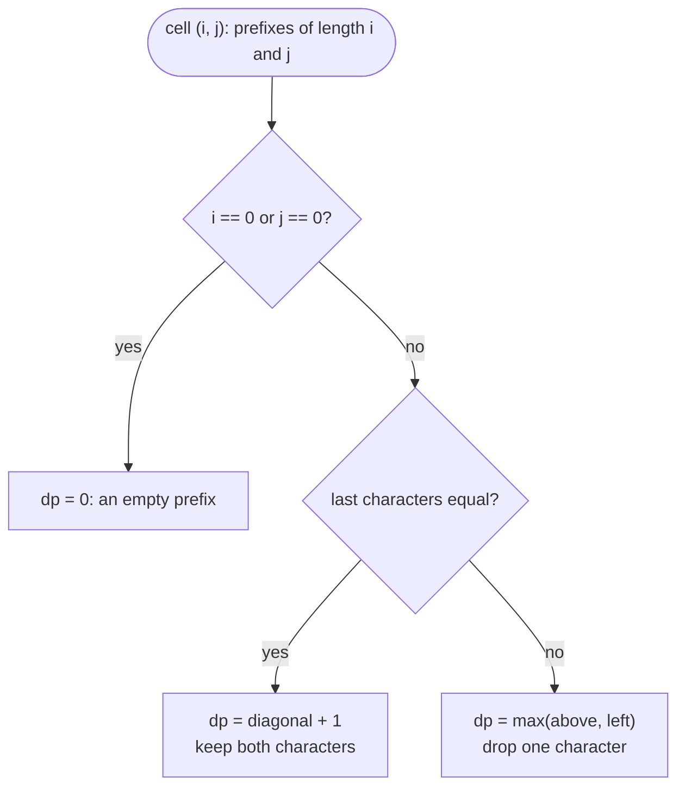

# 2-D Dynamic Programming

> [!abstract] In one sentence
> When "where am I" needs two numbers — a prefix of each string, a row and a column, an item and a remaining capacity, an interval's two ends, an index and a mode — the DP table becomes two-dimensional, each cell is filled from one to three neighbouring cells, and the whole craft is naming the two coordinates and the direction of the fill.

**Map:** [[Topics MOC]] → [[DSA Dashboard]]

> [!question] Predict before you read
> Coin change II counts the ways to make an amount with unlimited coins. If you loop over amounts on the outside and coins on the inside, the answer for amount 3 with coins `{1, 2}` comes out as 3 instead of 2. Which two "ways" got double-counted, and why does swapping the loops fix it?

## Why this exists

In [[Dynamic Programming]] the state was one integer and the table one row. Many problems cannot be described by one integer: comparing two strings needs a position in each; walking a grid needs a row and a column; "choose items without exceeding a capacity" needs how many items were considered *and* how much capacity remains; "burst balloons in some order" needs the interval that is still intact; "buy and sell with cooldown" needs the day *and* whether you hold stock. The second integer is the whole difference — the four questions (state, transition, base, order) are unchanged.

The signals are **two strings** in the statement (subsequence, edit, interleave, distinct, match a pattern), a **grid you move through** with restricted directions, **items with weights and a capacity or target** (subset, partition, coins with "number of combinations"), **remove or merge elements where the cost depends on the current neighbours** (interval DP), and **a small set of modes** (holding / sold / cooling).

## The idea from zero

[[LC 62 Unique Paths]]: a robot at the top-left of an m × n grid moves only right or down; how many paths reach the bottom-right? The last move into cell `(r, c)` came from above or from the left, and those sets of paths do not overlap, so `dp[r][c] = dp[r − 1][c] + dp[r][c − 1]`. The first row and first column have exactly one path each. Fill row by row: every cell reads a finished cell above and a finished cell to the left.

> [!example] Unique paths on a 3 x 3 grid
> ![[2-D Dynamic Programming — Unique paths on a 3 x 3 grid.excalidraw]]
> [[2-D Dynamic Programming — Unique paths on a 3 x 3 grid.excalidraw|Open in Excalidraw]] — dp[2][2] = dp[1][2] + dp[2][1] = 3 + 3; the whole table is filled left to right, top to bottom

%% excalidraw-spec
{"kind": "grid", "title": "Unique paths on a 3 x 3 grid", "col_labels": ["", "0", "1", "2"], "row_labels": ["", "0", "1", "2"], "rows": [ [1, 1, 1], [1, 2, 3], [1, 3, 6] ], "highlight": [ [2, 2] ], "arrows": [ [ [1, 2], [2, 2] ], [ [2, 1], [2, 2] ] ], "caption": "dp[2][2] = dp[1][2] + dp[2][1] = 3 + 3; the whole table is filled left to right, top to bottom"}
%%

That is the entire method: a cell, the one-to-three cells it is built from, and a fill order that makes those cells ready. The rest of this note is the catalogue of what the two coordinates can mean.

## The mechanism

### Two sequences: a cell is a pair of prefixes

For strings `a` (length m) and `b` (length n), `dp[i][j]` describes the prefixes `a[0..i)` and `b[0..j)`. The table is (m + 1) × (n + 1) because the empty prefix is a real state; row 0 and column 0 are the base cases. The character being decided at cell `(i, j)` is `a.charAt(i − 1)` and `b.charAt(j − 1)` — the index shift that causes most bugs.



> [!example]- Excalidraw version — the same diagram as an editable canvas
> ![[2-D Dynamic Programming — Two sequences- a cell is a pair of prefixes.excalidraw]]
> [[2-D Dynamic Programming — Two sequences- a cell is a pair of prefixes.excalidraw|Open in Excalidraw]] — needs the Excalidraw plugin (see [[Plugins to Install]]).

[[LC 1143 Longest Common Subsequence]] is exactly that flowchart. [[LC 72 Edit Distance]] changes the else-branch to `1 + min(diagonal, above, left)` — replace, delete, insert — and the base row to `dp[i][0] = i`. [[LC 115 Distinct Subsequences]] counts instead of maximising: `dp[i][j] = dp[i−1][j] + (match ? dp[i−1][j−1] : 0)`. [[LC 97 Interleaving String]] asks whether `s3[0..i+j)` can be formed: `dp[i][j]` is true if the last character of `s3` came from `s1` (`dp[i−1][j]`) or from `s2` (`dp[i][j−1]`). [[LC 10 Regular Expression Matching]] is the same table with a twist for `*`: it looks back *two* pattern characters (zero copies) or stays in the same pattern column while consuming one text character (one more copy).

> [!example] LCS table for abcde and ace
> ![[2-D Dynamic Programming — LCS table for abcde and ace.excalidraw]]
> [[2-D Dynamic Programming — LCS table for abcde and ace.excalidraw|Open in Excalidraw]] — matches a, c, e each extend the diagonal; every other cell copies the larger of above and left

%% excalidraw-spec
{"kind": "grid", "title": "LCS table for abcde and ace", "col_labels": ["", "", "a", "c", "e"], "row_labels": ["", "", "a", "b", "c", "d", "e"], "rows": [ [0, 0, 0, 0], [0, 1, 1, 1], [0, 1, 1, 1], [0, 1, 2, 2], [0, 1, 2, 2], [0, 1, 2, 3] ], "highlight": [ [5, 3] ], "arrows": [ [ [0, 0], [1, 1] ], [ [2, 1], [3, 2] ], [ [4, 2], [5, 3] ] ], "caption": "matches a, c, e each extend the diagonal; every other cell copies the larger of above and left"}
%%

### Knapsack: a cell is (items considered, capacity left)

With items `0..i−1` considered and capacity (or target sum) `w`, `dp[i][w]` is the best value, the number of ways, or whether it is reachable. Item `i − 1` is either skipped (`dp[i−1][w]`) or taken (`dp[i−1][w − weight]` plus its value). Two families:

| | 0/1 knapsack | Unbounded knapsack |
|---|---|---|
| each item | at most once | any number of times |
| take-transition reads | `dp[i−1][w − wt]` (previous row) | `dp[i][w − wt]` (same row: the item can be taken again) |
| 1-D compression | iterate `w` **downwards** so the cell you read still belongs to the previous row | iterate `w` **upwards** so the cell you read already includes this item |
| problems | [[LC 416 Partition Equal Subset Sum]], [[LC 494 Target Sum]] | [[LC 518 Coin Change II]], [[LC 322 Coin Change]] |

> [!example] Coin Change II: ways to make 0..5 with coins 1, 2, 5
> ![[2-D Dynamic Programming — Coin Change II- ways to make 0..5 with coins 1, 2, 5.excalidraw]]
> [[2-D Dynamic Programming — Coin Change II- ways to make 0..5 with coins 1, 2, 5.excalidraw|Open in Excalidraw]] — dp[coin 5][5] = dp[coin 2][5] (skip the 5) + dp[coin 5][0] (use a 5): 3 + 1 = 4

%% excalidraw-spec
{"kind": "grid", "title": "Coin Change II: ways to make 0..5 with coins 1, 2, 5", "col_labels": ["", "0", "1", "2", "3", "4", "5"], "row_labels": ["", "no coins", "+ coin 1", "+ coin 2", "+ coin 5"], "rows": [ [1, 0, 0, 0, 0, 0], [1, 1, 1, 1, 1, 1], [1, 1, 2, 2, 3, 3], [1, 1, 2, 2, 3, 4] ], "highlight": [ [3, 5] ], "arrows": [ [ [2, 5], [3, 5] ], [ [3, 0], [3, 5] ] ], "caption": "dp[coin 5][5] = dp[coin 2][5] (skip the 5) + dp[coin 5][0] (use a 5): 3 + 1 = 4"}
%%

The loop order is the famous trap. Coins on the outside, amounts on the inside counts each *combination* once: a combination is built in coin order, so `{1, 2}` and `{2, 1}` are the same cell. Amounts on the outside, coins on the inside counts *permutations* — a different problem (not in NeetCode 150, but the interviewer will ask). [[LC 494 Target Sum]] hides a 0/1 subset count: if P is the sum of the numbers given `+` and N the rest, `P − N = target` and `P + N = total`, so count subsets summing to `(total + target) / 2`.

### Interval DP: a cell is (left end, right end)

[[LC 312 Burst Balloons]] gives coins `a[i−1] · a[i] · a[i+1]` for bursting balloon i, and the neighbours change as balloons disappear — so "which balloon to burst first" has no clean subproblem. The trick is to ask which balloon is burst **last** inside an interval: if k is the last one burst strictly between i and j, then when it goes its neighbours are exactly i and j (everything between is already gone), and the two sides `(i, k)` and `(k, j)` were solved independently. `dp[i][j] = max over k of dp[i][k] + a[i]·a[k]·a[j] + dp[k][j]`, with the array padded by a 1 at each end. Fill by increasing interval length, because a cell reads only strictly shorter intervals.

> [!example] Burst Balloons dp over padded 1, 3, 1, 5, 8, 1
> ![[2-D Dynamic Programming — Burst Balloons dp over padded 1, 3, 1, 5, 8, 1.excalidraw]]
> [[2-D Dynamic Programming — Burst Balloons dp over padded 1, 3, 1, 5, 8, 1.excalidraw|Open in Excalidraw]] — dp[0][5] = 167 with k = 4 (burst 8 last): dp[0][4] + 1 * 8 * 1 + dp[4][5]; the table fills diagonal by diagonal, away from the main diagonal

%% excalidraw-spec
{"kind": "grid", "title": "Burst Balloons dp over padded 1, 3, 1, 5, 8, 1", "col_labels": ["", "0", "1", "2", "3", "4", "5"], "row_labels": ["", "0", "1", "2", "3", "4", "5"], "rows": [ [0, 0, 3, 30, 159, 167], [0, 0, 0, 15, 135, 159], [0, 0, 0, 0, 40, 48], [0, 0, 0, 0, 0, 40], [0, 0, 0, 0, 0, 0], [0, 0, 0, 0, 0, 0] ], "highlight": [ [0, 5] ], "arrows": [ [ [0, 4], [0, 5] ], [ [4, 5], [0, 5] ] ], "caption": "dp[0][5] = 167 with k = 4 (burst 8 last): dp[0][4] + 1 * 8 * 1 + dp[4][5]; the table fills diagonal by diagonal, away from the main diagonal"}
%%

### A matrix with DFS and memo: no fill order at all

[[LC 329 Longest Increasing Path in a Matrix]] asks for the longest strictly increasing path. Because every step goes to a strictly larger value, the moves form a DAG — no cycles, so no visited set — and `memo[r][c]` = longest path starting at `(r, c)` is computed by a DFS that tries the four neighbours. There is no natural order to tabulate in (you would have to sort cells by value), which is precisely when top-down memoisation is the better tool. The recursion depth is at most the number of cells; on a 200 × 200 matrix that is deep but passes.

### State machine: a cell is (day, mode)

[[LC 309 Best Time to Buy and Sell Stock with Cooldown]] has three modes per day: holding a share, just sold (so tomorrow is a cooldown), or resting. Each mode's best profit on day i comes from one or two modes on day i − 1; the table is n × 3, and because only yesterday's row is read it collapses to three variables. Draw the modes as a small automaton before coding — it is the one 2-D shape where the picture *is* the transition.

## Java template

Two-sequence alignment, the shape you will meet most.

```java
import java.util.*;

class Solution {
    public int longestCommonSubsequence(String a, String b) {
        int m = a.length(), n = b.length();
        int[][] dp = new int[m + 1][n + 1];            // dp[i][j] = LCS of a[0..i) and b[0..j); row and column 0 = empty prefix
        for (int i = 1; i <= m; i++)
            for (int j = 1; j <= n; j++)
                dp[i][j] = a.charAt(i - 1) == b.charAt(j - 1)
                        ? dp[i - 1][j - 1] + 1                       // match: extend the diagonal
                        : Math.max(dp[i - 1][j], dp[i][j - 1]);       // drop a character from either side
        return dp[m][n];
    }
}
```

**Time** O(m · n) · **Space** O(m · n), O(n) with two rows

```java
import java.util.*;

class Solution {
    public int minDistance(String a, String b) {
        int m = a.length(), n = b.length();
        int[][] dp = new int[m + 1][n + 1];            // dp[i][j] = edits turning a[0..i) into b[0..j)
        for (int i = 0; i <= m; i++) dp[i][0] = i;     // delete everything
        for (int j = 0; j <= n; j++) dp[0][j] = j;     // insert everything
        for (int i = 1; i <= m; i++)
            for (int j = 1; j <= n; j++) {
                if (a.charAt(i - 1) == b.charAt(j - 1)) dp[i][j] = dp[i - 1][j - 1];   // free match
                else dp[i][j] = 1 + Math.min(dp[i - 1][j - 1],                            // replace
                                     Math.min(dp[i - 1][j], dp[i][j - 1]));               // delete, insert
            }
        return dp[m][n];
    }
}
```

**Time** O(m · n) · **Space** O(m · n)

Knapsack in one dimension: the loop direction encodes 0/1 versus unbounded.

```java
import java.util.*;

class Knapsack {
    // Unbounded: number of combinations making amount; coins outer so each combination is counted once.
    int change(int amount, int[] coins) {
        int[] dp = new int[amount + 1];
        dp[0] = 1;                                      // one way to make 0: take nothing
        for (int c : coins)
            for (int a = c; a <= amount; a++) dp[a] += dp[a - c];   // upwards: c may be reused
        return dp[amount];
    }
    // 0/1: can some subset sum to half the total? Downwards so each number is used at most once.
    boolean canPartition(int[] nums) {
        int total = 0;
        for (int x : nums) total += x;
        if (total % 2 != 0) return false;
        int target = total / 2;
        boolean[] dp = new boolean[target + 1];
        dp[0] = true;
        for (int x : nums)
            for (int s = target; s >= x; s--) dp[s] = dp[s] || dp[s - x];
        return dp[target];
    }
    // Target sum: P - N = target and P + N = total, so count subsets summing to P = (total + target) / 2.
    int findTargetSumWays(int[] nums, int target) {
        int total = 0;
        for (int x : nums) total += x;
        if (Math.abs(target) > total || (total + target) % 2 != 0) return 0;
        int p = (total + target) / 2;
        int[] dp = new int[p + 1];
        dp[0] = 1;
        for (int x : nums)
            for (int s = p; s >= x; s--) dp[s] += dp[s - x];
        return dp[p];
    }
}
```

**Time** O(n · target) · **Space** O(target)

Interval DP with the "last one" trick.

```java
import java.util.*;

class Solution {
    public int maxCoins(int[] nums) {
        int n = nums.length;
        int[] a = new int[n + 2];                       // pad with 1s so every balloon has neighbours
        a[0] = 1; a[n + 1] = 1;
        for (int i = 0; i < n; i++) a[i + 1] = nums[i];
        int[][] dp = new int[n + 2][n + 2];             // dp[i][j] = best for balloons strictly between i and j
        for (int len = 2; len <= n + 1; len++)          // j - i, growing: shorter intervals first
            for (int i = 0; i + len <= n + 1; i++) {
                int j = i + len;
                for (int k = i + 1; k < j; k++)         // k = the LAST balloon burst inside (i, j)
                    dp[i][j] = Math.max(dp[i][j], dp[i][k] + a[i] * a[k] * a[j] + dp[k][j]);
            }
        return dp[0][n + 1];
    }
}
```

**Time** O(n³) · **Space** O(n²)

DFS with memo on a matrix.

```java
import java.util.*;

class Solution {
    private static final int[][] DIRS = {{1, 0}, {-1, 0}, {0, 1}, {0, -1}};

    public int longestIncreasingPath(int[][] matrix) {
        int m = matrix.length, n = matrix[0].length, best = 0;
        int[][] memo = new int[m][n];                   // 0 = not computed (every real answer is at least 1)
        for (int r = 0; r < m; r++)
            for (int c = 0; c < n; c++) best = Math.max(best, dfs(matrix, r, c, memo));
        return best;
    }
    private int dfs(int[][] g, int r, int c, int[][] memo) {
        if (memo[r][c] != 0) return memo[r][c];
        int len = 1;                                    // the cell on its own
        for (int[] d : DIRS) {
            int nr = r + d[0], nc = c + d[1];
            if (nr < 0 || nc < 0 || nr >= g.length || nc >= g[0].length || g[nr][nc] <= g[r][c]) continue;
            len = Math.max(len, 1 + dfs(g, nr, nc, memo));   // strictly increasing: no cycles, no visited set
        }
        return memo[r][c] = len;
    }
}
```

**Time** O(m · n) · **Space** O(m · n) memo plus recursion

Pattern matching with `*` as a two-way lookback.

```java
import java.util.*;

class Solution {
    public boolean isMatch(String s, String p) {
        int m = s.length(), n = p.length();
        boolean[][] dp = new boolean[m + 1][n + 1];     // dp[i][j] = s[0..i) matches p[0..j)
        dp[0][0] = true;
        for (int j = 2; j <= n; j++)                    // the empty text matches patterns like a*b*
            if (p.charAt(j - 1) == '*') dp[0][j] = dp[0][j - 2];
        for (int i = 1; i <= m; i++)
            for (int j = 1; j <= n; j++) {
                char pc = p.charAt(j - 1);
                if (pc == '*') {
                    char prev = p.charAt(j - 2);
                    dp[i][j] = dp[i][j - 2]                                               // zero copies of prev
                            || ((prev == '.' || prev == s.charAt(i - 1)) && dp[i - 1][j]); // one more copy
                } else {
                    dp[i][j] = (pc == '.' || pc == s.charAt(i - 1)) && dp[i - 1][j - 1];
                }
            }
        return dp[m][n];
    }
}
```

**Time** O(m · n) · **Space** O(m · n)

State machine, already collapsed to one row.

```java
import java.util.*;

class Solution {
    public int maxProfit(int[] prices) {
        int hold = Integer.MIN_VALUE, sold = 0, rest = 0;    // best profit ending the day in each mode
        for (int p : prices) {
            int newHold = Math.max(hold, rest - p);           // keep holding, or buy today (not right after a sale)
            int newSold = hold + p;                           // sell today
            int newRest = Math.max(rest, sold);               // idle, or the cooldown day after a sale
            hold = newHold; sold = newSold; rest = newRest;
        }
        return Math.max(sold, rest);
    }
}
```

**Time** O(n) · **Space** O(1)

## Complexity

| Shape | Time | Space | Why |
|---|---|---|---|
| grid paths | O(m · n) | O(n) with one rolling row | each cell reads above and left |
| two sequences | O(m · n) | O(m · n), O(n) with two rows | each cell reads up to three neighbours |
| knapsack | O(n · W) | O(W) | one pass over capacities per item; pseudo-polynomial in W |
| interval DP | O(n³) | O(n²) | n² intervals, each tries n split points |
| matrix DFS + memo | O(m · n) | O(m · n) | each cell computed once, four neighbours |
| state machine | O(n · modes) | O(modes) | one row per day, only yesterday is read |

## The canonical shapes

| Shape | Recognition cue | One-line solution | Problems |
|---|---|---|---|
| Grid paths | "only right or down", "count paths", "min path sum" | `dp[r][c]` from above and left | [[LC 62 Unique Paths]] |
| Two-sequence alignment | "two strings", "subsequence", "edit", "interleave", "distinct" | `dp[i][j]` over prefixes, diagonal on match | [[LC 1143 Longest Common Subsequence]], [[LC 72 Edit Distance]], [[LC 115 Distinct Subsequences]], [[LC 97 Interleaving String]] |
| Pattern matching | "`.` and `*`" | two-sequence table where `*` reads `j − 2` or stays in column j | [[LC 10 Regular Expression Matching]] |
| Unbounded knapsack | "number of combinations", "unlimited coins" | coins outer, amounts upwards | [[LC 518 Coin Change II]] |
| 0/1 knapsack | "each once", "partition", "assign + or −" | sums downwards; target sum becomes a subset count | [[LC 416 Partition Equal Subset Sum]], [[LC 494 Target Sum]] |
| Interval DP | "burst / remove / merge, cost depends on neighbours" | choose the last element in `(i, j)`, fill by length | [[LC 312 Burst Balloons]] |
| Matrix DFS + memo | "longest increasing path in a matrix" | memoised DFS; strictly increasing means no cycles | [[LC 329 Longest Increasing Path in a Matrix]] |
| State machine | "cooldown", "transaction fee", "at most k transactions" | one value per mode per day | [[LC 309 Best Time to Buy and Sell Stock with Cooldown]] |

## Worked example

[[LC 72 Edit Distance]] from `horse` to `ros`. State: `dp[i][j]` = fewest edits turning the first i characters of `horse` into the first j of `ros`. Base: `dp[i][0] = i` (delete all), `dp[0][j] = j` (insert all). Transition: if the last characters match, `dp[i−1][j−1]`; otherwise `1 + min(replace, delete, insert)`.

> [!example] Edit distance table: horse to ros
> ![[2-D Dynamic Programming — Edit distance table- horse to ros.excalidraw]]
> [[2-D Dynamic Programming — Edit distance table- horse to ros.excalidraw|Open in Excalidraw]] — the arrows are one optimal alignment: replace h with r, match o, delete r, match s, delete e: 3 edits

%% excalidraw-spec
{"kind": "grid", "title": "Edit distance table: horse to ros", "col_labels": ["", "", "r", "o", "s"], "row_labels": ["", "", "h", "o", "r", "s", "e"], "rows": [ [0, 1, 2, 3], [1, 1, 2, 3], [2, 2, 1, 2], [3, 2, 2, 2], [4, 3, 3, 2], [5, 4, 4, 3] ], "highlight": [ [5, 3] ], "arrows": [ [ [0, 0], [1, 1] ], [ [1, 1], [2, 2] ], [ [2, 2], [3, 2] ], [ [3, 2], [4, 3] ], [ [4, 3], [5, 3] ] ], "caption": "the arrows are one optimal alignment: replace h with r, match o, delete r, match s, delete e: 3 edits"}
%%

Read one cell to see the mechanism: `dp[3][2]` compares `r` with `o`; they differ, so it is `1 + min(dp[2][1] = 2, dp[2][2] = 1, dp[3][1] = 2) = 2`, the winning move being "delete `r`" (from `dp[2][2]`, directly above). The answer `dp[5][3] = 3`. The arrows are reconstructed by walking back from the bottom-right, always to the cell that produced the value — the same trick that returns the actual LCS or the actual edits when an interviewer asks.

## Pitfalls

> [!warning] The mistakes people make
> - **The index shift.** `dp[i][j]` is about *lengths*; the characters are `charAt(i − 1)` and `charAt(j − 1)`. Decide this once and write it as a comment.
> - **Wrong loop direction in 1-D knapsack.** Upwards for 0/1 lets an item be used twice; downwards for unbounded forbids reuse. Say the direction and why before you type it.
> - **Loop order for counting.** Amounts outside, coins inside counts permutations; if the question says "combinations", coins go outside.
> - **Interval DP filled row by row.** A cell `(i, j)` reads shorter intervals inside it, which row-major order has not computed; iterate by length.
> - **Forgetting the padding** in Burst Balloons, or indexing the padded array with the original indices.
> - **Memo sentinel of 0 when 0 is a real answer.** In LIP, 0 works because every path has length ≥ 1; in a cost problem use −1 or `Integer[][]`.
> - **Regex base row.** `dp[0][j]` must be true for patterns like `a*b*`; initialise it before the main loops.
> - **Integer overflow in counts.** Distinct Subsequences fits in an int on LeetCode, but say "I would use `long` or take a modulo if the constraints allowed larger counts".
> - **Space optimisation that overwrites the diagonal.** With one row for LCS or edit distance, the old `dp[i−1][j−1]` is overwritten before it is read; keep it in a temporary.

## Variations & follow-ups

**Reconstruct the answer.** Walk back from the final cell choosing the neighbour that produced it (LCS string, edit script, the chosen items).

**Reduce space.** Two rows for two-sequence DP; one row plus a temporary for the diagonal; one array with a loop direction for knapsack.

**Three dimensions.** "At most k transactions" is `dp[day][transactions][holding]`; "paths with at most k obstacles removed" is `(r, c, k)` — the table gains an axis, the method does not change.

**Longest common substring.** Same table as LCS but the no-match branch resets to 0 and the answer is the maximum cell.

**Matrix chain / optimal BST / palindrome partitioning II.** Interval DP cousins: the state is an interval and the transition chooses a split point.

**Bitmask over a small set.** When the "items considered" axis is a subset rather than a prefix, the index is a bitmask; n ≤ 20 is the giveaway.

## Interview script

Name the two coordinates first: "The state needs a position in each string, so this is a 2-D table over prefixes." Then:

1. Say `dp[i][j]` as a sentence and write the table's dimensions, including the +1 for empty prefixes.
2. Derive the transition from the last decision — last characters, last move, last item, last balloon — and draw the one-to-three arrows into a cell.
3. State the base row and column, and the sentinel for impossible.
4. Say the fill order and *why* it works (every arrow points at a finished cell); for interval DP say "by increasing length".
5. Code it; then offer the space reduction and the reconstruction as follow-ups.
6. Complexity: cells × work per cell.

What the interviewer is checking: that you can draw the table and the arrows into one cell, that you handle the empty-prefix row and column, that you know which loop direction encodes 0/1 versus unbounded, and that for interval DP you can explain the "last one" trick. Follow-ups: "can you do it in O(n) space?", "return the actual alignment", "what if each coin can be used once?", "what if the pattern also had `+`?".

## Spot the bug

```java
// snippet
int change(int amount, int[] coins) {
    int[] dp = new int[amount + 1];
    dp[0] = 1;
    for (int a = 1; a <= amount; a++)
        for (int c : coins)
            if (c <= a) dp[a] += dp[a - c];
    return dp[amount];
}
```

> [!example]- The fix
> The loops are swapped: with amounts outside, `dp[3]` for coins `{1, 2}` counts `1 + 2` and `2 + 1` separately and returns 3 instead of 2 — the code counts ordered sequences (permutations), while the problem counts combinations. Put the coins on the outside and the amounts on the inside (`for (int c : coins) for (int a = c; a <= amount; a++) dp[a] += dp[a - c];`). Then each combination is built in a fixed coin order and counted exactly once. The same code with the loops the other way round is the correct answer to a *different* LeetCode problem, which is why this bug survives a glance.

## Related

### Prerequisites
- [[Dynamic Programming]] — the four questions, memo versus table, the 1-D shapes
- [[Recursion]] — the memoised matrix DFS
- [[Strings]] — `charAt`, immutability, and why the table is over indices rather than substrings
- [[Graphs]] — the matrix as a DAG when moves are strictly increasing

### Builds on this
- [[DP Pattern Catalogue]] — all patterns on one page with a decision tree
- [[Greedy]] — stock problems where the DP collapses to a single pass

### Problems that use it
- [[LC 62 Unique Paths]]
- [[LC 1143 Longest Common Subsequence]]
- [[LC 309 Best Time to Buy and Sell Stock with Cooldown]]
- [[LC 518 Coin Change II]]
- [[LC 494 Target Sum]]
- [[LC 97 Interleaving String]]
- [[LC 329 Longest Increasing Path in a Matrix]]
- [[LC 115 Distinct Subsequences]]
- [[LC 72 Edit Distance]]
- [[LC 312 Burst Balloons]]
- [[LC 10 Regular Expression Matching]]
- [[LC 416 Partition Equal Subset Sum]] — the 0/1 knapsack bridge from 1-D
- [[DSA Patterns in Java]] — 2-D DP and knapsack skeletons

## Personal understanding

> [!question] Explain it without the note
> Write your own explanation here, from memory, then compare with the sections above and note what you missed.

### Mastery checklist
- [ ] I can state the idea in one sentence
- [ ] I can re-derive the mechanism on a whiteboard
- [ ] I can name when NOT to use it
- [ ] I have solved three problems with it without hints
- [ ] I can explain it to a colleague in two minutes

## Open questions
- [ ] Can I draw the arrows into one cell for each of the five shapes without looking?
- [ ] For Burst Balloons, why does choosing the *first* balloon to burst fail as a subproblem — can I show it on three balloons?
