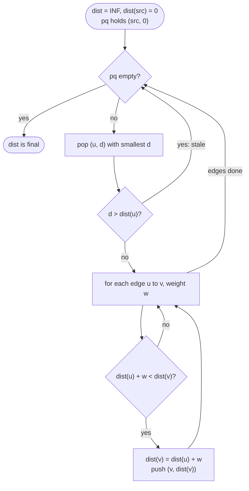

# Advanced Graphs

> [!abstract] In one sentence
> Weighted-graph problems are solved by five named algorithms — Dijkstra, Bellman-Ford, Prim, Kruskal, Hierholzer — plus two tricks (binary search on the answer, topological sort on a graph you infer), and each is BFS or DFS from [[Graphs]] with one data structure swapped in: a priority queue, an edge list relaxed in rounds, a sorted edge list with a DSU, or a post-order stack.

**Map:** [[Topics MOC]] → [[DSA Dashboard]]

> [!question] Predict before you read
> Java's `PriorityQueue` has no "decrease the priority of this element" operation, and `remove(Object)` is O(n). Dijkstra is described in textbooks with exactly that operation. How does the Java version get the same answer without it?

## Why this exists

Every algorithm in [[Graphs]] assumes an edge costs one step. Add a cost per edge — latency between servers, price of a flight, elevation of a cell — and the fewest-edges path is no longer the cheapest one. The statement signals the switch with the words **cost**, **time**, **weight**, **cheapest**, **minimum total**, **at most k stops**, **connect all points**, **network delay**, **use every ticket**, **order of letters in an unknown alphabet**, or a grid where the answer is a *threshold* ("the minimum time t such that a path exists using only cells ≤ t").

The family is small and each member answers one question:

| Question in the statement | Algorithm |
|---|---|
| cheapest path, all weights ≥ 0 | Dijkstra |
| cheapest path with negative weights, or with at most k edges | Bellman-Ford |
| cheapest set of edges that connects everything | Prim or Kruskal (minimum spanning tree) |
| a route that uses every edge exactly once | Hierholzer (Eulerian path) |
| smallest threshold for which a path exists | binary search on the answer plus BFS or [[Union-Find]] |
| an order consistent with constraints you must first extract | build the graph, then topological sort |

## The idea from zero

Three nodes: `A → B` costs 5, `A → C` costs 1, `C → B` costs 1. BFS from `A` reaches `B` in one edge and reports the direct edge; the cheapest route is `A → C → B` with cost 2.

> [!example] Fewest edges is not cheapest
> ![[Advanced Graphs — Fewest edges is not cheapest.excalidraw]]
> [[Advanced Graphs — Fewest edges is not cheapest.excalidraw|Open in Excalidraw]] — BFS would take A-B (one edge, cost 5); the cheapest path is A-C-B (cost 2)

%% excalidraw-spec
{"kind": "graph", "title": "Fewest edges is not cheapest", "directed": true, "nodes": [{"id": "A", "label": "A"}, {"id": "B", "label": "B"}, {"id": "C", "label": "C"}], "edges": [ ["A", "B", "5"], ["A", "C", "1"], ["C", "B", "1"] ], "highlight_nodes": ["A"], "highlight_edges": [ ["A", "C"], ["C", "B"] ], "caption": "BFS would take A-B (one edge, cost 5); the cheapest path is A-C-B (cost 2)"}
%%

The fix is one change to BFS: instead of taking nodes out of the queue in the order they went in, always take out the node with the *smallest distance found so far*. That is Dijkstra. The queue becomes a priority queue keyed by tentative distance, and the claim that makes it work is: when a node comes out with distance d, no cheaper path to it exists — every other path would have to pass through some node whose distance is already ≥ d, and edges only add cost. That last clause, "edges only add cost", is where non-negative weights are required; one negative edge breaks the claim, and that is why Bellman-Ford exists.

## The mechanism

### Dijkstra with a priority queue and lazy deletion

1. `dist[] = ∞` everywhere, `dist[src] = 0`; push `{src, 0}` into a `PriorityQueue<int[]>` ordered by the distance field.
2. Pop the smallest `{u, d}`. If `d > dist[u]`, this entry is **stale** — a better one was popped earlier — skip it.
3. For every edge `u → v` of weight `w`: if `dist[u] + w < dist[v]`, set `dist[v]` and push `{v, dist[v]}`. This is *relaxation*.
4. Repeat until the queue is empty. `dist[v]` is then final for every reachable `v`.



> [!example]- Excalidraw version — the same diagram as an editable canvas
> ![[Advanced Graphs — Dijkstra with a priority queue and lazy deletion.excalidraw]]
> [[Advanced Graphs — Dijkstra with a priority queue and lazy deletion.excalidraw|Open in Excalidraw]] — needs the Excalidraw plugin (see [[Plugins to Install]]).

Textbook Dijkstra *decreases the key* of `v` already in the queue. Java's `PriorityQueue` cannot do that cheaply, so you push a fresh entry and let the old one surface later with a distance larger than `dist[v]`; the `d > dist[u]` check throws it away. The queue can hold up to E entries instead of V, which is why the complexity is written O(E log E) — but log E ≤ 2 log V, so it is the same O((V + E) log V) in practice.

### Bellman-Ford: relax every edge, V − 1 rounds

Without a priority queue, simply relax *every edge* in the edge list, and repeat the whole pass V − 1 times. After pass i, every shortest path using at most i edges is correct; no shortest path uses more than V − 1 edges, so V − 1 passes suffice. If a V-th pass still improves something, a negative cycle is reachable. Cost O(V · E), slower than Dijkstra, but it tolerates negative weights, and — the reason it appears in NeetCode — it bounds the *number of edges* naturally. [[LC 787 Cheapest Flights Within K Stops]] allows at most k stops, that is k + 1 edges: run k + 1 passes, and in each pass relax from a **copy** of the previous pass's distances so that one pass cannot chain two edges.

> [!example] Bellman-Ford rounds, src 0, flights 0-1 (100), 1-2 (100), 2-0 (100), 1-3 (600), 2-3 (200)
> ![[Advanced Graphs — Bellman-Ford rounds, src 0, flights 0-1 (100), 1-2 (100), 2-0 (100), 1-3 (600), 2-3 (200).excalidraw]]
> [[Advanced Graphs — Bellman-Ford rounds, src 0, flights 0-1 (100), 1-2 (100), 2-0 (100), 1-3 (600), 2-3 (200).excalidraw|Open in Excalidraw]] — k = 1 stop means two rounds: 700 via 0-1-3; a third round (k = 2) finds 400 via 0-1-2-3

%% excalidraw-spec
{"kind": "grid", "title": "Bellman-Ford rounds, src 0, flights 0-1 (100), 1-2 (100), 2-0 (100), 1-3 (600), 2-3 (200)", "col_labels": ["", "0", "1", "2", "3"], "row_labels": ["", "start", "after 1", "after 2", "after 3"], "rows": [ [0, "INF", "INF", "INF"], [0, 100, "INF", "INF"], [0, 100, 200, 700], [0, 100, 200, 400] ], "highlight": [ [2, 3], [3, 3] ], "arrows": [ [ [1, 1], [2, 3] ], [ [2, 2], [3, 3] ] ], "caption": "k = 1 stop means two rounds: 700 via 0-1-3; a third round (k = 2) finds 400 via 0-1-2-3"}
%%

### Minimum spanning tree: Prim and Kruskal

A spanning tree connects all V nodes with V − 1 edges; the *minimum* one has the smallest total weight. Two greedy algorithms, both correct because of the cut property — the cheapest edge crossing any cut between "in the tree" and "not yet" belongs to some MST.

**Prim** grows one tree. Start anywhere; keep a priority queue of edges leaving the tree; pop the cheapest, skip it if its far end is already in the tree, otherwise add that node and push its edges. It is Dijkstra with the key changed from "distance from source" to "weight of this one edge".

**Kruskal** grows a forest. Sort all edges by weight; walk them in order; keep an edge if its two ends are in different components, which a [[Union-Find]] answers in near-constant time; stop after V − 1 kept edges.

> [!example] Kruskal keeps the highlighted edges
> ![[Advanced Graphs — Kruskal keeps the highlighted edges.excalidraw]]
> [[Advanced Graphs — Kruskal keeps the highlighted edges.excalidraw|Open in Excalidraw]] — sorted: AB1 keep, CD2 keep, AC3 keep, BC4 skip (B and C already joined), BD5 skip, CE6 keep, DE7 skip; total 12

%% excalidraw-spec
{"kind": "graph", "title": "Kruskal keeps the highlighted edges", "directed": false, "nodes": [{"id": "A", "label": "A"}, {"id": "B", "label": "B"}, {"id": "C", "label": "C"}, {"id": "D", "label": "D"}, {"id": "E", "label": "E"}], "edges": [ ["A", "B", "1"], ["C", "D", "2"], ["A", "C", "3"], ["B", "C", "4"], ["B", "D", "5"], ["C", "E", "6"], ["D", "E", "7"] ], "highlight_edges": [ ["A", "B"], ["C", "D"], ["A", "C"], ["C", "E"] ], "caption": "sorted: AB1 keep, CD2 keep, AC3 keep, BC4 skip (B and C already joined), BD5 skip, CE6 keep, DE7 skip; total 12"}
%%

[[LC 1584 Min Cost to Connect All Points]] gives points, so the graph is complete: E = V²/2 edges. Kruskal sorts all of them, O(V² log V); Prim with a plain array instead of a heap is O(V²) and is the best answer there — say both.

### Hierholzer: use every edge exactly once

[[LC 332 Reconstruct Itinerary]] asks for a route that uses every ticket (directed edge) once, starting at JFK, lexicographically smallest. Greedy "always fly to the smallest airport" can strand you at a dead end with tickets unused. Hierholzer's algorithm never does: run a DFS that *consumes* edges (poll from the sorted adjacency), and append an airport to the route only when it has no edges left — a post-order. The route built in reverse is the answer, because a node is finalised only after every edge out of it has been used.

> [!example] Why greedy fails: JFK-KUL is a dead end
> ![[Advanced Graphs — Why greedy fails- JFK-KUL is a dead end.excalidraw]]
> [[Advanced Graphs — Why greedy fails- JFK-KUL is a dead end.excalidraw|Open in Excalidraw]] — smallest-first from JFK goes to KUL and is stuck with NRT-JFK unused; post-order yields JFK, NRT, JFK, KUL

%% excalidraw-spec
{"kind": "graph", "title": "Why greedy fails: JFK-KUL is a dead end", "directed": true, "nodes": [{"id": "JFK", "label": "JFK"}, {"id": "KUL", "label": "KUL"}, {"id": "NRT", "label": "NRT"}], "edges": [ ["JFK", "KUL"], ["JFK", "NRT"], ["NRT", "JFK"] ], "highlight_nodes": ["KUL"], "caption": "smallest-first from JFK goes to KUL and is stuck with NRT-JFK unused; post-order yields JFK, NRT, JFK, KUL"}
%%

### Binary search on the answer, then BFS or DSU

[[LC 778 Swim in Rising Water]]: at time t you may stand on any cell with elevation ≤ t; what is the smallest t for which a path from top-left to bottom-right exists? The predicate "a path exists at time t" is monotonic — if it holds at t it holds at t + 1 — so binary search t over `0..n² − 1` and test each candidate with a BFS restricted to cells ≤ t, O(n² log n). The alternative is a Dijkstra where the "distance" of a path is the maximum elevation on it (`nd = max(d, grid[r][c])`), or a Kruskal-style sweep adding cells in elevation order with a [[Union-Find]] until the corners connect.

### Topological sort on an inferred graph

[[LC 269 Alien Dictionary]] hides the graph: the only information is that the word list is sorted. Compare each adjacent pair of words; the **first** differing character gives one edge `x → y`; characters after the first difference say nothing. If a word is followed by its own proper prefix (`abc` before `ab`), the input is inconsistent — return `""`. Then run Kahn's algorithm from [[Graphs]] over the characters; an order shorter than the number of distinct characters means a cycle.

## Java template

Dijkstra with lazy deletion.

```java
import java.util.*;

class Dijkstra {
    // adj.get(u) holds {v, w}; returns the shortest distance from src to every node, MAX_VALUE if unreachable.
    static int[] shortest(List<List<int[]>> adj, int src) {
        int[] dist = new int[adj.size()];
        Arrays.fill(dist, Integer.MAX_VALUE);
        dist[src] = 0;
        PriorityQueue<int[]> pq = new PriorityQueue<>((a, b) -> Integer.compare(a[1], b[1]));
        pq.offer(new int[]{src, 0});                        // {node, distance when pushed}
        while (!pq.isEmpty()) {
            int[] top = pq.poll();
            int u = top[0], d = top[1];
            if (d > dist[u]) continue;                      // stale: a shorter entry was popped earlier
            for (int[] e : adj.get(u)) {
                int v = e[0], nd = d + e[1];
                if (nd < dist[v]) {
                    dist[v] = nd;
                    pq.offer(new int[]{v, nd});             // "decrease-key" = push a fresh entry
                }
            }
        }
        return dist;
    }
}
```

**Time** O((V + E) log V) · **Space** O(V + E)

Bellman-Ford bounded by k stops.

```java
import java.util.*;

class Solution {
    public int findCheapestPrice(int n, int[][] flights, int src, int dst, int k) {
        int[] dist = new int[n];
        Arrays.fill(dist, Integer.MAX_VALUE);
        dist[src] = 0;
        for (int round = 0; round <= k; round++) {           // k stops = at most k + 1 edges
            int[] next = dist.clone();                       // relax from the previous round only
            for (int[] f : flights) {
                int u = f[0], v = f[1], w = f[2];
                if (dist[u] != Integer.MAX_VALUE && dist[u] + w < next[v]) next[v] = dist[u] + w;
            }
            dist = next;
        }
        return dist[dst] == Integer.MAX_VALUE ? -1 : dist[dst];
    }
}
```

**Time** O(k · E) · **Space** O(V)

Prim and Kruskal.

```java
import java.util.*;

class MinimumSpanningTree {
    // Prim: the PQ holds candidate edges {weight, node} leaving the tree.
    static int prim(List<List<int[]>> adj) {                 // adj.get(u) holds {v, w}
        int n = adj.size(), total = 0, inTree = 0;
        boolean[] done = new boolean[n];
        PriorityQueue<int[]> pq = new PriorityQueue<>((a, b) -> Integer.compare(a[0], b[0]));
        pq.offer(new int[]{0, 0});
        while (!pq.isEmpty() && inTree < n) {
            int[] top = pq.poll();
            int w = top[0], u = top[1];
            if (done[u]) continue;                           // lazy deletion again
            done[u] = true; inTree++; total += w;
            for (int[] e : adj.get(u)) if (!done[e[0]]) pq.offer(new int[]{e[1], e[0]});
        }
        return inTree == n ? total : -1;                     // -1: graph not connected
    }
    // Kruskal: cheapest edges first; keep an edge only if it joins two different components.
    static int kruskal(int n, int[][] edges) {               // edges: {u, v, w}
        Arrays.sort(edges, (a, b) -> Integer.compare(a[2], b[2]));
        int[] parent = new int[n];
        for (int i = 0; i < n; i++) parent[i] = i;
        int total = 0, used = 0;
        for (int[] e : edges) {
            int ru = find(parent, e[0]), rv = find(parent, e[1]);
            if (ru == rv) continue;                          // would close a cycle
            parent[ru] = rv;
            total += e[2];
            if (++used == n - 1) break;
        }
        return used == n - 1 ? total : -1;
    }
    private static int find(int[] parent, int x) {
        while (parent[x] != x) { parent[x] = parent[parent[x]]; x = parent[x]; }   // path halving
        return x;
    }
}
```

**Time** Prim O(E log V), Kruskal O(E log E) · **Space** O(V + E)

Hierholzer for the itinerary.

```java
import java.util.*;

class Solution {
    public List<String> findItinerary(List<List<String>> tickets) {
        Map<String, PriorityQueue<String>> adj = new HashMap<>();
        for (List<String> t : tickets)
            adj.computeIfAbsent(t.get(0), k -> new PriorityQueue<>()).offer(t.get(1));  // smallest first
        LinkedList<String> route = new LinkedList<>();
        visit("JFK", adj, route);
        return route;
    }
    private void visit(String airport, Map<String, PriorityQueue<String>> adj, LinkedList<String> route) {
        PriorityQueue<String> next = adj.get(airport);
        while (next != null && !next.isEmpty()) visit(next.poll(), adj, route);   // consume each ticket once
        route.addFirst(airport);                   // post-order: a node is placed only when it has no tickets left
    }
}
```

**Time** O(E log E) · **Space** O(E)

Binary search on the answer with a BFS predicate.

```java
import java.util.*;

class Solution {
    public int swimInWater(int[][] grid) {
        int n = grid.length, lo = Math.max(grid[0][0], grid[n - 1][n - 1]), hi = n * n - 1;
        while (lo < hi) {                                  // smallest t such that canReach(t)
            int mid = lo + (hi - lo) / 2;
            if (canReach(grid, mid)) hi = mid; else lo = mid + 1;
        }
        return lo;
    }
    private boolean canReach(int[][] grid, int t) {     // BFS restricted to cells with height <= t
        int n = grid.length;
        boolean[][] seen = new boolean[n][n];
        Deque<int[]> queue = new ArrayDeque<>();
        queue.offer(new int[]{0, 0});
        seen[0][0] = true;
        int[][] dirs = {{1, 0}, {-1, 0}, {0, 1}, {0, -1}};
        while (!queue.isEmpty()) {
            int[] cur = queue.poll();
            if (cur[0] == n - 1 && cur[1] == n - 1) return true;
            for (int[] d : dirs) {
                int r = cur[0] + d[0], c = cur[1] + d[1];
                if (r < 0 || c < 0 || r >= n || c >= n || seen[r][c] || grid[r][c] > t) continue;
                seen[r][c] = true;
                queue.offer(new int[]{r, c});
            }
        }
        return false;
    }
}
```

**Time** O(n² log n) · **Space** O(n²)

Topological sort on an inferred graph.

```java
import java.util.*;

class Solution {
    public String alienOrder(String[] words) {
        Map<Character, Set<Character>> adj = new HashMap<>();
        Map<Character, Integer> indeg = new HashMap<>();
        for (String w : words)
            for (char c : w.toCharArray()) { adj.putIfAbsent(c, new HashSet<>()); indeg.putIfAbsent(c, 0); }
        for (int i = 0; i + 1 < words.length; i++) {              // one edge per adjacent pair
            String a = words[i], b = words[i + 1];
            if (a.length() > b.length() && a.startsWith(b)) return "";   // "abc" before "ab": impossible
            for (int j = 0; j < Math.min(a.length(), b.length()); j++) {
                char x = a.charAt(j), y = b.charAt(j);
                if (x == y) continue;
                if (adj.get(x).add(y)) indeg.merge(y, 1, Integer::sum);  // count each distinct edge once
                break;                                                  // only the first difference matters
            }
        }
        Deque<Character> queue = new ArrayDeque<>();
        for (Map.Entry<Character, Integer> e : indeg.entrySet()) if (e.getValue() == 0) queue.offer(e.getKey());
        StringBuilder order = new StringBuilder();
        while (!queue.isEmpty()) {                                 // Kahn
            char u = queue.poll();
            order.append(u);
            for (char v : adj.get(u)) if (indeg.merge(v, -1, Integer::sum) == 0) queue.offer(v);
        }
        return order.length() == indeg.size() ? order.toString() : "";   // shorter = cycle
    }
}
```

**Time** O(total characters + 26²) · **Space** O(26²)

## Complexity

| Algorithm | Time | Space | Why |
|---|---|---|---|
| Dijkstra (binary heap, lazy) | O((V + E) log V) | O(V + E) | every relaxation may push; each pop is a log |
| Bellman-Ford | O(V · E), O(k · E) bounded | O(V) | relax all edges per round |
| Prim (heap) | O(E log V) | O(V + E) | each edge pushed once |
| Kruskal | O(E log E) | O(V + E) | the sort dominates; DSU is almost free |
| Hierholzer | O(E log E) | O(E) | sorting adjacency; each edge consumed once |
| binary search + BFS | O(V log R) | O(V) | log of the answer range, one BFS per probe |

## The canonical shapes

| Shape | Recognition cue | One-line solution | Problems |
|---|---|---|---|
| Single-source shortest path | "signal time", "minimum cost from source" | Dijkstra; answer is the max of `dist` for "time until all receive" | [[LC 743 Network Delay Time]] |
| Shortest path with an edge budget | "at most k stops" | Bellman-Ford, k + 1 rounds with a copied array | [[LC 787 Cheapest Flights Within K Stops]] |
| Connect everything cheaply | "min cost to connect all points" | Prim O(V²) on the complete graph, or Kruskal with DSU | [[LC 1584 Min Cost to Connect All Points]] |
| Use every edge once | "use all tickets", "lexicographically smallest itinerary" | Hierholzer with sorted adjacency, post-order, reverse | [[LC 332 Reconstruct Itinerary]] |
| Smallest threshold with a path | "at time t you can stand on cells ≤ t" | binary search on t + BFS, or Dijkstra on max-edge | [[LC 778 Swim in Rising Water]] |
| Order from sorted data | "sorted in an unknown alphabet" | infer edges from adjacent pairs, Kahn, detect prefix and cycle cases | [[LC 269 Alien Dictionary]] |

## Worked example

Dijkstra from `A` on the graph below ([[LC 743 Network Delay Time]] shape: the delay is the largest final distance).

> [!example] Dijkstra from A
> ![[Advanced Graphs — Dijkstra from A.excalidraw]]
> [[Advanced Graphs — Dijkstra from A.excalidraw|Open in Excalidraw]] — highlighted edges form the shortest-path tree; A-C (5) and B-D (7) lose to cheaper routes

%% excalidraw-spec
{"kind": "graph", "title": "Dijkstra from A", "directed": true, "nodes": [{"id": "A", "label": "A"}, {"id": "B", "label": "B"}, {"id": "C", "label": "C"}, {"id": "D", "label": "D"}, {"id": "E", "label": "E"}], "edges": [ ["A", "B", "2"], ["A", "C", "5"], ["B", "C", "1"], ["B", "D", "7"], ["C", "D", "2"], ["C", "E", "6"], ["D", "E", "1"] ], "highlight_nodes": ["A"], "highlight_edges": [ ["A", "B"], ["B", "C"], ["C", "D"], ["D", "E"] ], "caption": "highlighted edges form the shortest-path tree; A-C (5) and B-D (7) lose to cheaper routes"}
%%

| Pop (node, d) | Stale? | Relaxations | dist after |
|---|---|---|---|
| (A, 0) | no | B: 2, C: 5 | A0 B2 C5 D∞ E∞ |
| (B, 2) | no | C: 3 (via B), D: 9 | A0 B2 C3 D9 E∞ |
| (C, 3) | no | D: 5, E: 9 | A0 B2 C3 D5 E9 |
| (C, 5) | yes, 5 > 3 | skipped | unchanged |
| (D, 5) | no | E: 6 | A0 B2 C3 D5 E6 |
| (E, 6) | no | no out-edges | unchanged |
| (D, 9), (E, 9) | yes | skipped | final |

> [!example] Final dist from A
> ![[Advanced Graphs — Final dist from A.excalidraw]]
> [[Advanced Graphs — Final dist from A.excalidraw|Open in Excalidraw]] — network delay = max = 6; two stale entries were popped and ignored

%% excalidraw-spec
{"kind": "array", "title": "Final dist from A", "values": [0, 2, 3, 5, 6], "labels": {"0": "A", "1": "B", "2": "C", "3": "D", "4": "E"}, "highlight": [4], "caption": "network delay = max = 6; two stale entries were popped and ignored"}
%%

## Pitfalls

> [!warning] The mistakes people make
> - **Marking visited on push in Dijkstra.** A node can be pushed with distance 9 and later with 5; marking at push time freezes the 9. Decide at pop time with the stale check.
> - **Comparator by subtraction.** `(a, b) -> a[1] - b[1]` overflows when distances approach `Integer.MAX_VALUE`; use `Integer.compare`.
> - **`Integer.MAX_VALUE + w`.** Relaxing from an unreachable node overflows to a negative number and "improves" everything. Guard with `dist[u] != MAX_VALUE` (Bellman-Ford) or rely on the pop order (Dijkstra never relaxes from an unreachable node).
> - **Bellman-Ford without the copied array** for the k-stops version lets one round chain several edges and under-counts stops.
> - **Dijkstra with a negative edge.** The popped-is-final claim breaks; the answer is silently wrong. Say "all weights non-negative?" before you choose it.
> - **Greedy itinerary.** Always-smallest-next strands you; Hierholzer's post-order is the fix, and the route must be built by `addFirst`.

## Variations & follow-ups

**Dijkstra on an expanded state.** "At most k stops" as `(node, stops)`, "with one discount" as `(node, used)` — the template is unchanged. **All pairs:** Floyd-Warshall, O(V³), for V ≤ 400.

**0-1 BFS.** Weights of only 0 and 1: a deque replaces the heap — a weight-0 edge pushes to the front (same layer), a weight-1 edge to the back — for O(V + E).

## Interview script

Read the statement for two facts: are edges weighted, and what exactly is minimised. Then say the algorithm by name and the reason: "Weights are non-negative and we want a single-source shortest path, so Dijkstra with a priority queue."

1. Represent: adjacency list of `{v, w}` pairs; say O(V + E) to build.
2. Name the structure that replaces the queue and why: PQ keyed by distance (Dijkstra), sorted edge list with DSU (Kruskal), post-order stack (Hierholzer), binary search over the answer range (threshold problems).
3. State the invariant in one sentence: "a popped node is final", "after i rounds all paths of ≤ i edges are correct", "the cheapest crossing edge is safe".
4. Code the template; the only lines that change are the relaxation and the stop condition.
5. Give complexity with the log explained: "E log E from the heap, which is O(E log V)".

What the interviewer is checking: Dijkstra's precondition (non-negative), stale-entry handling in the Java PQ, why Kahn's shorter output means a cycle, and that you choose Bellman-Ford *because* of the edge bound. Follow-ups: "what if a weight is negative?", "how do you get the path?" (keep `parent[v] = u` on each relaxation), "what changes with k stops?", "could Union-Find do this?".

## Spot the bug

```java
// snippet
boolean[] done = new boolean[n];
pq.offer(new int[]{src, 0});
done[src] = true;
while (!pq.isEmpty()) {
    int[] top = pq.poll();
    int u = top[0], d = top[1];
    for (int[] e : adj.get(u)) {
        int v = e[0], nd = d + e[1];
        if (!done[v]) {                 // BFS habit
            dist[v] = nd;
            done[v] = true;
            pq.offer(new int[]{v, nd});
        }
    }
}
```

> [!example]- The fix
> This is BFS with a priority queue, not Dijkstra: the first time `v` is seen it is frozen, even if a cheaper path arrives later (in the worked example, `C` would be frozen at 5 via `A` instead of 3 via `B`). Replace the `done[]` logic with distance comparison: `if (nd < dist[v]) { dist[v] = nd; pq.offer(new int[]{v, nd}); }`, and add `if (d > dist[u]) continue;` right after the poll so that stale entries are skipped. The priority queue decides what is final, not the order of discovery.

## Related

### Prerequisites
- [[Graphs]] — BFS, DFS, adjacency lists and Kahn's algorithm, all reused here
- [[Heaps & Priority Queues]] — the `PriorityQueue<int[]>` comparator and its missing decrease-key
- [[Union-Find]] — Kruskal and the threshold-sweep alternative; [[Binary Search]] — searching on the answer

### Builds on this
- [[Dynamic Programming]] — Bellman-Ford is DP over the number of edges

### Problems that use it
- [[LC 743 Network Delay Time]]
- [[LC 787 Cheapest Flights Within K Stops]]
- [[LC 1584 Min Cost to Connect All Points]]
- [[LC 332 Reconstruct Itinerary]]
- [[LC 778 Swim in Rising Water]]
- [[LC 269 Alien Dictionary]]
- [[DSA Patterns in Java]] — Dijkstra, Prim, Kruskal templates
- [[Java Collections Cheat Sheet]] — `PriorityQueue` comparator forms, `Integer.compare`, `LinkedList.addFirst`

## Personal understanding

> [!question] Explain it without the note
> Write your own explanation here, from memory, then compare with the sections above and note what you missed.

### Mastery checklist
- [ ] I can state the idea in one sentence
- [ ] I can re-derive the mechanism on a whiteboard
- [ ] I can name when NOT to use it
- [ ] I have solved three problems with it without hints
- [ ] I can explain it to a colleague in two minutes

## Open questions
- [ ] For Min Cost to Connect All Points at n = 1000, how much faster is array-based Prim than Kruskal with a sort, measured on LeetCode?
