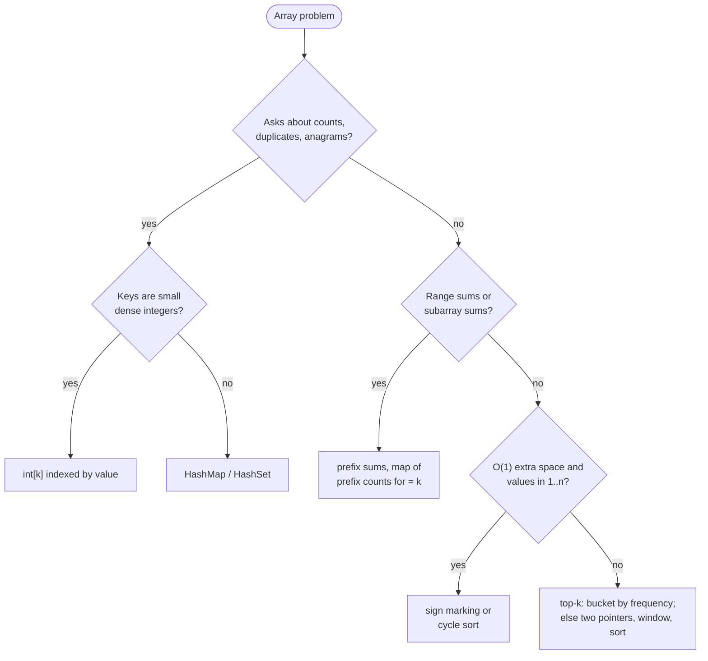

# Arrays & Hashing

> [!abstract] In one sentence
> Most array problems that look quadratic become linear once you decide what to *remember* while scanning — a count per value, a running prefix, the index of a complement, the frequency bucket an item belongs to — and an array or a `HashMap` is the memory, chosen by whether the keys are small dense integers or anything else.

**Map:** [[Topics MOC]] → [[DSA Dashboard]]

> [!question] Predict before you read
> You need the k most frequent values of an array of 10⁵ integers in O(n), and sorting by frequency is n log n. What can an array *index* stand in for so that no comparison sort is needed?

## Why this exists

The brute force for "is there a duplicate", "do these two strings have the same letters", "which pair sums to the target", "the sum of this range" is a nested scan: O(n²). Each of those has a linear answer, and the answer is always the same move: do one pass that stores something, so that the second pass (or the same pass) looks the answer up instead of searching for it. The stored thing is a count, a prefix, an index, or a canonical key; the container is an `int[]` when the keys are small dense integers (letters, values ≤ 10⁵) and a `HashMap`/`HashSet` otherwise — the internals of which are in [[Hashing]].

The signals: **frequency / count / most common**, **duplicate / unique / distinct**, **anagram / same letters**, **pair that sums to**, **range sum / subarray sum**, **O(1) extra space** (a hint to use the array itself), **encode / serialise**, **consecutive**.

## The idea from zero

Six values `[3, 1, 3, 7, 3, 1]`, values known to lie in `0..7`. Instead of comparing every pair, make an array of 8 counters and let the *value* be the *index*: one pass, `count[v]++`.

> [!example] count[v] after one pass over [3,1,3,7,3,1]
> ![[Arrays & Hashing — count-v- after one pass over -3,1,3,7,3,1-.excalidraw]]
> [[Arrays & Hashing — count-v- after one pass over -3,1,3,7,3,1-.excalidraw|Open in Excalidraw]] — the index is the key; duplicates, the mode, and the k most frequent are all now one more pass

%% excalidraw-spec
{"kind": "array", "title": "count[v] after one pass over [3,1,3,7,3,1]", "values": [0, 2, 0, 3, 0, 0, 0, 1], "highlight": [1, 3, 7], "labels": {"1": "v = 1", "3": "v = 3", "7": "v = 7"}, "caption": "the index is the key; duplicates, the mode, and the k most frequent are all now one more pass"}
%%

That single move — index as key — answers "any duplicate?" (a count reaches 2), "same letters?" (two count arrays are equal, or one array goes up for `s` and down for `t` and ends all zero), and "most frequent?" (the largest counter). When the keys are not small integers — strings, pairs, values up to 10⁹ — the array becomes a `HashMap<K, Integer>` and nothing else changes.

## The mechanism

**Counting.** `int[26] freq; freq[c - 'a']++` for lowercase letters, `int[128]` for ASCII, `Map<K, Integer>` with `merge(k, 1, Integer::sum)` otherwise. Compare two multisets by one array: increment for `s`, decrement for `t`, then any non-zero means different.

**Prefix sums.** `pre[i + 1] = pre[i] + a[i]` with `pre[0] = 0`, so the sum of `a[l..r]` inclusive is `pre[r + 1] - pre[l]` in O(1) after an O(n) build. The `n + 1` length is what makes `l = 0` need no special case. The same idea with a map — "how many earlier prefixes equal `pre − k`" — counts subarrays summing to k in one pass. The dual, a **difference array**, applies range *updates* in O(1): `diff[l] += v; diff[r + 1] -= v`, and one prefix pass at the end materialises the values.

> [!example] Prefix sums of a = [2, -1, 3, 5, -2]
> ![[Arrays & Hashing — Prefix sums of a = -2, -1, 3, 5, -2-.excalidraw]]
> [[Arrays & Hashing — Prefix sums of a = -2, -1, 3, 5, -2-.excalidraw|Open in Excalidraw]] — sum of a[1..3] = pre[4] - pre[1] = 9 - 2 = 7, which is -1 + 3 + 5

%% excalidraw-spec
{"kind": "array", "title": "Prefix sums of a = [2, -1, 3, 5, -2]", "values": [0, 2, 1, 4, 9, 7], "pointers": {"l": 1, "r+1": 4}, "highlight": [1, 4], "labels": {"0": "empty"}, "caption": "sum of a[1..3] = pre[4] - pre[1] = 9 - 2 = 7, which is -1 + 3 + 5"}
%%

**The array as its own hash table.** When values lie in `1..n` and the statement says O(1) extra space, the slot `nums[v - 1]` belongs to value `v`. Sign marking: visit each value, negate the slot it owns; a slot that is already negative means its value was seen twice, a slot still positive at the end means its value is missing. Cycle sort is the stronger cousin: swap each value into its own slot until every position holds its value or a duplicate. Both mutate the input — say so, and ask whether that is allowed.

> [!example] Sign marking on [4, 3, 2, 7, 8, 2, 3, 1] after processing 4, 3, 2, 7
> ![[Arrays & Hashing — Sign marking on -4, 3, 2, 7, 8, 2, 3, 1- after processing 4, 3, 2, 7.excalidraw]]
> [[Arrays & Hashing — Sign marking on -4, 3, 2, 7, 8, 2, 3, 1- after processing 4, 3, 2, 7.excalidraw|Open in Excalidraw]] — value v flips the sign of slot v-1; later, value 2 again finds slot 1 already negative: 2 is a duplicate

%% excalidraw-spec
{"kind": "array", "title": "Sign marking on [4, 3, 2, 7, 8, 2, 3, 1] after processing 4, 3, 2, 7", "values": [-4, -3, -2, 7, 8, 2, -3, 1], "highlight": [0, 1, 2, 6], "labels": {"0": "slot of 1", "1": "slot of 2", "2": "slot of 3", "6": "slot of 7"}, "caption": "value v flips the sign of slot v-1; later, value 2 again finds slot 1 already negative: 2 is a duplicate"}
%%

**Encode and decode with a length prefix.** A separator alone fails when the data can contain it. Write `length + '#' + string` for each string; the decoder reads digits up to the `#`, then takes exactly that many characters, so the payload may contain anything — the same framing as a length-prefixed TCP message.

**Bucket by frequency, and walk only from the start.** Frequencies are integers in `1..n`, so after counting, put each value into `bucket[frequency]`; walking buckets from `n` downwards yields the top-k in O(n) with no sort — [[Sorting]] calls this counting sort on the frequency. For the longest run of consecutive integers, put everything in a set and extend a run only from a value whose predecessor is absent; every value is then walked over at most once in total, which is why the nested loop is O(n) ([[Complexity Analysis]] proves it).



> [!example]- Excalidraw version — the same diagram as an editable canvas
> ![[Arrays & Hashing — The mechanism.excalidraw]]
> [[Arrays & Hashing — The mechanism.excalidraw|Open in Excalidraw]] — needs the Excalidraw plugin (see [[Plugins to Install]]).

## Java template

```java
import java.util.*;

class ArrayTricks {
    boolean isAnagram(String s, String t) {              // one array: up for s, down for t
        if (s.length() != t.length()) return false;
        int[] freq = new int[26];
        for (int i = 0; i < s.length(); i++) {
            freq[s.charAt(i) - 'a']++;
            freq[t.charAt(i) - 'a']--;
        }
        for (int f : freq) if (f != 0) return false;
        return true;
    }

    int countSubarraysSummingTo(int[] a, int k) {        // prefix sums + map of how often each prefix occurred
        Map<Long, Integer> seen = new HashMap<>();
        seen.put(0L, 1);                                 // the empty prefix
        long pre = 0; int count = 0;
        for (int x : a) {
            pre += x;                                    // long: prefixes overflow int long before n does
            count += seen.getOrDefault(pre - k, 0);
            seen.merge(pre, 1, Integer::sum);
        }
        return count;
    }
}
```

**Time** O(n) each · **Space** O(1) for the anagram, O(n) for the prefix map

```java
import java.util.*;

class Solution {
    public int[] topKFrequent(int[] nums, int k) {
        Map<Integer, Integer> count = new HashMap<>();
        for (int x : nums) count.merge(x, 1, Integer::sum);
        List<List<Integer>> bucket = new ArrayList<>();
        for (int i = 0; i <= nums.length; i++) bucket.add(new ArrayList<>());   // index = frequency, 0..n
        for (Map.Entry<Integer, Integer> e : count.entrySet()) bucket.get(e.getValue()).add(e.getKey());
        int[] out = new int[k]; int filled = 0;
        for (int f = nums.length; f >= 1 && filled < k; f--)                    // highest frequency first
            for (int v : bucket.get(f)) if (filled < k) out[filled++] = v;
        return out;
    }

    public String encode(List<String> strs) {
        StringBuilder sb = new StringBuilder();
        for (String s : strs) sb.append(s.length()).append('#').append(s);
        return sb.toString();
    }

    public List<String> decode(String s) {
        List<String> out = new ArrayList<>();
        int i = 0;
        while (i < s.length()) {
            int j = s.indexOf('#', i);                               // digits before the first '#'
            int len = Integer.parseInt(s.substring(i, j));
            out.add(s.substring(j + 1, j + 1 + len));                // exactly len chars, '#' inside is fine
            i = j + 1 + len;
        }
        return out;
    }
}
```

**Time** O(n) for all three · **Space** O(n)

## Complexity

| Trick | Time | Space | Why |
|---|---|---|---|
| counting with `int[k]` / map | O(n) | O(k) / O(distinct) | one increment per element |
| prefix sums: build, then each range query; sum-equals-k with a map | O(n), O(1); O(n) | O(n) | subtraction of two stored sums; each prefix looked up once |
| sign marking / cycle sort | O(n) | O(1) | each value visits its own slot; cycle sort swaps each element into place at most once |
| bucket by frequency | O(n) | O(n) | counting sort on frequencies 1..n |
| longest consecutive via set | O(n) | O(n) | each value walked at most once; the nested scan they all replace is O(n²) |

## The canonical shapes

| Shape | Recognition cue | One-line solution | Problem |
|---|---|---|---|
| Membership / dedupe | "contains duplicate" | `HashSet.add` returns false on a repeat | [[LC 217 Contains Duplicate]] |
| Count and compare | "anagram", "same letters" | one `int[26]`, up for s and down for t | [[LC 242 Valid Anagram]] |
| Complement lookup | "two numbers that sum to target" | map value → index; check `target − x` before inserting x | [[LC 1 Two Sum]] |
| Canonical key | "group anagrams" | key = sorted string or the 26-count signature | [[LC 49 Group Anagrams]] |
| Frequency bucket | "k most frequent" | count, bucket by frequency, walk down | [[LC 347 Top K Frequent Elements]] |
| Length-prefix framing | "encode a list of strings" | `len#payload` | [[LC 271 Encode and Decode Strings]] |
| Prefix and suffix passes | "product except self, no division" | left pass into the output, right pass with a running suffix | [[LC 238 Product of Array Except Self]] |
| Composite seen-keys | "valid sudoku" | sets keyed by row, column, box | [[LC 36 Valid Sudoku]] |
| Start-only walk | "longest consecutive sequence in O(n)" | set; extend only from x with x − 1 absent | [[LC 128 Longest Consecutive Sequence]] |

## Worked example

[[LC 347 Top K Frequent Elements]] with `nums = [1, 1, 1, 2, 2, 3]`, `k = 2`.

| Step | State |
|---|---|
| count | `{1: 3, 2: 2, 3: 1}` |
| buckets (index = frequency, size n + 1 = 7) | `bucket[1] = [3]`, `bucket[2] = [2]`, `bucket[3] = [1]`, the rest empty |
| walk from f = 6 down | f = 6, 5, 4 empty; f = 3 gives 1; f = 2 gives 2 — two collected, stop |

> [!example] bucket[f] = values with frequency f
> ![[Arrays & Hashing — bucket-f- = values with frequency f.excalidraw]]
> [[Arrays & Hashing — bucket-f- = values with frequency f.excalidraw|Open in Excalidraw]] — walking from the right collects the amber buckets first: answer [1, 2]. Counting, placing and walking are each one pass, so O(n); the heap alternative is O(n log k)

%% excalidraw-spec
{"kind": "array", "title": "bucket[f] = values with frequency f", "values": ["-", "[3]", "[2]", "[1]", "-", "-", "-"], "pointers": {"walk from": 6}, "highlight": [3, 2], "labels": {"3": "f = 3", "2": "f = 2"}, "caption": "walking from the right collects the amber buckets first: answer [1, 2]. Counting, placing and walking are each one pass, so O(n); the heap alternative is O(n log k)"}
%%

## Pitfalls

> [!warning] The mistakes people make
> - **`int[26]` with the wrong alphabet.** `c - 'a'` is negative for uppercase or digits; check the constraints, and use `int[128]` or a map when unsure.
> - **Prefix sums off by one.** `pre` has length n + 1; the inclusive range `[l, r]` is `pre[r + 1] − pre[l]`. Writing `pre[r] − pre[l]` drops `a[r]`.
> - **Prefix sums in `int`.** 10⁵ values of 10⁴ already reach 10⁹; a few more and it wraps. Use `long` for prefixes and products.
> - **Boxed `Integer` traps.** `int v = map.get(x)` throws `NullPointerException` on a missing key (use `getOrDefault(x, 0)`), and `==` between two `Integer`s is true only up to 127 (use `equals` or unbox).
> - **Sign marking on the wrong domain.** It needs values in `1..n` with no zeros (zero has no sign), and it mutates the input; and separator-only encoding (`String.join(",")`) breaks on a comma in the data — hence the length prefix.

## Variations & follow-ups

**2-D prefix sums** make any rectangle sum O(1): `P[i+1][j+1] = a[i][j] + P[i][j+1] + P[i+1][j] − P[i][j]`, and a rectangle is four lookups with inclusion–exclusion. **Top-k on a stream** cannot bucket (n unknown): keep a min-heap of size k from [[Heaps & Priority Queues]]. **Values up to 10⁹** push counting into a map or into coordinate compression (sort the distinct values, replace each by its rank). **Sudoku with bitmasks** replaces each set with an `int` of 9 bits ([[Bit Manipulation]]). **Prefix sums with a condition** — "subarray with sum divisible by k" — store `pre mod k` in the map, with `Math.floorMod` for negatives.

## Interview script

Name the stored thing first: "I'll do one pass storing the count per value — the keys are small integers, so an array indexed by value; then the answer is a second pass." For ranges: "prefix sums turn each range query into a subtraction, O(n) once then O(1) per query." For O(1)-space hints: "the values are in 1..n, so the array can be its own hash table by negating the slot that belongs to each value — that mutates the input, is that acceptable?"

The interviewer checks that you pick array versus map for a reason, state the O(n) with the reason (one pass, O(1) lookups), and handle the edge cases you asked about (empty, single element, overflow). Follow-ups: "what if the values are up to 10⁹?" (map or compression), "can you do it without modifying the input?" (then it is O(n) space), "what if k is close to n?" (bucket walk is still O(n)).

## Spot the bug

```java
// snippet
int[] pre = new int[n + 1];
for (int i = 0; i < n; i++) pre[i + 1] = pre[i] + a[i];
int rangeSum(int l, int r) {            // inclusive l..r
    return pre[r] - pre[l];
}
```

> [!example]- The fix
> `pre[r]` is the sum of `a[0..r−1]`, so `pre[r] − pre[l]` is the sum of `a[l..r−1]` — the last element is missing, and for `l == r` it returns 0 instead of `a[l]`. The inclusive range is `pre[r + 1] − pre[l]`. The n + 1 length exists precisely so that this formula needs no special case at `l = 0`; keep the convention "`pre[i]` = sum of the first i elements" in your head and the indices follow.

## Related

### Prerequisites
- [[Complexity Analysis]] — why the start-only walk and bucket sort are linear

### Builds on this
- [[Hashing]] — what the map costs and when it degrades; [[Sorting]] — counting and bucket sort as the general form of the frequency bucket
- [[Two Pointers]] and [[Sliding Window]] — the other two linear-pass families for arrays
- [[Java Collections Cheat Sheet]] (`merge`, `getOrDefault`, `computeIfAbsent`, `Map.Entry`), [[DSA Patterns in Java]], [[Java Pitfalls in Interviews]]

### Problems that use it
- [[LC 217 Contains Duplicate]], [[LC 242 Valid Anagram]], [[LC 1 Two Sum]], [[LC 49 Group Anagrams]], [[LC 347 Top K Frequent Elements]], [[LC 271 Encode and Decode Strings]]
- [[LC 238 Product of Array Except Self]], [[LC 36 Valid Sudoku]], [[LC 128 Longest Consecutive Sequence]]

## Personal understanding

> [!question] Explain it without the note
> Write your own explanation here, from memory, then compare with the sections above and note what you missed.

### Mastery checklist
- [ ] I can state the idea in one sentence
- [ ] I can re-derive the mechanism on a whiteboard
- [ ] I can name when NOT to use it
- [ ] I have solved three problems with it without hints
- [ ] I can explain it to a colleague in two minutes

## Open questions
- [ ] For `int[26]` versus `HashMap<Character,Integer>` on a 10⁵-character string, how large is the constant-factor gap on the JVM, measured? And which of my services frame messages by length prefix versus delimiter?
