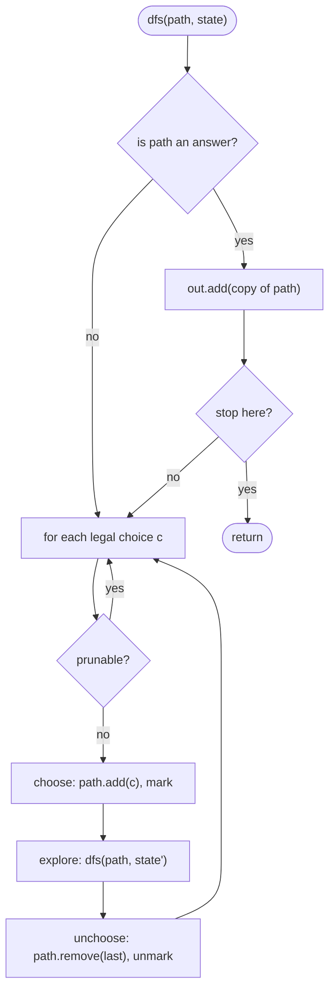

# Backtracking

> [!abstract] In one sentence
> Build the answer one decision at a time, recurse on the remaining decisions, and undo the decision on the way back so the same `path` list can be reused for every branch — the recursion tree *is* the search space, so the cost is the number of its nodes, and pruning (sorted input, remaining budget, constraint sets) is the only lever you have to shrink it.

**Map:** [[Topics MOC]] → [[DSA Dashboard]]

> [!question] Predict before you read
> Sorted `[1, 2, 2]`, all unique subsets. The usual loop `for (i = start; …)` with the guard `if (i > start && a[i] == a[i − 1]) continue;` yields exactly `[], [1], [1,2], [1,2,2], [2], [2,2]`. Why does the guard compare with `start` rather than skipping *every* repeated value — which subset would be lost if it did?

## Why this exists

Some problems have no shortcut: "list every subset", "every permutation", "every way to split this string into palindromes", "place n queens". The answer *is* exponential in size, so an exponential algorithm is optimal — the skill is enumerating without repeats and without wasted branches. The signals: **"all / every / generate"**, **"combinations / subsets / permutations / partitions"**, **"does a path exist in this grid spelling…"**, **"place items subject to constraints"**, and small constraints (n ≤ 10–20, string length ≤ 16). When the statement asks only for a *count* or a *minimum* and sub-problems repeat, stop — that is [[Dynamic Programming]].

## The idea from zero

Subsets of `[1, 2, 3]`: at each element you decide *in* or *out*. Draw the decisions as a tree and every root-to-node path is a partial subset.

> [!example] Recursion tree of subsets([1,2,3]) in the loop form: each node adds one later element
> ![[Backtracking — Recursion tree of subsets(-1,2,3-) in the loop form- each node adds one later element.excalidraw]]
> [[Backtracking — Recursion tree of subsets(-1,2,3-) in the loop form- each node adds one later element.excalidraw|Open in Excalidraw]] — 8 nodes = 8 subsets; a node's children only add elements with a larger index (the start parameter), which is what prevents [2,1] appearing as well as [1,2]

%% excalidraw-spec
{"kind": "tree", "title": "Recursion tree of subsets([1,2,3]) in the loop form: each node adds one later element", "nodes": [{"id": "r", "label": "[]", "children": ["a", "b", "c"]}, {"id": "a", "label": "[1]", "children": ["ab", "ac"]}, {"id": "b", "label": "[2]", "children": ["bc"]}, {"id": "c", "label": "[3]", "children": []}, {"id": "ab", "label": "[1,2]", "children": ["abc"]}, {"id": "ac", "label": "[1,3]", "children": []}, {"id": "bc", "label": "[2,3]", "children": []}, {"id": "abc", "label": "[1,2,3]", "children": []}], "root": "r", "highlight": ["ab", "abc"], "caption": "8 nodes = 8 subsets; a node's children only add elements with a larger index (the start parameter), which is what prevents [2,1] appearing as well as [1,2]"}
%%

Two equivalent ways to draw it. The **include / exclude** form branches twice per element (depth n, 2ⁿ leaves, answers at the leaves). The **loop** form has one node per subset: from a node holding elements up to index `i`, try each later index `j > i` as the next element (answers at every node). Both visit 2ⁿ nodes; the loop form generalises to combinations and combination sums, so learn that one.

## The mechanism

**Choose, explore, unchoose.** The function receives the current partial answer `path` and whatever tells it what is still allowed (`start`, `used[]`, `remain`). It records an answer if the node is one, then for each legal next choice: add it to `path`, recurse, remove it. Because the removal exactly undoes the addition, every branch sees the same `path` state as its siblings, and one list serves the whole search. Copy `path` when you record it — `new ArrayList<>(path)` — because you will keep mutating it.



> [!example]- Excalidraw version — the same diagram as an editable canvas
> ![[Backtracking — The mechanism.excalidraw]]
> [[Backtracking — The mechanism.excalidraw|Open in Excalidraw]] — needs the Excalidraw plugin (see [[Plugins to Install]]).

**What makes the shapes differ** is only the rule for "legal next choice". *Subsets / combinations*: indices greater than the last one (`start = i + 1`); for combinations also stop when `path.size() == k`. *Permutations*: any unused index (`used[]`), or swap `a[i]` with `a[pos]` and recurse on `pos + 1`. *Combination sum with reuse*: `start = i` (the same index may be chosen again) and `remain − a[i]`; *without reuse*: `start = i + 1`. *Palindrome partitioning*: the next choice is an end index `e` such that `s[start..e]` is a palindrome. *Letter combinations*: the next choice is one of the 3–4 letters of digit `path.length()`. *Word search*: the next choice is one of four neighbours whose letter matches `word[i]`, with the cell marked while on the path. *N-Queens*: the next choice is a column in the next row not under attack.

**Dedupe on sorted input.** Sort, then at any depth skip a value equal to the previous one *in the same loop*: `if (i > start && a[i] == a[i − 1]) continue;`. Two equal values at the same depth would spawn identical subtrees; the first copy still extends into `[2, 2]` because its child loop starts at `i + 1`, where the second 2 is `i == start` and allowed. For permutations the guard is `used[i − 1] == false` instead of `start`.

> [!example] Dedupe at one depth of combinationSum2 on sorted [1,2,2,2,5], start = 1
> ![[Backtracking — Dedupe at one depth of combinationSum2 on sorted -1,2,2,2,5-, start = 1.excalidraw]]
> [[Backtracking — Dedupe at one depth of combinationSum2 on sorted -1,2,2,2,5-, start = 1.excalidraw|Open in Excalidraw]] — i = 1 (the first 2) is explored; i = 2 and i = 3 are skipped because a[i] == a[i-1] and i > start — their subtrees would repeat the first one. Inside the branch of i = 1 the loop restarts at start = 2, so taking a second 2 is allowed there

%% excalidraw-spec
{"kind": "array", "title": "Dedupe at one depth of combinationSum2 on sorted [1,2,2,2,5], start = 1", "values": [1, 2, 2, 2, 5], "pointers": {"start": 1, "i": 2}, "highlight": [2, 3], "caption": "i = 1 (the first 2) is explored; i = 2 and i = 3 are skipped because a[i] == a[i-1] and i > start — their subtrees would repeat the first one. Inside the branch of i = 1 the loop restarts at start = 2, so taking a second 2 is allowed there"}
%%

**Pruning.** Sort and `break` when `a[i] > remain` (nothing later fits). Stop a combination when `path.size() == k`. In N-Queens three boolean arrays (`col`, `r − c`, `r + c`) make the attack test O(1). In word search check the letter *before* recursing. Pruning never changes the answers, only the number of nodes visited.

## Java template

```java
import java.util.*;

class Solution {
    public List<List<Integer>> subsets(int[] nums) {        // LC 78: loop form with a start index
        List<List<Integer>> out = new ArrayList<>();
        dfsSubsets(nums, 0, new ArrayList<>(), out);
        return out;
    }
    private void dfsSubsets(int[] a, int start, List<Integer> path, List<List<Integer>> out) {
        out.add(new ArrayList<>(path));                     // every node is an answer: copy it
        for (int i = start; i < a.length; i++) {
            path.add(a[i]);                                 // choose
            dfsSubsets(a, i + 1, path, out);                // explore: only later elements
            path.remove(path.size() - 1);                   // unchoose: remove(int index), not remove(Object)
        }
    }

    public List<List<Integer>> permute(int[] nums) {        // LC 46: used[] instead of a start index
        List<List<Integer>> out = new ArrayList<>();
        dfsPermute(nums, new boolean[nums.length], new ArrayList<>(), out);
        return out;
    }
    private void dfsPermute(int[] a, boolean[] used, List<Integer> path, List<List<Integer>> out) {
        if (path.size() == a.length) { out.add(new ArrayList<>(path)); return; }   // only leaves are answers
        for (int i = 0; i < a.length; i++) {
            if (used[i]) continue;
            used[i] = true; path.add(a[i]);
            dfsPermute(a, used, path, out);
            path.remove(path.size() - 1); used[i] = false;
        }
    }

    public List<List<Integer>> combinationSum2(int[] cand, int target) {   // LC 40: sorted, no reuse, dedupe
        Arrays.sort(cand);
        List<List<Integer>> out = new ArrayList<>();
        dfsSum(cand, 0, target, new ArrayList<>(), out, false);
        return out;
    }
    private void dfsSum(int[] a, int start, int remain, List<Integer> path, List<List<Integer>> out, boolean reuse) {
        if (remain == 0) { out.add(new ArrayList<>(path)); return; }
        for (int i = start; i < a.length; i++) {
            if (a[i] > remain) break;                       // prune: sorted, so nothing later fits
            if (!reuse && i > start && a[i] == a[i - 1]) continue;   // skip a duplicate at the same depth
            path.add(a[i]);
            dfsSum(a, reuse ? i : i + 1, remain - a[i], path, out, reuse);   // LC 39 passes reuse = true
            path.remove(path.size() - 1);
        }
    }
}
```

**Time** O(n · 2ⁿ) subsets, O(n · n!) permutations, O(k · C(n, k)) combinations — nodes of the tree times the cost of copying an answer · **Space** O(n) recursion plus the output

```java
import java.util.*;

class Solution {
    public boolean exist(char[][] board, String word) {     // LC 79: grid DFS with mark / unmark
        for (int r = 0; r < board.length; r++)
            for (int c = 0; c < board[0].length; c++)
                if (dfs(board, word, r, c, 0)) return true;
        return false;
    }
    private boolean dfs(char[][] b, String w, int r, int c, int i) {
        if (i == w.length()) return true;
        if (r < 0 || c < 0 || r >= b.length || c >= b[0].length || b[r][c] != w.charAt(i)) return false;
        char keep = b[r][c];
        b[r][c] = '#';                                      // mark: this cell is on the current path
        boolean found = dfs(b, w, r + 1, c, i + 1) || dfs(b, w, r - 1, c, i + 1)
                     || dfs(b, w, r, c + 1, i + 1) || dfs(b, w, r, c - 1, i + 1);
        b[r][c] = keep;                                     // unmark even on success: leave the board intact
        return found;
    }

    public List<List<String>> solveNQueens(int n) {         // LC 51: one queen per row, O(1) attack test
        List<List<String>> out = new ArrayList<>();
        placeRow(n, 0, new int[n], new boolean[n], new boolean[2 * n], new boolean[2 * n], out);
        return out;
    }
    private void placeRow(int n, int r, int[] colOf, boolean[] col, boolean[] diag, boolean[] anti, List<List<String>> out) {
        if (r == n) { out.add(render(colOf)); return; }
        for (int c = 0; c < n; c++) {
            int d = r - c + n, a = r + c;                    // r - c is constant on a diagonal, r + c on an anti-diagonal
            if (col[c] || diag[d] || anti[a]) continue;
            col[c] = diag[d] = anti[a] = true; colOf[r] = c;
            placeRow(n, r + 1, colOf, col, diag, anti, out);
            col[c] = diag[d] = anti[a] = false;
        }
    }
    private List<String> render(int[] colOf) {
        List<String> rows = new ArrayList<>();
        for (int c : colOf) { char[] row = new char[colOf.length]; Arrays.fill(row, '.'); row[c] = 'Q'; rows.add(new String(row)); }
        return rows;
    }
}
```

**Time** O(m · n · 3^L) word search (three directions after the first, L = word length), O(n!) N-Queens with pruning · **Space** O(L) and O(n)

## Complexity

| Shape | Nodes in the tree | Per answer | Total | Why |
|---|---|---|---|---|
| subsets | 2ⁿ | O(n) copy | O(n · 2ⁿ) | one node per subset |
| permutations | ~e · n! | O(n) | O(n · n!) | n! leaves, each path length n |
| combinations of size k | C(n, k) leaves | O(k) | O(k · C(n, k)) | stop at depth k |
| combination sum | ≤ bᵈ, b choices, depth d = target / min | O(d) | exponential | pruning by sorted `break` cuts most of it |
| palindrome partitioning | 2ⁿ⁻¹ cut patterns | O(n) | O(n · 2ⁿ) | each gap is cut or not |
| letter combinations | 4ⁿ leaves | O(n) | O(n · 4ⁿ) | 3–4 letters per digit |
| word search | 3^L per start | — | O(m · n · 3^L) | never return to the previous cell |
| N-Queens | ≤ n! | O(n²) render | O(n!) | each row has fewer legal columns |

## The canonical shapes

| Shape | Recognition cue | One-line solution | Problem |
|---|---|---|---|
| Subsets | "all subsets / power set" | loop form, `start = i + 1`, record every node | [[LC 78 Subsets]] |
| Subsets with duplicates | "may contain duplicates, no duplicate subsets" | sort + `i > start && a[i] == a[i−1]` | [[LC 90 Subsets II]] |
| Permutations | "all orderings" | `used[]`, record at depth n | [[LC 46 Permutations]] |
| Combination sum, reuse | "unlimited use of each candidate" | `start = i`, `remain` | [[LC 39 Combination Sum]] |
| Combination sum, no reuse | "each candidate once, unique combinations" | sort, `start = i + 1`, dedupe guard | [[LC 40 Combination Sum II]] |
| Grid path | "does the word exist in the grid" | DFS from every cell, mark / unmark | [[LC 79 Word Search]] |
| Partition | "split into palindromes" | choose the next cut end, check palindrome | [[LC 131 Palindrome Partitioning]] |
| Cartesian product | "letter combinations of a phone number" | choose a letter for digit `path.length()` | [[LC 17 Letter Combinations of a Phone Number]] |
| Constraint placement | "n queens", "sudoku" | one row per depth, sets for attacks | [[LC 51 N-Queens]] |

## Worked example

[[LC 79 Word Search]] for `ABCCED` on the board below. Start at (0,0) = A: mark it, try down (S ≠ B), up (out), right (0,1) = B: mark, right (0,2) = C: mark, down (1,2) = C: mark, down (2,2) = E: mark, left (2,1) = D: mark, `i == 6` → true. Each return unmarks its cell, so the board is unchanged afterwards.

> [!example] Word search for ABCCED: the path found by DFS
> ![[Backtracking — Word search for ABCCED- the path found by DFS.excalidraw]]
> [[Backtracking — Word search for ABCCED- the path found by DFS.excalidraw|Open in Excalidraw]] — cells on the current path are temporarily '#' so the C at (1,2) cannot reuse the C at (0,2); on the way back each cell is restored

%% excalidraw-spec
{"kind": "grid", "title": "Word search for ABCCED: the path found by DFS", "col_labels": ["", "0", "1", "2", "3"], "row_labels": ["", "0", "1", "2"], "rows": [ ["", "A", "B", "C", "E"], ["", "S", "F", "C", "S"], ["", "A", "D", "E", "E"] ], "highlight": [ [1, 1], [1, 2], [1, 3], [2, 3], [3, 3], [3, 2] ], "arrows": [ [ [1, 1], [1, 2] ], [ [1, 2], [1, 3] ], [ [1, 3], [2, 3] ], [ [2, 3], [3, 3] ], [ [3, 3], [3, 2] ] ], "caption": "cells on the current path are temporarily '#' so the C at (1,2) cannot reuse the C at (0,2); on the way back each cell is restored"}
%%

## Pitfalls

> [!warning] The mistakes people make
> - **Recording `path` itself instead of a copy.** Every answer then aliases the same list, which ends up empty. `out.add(new ArrayList<>(path))`.
> - **`path.remove(a[i])`.** On a `List<Integer>` that is `remove(Object)`; with small ints it may remove the wrong element or nothing. Use `remove(path.size() − 1)`.
> - **Dedupe without sorting**, or with `i > 0` instead of `i > start`: the first drops nothing useful, the second loses `[1, 2, 2]`.
> - **Forgetting to unmark** on the successful branch of word search, or marking with a `visited[][]` you never clear.
> - **Reuse confusion.** `start = i` allows reusing the same candidate; `start = i + 1` does not. Combination Sum is the first, Combination Sum II the second.
> - **Checking the constraint after recursing.** Test the letter / attack / budget *before* the call; otherwise you pay a frame for every dead branch.
> - **Using backtracking for a count.** "How many ways" with overlapping sub-problems (decode ways, climbing stairs) is DP; enumeration will time out.

## Variations & follow-ups

**Subsets II / Permutations II** add the sorted dedupe (`used[i − 1]` guard for permutations). **Combinations (n choose k)** is subsets with a depth stop. **Sudoku** is N-Queens with a 9 × 9 constraint check per cell. **Generate parentheses** is backtracking with two counters (`open < n`, `close < open`) — see [[LC 22 Generate Parentheses]]. **Palindrome partitioning** gets a precomputed `isPal[i][j]` table to make the check O(1). **Word Search II** replaces the word with a [[Tries]] walk so all words are searched in one DFS. **Bitmask enumeration** of subsets (`for (int m = 0; m < 1 << n; m++)`) is the iterative alternative when n ≤ 20 — see [[Bit Manipulation]]. **Memoised backtracking** (state → result) is the bridge to DP.

## Interview script

Name the tree before the code: "each level of recursion decides one element; the children of a node are the later indices, so every subset is generated exactly once; I copy the path when I record it and undo the choice after the recursive call so the same list serves every branch." Then the cost: "the tree has 2ⁿ nodes and copying costs n, so O(n · 2ⁿ), which is optimal because the output is that big." Say the pruning you will add before being asked: sort + break on budget, dedupe guard, constraint sets.

What they are checking: that you can draw the recursion tree, that you know the answer size bounds the complexity, that your unchoose exactly mirrors your choose, and that you handle duplicates deliberately. Follow-ups: "what if the input has duplicates?", "iteratively?", "can you prune further?", "count only — can you do better?" (DP), "what is the recursion depth and is it safe?".

## Spot the bug

```java
// snippet
void dfs(int[] a, int start, List<Integer> path, List<List<Integer>> out) {
    out.add(path);
    for (int i = start; i < a.length; i++) {
        path.add(a[i]);
        dfs(a, i + 1, path, out);
        path.remove(a[i]);
    }
}
```

> [!example]- The fix
> Two bugs. `out.add(path)` stores a reference to the one shared list, so every recorded "subset" is the same object and ends up empty: store `new ArrayList<>(path)`. And `path.remove(a[i])` with an `int` argument calls `remove(int index)`, so for `a = [5, 1]` it tries to remove index 5 and throws `IndexOutOfBoundsException` — or silently removes the wrong element when the index happens to exist. Always `path.remove(path.size() - 1)`.

## Related

### Prerequisites
- [[Recursion]] — the call stack as the path; base cases
- [[Trees]] — the recursion tree is a tree; DFS orders

### Builds on this
- [[Graphs]] (DFS with a visited set is backtracking on a graph), [[Tries]] (word search II), [[Dynamic Programming]] (memoise when states repeat), [[Bit Manipulation]] (bitmask subsets)
- [[DSA Patterns in Java]], [[Java Collections Cheat Sheet]] (`List.remove(int)` vs `remove(Object)`, `new ArrayList<>(path)`), [[Java Pitfalls in Interviews]]

### Problems that use it
- [[LC 78 Subsets]], [[LC 39 Combination Sum]], [[LC 46 Permutations]], [[LC 90 Subsets II]], [[LC 40 Combination Sum II]]
- [[LC 79 Word Search]], [[LC 131 Palindrome Partitioning]], [[LC 17 Letter Combinations of a Phone Number]], [[LC 51 N-Queens]], and [[LC 22 Generate Parentheses]] from the Stack set

## Personal understanding

> [!question] Explain it without the note
> Write your own explanation here, from memory, then compare with the sections above and note what you missed.

### Mastery checklist
- [ ] I can state the idea in one sentence
- [ ] I can re-derive the mechanism on a whiteboard
- [ ] I can name when NOT to use it
- [ ] I have solved three problems with it without hints
- [ ] I can explain it to a colleague in two minutes

## Open questions
- [ ] Write the swap-based permutation generator and explain why it cannot be deduplicated with the sorted `a[i] == a[i − 1]` guard (the swaps destroy the sorted order) — what do you use instead?
