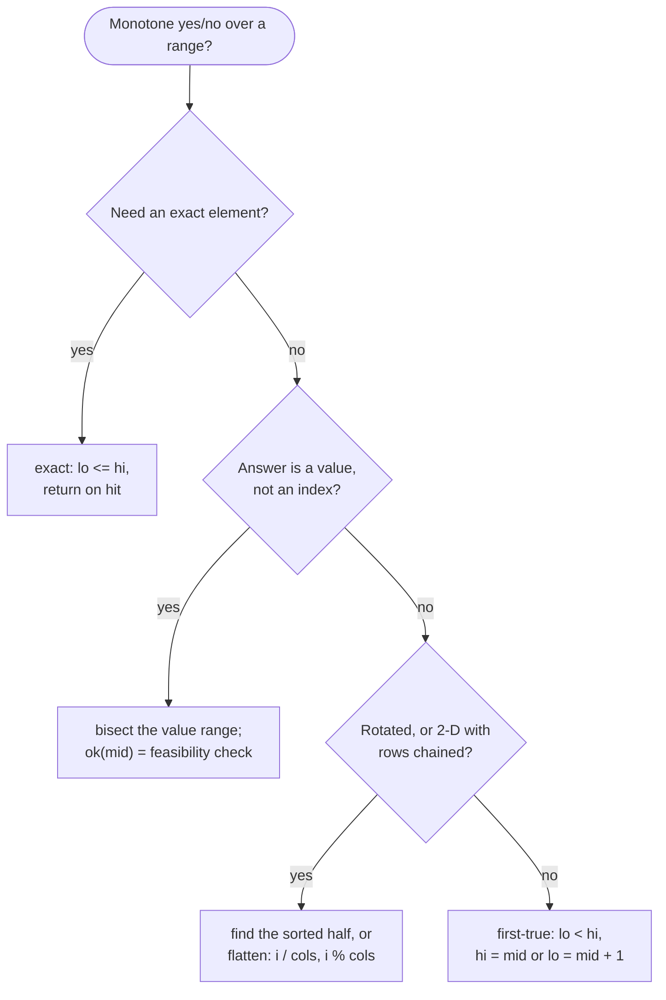

# Binary Search

> [!abstract] In one sentence
> Whenever a yes/no question over a range is *monotone* — false up to some point and true after it — you can find that point in O(log n) by asking the question at the middle and discarding the half that cannot contain the boundary; the array being sorted is just the most common way to get such a question, and "the smallest speed / capacity / time that works" is the second most common.

**Map:** [[Topics MOC]] → [[DSA Dashboard]]

> [!question] Predict before you read
> You write `while (lo < hi)` with `if (ok(mid)) hi = mid; else lo = mid;`. On which input does this loop never finish, and which single character fixes it? Separately: what property must `ok` have for any binary search to be correct at all?

## Why this exists

Linear search costs O(n); on 10⁵ elements that is fine once, but inside a loop of 10⁵ queries it is 10¹⁰. Binary search costs O(log n) — 17 steps for 10⁵, 30 for 10⁹ — and it needs only one thing: a predicate that is monotone over the range. Sorted arrays give it for free (`a[i] >= target` is false then true). But so does "can Koko finish in h hours at speed k" (false for slow speeds, true for fast ones), which is why the same 10 lines also solve problems whose statements never mention sorting.

The signals: **sorted** (fully, or rotated), **find the first / last position**, **minimum x such that … is possible**, **maximise the minimum / minimise the maximum**, **answer lies in a numeric range up to 10⁹ or 10¹⁸** (you cannot iterate it, but you can bisect it), **k-th smallest in a sorted structure**, **time-based lookup**, **median of two sorted arrays**.

## The idea from zero

Find 11 in `[1, 3, 5, 7, 9, 11, 13, 15]`. Look at the middle: `a[3] = 7 < 11`, so 11 cannot be in `[0, 3]` — discard it. The remaining range `[4, 7]` has middle `a[5] = 11`. Two comparisons for eight elements; 17 for a hundred thousand.

> [!example] Searching 11: first step discards the left half
> ![[Binary Search — Searching 11- first step discards the left half.excalidraw]]
> [[Binary Search — Searching 11- first step discards the left half.excalidraw|Open in Excalidraw]] — a[mid] = 7 < 11, so lo = mid + 1 = 4; the amber half is all that remains; next mid = 5 hits 11

%% excalidraw-spec
{"kind": "array", "title": "Searching 11: first step discards the left half", "values": [1, 3, 5, 7, 9, 11, 13, 15], "pointers": {"lo": 0, "mid": 3, "hi": 7}, "highlight": [4, 5, 6, 7], "caption": "a[mid] = 7 < 11, so lo = mid + 1 = 4; the amber half is all that remains; next mid = 5 hits 11"}
%%

> [!example] ok(k) = hours at speed k <= 8, for k = 1..11
> ![[Binary Search — ok(k) = hours at speed k -= 8, for k = 1..11.excalidraw]]
> [[Binary Search — ok(k) = hours at speed k -= 8, for k = 1..11.excalidraw|Open in Excalidraw]] — generalise: replace a[i] >= 11 by any predicate that is F..FT..T over the range. Here, Koko with piles [3,6,7,11] and 8 hours: a faster speed never fails if a slower one succeeded, so the first T (amber) is the answer, found by bisecting speeds, never by iterating them

%% excalidraw-spec
{"kind": "array", "title": "ok(k) = hours at speed k <= 8, for k = 1..11", "values": ["F", "F", "F", "T", "T", "T", "T", "T", "T", "T", "T"], "pointers": {"lo": 0, "hi": 10}, "highlight": [3], "labels": {"0": "k = 1", "3": "k = 4", "10": "k = 11"}, "caption": "generalise: replace a[i] >= 11 by any predicate that is F..FT..T over the range. Here, Koko with piles [3,6,7,11] and 8 hours: a faster speed never fails if a slower one succeeded, so the first T (amber) is the answer, found by bisecting speeds, never by iterating them"}
%%

## The mechanism

**The invariant templates.** Pick one by what you want, then never deviate from its loop shape.

1. **Exact match** — closed interval `[lo, hi]`, `while (lo <= hi)`, return on hit, `lo = mid + 1` / `hi = mid − 1`. Ends with `lo > hi` meaning not found. Used only when you need *a* position of an exact value.
2. **First true** (lower bound) — predicate `F…FT…T`, half-open `[lo, hi)` with `hi = n` initially, `while (lo < hi)`: if `ok(mid)` then `hi = mid` (mid might be the answer, keep it) else `lo = mid + 1`. Ends with `lo == hi` = the first true, or `n` if none. This one template covers lower bound, upper bound (`a[i] > target`), insert position, and every "minimum x such that" problem.
3. **Last true** — predicate `T…TF…F`; mirror image, with `mid = lo + (hi − lo + 1) / 2` rounding *up* so that `lo = mid` always makes progress, and `lo = −1` initially for "none". In every template `mid = lo + (hi − lo) / 2`, never `(lo + hi) / 2`: the sum overflows `int` when both are near 10⁹; with a value range that includes negatives, shift it to be non-negative first.

**Rotated sorted arrays.** One half of `[lo, hi]` around `mid` is always properly sorted: if `nums[lo] <= nums[mid]` the left half is, otherwise the right half is. Check whether the target lies inside the sorted half (a plain range test) and discard the other. For the minimum, compare `nums[mid]` with `nums[hi]`: greater means the drop is to the right (`lo = mid + 1`), otherwise the minimum is at `mid` or left (`hi = mid`).

> [!example] Rotated [4,5,6,7,0,1,2], target 0, first step
> ![[Binary Search — Rotated -4,5,6,7,0,1,2-, target 0, first step.excalidraw]]
> [[Binary Search — Rotated -4,5,6,7,0,1,2-, target 0, first step.excalidraw|Open in Excalidraw]] — nums[lo] = 4 <= nums[mid] = 7: the amber left half is sorted; 0 is not in [4, 7], so search the right half

%% excalidraw-spec
{"kind": "array", "title": "Rotated [4,5,6,7,0,1,2], target 0, first step", "values": [4, 5, 6, 7, 0, 1, 2], "pointers": {"lo": 0, "mid": 3, "hi": 6}, "highlight": [0, 1, 2, 3], "caption": "nums[lo] = 4 <= nums[mid] = 7: the amber left half is sorted; 0 is not in [4, 7], so search the right half"}
%%

**2-D matrix as a flat index.** When rows are sorted and each row starts after the previous ends, the matrix is a sorted array of `rows × cols` cells: index `i` maps to `m[i / cols][i % cols]`; run the exact template on `[0, rows × cols − 1]`. **Binary search on the answer.** When the question is "the smallest k such that feasible(k)" and feasibility is monotone in k: bisect the *value* range with the first-true template, where `ok(mid)` runs a linear feasibility check. Koko: speed range `1..max(piles)`, check sums ceil divisions. Swim in rising water: time range `0..max cell`, check is a BFS/DFS that only enters cells `<= t` ([[Graphs]]). The cost is O(log(range) × cost of check).

**Median of two sorted arrays.** Cut the shorter array A at `i` and B at `j = (m + n + 1) / 2 − i` so the left parts together hold half the elements; the cut is correct when `A[i − 1] <= B[j]` and `B[j − 1] <= A[i]` (use ±∞ at the edges). If `A[i − 1] > B[j]` the cut in A is too far right — `hi = i − 1`; otherwise `lo = i + 1`. The median is the max of the left parts (odd total) or the average of that and the min of the right parts. It is binary search on `i ∈ [0, m]`, O(log min(m, n)), and the hardest problem in the category because the predicate is hidden.



> [!example]- Excalidraw version — the same diagram as an editable canvas
> ![[Binary Search — The mechanism.excalidraw]]
> [[Binary Search — The mechanism.excalidraw|Open in Excalidraw]] — needs the Excalidraw plugin (see [[Plugins to Install]]).

## Java template

```java
import java.util.*;
import java.util.function.IntPredicate;

class BinarySearchTemplates {
    int exact(int[] a, int target) {                    // closed [lo, hi]; -1 if absent
        int lo = 0, hi = a.length - 1;
        while (lo <= hi) {
            int mid = lo + (hi - lo) / 2;               // never (lo + hi) / 2: it overflows
            if (a[mid] == target) return mid;
            if (a[mid] < target) lo = mid + 1; else hi = mid - 1;
        }
        return -1;
    }

    int firstTrue(int n, IntPredicate ok) {             // F..FT..T over [0, n); returns n if all false
        int lo = 0, hi = n;
        while (lo < hi) {
            int mid = lo + (hi - lo) / 2;
            if (ok.test(mid)) hi = mid;                 // mid may be the answer: keep it in range
            else lo = mid + 1;                          // mid is not: exclude it
        }
        return lo;
    }

    int lastTrue(int n, IntPredicate ok) {              // T..TF..F over [0, n); returns -1 if all false
        int lo = -1, hi = n - 1;
        while (lo < hi) {
            int mid = lo + (hi - lo + 1) / 2;           // round up so that lo = mid makes progress
            if (ok.test(mid)) lo = mid; else hi = mid - 1;
        }
        return lo;
    }
}
```

**Time** O(log n) · **Space** O(1) — lower bound is `firstTrue(n, i -> a[i] >= target)`, insert position the same, upper bound `a[i] > target`

```java
import java.util.*;

class Solution {
    public int search(int[] nums, int target) {                            // rotated sorted array, distinct values
        int lo = 0, hi = nums.length - 1;
        while (lo <= hi) {
            int mid = lo + (hi - lo) / 2;
            if (nums[mid] == target) return mid;
            if (nums[lo] <= nums[mid]) {                                   // left half sorted
                if (nums[lo] <= target && target < nums[mid]) hi = mid - 1; else lo = mid + 1;
            } else {                                                       // right half sorted
                if (nums[mid] < target && target <= nums[hi]) lo = mid + 1; else hi = mid - 1;
            }
        }
        return -1;
    }

    public int minEatingSpeed(int[] piles, int h) {                        // binary search on the answer
        int lo = 1, hi = 0;
        for (int p : piles) hi = Math.max(hi, p);                          // speed max(piles) always works
        while (lo < hi) {
            int mid = lo + (hi - lo) / 2;
            if (hours(piles, mid) <= h) hi = mid; else lo = mid + 1;        // first speed that is fast enough
        }
        return lo;
    }

    private long hours(int[] piles, int k) {
        long total = 0;
        for (int p : piles) total += (p - 1) / k + 1;                      // ceil(p / k) without overflow or doubles
        return total;
    }
}
```

**Time** O(log n) for the rotated search (O(n) with duplicates), O(n log max(piles)) for Koko · **Space** O(1) — find-minimum is `if (nums[mid] > nums[hi]) lo = mid + 1; else hi = mid;` under `while (lo < hi)`, and the flattened matrix is the exact template over `m[mid / cols][mid % cols]`

## Complexity

| Variant | Time | Why |
|---|---|---|
| exact / first-true / last-true on an array, flattened matrix, time-based `get` | O(log n) | the range halves every iteration |
| rotated array | O(log n), O(n) with duplicates | one half is always sorted; equal ends hide which |
| search on the answer | O(log(range) × check) | ≤ 31 iterations for an `int` range, ≤ 63 for `long`, each running the feasibility check |
| median of two sorted arrays | O(log min(m, n)) | bisect the cut position in the shorter array |

## The canonical shapes

| Shape | Recognition cue | One-line solution | Problem |
|---|---|---|---|
| Exact match | "sorted array, return the index of target" | template 1 | [[LC 704 Binary Search]] |
| Flattened 2-D | "each row sorted, rows chained" | flat index, `i / cols`, `i % cols` | [[LC 74 Search a 2D Matrix]] |
| Minimum feasible value | "minimum speed / capacity so that … within h" | first-true over the value range with a linear check | [[LC 875 Koko Eating Bananas]] |
| Rotated search | "sorted then rotated, find target" | pick the sorted half, range-test | [[LC 33 Search in Rotated Sorted Array]] |
| Rotated minimum | "minimum of a rotated sorted array" | compare `mid` with `hi` | [[LC 153 Find Minimum in Rotated Sorted Array]] |
| Versioned lookup | "value at the latest timestamp ≤ t" | per key an `ArrayList` of (timestamp, value) appended in increasing order, `get` = last-true on `ts[i] <= t`; or a `TreeMap` per key with `floorEntry(t)` — same O(log n), less code, more memory | [[LC 981 Time Based Key-Value Store]] |
| Partition search | "median of two sorted arrays in log time" | bisect the cut in the shorter array | [[LC 4 Median of Two Sorted Arrays]] |

## Worked example

[[LC 875 Koko Eating Bananas]] with `piles = [3, 6, 7, 11]`, `h = 8`, speeds `1..11`.

| lo | hi | mid | hours(mid) | ok? | move |
|---|---|---|---|---|---|
| 1 | 11 | 6 | 1 + 1 + 2 + 2 = 6 | yes | hi = 6 |
| 1 | 6 | 3 | 1 + 2 + 3 + 4 = 10 | no | lo = 4 |
| 4 | 6 | 5 | 1 + 2 + 2 + 3 = 8 | yes | hi = 5 |
| 4 | 5 | 4 | 1 + 2 + 2 + 3 = 8 | yes | hi = 4 |
| 4 | 4 | — | — | — | return 4: four O(n) checks instead of eleven speeds; for piles up to 10⁹, 30 checks instead of a billion |

## Pitfalls

> [!warning] The mistakes people make
> - **Mixing templates.** `while (lo <= hi)` with `hi = mid` loops forever when `lo == hi`; `while (lo < hi)` with `hi = mid − 1` can skip the answer. Choose the template first, then type its loop verbatim.
> - **`lo = mid` without rounding up.** With `lo = 4, hi = 5`, `mid = 4`; if `ok(4)` sets `lo = mid` nothing changes — ever. Last-true needs `mid = lo + (hi − lo + 1) / 2`.
> - **`(lo + hi) / 2`.** Overflows for `lo, hi` near 2·10⁹; always `lo + (hi − lo) / 2`. On a value range use `long` bounds when the range exceeds `int`.
> - **A predicate that is not monotone, or a wrong initial range.** `F T F T` cannot be bisected — check two or three values before trusting it ("if speed 5 works, does 6?"); first-true needs `hi = n` (exclusive) to represent "no index is true", and search-on-answer needs `lo` = smallest *possibly feasible* value and `hi` = a value that is *certainly* feasible.
> - **Duplicates in rotated arrays, and `Arrays.binarySearch`.** `[1, 1, 1, 0, 1]`: equal `lo`, `mid`, `hi` reveal nothing, so shrink both ends by one and accept O(n) worst case; `Arrays.binarySearch` needs sorted input and returns `−(insertionPoint) − 1` when absent.

## Variations & follow-ups

**Peak element** — bisect on `a[mid] < a[mid + 1]`: the predicate "we are still climbing" is monotone enough for *a* peak. **Real-valued answers** (square root to 1e-6, minimise a ratio): loop a fixed 100 times instead of testing `lo < hi`. **Maximise the minimum / minimise the maximum** (split array largest sum, ship packages in D days, magnetic balls) — all search on the answer with a greedy check. **K-th smallest in a sorted matrix or in a multiplication table** — bisect the value, count how many entries are `<= mid` in O(rows). **`TreeMap`/`TreeSet` floor, ceiling, higher, lower** ([[Searching]]) are binary search over a balanced tree when the data changes between queries.

## Interview script

Name the predicate before the code: "the array is sorted, so `a[i] >= target` is false then true; I want the first true." Or: "the answer is a speed between 1 and the largest pile; a faster speed never fails if a slower one worked, so feasibility is monotone and I can bisect it with an O(n) check per step — O(n log max)." Then the template by name and the loop invariant: "everything left of `lo` is false, everything from `hi` on is true, and the range shrinks every iteration."

What the interviewer is checking: that you can state the monotone predicate, that your loop terminates and cannot skip the boundary, the overflow-safe midpoint, and the empty / not-found cases (`n`, `−1`, `[]`). Follow-ups: "what if there are duplicates?", "find the last occurrence instead", "what is the range for the answer and why is `hi` feasible?", "can you do the median without the partition trick?" (merge-and-count is O(m + n); they want the log).

## Spot the bug

```java
// snippet
int lo = 0, hi = n - 1;                 // first index with ok(i) true, or -1
while (lo < hi) {
    int mid = (lo + hi) / 2;
    if (ok(mid)) hi = mid;
    else lo = mid;
}
return ok(lo) ? lo : -1;
```

> [!example]- The fix
> Three bugs. `lo = mid` does not advance when `hi == lo + 1` and `ok(mid)` is false — infinite loop; it must be `lo = mid + 1`. `(lo + hi) / 2` overflows for large indices; use `lo + (hi − lo) / 2`. And `hi = n − 1` cannot express "no index is true": with `hi = n` the loop returns `n` for that case and the final `ok(lo)` call (which may index out of bounds) is unnecessary. Correct form: `lo = 0, hi = n; while (lo < hi) { mid = lo + (hi − lo) / 2; if (ok(mid)) hi = mid; else lo = mid + 1; } return lo == n ? -1 : lo;`.

## Related

### Prerequisites
- [[Sorting]] — the n log n you pay to make an array bisectable
- [[Complexity Analysis]] — log n from the halving recurrence; reading "values up to 10⁹" as a hint

### Builds on this
- [[Searching]] (where binary search sits among linear, ternary, exponential and tree searches), [[Two Pointers]] (the other way to exploit sorted order), [[Graphs]] and [[Advanced Graphs]] (the BFS check inside search-on-answer, [[LC 778 Swim in Rising Water]])
- [[DSA Patterns in Java]], [[Java Collections Cheat Sheet]] (`Arrays.binarySearch`, `TreeMap.floorEntry`), [[Java Pitfalls in Interviews]] (the midpoint overflow)

### Problems that use it
- [[LC 704 Binary Search]], [[LC 74 Search a 2D Matrix]], [[LC 875 Koko Eating Bananas]], [[LC 33 Search in Rotated Sorted Array]], [[LC 153 Find Minimum in Rotated Sorted Array]], [[LC 981 Time Based Key-Value Store]], [[LC 4 Median of Two Sorted Arrays]]

## Personal understanding

> [!question] Explain it without the note
> Write your own explanation here, from memory, then compare with the sections above and note what you missed.

### Mastery checklist
- [ ] I can state the idea in one sentence
- [ ] I can re-derive the mechanism on a whiteboard
- [ ] I can name when NOT to use it
- [ ] I have solved three problems with it without hints
- [ ] I can explain it to a colleague in two minutes

## Open questions
- [ ] Write the median-of-two-arrays partition from memory and test it on `[1, 2]` / `[3, 4]` and on `[1]` / `[]` — which edge sentinel did I forget? And at what number of versions per key does `TreeMap` lose to `ArrayList` + last-true in memory?
