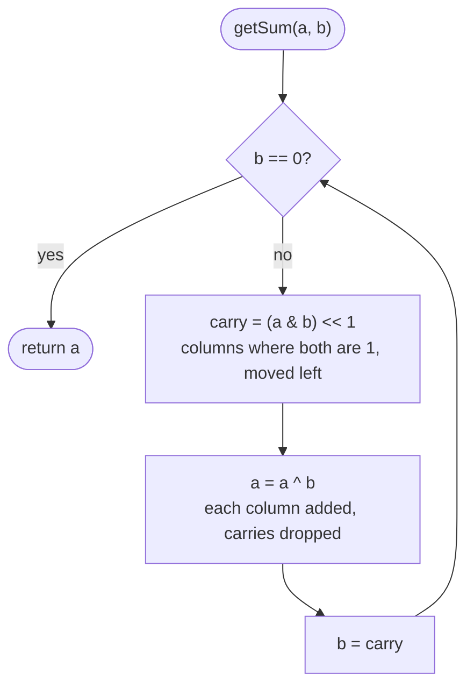

# Bit Manipulation

> [!abstract] In one sentence
> Treat a number as a row of 32 switches: XOR cancels anything that appears twice, `n & (n - 1)` turns off the lowest switch that is on, a mask of n switches names every subset of n items, and two's complement — negative means "the top switch is on" — is why `>>` and `>>>` differ and why `-Integer.MIN_VALUE` is still negative.

**Map:** [[Topics MOC]] → [[DSA Dashboard]]

> [!question] Predict before you read
> Every element of an array appears exactly twice except one. Without a set, a sort or any extra space, in one pass, how do you find it — and which single property of one operator makes it work?

## Why this exists

The problem class is numbers used as *bit vectors*: parity, membership, flags, arithmetic rebuilt from logic, counting ones. Each operator costs one CPU instruction, so a trick that moves a problem from "store it in a set" to "XOR it into an int" moves it from O(n) space to O(1) and from a cache miss to a register. The signals: "without using + or −", "every element appears twice except one", "O(1) extra space" on a counting problem, "number of 1 bits", "reverse the bits", "power of two", "n ≤ 20" (masks enumerate the 2²⁰ subsets), "set of lowercase letters" (a 26-bit int), "handle 32-bit overflow".

More often, bits are not the topic but the *tool* hiding inside another one: the Fenwick step `i & -i` ([[Fenwick Trees]]), `mask < 1 << n` instead of recursion in [[Backtracking]], the three masks of [[LC 51 N-Queens]], the 9-bit rows of [[LC 36 Valid Sudoku]], a `long` as a visited set of 64 nodes, `hash & (n - 1)` as a bucket index in [[Hashing]], `dp[mask]` in bitmask DP. Knowing the seven idioms here is what makes those notes readable.

## The idea from zero

An `int` is 32 bits in **two's complement**: bit 31 is worth −2³¹ instead of +2³¹, every other bit i is worth +2ⁱ. So a number is negative exactly when its top bit is set, `-1` is all ones, the range is −2³¹ … 2³¹ − 1 (one more negative than positive), and negation is "invert every bit, then add one": `-x == ~x + 1`. That single rule explains the surprises: `-Integer.MIN_VALUE` overflows back to itself, `~x` is `-x - 1`, and `>>` (arithmetic shift, copies the sign bit in) differs from `>>>` (logical shift, brings zeros in) only on negatives.

> [!example] Two's complement in 8 bits: -x is ~x + 1
> ![[Bit Manipulation — Two's complement in 8 bits- -x is ~x + 1.excalidraw]]
> [[Bit Manipulation — Two's complement in 8 bits- -x is ~x + 1.excalidraw|Open in Excalidraw]] — the top bit is worth -128, not +128: 11111011 = -128 + 64 + 32 + 16 + 8 + 2 + 1 = -5; adding 5 and -5 column by column gives 100000000, and the ninth bit falls off the end

%% excalidraw-spec
{"kind": "bits", "title": "Two's complement in 8 bits: -x is ~x + 1", "rows": [ {"label": "5", "bits": "00000101"}, {"label": "~5 = -6", "bits": "11111010"}, {"label": "~5 + 1 = -5", "bits": "11111011"} ], "highlight_cols": [0], "caption": "the top bit is worth -128, not +128: 11111011 = -128 + 64 + 32 + 16 + 8 + 2 + 1 = -5; adding 5 and -5 column by column gives 100000000, and the ninth bit falls off the end"}
%%

| Operator | Meaning | Idiom |
|---|---|---|
| `a & b` | 1 where both are 1 | test a bit: `(x >> i & 1) == 1`; keep low bits: `x & 0xF` |
| `a \| b` | 1 where either is 1 | set a bit: `x \|= 1 << i` |
| `a ^ b` | 1 where they differ | toggle: `x ^= 1 << i`; cancel pairs: `a ^ a == 0`, `a ^ 0 == a` |
| `~a` | every bit flipped | clear a bit: `x &= ~(1 << i)`; `~x == -x - 1` |
| `a << k` | multiply by 2ᵏ | `1 << i` is the mask for bit i; `1 << 31` is negative; the count is taken mod 32, so `1 << 32 == 1` |
| `a >> k`, `a >>> k` | divide by 2ᵏ (towards −∞), or shift zeros in | loops on bits use `>>>`; `n >> 1` for "drop the lowest bit" |

`&`, `^` and `|` bind *looser* than `==`, so `n & 1 == 1` compares `1 == 1` first: always parenthesise.

## The mechanism

**XOR cancellation ([[LC 136 Single Number]], [[LC 268 Missing Number]]).** XOR is associative and commutative, every value is its own inverse and 0 is the identity, so XOR-ing a whole array in any order cancels every pair and leaves the unpaired element. Missing number is the same trick on two arrays at once: XOR the indices 0..n together with the values; every present value cancels its own index and the missing index survives. (The sum formula `n(n + 1) / 2 − sum` also works; it overflows at n ≈ 65 000, which XOR never does.)

**The lowest set bit ([[LC 191 Number of 1 Bits]]).** Subtracting 1 flips the lowest set bit to 0 and every bit below it to 1; AND-ing with the original keeps everything above untouched, so `n & (n - 1)` clears exactly the lowest set bit. Loop until zero and you have counted the set bits in as many steps as there are ones — and it terminates for negatives, which `while (n != 0) n >>= 1` never does. The companion `n & -n` *isolates* the lowest set bit, because `-n = ~n + 1` agrees with `n` only there; it is the Fenwick step. Power of two: `n > 0 && (n & (n - 1)) == 0`.

> [!example] n & (n - 1) clears the lowest set bit; n & -n keeps only it
> ![[Bit Manipulation — n & (n - 1) clears the lowest set bit; n & -n keeps only it.excalidraw]]
> [[Bit Manipulation — n & (n - 1) clears the lowest set bit; n & -n keeps only it.excalidraw|Open in Excalidraw]] — the borrow from subtracting 1 runs through the trailing zeros and stops at the lowest 1; the carry from adding 1 to ~n does the same from the other side

%% excalidraw-spec
{"kind": "bits", "title": "n & (n - 1) clears the lowest set bit; n & -n keeps only it", "rows": [ {"label": "n = 12", "bits": "00001100"}, {"label": "n - 1 = 11", "bits": "00001011"}, {"label": "n & (n - 1) = 8", "bits": "00001000"}, {"label": "-n = -12", "bits": "11110100"}, {"label": "n & -n = 4", "bits": "00000100"} ], "highlight_cols": [5], "caption": "the borrow from subtracting 1 runs through the trailing zeros and stops at the lowest 1; the carry from adding 1 to ~n does the same from the other side"}
%%

**Counting bits as a DP ([[LC 338 Counting Bits]]).** `bits[i] = bits[i >> 1] + (i & 1)`: dropping the lowest bit halves the number, and the dropped bit is `i & 1`. One pass fills every answer up to n in O(n); the alternative recurrence `bits[i] = bits[i & (i - 1)] + 1` reads "one more than the number with the lowest bit removed".

> [!example] Counting bits for 0..7 from the halved number
> ![[Bit Manipulation — Counting bits for 0..7 from the halved number.excalidraw]]
> [[Bit Manipulation — Counting bits for 0..7 from the halved number.excalidraw|Open in Excalidraw]] — bits[6] = bits[3] + (6 & 1) = 2 + 0; every cell reads one earlier cell, so the row is a 1-D DP in disguise

%% excalidraw-spec
{"kind": "grid", "title": "Counting bits for 0..7 from the halved number", "col_labels": ["i = 0", "1", "2", "3", "4", "5", "6", "7"], "row_labels": ["i >> 1", "i & 1", "bits[i]"], "rows": [ [0, 0, 1, 1, 2, 2, 3, 3], [0, 1, 0, 1, 0, 1, 0, 1], [0, 1, 1, 2, 1, 2, 2, 3] ], "highlight": [ [2, 6] ], "arrows": [ [ [2, 3], [2, 6] ] ], "caption": "bits[6] = bits[3] + (6 & 1) = 2 + 0; every cell reads one earlier cell, so the row is a 1-D DP in disguise"}
%%

**Reverse bits ([[LC 190 Reverse Bits]]).** Thirty-two iterations: shift the result left, OR in the lowest bit of n, shift n right with `>>>`. With a fixed 32-step loop the shift kind does not change the answer, but `>>>` is the habit that saves you the day the loop is `while (n != 0)`. Follow-up ("called many times"): reverse one byte at a time with a 256-entry table.

**Add without `+` ([[LC 371 Sum of Two Integers]]).** `a ^ b` is the column-wise sum with every carry thrown away; `(a & b) << 1` is exactly the carries, moved one column left. Repeat with those two as the new operands until the carry is zero. Two's complement makes it correct for negatives for free, and it terminates within 32 rounds because each round pushes the lowest carry at least one bit higher until it falls off the top.



> [!example]- Excalidraw version — the same diagram as an editable canvas
> ![[Bit Manipulation — The mechanism.excalidraw]]
> [[Bit Manipulation — The mechanism.excalidraw|Open in Excalidraw]] — needs the Excalidraw plugin (see [[Plugins to Install]]).

**Reverse an integer at the 32-bit edge ([[LC 7 Reverse Integer]]).** Peel digits with `% 10` and `/ 10` — Java keeps the sign, so one loop handles −123 — and *before* `rev = rev * 10 + d` check `rev > MAX / 10 || (rev == MAX / 10 && d > 7)` and the mirror for MIN with −8. Checking after the multiply is checking a number that has already wrapped. NeetCode files this under bits because the whole problem is the boundary of the word.

**Masks as sets.** With n ≤ 20, every subset is an integer from 0 to `(1 << n) - 1`, bit i meaning "item i is in"; a loop over masks replaces the recursion of [[LC 78 Subsets]]. The submasks of a mask: `for (int s = mask; s > 0; s = (s - 1) & mask)`, which visits each in decreasing order. A word's letters: `mask |= 1 << (c - 'a')`; two words share a letter iff `(m1 & m2) != 0`. Past 31 flags switch to `long` and `1L << i`.

**Java helpers.** `Integer.bitCount(n)` (popcount, a CPU instruction), `Integer.highestOneBit(n)` (largest power of two ≤ n), `Integer.lowestOneBit(n)` (`n & -n`), `Integer.numberOfTrailingZeros(n)`, `Integer.toBinaryString(n)` (no leading zeros; a negative prints all 32 bits), `Integer.reverse(n)` (LC 190 in one call — say you know it, then write the loop), `Integer.parseInt(s, 2)`, and the `Long` twins.

## Java template

```java
import java.util.*;

class Solution {
    public int singleNumber(int[] nums) {                  // LC 136: pairs cancel under XOR
        int x = 0;
        for (int v : nums) x ^= v;
        return x;
    }
    public int missingNumber(int[] nums) {                 // LC 268: XOR indices 0..n with the values
        int x = nums.length;                               // start with n, the index the loop never reaches
        for (int i = 0; i < nums.length; i++) x ^= i ^ nums[i];
        return x;
    }
    public int hammingWeight(int n) {                      // LC 191: clear the lowest set bit until none is left
        int count = 0;
        for (; n != 0; n &= n - 1) count++;                // one iteration per set bit, negatives included
        return count;
    }
    public int[] countBits(int n) {                        // LC 338: bits[i] = bits[i >> 1] + (i & 1)
        int[] bits = new int[n + 1];
        for (int i = 1; i <= n; i++) bits[i] = bits[i >> 1] + (i & 1);
        return bits;
    }
    public int reverseBits(int n) {                        // LC 190: 32 iterations, logical shift
        int res = 0;
        for (int i = 0; i < 32; i++) { res = (res << 1) | (n & 1); n >>>= 1; }
        return res;
    }
    public int getSum(int a, int b) {                      // LC 371: xor is the carry-less sum, and-shift the carry
        while (b != 0) { int carry = (a & b) << 1; a ^= b; b = carry; }
        return a;
    }
    public int reverse(int x) {                            // LC 7: check before the multiply, not after
        int rev = 0;
        while (x != 0) {
            int d = x % 10;                                // keeps the sign: -123 % 10 == -3
            x /= 10;
            if (rev > Integer.MAX_VALUE / 10 || (rev == Integer.MAX_VALUE / 10 && d > 7)) return 0;
            if (rev < Integer.MIN_VALUE / 10 || (rev == Integer.MIN_VALUE / 10 && d < -8)) return 0;
            rev = rev * 10 + d;
        }
        return rev;
    }
}
```

**Time** O(n) for the array problems, O(1) — at most 32 steps — for the single-number ones · **Space** O(1), except the O(n) output of `countBits`.

```java
import java.util.*;

class Solution {
    public List<List<Integer>> subsets(int[] nums) {       // LC 78 by masks: bit i of mask says "nums[i] is in"
        int n = nums.length;
        List<List<Integer>> out = new ArrayList<>();
        for (int mask = 0; mask < (1 << n); mask++) {      // 2^n masks; n <= 20 keeps this around a million
            List<Integer> cur = new ArrayList<>();
            for (int i = 0; i < n; i++) if ((mask >> i & 1) == 1) cur.add(nums[i]);
            out.add(cur);
        }
        return out;
    }
    static List<Integer> submasks(int mask) {              // every non-empty submask, in decreasing order
        List<Integer> out = new ArrayList<>();
        for (int s = mask; s > 0; s = (s - 1) & mask) out.add(s);
        return out;
    }
    static int letterMask(String w) {                      // a set of lowercase letters in 26 bits
        int m = 0;
        for (char c : w.toCharArray()) m |= 1 << (c - 'a');
        return m;                                          // words share a letter iff (m1 & m2) != 0
    }
}
```

**Time** O(2ⁿ · n) for all subsets, O(2ᵏ) for the submasks of a k-bit mask, O(L) for a word mask · **Space** O(1) beyond the output.

## Complexity

| Operation | Time | Why |
|---|---|---|
| any single operator | O(1) | one instruction on a 32- or 64-bit word; a "bit vector" of n flags costs n / 32 words |
| count set bits with `n & (n - 1)` | O(number of ones) ≤ 32 | one loop iteration per set bit; `bitCount` is a single instruction |
| counting bits for 0..n | O(n) | one earlier cell per number |
| reverse bits, add without `+` | O(32) = O(1) | fixed word width; the carry climbs at least one column per round |
| enumerate subsets by mask | O(2ⁿ · n), or O(2ⁿ) with the lowbit trick | every mask once; the inner loop can walk only the set bits |

## The canonical shapes

| Shape | Recognition cue | One-line solution | Problem |
|---|---|---|---|
| Pairs cancel | "every element twice except one, O(1) space" | XOR everything | [[LC 136 Single Number]] |
| Two sequences cancel | "0..n with one number missing" | XOR indices and values, start from n | [[LC 268 Missing Number]] |
| Clear the lowest bit | "number of 1 bits", "power of two?" | loop `n &= n - 1` | [[LC 191 Number of 1 Bits]] |
| Halve and look up | "count bits for every number up to n, O(n)" | `bits[i] = bits[i >> 1] + (i & 1)` | [[LC 338 Counting Bits]] |
| Fixed-width loop | "reverse the 32 bits" | shift result left, OR `n & 1`, `n >>>= 1`, 32 times | [[LC 190 Reverse Bits]] |
| XOR plus carry | "sum without `+` or `-`" | `a ^ b` and `(a & b) << 1` until no carry | [[LC 371 Sum of Two Integers]] |
| Guard the word edge | "reverse the digits, return 0 on overflow" | check against `MAX / 10` before each multiply | [[LC 7 Reverse Integer]] |

## Worked example

[[LC 371 Sum of Two Integers]] with `a = 5`, `b = 3`, in four bits. The first round splits the addition into "sum of each column" and "carries from each column"; later rounds add those two until the carry is gone.

> [!example] Round 1 of getSum(5, 3): xor keeps the column sums, and-shift keeps the carries
> ![[Bit Manipulation — Round 1 of getSum(5, 3)- xor keeps the column sums, and-shift keeps the carries.excalidraw]]
> [[Bit Manipulation — Round 1 of getSum(5, 3)- xor keeps the column sums, and-shift keeps the carries.excalidraw|Open in Excalidraw]] — only column 0 has two 1s, so its sum bit is 0 and it produces the one carry, which lands in column 1 for the next round

%% excalidraw-spec
{"kind": "bits", "title": "Round 1 of getSum(5, 3): xor keeps the column sums, and-shift keeps the carries", "rows": [ {"label": "a = 5", "bits": "0101"}, {"label": "b = 3", "bits": "0011"}, {"label": "a ^ b = 6", "bits": "0110"}, {"label": "(a & b) << 1 = 2", "bits": "0010"} ], "highlight_cols": [3], "caption": "only column 0 has two 1s, so its sum bit is 0 and it produces the one carry, which lands in column 1 for the next round"}
%%

| round | a | b | a ^ b | (a & b) << 1 |
|---|---|---|---|---|
| 1 | 0101 (5) | 0011 (3) | 0110 (6) | 0010 (2) |
| 2 | 0110 (6) | 0010 (2) | 0100 (4) | 0100 (4) |
| 3 | 0100 (4) | 0100 (4) | 0000 (0) | 1000 (8) |
| 4 | 0000 (0) | 1000 (8) | 1000 (8) | 0000 — stop, answer 8 |

Each round the carry moves one column up (bit 1, then bit 2, then bit 3) and the XOR loses the bits that collided, which is why it ends: in 32-bit arithmetic a carry that reaches bit 32 simply vanishes, and that is also exactly how `5 + (-5)` becomes 0 in two's complement.

## Pitfalls

> [!warning] The mistakes people make
> - **`>>` in a `while (n != 0)` loop.** A negative n becomes −1 and stays there forever; use `>>>` or `n &= n - 1`.
> - **Missing parentheses.** `n & 1 == 1` is `n & (1 == 1)`, which does not compile; `mask >> i & 1 == 1` compiles and is wrong. Write `(n & 1) == 1`.
> - **`1 << 31` and `1 << 32`.** The first is `Integer.MIN_VALUE`, the second is 1 because the shift count is taken mod 32; past 31 flags use `long` and `1L << i`.
> - **Negating `Integer.MIN_VALUE`** in [[LC 7 Reverse Integer]] or [[LC 50 Pow(x, n)]] — overflow before you started. Widen to `long` or keep the sign in the arithmetic.
> - **Checking overflow after the multiply.** By then `rev` has already wrapped; the check must look at `rev` and the next digit before `rev * 10 + d`.
> - **XOR when elements appear three times.** Pairs cancel; triples do not. That variant counts each bit position modulo 3 — a different problem, say so.
> - **`Integer.toBinaryString` for a fixed width.** It drops leading zeros; pad with `String.format("%32s", s).replace(' ', '0')` when you need all 32 columns.

## Variations & follow-ups

"Every element appears three times" counts the ones in each bit position modulo 3; "two elements appear once" XORs everything to get `x ^ y`, then splits the array by any set bit of that result (`diff & -diff`) and XORs each half. Hamming distance is `bitCount(a ^ b)`; power of four adds "the single bit sits in an even position". Swapping without a temporary (`a ^= b; b ^= a; a ^= b`) is a party trick that fails when both refer to the same variable. Bitmask DP — `dp[mask]` over subsets of ≤ 20 items (travelling salesman, assigning tasks to people) — is where masks meet [[Dynamic Programming]]; Gray code and `i ^ (i >> 1)` is a name to recognise. In this vault the trick reappears in [[Fenwick Trees]] (`i & -i`), [[LC 36 Valid Sudoku]] and [[LC 51 N-Queens]] (masks instead of boolean arrays), and [[LC 78 Subsets]] (masks instead of recursion).

## Interview script

Say the law, then the code: "XOR is its own inverse and commutes, so XOR-ing the whole array cancels every pair and leaves the single element — one pass, no extra space." For the bit count: "`n & (n − 1)` clears the lowest set bit because subtracting one borrows through the trailing zeros and stops at the first 1; I loop until zero, which also terminates for negative inputs, unlike shifting with `>>`." For add without plus: "XOR is the sum without carries, AND shifted left is the carries; I repeat until the carry is zero, and two's complement makes negatives work unchanged."

What the interviewer is checking: that you know *why* each identity holds, that you handle negatives and the 32-bit edge without being asked, and that you reach for `long` before the overflow rather than after. Follow-ups they ask: "and if every element appears three times?", "two singles?", "reverse bits when it is called a million times?" (byte table), "what does `>>` do to −1?" (nothing: it stays −1), "can you do the sum for `long`?" (same loop, 64 rounds), "why does the add loop terminate?"

## Spot the bug

```java
// snippet
public int hammingWeight(int n) {
    int count = 0;
    while (n != 0) { count += n & 1; n >>= 1; }       // n = -1 ?
    return count;
}
```

> [!example]- The fix
> `>>` copies the sign bit in, so a negative n walks −1 → −1 → −1 forever and the method never returns. Either shift logically, `n >>>= 1`, so zeros arrive from the top and the loop ends after 32 steps, or drop the shift altogether and clear the lowest set bit each round: `for (; n != 0; n &= n - 1) count++;` — one iteration per set bit, correct for every input, and the version to say aloud.

## Related

### Prerequisites
- [[Math & Geometry]] — the overflow habits and `Integer.MIN_VALUE`, seen from the arithmetic side; [[Arrays & Hashing]] — the array walks the XOR tricks replace

### Builds on this
- [[Fenwick Trees]] (`i & -i` is the whole structure), [[Backtracking]] and [[LC 78 Subsets]] (masks instead of recursion), [[Dynamic Programming]] (counting bits is a 1-D DP; bitmask DP), [[Hashing]] (`hash & (n - 1)` as a bucket index)
- [[Java Pitfalls in Interviews]] (`>>>` vs `>>`, `Math.abs(Integer.MIN_VALUE)`), [[Java Collections Cheat Sheet]] (`Integer` statics), [[DSA Patterns in Java]] (the bit-tricks snippet)

### Problems that use it
- [[LC 136 Single Number]], [[LC 191 Number of 1 Bits]], [[LC 338 Counting Bits]], [[LC 190 Reverse Bits]], [[LC 268 Missing Number]], [[LC 371 Sum of Two Integers]], [[LC 7 Reverse Integer]]
- Bits as a tool elsewhere: [[LC 50 Pow(x, n)]] (the exponent's bits), [[LC 36 Valid Sudoku]] and [[LC 51 N-Queens]] (masks as sets), [[LC 78 Subsets]] (mask enumeration), [[LC 287 Find the Duplicate Number]] (the bit-counting alternative to Floyd)

## Personal understanding

> [!question] Explain it without the note
> Write your own explanation here, from memory, then compare with the sections above and note what you missed.

### Mastery checklist
- [ ] I can state the idea in one sentence
- [ ] I can re-derive the mechanism on a whiteboard
- [ ] I can name when NOT to use it
- [ ] I have solved three problems with it without hints
- [ ] I can explain it to a colleague in two minutes

## Open questions
- [ ] Prove in three lines that `n & -n` is the lowest set bit using `-n = ~n + 1`; then work out, on paper, why `getSum(-5, 5)` needs exactly 32 rounds to reach a zero carry and what that says about the loop's worst case.
