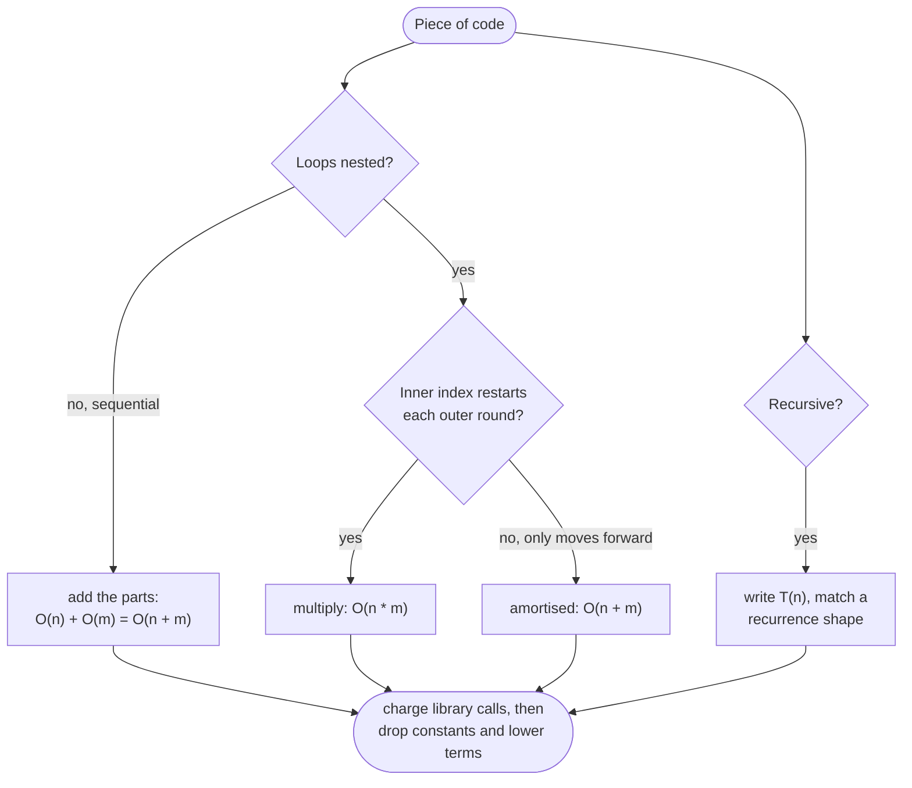

# Complexity Analysis

> [!abstract] In one sentence
> Complexity analysis counts how the number of elementary steps and the memory of an algorithm grow as the input grows, keeping only the fastest-growing term, so that you can decide from the constraints alone which algorithm family can pass and which cannot.

**Map:** [[Topics MOC]] → [[DSA Dashboard]]

> [!question] Predict before you read
> A problem says n ≤ 10⁵. Your idea compares every pair. Before reading on: how many operations is that, how long would Java take, and what is the slowest complexity class that still passes?

## Why this exists

Every interview round asks "what is the complexity?" at least twice, and the honest answer decides whether your approach is accepted. More useful than answering it afterwards is using it *before* you code: the constraints line (`1 <= n <= 10^5`) is a hint that tells you the intended complexity class, and therefore the pattern. An O(n²) idea for n = 10⁵ is 10¹⁰ steps — minutes, not seconds — so it is wrong before you write it, and you can say so out loud and move on to n log n.

The second use is pricing the library. `HashMap.get` is O(1) on average but O(n) adversarially; `ArrayList.remove(0)` is O(n); `s += c` in a loop is O(n²); `PriorityQueue.remove(Object)` is O(n). An interviewer who hears "I use a map so it is O(n)" will ask what the map costs, and you need the number. The third is defending amortised claims — `ArrayList.add` is O(1) "on average over the sequence", [[Union-Find]] is "near-constant amortised" — which is a different statement from "every call is O(1)".

## The idea from zero

Count the steps of a loop. `for i in 0..n: sum += a[i]` does one addition per element: n steps. Two nested loops over the same array do n·n = n² steps. A loop that halves the remaining range (`n, n/2, n/4, …`) stops after log₂ n steps. Big-O keeps only the dominant term and drops constants: 3n² + 10n + 7 is O(n²), because for large n the n² term is all that matters, and because constants depend on the machine, not on the algorithm.

What matters is how fast each class grows, because the judge gives you roughly 10⁸ simple operations per second in Java. Read the table below by rows: log n is free at any size, n log n is fine up to 10⁶, n² dies at 10⁵, 2ⁿ dies at n ≈ 25. That is the whole art of reading constraints.

> [!example] Steps by growth class and input size
> ![[Complexity Analysis — Steps by growth class and input size.excalidraw]]
> [[Complexity Analysis — Steps by growth class and input size.excalidraw|Open in Excalidraw]] — about 1e8 simple operations fit in one second; the amber cells do not

%% excalidraw-spec
{"kind": "grid", "title": "Steps by growth class and input size", "col_labels": ["n = 10", "n = 1e3", "n = 1e5", "n = 1e6"], "row_labels": ["log n", "n", "n log n", "n^2", "2^n"], "rows": [ ["3", "10", "17", "20"], ["10", "1e3", "1e5", "1e6"], ["33", "1e4", "1.7e6", "2e7"], ["100", "1e6", "1e10", "1e12"], ["1024", "1e301", "-", "-"] ], "highlight": [ [3, 2], [3, 3], [4, 1], [4, 2], [4, 3] ], "caption": "about 1e8 simple operations fit in one second; the amber cells do not"}
%%

## The mechanism

### The four rules

1. **Sequential blocks add**: a loop of O(n) followed by a loop of O(m) is O(n + m). Do not collapse it to O(n) unless you know m ≤ n.
2. **Nested loops multiply** — but only when the inner index restarts every outer round. A `while` inside a `for` whose index only moves forward is O(n) in total (the two-pointer and monotonic-stack argument), not O(n²).
3. **Recursion is a recurrence**: write T(n) in terms of smaller calls plus the work done in this call, then match it to a known shape (below).
4. **Library calls are charged per call**: `Arrays.sort` inside a loop is n·(n log n). `substring` inside a loop is n·k.



> [!example]- Excalidraw version — the same diagram as an editable canvas
> ![[Complexity Analysis — The four rules.excalidraw]]
> [[Complexity Analysis — The four rules.excalidraw|Open in Excalidraw]] — needs the Excalidraw plugin (see [[Plugins to Install]]).

### Amortised analysis

An amortised bound says: *over any sequence of m operations, the total is O(m · f)*, even though a single operation may cost much more. The classic case is a dynamic array that doubles when full. Most `add` calls write one slot; the k-th doubling copies 2ᵏ elements, but it happens only after 2ᵏ cheap adds paid for it.

> [!example] Cost of each add into a doubling array (capacity starts at 1)
> ![[Complexity Analysis — Cost of each add into a doubling array (capacity starts at 1).excalidraw]]
> [[Complexity Analysis — Cost of each add into a doubling array (capacity starts at 1).excalidraw|Open in Excalidraw]] — nine adds cost 24 steps in total: under 3 per add, so O(1) amortised, although adds 2, 3, 5 and 9 were O(size)

%% excalidraw-spec
{"kind": "array", "title": "Cost of each add into a doubling array (capacity starts at 1)", "values": [1, 2, 3, 1, 5, 1, 1, 1, 9], "highlight": [1, 2, 4, 8], "labels": {"1": "copy 1", "2": "copy 2", "4": "copy 4", "8": "copy 8"}, "caption": "nine adds cost 24 steps in total: under 3 per add, so O(1) amortised, although adds 2, 3, 5 and 9 were O(size)"}
%%

The accounting view: charge each add 3 units — one to write itself, two saved up to pay for copying itself and one older element at the next resize. The savings never run out, so the total is ≤ 3m. Java's `ArrayList` grows by 1.5× (`old + (old >> 1)`) starting from 10, which gives the same O(1) amortised bound with a slightly higher constant. `StringBuilder.append`, `ArrayDeque` and `HashMap` resizing (double at load factor 0.75) all use the same argument. The subtler example is [[Union-Find]]: path compression makes a long `find` pay for itself by shortening every path it walks, giving O(α(n)) amortised.

Amortised is not worst-case per operation. A latency-sensitive system (a rate limiter, a tick loop) can still see the one slow resize; you avoid that by pre-sizing (`new ArrayList<>(n)`, `new HashMap<>(n * 4 / 3 + 1)`).

### Recurrences you will actually meet

| T(n) | Solves to | Where you meet it |
|---|---|---|
| T(n/2) + O(1) | O(log n) | [[Binary Search]]; with + O(n) instead it is O(n): quickselect, see [[Sorting]] |
| 2T(n/2) + O(1) | O(n) | visiting every node of a balanced tree, building a segment tree |
| 2T(n/2) + O(n) | O(n log n) | merge sort, balanced quicksort |
| T(n − 1) + O(1) | O(n) | linear recursion: reversing a list, summing an array |
| T(n − 1) + O(n) | O(n²) | quicksort on sorted input, selection sort |
| 2T(n − 1) + O(1) | O(2ⁿ) | subsets, Tower of Hanoi, naive "take or skip" |
| T(n − 1) + T(n − 2) | O(φⁿ) ≈ O(1.618ⁿ) | naive Fibonacci / climbing stairs without memo |
| n · T(n − 1) | O(n!) | permutations |

The master-theorem shortcut for T(n) = a·T(n/b) + O(n^d): compare d with log_b a. If d < log_b a the leaves dominate and the answer is O(n^(log_b a)); if equal, every level does the same work and you get O(n^d · log n); if d > log_b a the root dominates and it is O(n^d). Merge sort is a = 2, b = 2, d = 1 → equal → n log n. Binary search is a = 1, b = 2, d = 0 → equal → log n.

**Space.** Count the auxiliary memory, not the input: an `int[26]` is O(1); a `HashMap` of all elements is O(n); and **recursion depth is space** — a DFS that goes n deep uses O(n) stack even if you allocate nothing (see [[Recursion]] for the depth limit). "O(1) space" claims for a recursive solution are the most common false statement in interviews.

## Java template

Dynamic array with doubling, instrumented so you can see the amortised argument in numbers.

```java
import java.util.*;

class DynamicArray {
    private int[] data = new int[1];
    private int size = 0;
    int copies = 0;                                   // total elements ever copied: the "expensive" work

    void add(int x) {
        if (size == data.length) {                    // full: double, copying every element once
            data = Arrays.copyOf(data, data.length * 2);
            copies += size;
        }
        data[size++] = x;
    }

    int get(int i) { return data[i]; }                // O(1): plain index arithmetic
    int size() { return size; }
}
```

**Time** O(1) amortised per `add`, O(n) for one resize · **Space** O(n), at most 2× the live elements

The other template is not code but a sentence: for a `while` nested in a `for`, say "the inner index only moves forward, so the inner loop runs at most n times *in total*" — the shape behind [[Two Pointers]], [[Sliding Window]] and the monotonic stack, and the worked example below.

## Complexity

The costs you must know for the Java collections you reach for (average unless stated).

| Operation | Cost | Why |
|---|---|---|
| `HashMap` / `HashSet` get, put, contains, remove | O(1) avg; O(log n) worst in a treeified bin, O(n) with a bad `hashCode` | hash → bucket; chains treeify at 8 ([[Hashing]]) |
| `HashMap.put` that triggers resize | O(n) once, O(1) amortised | doubling at load 0.75 |
| `ArrayList` get, set, add at end | O(1), add amortised | index arithmetic; 1.5× growth |
| `ArrayList` add(i, x), remove(int i), contains, indexOf, remove(Object) | O(n) | shifts the tail / linear scan |
| `LinkedList.get(i)` | O(n) | walks the nodes; avoid it entirely |
| `ArrayDeque` push, pop, peek, offer, poll, peekLast, pollLast | O(1) amortised | circular array, doubling |
| `PriorityQueue` offer, poll / peek / remove(Object), contains | O(log n) / O(1) / O(n) | sift / the root / linear search of the heap array |
| `new PriorityQueue<>(collection)` | O(n) | heapify, not n inserts |
| `TreeMap` / `TreeSet` get, put, floorKey, ceilingKey, first, last | O(log n) | red-black tree |
| `String.charAt`, `length` / `substring(i, j)` | O(1) / O(j − i) | array index / copies since Java 7u6 |
| `String.equals`, `compareTo`, `hashCode` (first call) | O(len) | `hashCode` is cached afterwards |
| `s + t`, and `s += c` in a loop of n | O(len), O(n²) total | each concatenation builds a new string |
| `StringBuilder.append` / `insert(0, x)`, `deleteCharAt(0)` | O(1) amortised / O(n) | doubling buffer / shifts everything |
| `Arrays.sort(int[])`, `Arrays.sort(T[])`, `Collections.sort` | O(n log n) | dual-pivot quicksort, TimSort ([[Sorting]]) |
| `Arrays.fill`, `copyOf`, `equals`, `hashCode`, `Collections.max` | O(n) | one pass |

## The canonical shapes

Here the "shape" is the constraint line, and the skill is reading it.

| Constraint | Target class | Pattern that gets there | Try it on |
|---|---|---|---|
| n ≤ 12 | O(n!) | permutations, full backtracking | [[LC 46 Permutations]] |
| n ≤ 20–25 | O(2ⁿ · n) | subsets, bitmask DP | [[LC 78 Subsets]] |
| n ≤ 100–300 | O(n³) | interval DP, Floyd-Warshall | [[LC 312 Burst Balloons]] |
| n ≤ 2·10³–5·10³ | O(n²) | 2-D DP, all pairs | [[LC 300 Longest Increasing Subsequence]] |
| n ≤ 10⁵–2·10⁵ | O(n log n) | sort, heap, binary search, TreeMap | [[LC 347 Top K Frequent Elements]] |
| n ≤ 10⁶–10⁷ | O(n) | hashing, two pointers, sliding window, prefix sums | [[LC 3 Longest Substring Without Repeating Characters]] |
| values up to 10⁹ or 10¹⁸ | O(log V) | binary search on the answer, fast power | [[LC 875 Koko Eating Bananas]], [[LC 50 Pow(x, n)]] |

When the obvious structure gives O(n log n) and the constraint allows it, stop optimising: a correct n log n delivered in 20 minutes beats an O(n) idea half-coded.

## Worked example

[[LC 128 Longest Consecutive Sequence]] on `nums = [100, 4, 200, 1, 3, 2]`: put everything in a `HashSet`, then for each number that is a *start* (its predecessor is absent) walk forward counting. The code has a `while` inside a `for`, and the question is whether that is O(n²).

> [!example] Which numbers start a walk
> ![[Complexity Analysis — Which numbers start a walk.excalidraw]]
> [[Complexity Analysis — Which numbers start a walk.excalidraw|Open in Excalidraw]] — only amber cells start a walk; 4, 3 and 2 have a predecessor in the set and are skipped in O(1)

%% excalidraw-spec
{"kind": "array", "title": "Which numbers start a walk", "values": [100, 4, 200, 1, 3, 2], "highlight": [0, 2, 3], "labels": {"0": "99 absent", "2": "199 absent", "3": "0 absent"}, "caption": "only amber cells start a walk; 4, 3 and 2 have a predecessor in the set and are skipped in O(1)"}
%%

| num | pred in set? | walk | steps |
|---|---|---|---|
| 100 | 99 no | 100 | 1 |
| 4 | 3 yes | skip | 0 |
| 200 | 199 no | 200 | 1 |
| 1 | 0 no | 1, 2, 3, 4 | 4 |
| 3 | 2 yes | skip | 0 |
| 2 | 1 yes | skip | 0 |

Six numbers, six walk steps in total. The argument: every element is visited by a walk at most once, because the only walk that reaches x is the one starting at the smallest element of x's run, and that run has exactly one start. So the nested loop is O(n) in total — rule 2 above, in the "index only moves forward" form, and the sentence you say to the interviewer.

## Pitfalls

> [!warning] The mistakes people make
> - **Quoting average as worst.** `HashMap` is O(1) *expected*; say "average" and know the worst case ([[Hashing]]). `Arrays.sort(T[])` is n log n worst-case (TimSort); dual-pivot quicksort on primitives is n log n worst-case only since JDK 14 added a heap-sort fallback.
> - **Hidden linear calls.** `list.contains`, `list.remove(Object)`, `list.indexOf`, `pq.remove(x)`, `s.substring`, `s + t`, `LinkedList.get(i)` inside a loop silently add a factor of n.
> - **"O(1) space" with recursion.** Depth is space; a recursive DFS on a path graph of 10⁵ nodes is O(10⁵) stack.
> - **Collapsing two inputs.** A grid is O(m · n), two strings are O(n + m) or O(n · m) — never just O(n).
> - **Pretending constants are free.** 26 in `int[26]` is a constant; k nested inside n is not if k can be 10⁵.
> - **Treating amortised as per-call.** A single `ArrayList.add` can be O(n); say "amortised" when you mean it, and remember the output: returning all subsets is Ω(2ⁿ) however clever the generation.

## Variations & follow-ups

**"Can you do better?"** Know the lower bounds: comparison sorting is Ω(n log n); searching an unsorted array is Ω(n); any algorithm that must read the input is Ω(n). If you are at the bound, say so — it ends the question.

**Best, average, worst, expected.** Quicksort is O(n log n) average and O(n²) worst; *randomised* quickselect is O(n) *expected* with no assumption on the input. Interviewers ask this to see whether you know why `Arrays.sort` on `int[]` is safe to call, and "O(n + k)" with k the output size shows you thought about what dominates. Name space-time trades when you make them: memoisation ([[Dynamic Programming]]) buys exponential time with O(n) memory; a prefix sum buys O(1) queries with O(n) memory.

## Interview script

Before coding, say the target: "n is up to 10⁵, so I need n log n or better; the O(n²) brute force would be 10¹⁰ operations." After coding, give both numbers with the reason: "O(n log n) time because of the sort; everything after it is one linear pass. O(n) extra space for the map; I am not counting the input."

What the interviewer is checking: that you derive the bound from the code rather than reciting it, that you price library calls, that you separate average from worst, and that you count recursion depth. Follow-ups: "what dominates?", "can you do it in O(1) space?", "what happens with adversarial keys in your map?", "is that amortised or worst-case?"

## Spot the bug

```java
// snippet
String build(int[] codes) {
    String out = "";
    for (int c : codes) out += (char) c;      // "O(n): one pass over the input"
    return out;
}
```

> [!example]- The fix
> The pass is linear, but `out += ...` creates a new `String` holding everything so far on every iteration: 1 + 2 + … + n character copies, O(n²) total. For n = 10⁵ that is 5·10⁹ copies. Use a `StringBuilder sb` and `sb.append((char) c)` — O(1) amortised per append — and `return sb.toString()`.

## Related

### Prerequisites
- none — this is the first note of week 1
### Builds on this
- [[Problem-Solving Framework]] — reading constraints is step one of the protocol
- [[Recursion]] — recurrences and the stack-depth space cost
- [[Sorting]], [[Hashing]], [[Union-Find]], [[Dynamic Programming]] — the library costs you quote most, amortised bounds, the exponential-to-polynomial jump
- [[Java Collections Cheat Sheet]], [[Java Pitfalls in Interviews]], [[DSA Patterns in Java]]

### Problems that use it
- [[LC 128 Longest Consecutive Sequence]] — the nested loop that is linear
- [[LC 347 Top K Frequent Elements]] — n log n versus O(n) bucket sort
- [[LC 78 Subsets]], [[LC 46 Permutations]], [[LC 875 Koko Eating Bananas]] — exponential by construction; log of the value range

## Personal understanding

> [!question] Explain it without the note
> Write your own explanation here, from memory, then compare with the sections above and note what you missed.

### Mastery checklist
- [ ] I can state the idea in one sentence
- [ ] I can re-derive the mechanism on a whiteboard
- [ ] I can name when NOT to use it
- [ ] I have solved three problems with it without hints
- [ ] I can explain it to a colleague in two minutes

## Open questions
- [ ] Measure it: how many `HashMap.get` calls per second does my laptop's JVM actually do, how far is that from the 10⁸ rule of thumb, and which production endpoint of mine hides an O(n²) (`contains` in a loop, string concatenation) that only shows at scale?
