# DP Pattern Catalogue

> [!abstract] In one sentence
> Every DP problem you will meet is one of twelve table shapes, and each shape is recognised by a phrase in the statement, defined by a one-sentence state, and solved by a one-line transition — this page is the lookup table, and the two deep-dive notes are where each row is derived.

**Map:** [[Topics MOC]] → [[DSA Dashboard]]

> [!question] Predict before you read
> "Partition the array into two subsets with equal sums" and "fewest coins to make an amount" both loop over a target sum. One iterates the sum *downwards*, the other *upwards*. Before reading the table, say which is which and what goes wrong if you swap them.

## Why this exists

[[Dynamic Programming]] and [[2-D Dynamic Programming]] teach the method — state, transition, base, order — on each shape in turn. In an interview you do not have time to re-derive; you have about a minute to recognise *which* shape you are looking at and then fill in the four answers from memory. This note is the index for that minute. It is deliberately short: one table, one decision tree, one compiled skeleton per table dimension, and the traps that distinguish neighbouring rows.

Use it two ways. Before attempting a DP problem, read the cue column and commit to a row before you open the editor. After solving one, come back and check whether your state sentence matched the row — if it did not, write what was different in the open questions.

## The idea from zero

Twelve rows look like a lot until you see that they come from one question asked twice: **how many numbers describe "where am I"**, and **what moves them**. One index that moves by a fixed step, by any earlier position, or by an amount gives the 1-D rows; two indices that are two prefixes, a row and a column, an interval's ends, or an index plus a mode give the 2-D rows. Pick the number of coordinates, then what each coordinate means, and the row is determined.

> [!example] One coordinate: Decode Ways dp for 226
> ![[DP Pattern Catalogue — One coordinate- Decode Ways dp for 226.excalidraw]]
> [[DP Pattern Catalogue — One coordinate- Decode Ways dp for 226.excalidraw|Open in Excalidraw]] — dp[3] = dp[2] (last digit 6 alone) + dp[1] (last two digits 26): the linear-step row

%% excalidraw-spec
{"kind": "array", "title": "One coordinate: Decode Ways dp for 226", "values": [1, 1, 2, 3], "pointers": {"i-2": 1, "i-1": 2, "i": 3}, "highlight": [3], "caption": "dp[3] = dp[2] (last digit 6 alone) + dp[1] (last two digits 26): the linear-step row"}
%%

> [!example] Two coordinates: LCS of abc and ac
> ![[DP Pattern Catalogue — Two coordinates- LCS of abc and ac.excalidraw]]
> [[DP Pattern Catalogue — Two coordinates- LCS of abc and ac.excalidraw|Open in Excalidraw]] — a cell is a pair of prefixes; a match extends the diagonal: the two-sequence row

%% excalidraw-spec
{"kind": "grid", "title": "Two coordinates: LCS of abc and ac", "col_labels": ["", "", "a", "c"], "row_labels": ["", "", "a", "b", "c"], "rows": [ [0, 0, 0], [0, 1, 1], [0, 1, 1], [0, 1, 2] ], "highlight": [ [3, 2] ], "arrows": [ [ [2, 1], [3, 2] ] ], "caption": "a cell is a pair of prefixes; a match extends the diagonal: the two-sequence row"}
%%

## The mechanism

### The twelve patterns

| # | Pattern | Cue in the statement | State (say it in a sentence) | Transition | NeetCode problems |
|---|---|---|---|---|---|
| 1 | Linear step | "ways to reach", "1 or 2 steps", "decode digits" | `dp[i]` = answer for the first i steps/characters | `dp[i] = dp[i−1] + dp[i−2]` with validity guards; min-cost: `cost[i] + min(dp[i−1], dp[i−2])` | [[LC 70 Climbing Stairs]], [[LC 746 Min Cost Climbing Stairs]], [[LC 91 Decode Ways]] |
| 2 | Take or skip with a gap | "cannot take two adjacent" | `dp[i]` = best using items 0..i | `max(dp[i−1], dp[i−2] + a[i])`; circular → solve twice | [[LC 198 House Robber]], [[LC 213 House Robber II]] |
| 3 | Running best (Kadane) | "maximum subarray / product" | best value of a subarray *ending at* i | `cur = max(a[i], cur + a[i])`; product: track max and min | [[LC 53 Maximum Subarray]], [[LC 152 Maximum Product Subarray]] |
| 4 | Best ending here, any earlier j | "longest increasing subsequence" | `dp[i]` = longest valid subsequence ending at i | `1 + max(dp[j])` over j < i with `a[j] < a[i]`; or patience with tails | [[LC 300 Longest Increasing Subsequence]] |
| 5 | Segmentation | "split into dictionary words / palindromes" | `dp[i]` = can (or best way) the prefix of length i be split | any j < i with `dp[j]` and `valid(j, i)` | [[LC 139 Word Break]], [[LC 131 Palindrome Partitioning]] |
| 6 | Palindromes | "longest / count palindromic substrings" | a centre, or `pal[i][j]` | expand while ends match; or `s[i] == s[j] && pal[i+1][j−1]` | [[LC 5 Longest Palindromic Substring]], [[LC 647 Palindromic Substrings]] |
| 7 | Unbounded knapsack | "unlimited coins", "fewest coins", "number of combinations" | `dp[a]` = answer for amount a | min or sum over coins; amounts upwards; coins outer for combinations | [[LC 322 Coin Change]], [[LC 518 Coin Change II]] |
| 8 | 0/1 knapsack, subset sum | "each element once", "partition", "assign + or −" | `dp[s]` = reachable (or count) for sum s after the items so far | sums downwards: `dp[s] |= dp[s − x]` | [[LC 416 Partition Equal Subset Sum]], [[LC 494 Target Sum]] |
| 9 | Grid paths | "move only right or down", "min path sum" | `dp[r][c]` = answer for reaching the cell | from above and from the left | [[LC 62 Unique Paths]] |
| 10 | Two-sequence alignment | "two strings", "subsequence", "edit", "interleave", "distinct", "`.` and `*`" | `dp[i][j]` over prefixes of length i and j | diagonal on match; else above / left (or both, or `j − 2` for `*`) | [[LC 1143 Longest Common Subsequence]], [[LC 72 Edit Distance]], [[LC 115 Distinct Subsequences]], [[LC 97 Interleaving String]], [[LC 10 Regular Expression Matching]] |
| 11 | Interval | "burst / remove / merge, cost depends on current neighbours" | `dp[i][j]` = best for the open interval (i, j) | choose the *last* element k in (i, j); fill by length | [[LC 312 Burst Balloons]] |
| 12 | State machine, DAG memo | "cooldown / fee / modes", "longest increasing path" | `dp[i][mode]`, or `memo[r][c]` on a DAG | one value per mode from yesterday's modes; DFS + memo when moves form a DAG | [[LC 309 Best Time to Buy and Sell Stock with Cooldown]], [[LC 329 Longest Increasing Path in a Matrix]] |

> [!tip] How to read a row
> The cue column is what you scan for; the state column is what you say out loud; the transition column is what you type. If you can only remember one column, remember the state — the other two follow from it.

### Which pattern: the decision tree

```mermaid
flowchart TD
    q1{"how many numbers say<br/>where you are?"} -->|"one"| q2{"what moves the index?"}
    q1 -->|"two"| q3{"what are the two?"}
    q2 -->|"a fixed step back"| p1["linear step, take or skip<br/>LC 70, 198"]
    q2 -->|"any earlier j"| p2["LIS, word break<br/>LC 300, 139"]
    q2 -->|"an amount or a sum"| q4{"items reusable?"}
    q4 -->|"yes"| p3["unbounded knapsack<br/>LC 322, 518"]
    q4 -->|"no"| p4["0/1 knapsack<br/>LC 416, 494"]
    q2 -->|"a running best"| p5["Kadane<br/>LC 53, 152"]
    q3 -->|"prefixes of two strings"| p6["two-sequence<br/>LC 1143, 72, 10"]
    q3 -->|"row and column"| p7["grid paths, DAG memo<br/>LC 62, 329"]
    q3 -->|"two ends of an interval"| p8["interval DP<br/>LC 312, 5"]
    q3 -->|"index and a mode"| p9["state machine<br/>LC 309"]
```



> [!example]- Excalidraw version — the same diagram as an editable canvas
> ![[DP Pattern Catalogue — Which pattern- the decision tree.excalidraw]]
> [[DP Pattern Catalogue — Which pattern- the decision tree.excalidraw|Open in Excalidraw]] — needs the Excalidraw plugin (see [[Plugins to Install]]).

### The traps that separate neighbouring rows

Rows 7 and 8 share a loop over sums and differ only in direction: **downwards** when each item may be used once (the cell you read must still belong to the previous row), **upwards** when it may be reused. Rows 7's two problems differ in loop *nesting*: coins outside counts combinations, amounts outside counts ordered sequences. Rows 4 and 5 both scan "any earlier j", but row 4's answer is the maximum over the table and row 5's is the last cell. Row 11 is the only one filled by interval length rather than by index. Row 12's second half is the only pattern with *no* fill order: the DFS with memo discovers the order.

> [!example] 0/1 subset sum for 1, 5, 11, 5 after all items (1 = reachable)
> ![[DP Pattern Catalogue — 0-1 subset sum for 1, 5, 11, 5 after all items (1 = reachable).excalidraw]]
> [[DP Pattern Catalogue — 0-1 subset sum for 1, 5, 11, 5 after all items (1 = reachable).excalidraw|Open in Excalidraw]] — processing x = 5 last, downwards: dp[11] |= dp[6]; going upwards would have let the same 5 count twice

%% excalidraw-spec
{"kind": "array", "title": "0/1 subset sum for 1, 5, 11, 5 after all items (1 = reachable)", "values": [1, 1, 0, 0, 0, 1, 1, 0, 0, 0, 1, 1], "pointers": {"s-x": 6, "s": 11}, "highlight": [11], "caption": "processing x = 5 last, downwards: dp[11] |= dp[6]; going upwards would have let the same 5 count twice"}
%%

> [!example] Interval DP fill order: cell value = the pass that fills it
> ![[DP Pattern Catalogue — Interval DP fill order- cell value = the pass that fills it.excalidraw]]
> [[DP Pattern Catalogue — Interval DP fill order- cell value = the pass that fills it.excalidraw|Open in Excalidraw]] — pass 1 fills length-1 intervals next to the diagonal, pass 2 the next diagonal; dp[0][3] reads dp[0][1] and dp[1][3] from earlier passes

%% excalidraw-spec
{"kind": "grid", "title": "Interval DP fill order: cell value = the pass that fills it", "col_labels": ["", "0", "1", "2", "3"], "row_labels": ["", "0", "1", "2", "3"], "rows": [ [0, 1, 2, 3], [0, 0, 1, 2], [0, 0, 0, 1], [0, 0, 0, 0] ], "highlight": [ [0, 3] ], "arrows": [ [ [0, 1], [0, 3] ], [ [1, 3], [0, 3] ] ], "caption": "pass 1 fills length-1 intervals next to the diagonal, pass 2 the next diagonal; dp[0][3] reads dp[0][1] and dp[1][3] from earlier passes"}
%%

## Java template

One compiled skeleton per table dimension — a 1-D step, a 1-D sum with the 0/1 direction, a 2-D two-sequence table, and a memo shape with `Integer` nulls.

```java
import java.util.*;

class DpSkeletons {
    // Row 1: linear step. Min cost to reach the top of the stairs.
    int minCostClimbing(int[] cost) {
        int prev2 = 0, prev1 = 0;                                   // cost to stand on step i-2, i-1
        for (int i = 2; i <= cost.length; i++) {
            int cur = Math.min(prev1 + cost[i - 1], prev2 + cost[i - 2]);
            prev2 = prev1; prev1 = cur;
        }
        return prev1;
    }
    // Row 8: 0/1 subset sum. Downwards so each number is used at most once.
    boolean subsetSum(int[] nums, int target) {
        boolean[] dp = new boolean[target + 1];
        dp[0] = true;
        for (int x : nums)
            for (int s = target; s >= x; s--) dp[s] = dp[s] || dp[s - x];
        return dp[target];
    }
    // Row 10: two-sequence table over prefixes.
    int lcs(String a, String b) {
        int[][] dp = new int[a.length() + 1][b.length() + 1];
        for (int i = 1; i <= a.length(); i++)
            for (int j = 1; j <= b.length(); j++)
                dp[i][j] = a.charAt(i - 1) == b.charAt(j - 1) ? dp[i - 1][j - 1] + 1
                                                              : Math.max(dp[i - 1][j], dp[i][j - 1]);
        return dp[a.length()][b.length()];
    }
    // Row 12: memo with null as "not computed", for states where any int can be a real answer.
    private Integer[][] memo;
    int solve(int i, int j) {
        if (i < 0 || j < 0) return 0;                               // base
        if (memo[i][j] != null) return memo[i][j];
        return memo[i][j] = Math.max(solve(i - 1, j), solve(i, j - 1));   // placeholder transition
    }
}
```

**Time** states × work per state · **Space** the table, or one row when only the previous row is read

## Complexity

| Rows | Time | Space | Why |
|---|---|---|---|
| 1, 2, 3 | O(n) | O(1) | constant look-back |
| 4, 5 | O(n²) (LIS O(n log n) with tails) | O(n) | any earlier j |
| 6 | O(n²) | O(1) by expansion | 2n − 1 centres |
| 7, 8 | O(n · target) | O(target) | pseudo-polynomial in the target |
| 9, 10, 12 (state machine) | O(m · n), O(n · modes) | one row | neighbours in the table |
| 11 | O(n³) | O(n²) | n² intervals × n split points |
| 12 (DAG memo) | O(cells) | O(cells) | each cell once |

## The canonical shapes

The table above is the list; the three rows interviewers reach for most often, with the one-line answer you should be able to say cold, are:

| Shape | Recognition cue | One-line solution | Problems |
|---|---|---|---|
| Take or skip | "no two adjacent" | `max(skip, take)` carried as two variables | [[LC 198 House Robber]] |
| Amount with coins | "fewest coins" / "combinations" | `dp[a]` over amounts; upwards; coins outer for combinations | [[LC 322 Coin Change]], [[LC 518 Coin Change II]] |
| Two strings | "subsequence / edit" | `dp[i][j]` over prefixes, diagonal on match | [[LC 1143 Longest Common Subsequence]], [[LC 72 Edit Distance]] |
| Interval | "burst / merge, cost from neighbours" | choose the last element in (i, j), fill by length | [[LC 312 Burst Balloons]] |

## Worked example

Picking the row for [[LC 494 Target Sum]] in one minute. The cue is "assign `+` or `−` to each number so the total is target" — each number is used exactly once, and the quantity being tracked is a sum, so the tree goes *one coordinate → an amount or a sum → items not reusable → row 8, 0/1 knapsack*. The state sentence: "`dp[s]` is the number of subsets of the numbers so far whose sum is s." The transformation that makes it a subset problem: with P the sum of the `+` numbers and N the sum of the `−` numbers, `P − N = target` and `P + N = total`, so `P = (total + target) / 2`; if that is not an integer or is negative, the answer is 0. Transition: for each number x, for s from P down to x, `dp[s] += dp[s − x]`. Base: `dp[0] = 1`. The downward loop is what makes each number count once — the subset-sum picture above is the same mechanism with booleans.

## Pitfalls

> [!warning] The mistakes people make
> - **Choosing the row by the data type instead of by the cue.** "An array of integers" is every row; "cannot take two adjacent" is row 2.
> - **Writing code before the state sentence.** If the sentence is vague, the transition will be wrong in a way that passes small tests.
> - **Mixing rows 7 and 8** — loop direction — and **mixing the two problems in row 7** — loop nesting.
> - **Returning the last cell when the answer is the maximum cell** (rows 3, 4, 6, 12's DAG memo).
> - **Filling row 11 row-major.** Interval DP goes by length.
> - **Treating a greedy-looking problem as DP** ([[Greedy]]) or the reverse: coin change with coins `[1, 3, 4]` and amount 6 is the two-line test that greedy fails.

## Variations & follow-ups

Three dimensions (an extra mode or budget), reconstruction of the choices by walking the table backwards, space reduction to one or two rows, and the bitmask row for n ≤ 20 — each is covered where it belongs in [[Dynamic Programming]] and [[2-D Dynamic Programming]]. Keep this page to the twelve rows; when a problem does not fit any, that is itself the signal to re-read its cue, because at SDE-2 level the problem almost always fits.

The one addition worth making yourself: after each contest or mock, append a line under the row you used with the problem name and the state sentence you wrote. The catalogue becomes your own, and the rows you never fill in are the ones to drill next.

## Interview script

In the first minute: read the cue aloud, walk the decision tree, name the row, and say the state sentence. In the second minute: the transition with the "last decision" justification, the base cases, the fill order. Then code the skeleton for that row and adapt. Say the complexity as "states times work per state". When asked "why DP and not greedy", give the row's counter-example. When asked for less space, say which earlier cells the transition reads and keep only those.

What the interviewer is checking is less whether you know twelve patterns than whether you can *commit* to one quickly, defend it with the state sentence, and change rows calmly if a test case disproves it.

## Spot the bug

```java
// snippet
boolean canReach(int[] nums, int target) {
    boolean[] dp = new boolean[target + 1];
    dp[0] = true;
    for (int x : nums)
        for (int s = x; s <= target; s++) dp[s] = dp[s] || dp[s - x];
    return dp[target];
}
```

> [!example]- The fix
> The inner loop runs upwards, so when `s − x` was set to true earlier in the *same* pass, `x` is counted again: `nums = [3]`, `target = 6` returns true. That is the unbounded (row 7) loop applied to a 0/1 (row 8) question. Iterate `s` from `target` down to `x` so that every `dp[s − x]` read still reflects the items before `x`.

## Related

### Prerequisites
- [[Dynamic Programming]] — rows 1 to 8 derived from zero
- [[2-D Dynamic Programming]] — rows 9 to 12 derived from zero
- [[Recursion]] — the memoised forms

### Builds on this
- [[Pattern Recognition Table]] — the vault-wide cue table this page plugs into
- [[Greedy]] — the rows that collapse to one choice, and the counter-examples
- [[Backtracking]] — what to do when the state is too big for a table

### Problems that use it
- [[LC 70 Climbing Stairs]], [[LC 746 Min Cost Climbing Stairs]], [[LC 91 Decode Ways]]
- [[LC 198 House Robber]], [[LC 213 House Robber II]]
- [[LC 53 Maximum Subarray]], [[LC 152 Maximum Product Subarray]]
- [[LC 300 Longest Increasing Subsequence]]
- [[LC 139 Word Break]], [[LC 131 Palindrome Partitioning]]
- [[LC 5 Longest Palindromic Substring]], [[LC 647 Palindromic Substrings]]
- [[LC 322 Coin Change]], [[LC 518 Coin Change II]]
- [[LC 416 Partition Equal Subset Sum]], [[LC 494 Target Sum]]
- [[LC 62 Unique Paths]]
- [[LC 1143 Longest Common Subsequence]], [[LC 72 Edit Distance]], [[LC 115 Distinct Subsequences]], [[LC 97 Interleaving String]], [[LC 10 Regular Expression Matching]]
- [[LC 312 Burst Balloons]]
- [[LC 309 Best Time to Buy and Sell Stock with Cooldown]], [[LC 329 Longest Increasing Path in a Matrix]]
- [[DSA Patterns in Java]] — the memo and table skeletons

## Personal understanding

> [!question] Explain it without the note
> Write your own explanation here, from memory, then compare with the sections above and note what you missed.

### Mastery checklist
- [ ] I can state the idea in one sentence
- [ ] I can re-derive the mechanism on a whiteboard
- [ ] I can name when NOT to use it
- [ ] I have solved three problems with it without hints
- [ ] I can explain it to a colleague in two minutes

## Open questions
- [ ] Which NeetCode DP problem did I file in the wrong row on first reading, and what in the cue misled me?
- [ ] Can I reproduce the decision tree from memory, including the two loop traps, in under three minutes?
- [ ] Which rows have I never used in a timed setting, and which problem from the row would be the first to try?
