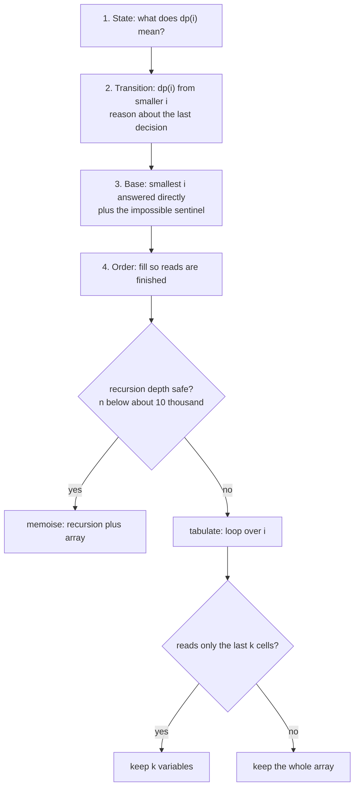

# Dynamic Programming

> [!abstract] In one sentence
> Dynamic programming is what you get when a recursive solution keeps solving the same subproblem and you write each answer down once — top-down with a memo array or bottom-up with a loop — so that an exponential recursion tree collapses into a table of n cells, each filled from a few earlier cells.

**Map:** [[Topics MOC]] → [[DSA Dashboard]]

> [!question] Predict before you read
> `ways(n) = ways(n - 1) + ways(n - 2)` for climbing stairs makes about 2^n calls for input n, yet there are only n + 1 distinct inputs. Where does the waste come from, and what is the smallest change to the code that removes all of it?

## Why this exists

Some problems ask for a *best* or a *count* over choices made in sequence, where a choice now changes what is possible later: rob this house and the next is off limits; take this coin and a smaller amount remains; cut the string here and the rest must still be valid. [[Backtracking]] explores every sequence of choices and is exponential. [[Greedy]] commits to one choice and is only right when a local best is provably a global best, which is rare. DP is the middle: it still considers every choice, but it notices that after a choice the *remaining* problem is one of a small number of distinct subproblems, and solves each only once.

The signals in a statement are **number of ways**, **minimum / maximum cost, length, product**, **can it be done**, **longest subsequence**, and constraints that make brute force impossible (n up to 10³ to 10⁵) while the state you need to describe "where am I" is tiny — an index, an amount, a length. The first time you see a problem you will not know it is DP; the skill is the habit of asking *what is the smallest piece of information I need to carry forward*, and recognising that the answer is one integer.

NeetCode's twelve 1-D problems are the vocabulary: climbing stairs and its variants ([[LC 70 Climbing Stairs]], [[LC 746 Min Cost Climbing Stairs]], [[LC 91 Decode Ways]]), take-or-skip ([[LC 198 House Robber]], [[LC 213 House Robber II]]), palindromes ([[LC 5 Longest Palindromic Substring]], [[LC 647 Palindromic Substrings]]), amounts ([[LC 322 Coin Change]]), running products ([[LC 152 Maximum Product Subarray]]), segmentation ([[LC 139 Word Break]]), increasing subsequences ([[LC 300 Longest Increasing Subsequence]]) and subset sums ([[LC 416 Partition Equal Subset Sum]]).

## The idea from zero

Climbing stairs: you can climb 1 or 2 steps at a time; how many distinct ways reach step n? Think about the *last* move. You arrived at step n either from step n − 1 (one step) or from step n − 2 (two steps), and those two sets of ways do not overlap, so `ways(n) = ways(n − 1) + ways(n − 2)`. With `ways(0) = 1` (standing at the bottom is one way to be there) and `ways(1) = 1`, that is a complete recursive solution. It is also hopeless for n = 45, because of what the call tree looks like:

> [!example] Call tree of ways(5)
> ![[Dynamic Programming — Call tree of ways(5).excalidraw]]
> [[Dynamic Programming — Call tree of ways(5).excalidraw|Open in Excalidraw]] — ways(3) is computed twice, ways(2) three times; for n = 45 the tree has about 1.8 billion nodes for 46 distinct inputs

%% excalidraw-spec
{"kind": "tree", "title": "Call tree of ways(5)", "nodes": [{"id": "n5", "label": "ways(5)", "children": ["n4", "n3a"]}, {"id": "n4", "label": "ways(4)", "children": ["n3b", "n2a"]}, {"id": "n3a", "label": "ways(3)", "children": ["n2b", "n1a"]}, {"id": "n3b", "label": "ways(3)", "children": ["n2c", "n1b"]}, {"id": "n2a", "label": "ways(2)", "children": []}, {"id": "n2b", "label": "ways(2)", "children": []}, {"id": "n1a", "label": "ways(1)", "children": []}, {"id": "n2c", "label": "ways(2)", "children": []}, {"id": "n1b", "label": "ways(1)", "children": []}], "root": "n5", "highlight": ["n3a", "n3b"], "caption": "ways(3) is computed twice, ways(2) three times; for n = 45 the tree has about 1.8 billion nodes for 46 distinct inputs"}
%%

**Memoisation** is the one-line fix: before computing `ways(i)`, look in a notebook; after computing it, write it down. The second call to `ways(3)` returns in O(1), and the tree collapses to one node per distinct input.

> [!example] memo after ways(5)
> ![[Dynamic Programming — memo after ways(5).excalidraw]]
> [[Dynamic Programming — memo after ways(5).excalidraw|Open in Excalidraw]] — memo[i] = memo[i-1] + memo[i-2]; every cell is written once and read at most twice

%% excalidraw-spec
{"kind": "array", "title": "memo after ways(5)", "values": [1, 1, 2, 3, 5, 8], "pointers": {"i-2": 3, "i-1": 4, "i": 5}, "highlight": [5], "caption": "memo[i] = memo[i-1] + memo[i-2]; every cell is written once and read at most twice"}
%%

**Tabulation** notices that the notebook is filled in a predictable order — `ways(2)` before `ways(3)` before `ways(4)` — and replaces the recursion with a loop that fills the array left to right. Same table, no call stack. **Space optimisation** notices the loop only ever reads the two previous cells, so two variables replace the array. Four versions, one idea: *the recursion defines the answer; the table is how you avoid repeating yourself.*

## The mechanism

### The four questions

Every DP, 1-D or 2-D, is designed by answering four questions in order. Stop at each one and say the answer out loud before writing code.

1. **State.** What does `dp[i]` *mean*, in a full sentence? "`dp[i]` is the number of ways to reach step i." "`dp[i]` is the maximum loot from houses `0..i`." "`dp[a]` is the fewest coins making amount `a`." A vague state is the root of every DP failure.
2. **Transition.** How is `dp[i]` computed from smaller states? This is where you reason about the *last* decision: the last step, the last house, the last coin, the last word.
3. **Base.** Which states are answered without a transition? `dp[0]`, sometimes `dp[1]`; and what value means "impossible" (an `INF` sentinel, `false`, 0).
4. **Order.** In which order must cells be filled so that every transition reads a finished cell? For 1-D, almost always increasing `i`; the memoised version gets the order for free because recursion computes what it needs first.



> [!example]- Excalidraw version — the same diagram as an editable canvas
> ![[Dynamic Programming — The four questions.excalidraw]]
> [[Dynamic Programming — The four questions.excalidraw|Open in Excalidraw]] — needs the Excalidraw plugin (see [[Plugins to Install]]).

### Memo storage in Java

The memo must distinguish "not computed yet" from every legitimate answer. Three options, in order of preference:

| Memo | Not-yet marker | Use when |
|---|---|---|
| `int[] memo` filled with `-1` | `-1` | answers are never negative (counts, lengths, non-negative costs) |
| `Integer[] memo` | `null` | `-1` or any int can be a real answer |
| `HashMap<Long, Integer>` | `containsKey` | two or three ints of state packed into one `long`; faster than string keys |

```java
// snippet
Integer[] memo = new Integer[n + 1];                    // null = not computed; -1 can be a real answer
Map<Long, Integer> memo2 = new HashMap<>();
long key = ((long) i << 32) | (j & 0xffffffffL);        // two ints in one long, no String building
```

Avoid `Map<String, Integer>` with `i + "," + j` keys: it works, but string building per call is the difference between passing and timing out on 10⁶ states.

### Recursion depth

The memoised recursion goes as deep as the longest chain of dependencies — n for a linear transition. The JVM's default thread stack holds somewhere between ten and twenty thousand simple frames; `n ≤ 10⁴` is usually safe, `n = 10⁵` is a `StackOverflowError`. When the constraint says 10⁵, tabulate. Say this out loud when you choose top-down in an interview; it shows you know the trade-off rather than a habit.

### The 1-D shapes, each in one sentence

**Linear step** — `dp[i]` depends on `dp[i−1]` and `dp[i−2]` (or the last k): climbing stairs, min-cost stairs (`dp[i] = cost[i] + min(dp[i−1], dp[i−2])`), decode ways (one digit or two digits form the last letter, with the zero rules as guards).

**Take or skip with a gap** — house robber: `dp[i] = max(dp[i−1], dp[i−2] + nums[i])`; the circular version runs the straight version twice, once without the first house and once without the last.

**Best ending here** — LIS O(n²): `dp[i] = 1 + max(dp[j] for j < i with nums[j] < nums[i])`; the answer is the max over all i, not `dp[n−1]`. The O(n log n) version keeps `tails[k]` = the smallest tail of any increasing subsequence of length k + 1 and binary-searches each element in.

**Running best with a sign flip** — maximum product subarray: keep both the largest and the smallest product ending here, because a negative number swaps them.

**Segmentation** — word break: `dp[i]` = can the prefix of length i be split; true if some `j < i` has `dp[j]` and `s[j..i)` in the dictionary. `dp[0] = true`.

**Amount with reusable items** — coin change: `dp[a] = 1 + min(dp[a − c])` over coins c ≤ a; `INF = amount + 1` is the impossible marker, chosen so that `INF + 1` cannot overflow.

**Palindromes** — expanding from each centre (2n − 1 centres, O(n²) time, O(1) space) is *simpler* than the `dp[i][j]` table and equally fast; know both, write the expansion.

**Subset sum** — partition equal subset sum is 0/1 knapsack on a boolean array of reachable sums, iterated *downwards* so each number is used once; it is the bridge to [[2-D Dynamic Programming]].

## Java template

The four versions of one problem — type these until the progression is automatic.

```java
import java.util.*;

class ClimbingStairs {
    // 1. Recursion + memo (top-down). memo[i] = ways to reach step i; -1 = not computed yet.
    int climbMemo(int n) {
        int[] memo = new int[n + 1];
        Arrays.fill(memo, -1);
        return ways(n, memo);
    }
    private int ways(int i, int[] memo) {
        if (i <= 1) return 1;                         // base: one way to stand on step 0 or 1
        if (memo[i] != -1) return memo[i];            // already solved: the notebook
        return memo[i] = ways(i - 1, memo) + ways(i - 2, memo);
    }
    // 2. Tabulation (bottom-up): fill the same table in the order the recursion needed it.
    int climbTab(int n) {
        int[] dp = new int[n + 1];
        dp[0] = 1;
        if (n >= 1) dp[1] = 1;
        for (int i = 2; i <= n; i++) dp[i] = dp[i - 1] + dp[i - 2];
        return dp[n];
    }
    // 3. Space optimisation: the transition only looks back two cells, so keep two variables.
    int climb(int n) {
        int prev2 = 1, prev1 = 1;                     // dp[i-2], dp[i-1]
        for (int i = 2; i <= n; i++) {
            int cur = prev1 + prev2;
            prev2 = prev1;
            prev1 = cur;
        }
        return prev1;
    }
}
```

**Time** O(n) · **Space** O(n) for memo and table, O(1) optimised

Take-or-skip, already space-optimised, plus the circular trick.

```java
import java.util.*;

class HouseRobber {
    // skip / take = best loot up to the previous house without / with robbing it.
    int rob(int[] nums) {
        int skip = 0, take = 0;
        for (int x : nums) {
            int newTake = skip + x;                    // rob this one: the previous must be skipped
            skip = Math.max(skip, take);               // skip this one: best of either
            take = newTake;
        }
        return Math.max(skip, take);
    }
    // Circular street: first and last cannot both be robbed, so solve two straight streets.
    int robCircle(int[] nums) {
        int n = nums.length;
        if (n == 1) return nums[0];
        return Math.max(rob(Arrays.copyOfRange(nums, 0, n - 1)), rob(Arrays.copyOfRange(nums, 1, n)));
    }
}
```

**Time** O(n) · **Space** O(1)

Longest increasing subsequence, both versions.

```java
import java.util.*;

class LIS {
    // O(n^2): dp[i] = length of the longest increasing subsequence that ENDS at i.
    int lengthQuadratic(int[] nums) {
        int n = nums.length, best = 0;
        int[] dp = new int[n];
        for (int i = 0; i < n; i++) {
            dp[i] = 1;                                  // the element on its own
            for (int j = 0; j < i; j++)
                if (nums[j] < nums[i]) dp[i] = Math.max(dp[i], dp[j] + 1);
            best = Math.max(best, dp[i]);               // the answer can end anywhere
        }
        return best;
    }
    // O(n log n): tails[k] = smallest possible tail of an increasing subsequence of length k + 1.
    int lengthPatience(int[] nums) {
        int[] tails = new int[nums.length];
        int size = 0;
        for (int x : nums) {
            int pos = Arrays.binarySearch(tails, 0, size, x);
            if (pos < 0) pos = -(pos + 1);              // insertion point: first tail >= x
            tails[pos] = x;                             // extend (pos == size) or lower an existing tail
            if (pos == size) size++;
        }
        return size;
    }
}
```

**Time** O(n²) and O(n log n) · **Space** O(n)

Segmentation and amounts — the two "any earlier j" shapes.

```java
import java.util.*;

class WordBreak {
    // dp[i] = can s[0..i) be segmented; dp[0] = true for the empty prefix.
    boolean wordBreak(String s, List<String> wordDict) {
        Set<String> dict = new HashSet<>(wordDict);
        int n = s.length();
        boolean[] dp = new boolean[n + 1];
        dp[0] = true;
        for (int i = 1; i <= n; i++)
            for (int j = 0; j < i; j++)                 // the last word is s[j..i)
                if (dp[j] && dict.contains(s.substring(j, i))) { dp[i] = true; break; }
        return dp[n];
    }
}
```

**Time** O(n² · L) with substring hashing · **Space** O(n)

```java
import java.util.*;

class CoinChange {
    // dp[a] = fewest coins that make amount a; INF = amount + 1 can never be a real answer.
    int coinChange(int[] coins, int amount) {
        int INF = amount + 1;
        int[] dp = new int[amount + 1];
        Arrays.fill(dp, INF);
        dp[0] = 0;
        for (int a = 1; a <= amount; a++)
            for (int c : coins)
                if (c <= a) dp[a] = Math.min(dp[a], dp[a - c] + 1);   // the last coin used is c
        return dp[amount] == INF ? -1 : dp[amount];
    }
}
```

**Time** O(amount · coins) · **Space** O(amount)

## Complexity

| Shape | Time | Space | Why |
|---|---|---|---|
| linear step (stairs, decode ways) | O(n) | O(1) | each cell reads a constant number of earlier cells |
| take or skip (house robber) | O(n) | O(1) | same, two running values |
| LIS | O(n²), O(n log n) with tails | O(n) | "any earlier j", or a binary search per element |
| word break | O(n² · L) | O(n) | any earlier j plus a substring per check |
| coin change | O(amount · coins) | O(amount) | one pass over coins per amount |
| palindromes by expansion | O(n²) | O(1) | 2n − 1 centres, each expanding up to n |
| subset sum | O(n · target) | O(target) | one boolean per reachable sum |

The memoised version has the same time as the table but adds O(depth) stack and a constant factor for the calls.

## The canonical shapes

| Shape | Recognition cue | One-line solution | Problems |
|---|---|---|---|
| Linear step | "ways to reach", "steps of 1 or 2", "decode digits" | `dp[i]` from `dp[i−1]`, `dp[i−2]` with validity guards | [[LC 70 Climbing Stairs]], [[LC 746 Min Cost Climbing Stairs]], [[LC 91 Decode Ways]] |
| Take or skip | "cannot pick two adjacent" | `max(dp[i−1], dp[i−2] + a[i])`; circular → run twice | [[LC 198 House Robber]], [[LC 213 House Robber II]] |
| Palindromes | "longest palindromic substring", "count palindromic substrings" | expand around 2n − 1 centres | [[LC 5 Longest Palindromic Substring]], [[LC 647 Palindromic Substrings]] |
| Amount, reusable items | "fewest coins", "unlimited supply" | `dp[a] = 1 + min(dp[a−c])`, INF sentinel | [[LC 322 Coin Change]] |
| Running best with sign | "maximum product subarray" | carry max and min ending here | [[LC 152 Maximum Product Subarray]] |
| Segmentation | "can be split into dictionary words" | `dp[i] = any(dp[j] and s[j..i) in dict)` | [[LC 139 Word Break]] |
| Best ending here | "longest increasing subsequence" | `dp[i] = 1 + max(dp[j])`, or patience with tails | [[LC 300 Longest Increasing Subsequence]] |
| Subset sum | "partition into two equal sums" | boolean sums, iterate downwards | [[LC 416 Partition Equal Subset Sum]] |

## Worked example

[[LC 322 Coin Change]] with coins `[1, 2, 5]` and amount 11. State: `dp[a]` = fewest coins making exactly `a`. Transition: the last coin is one of the coins, so `dp[a] = 1 + min(dp[a−1], dp[a−2], dp[a−5])` over the coins that fit. Base: `dp[0] = 0`, everything else starts at `INF = 12`. Order: increasing `a`.

> [!example] dp for coins 1, 2, 5 and amount 11
> ![[Dynamic Programming — dp for coins 1, 2, 5 and amount 11.excalidraw]]
> [[Dynamic Programming — dp for coins 1, 2, 5 and amount 11.excalidraw|Open in Excalidraw]] — dp[11] = 1 + min(dp[10], dp[9], dp[6]) = 1 + min(2, 3, 2) = 3, which is 5 + 5 + 1

%% excalidraw-spec
{"kind": "array", "title": "dp for coins 1, 2, 5 and amount 11", "values": [0, 1, 1, 2, 2, 1, 2, 2, 3, 3, 2, 3], "pointers": {"a-5": 6, "a-2": 9, "a-1": 10}, "highlight": [11], "caption": "dp[11] = 1 + min(dp[10], dp[9], dp[6]) = 1 + min(2, 3, 2) = 3, which is 5 + 5 + 1"}
%%

Read the table left to right: `dp[5] = 1` because the coin 5 fits exactly; `dp[6] = 1 + min(dp[5], dp[4], dp[1]) = 2`; and so on. The answer 3 is `dp[11]`, and `dp[a]` still equal to `INF` at the end would mean "impossible", which is why the final line compares against the sentinel rather than returning the raw value. Two more traces worth doing on paper, with the same four questions:

> [!example] House Robber dp for 2, 7, 9, 3, 1
> ![[Dynamic Programming — House Robber dp for 2, 7, 9, 3, 1.excalidraw]]
> [[Dynamic Programming — House Robber dp for 2, 7, 9, 3, 1.excalidraw|Open in Excalidraw]] — dp[i] = max(dp[i-1], dp[i-2] + nums[i]); dp[2] = 2 + 9, dp[4] = 11 + 1

%% excalidraw-spec
{"kind": "array", "title": "House Robber dp for 2, 7, 9, 3, 1", "values": [2, 7, 11, 11, 12], "highlight": [4], "caption": "dp[i] = max(dp[i-1], dp[i-2] + nums[i]); dp[2] = 2 + 9, dp[4] = 11 + 1"}
%%

> [!example] LIS dp for 10, 9, 2, 5, 3, 7, 101, 18
> ![[Dynamic Programming — LIS dp for 10, 9, 2, 5, 3, 7, 101, 18.excalidraw]]
> [[Dynamic Programming — LIS dp for 10, 9, 2, 5, 3, 7, 101, 18.excalidraw|Open in Excalidraw]] — dp[i] = 1 + max over earlier smaller elements; the answer 4 is the maximum cell, not the last

%% excalidraw-spec
{"kind": "array", "title": "LIS dp for 10, 9, 2, 5, 3, 7, 101, 18", "values": [1, 1, 1, 2, 2, 3, 4, 4], "highlight": [6], "caption": "dp[i] = 1 + max over earlier smaller elements; the answer 4 is the maximum cell, not the last"}
%%

## Pitfalls

> [!warning] The mistakes people make
> - **A state you cannot say in a sentence.** If you cannot finish "`dp[i]` is the …", you do not have a transition either. Write the sentence first.
> - **Overflowing the sentinel.** `Integer.MAX_VALUE + 1` is negative and wins every `min`. Use `amount + 1`, or guard before adding.
> - **A sentinel that is also an answer.** `-1` as "not computed" breaks when −1 is a real result; switch to `Integer[]` and `null`.
> - **Index vs length.** `dp[i]` over "the first i characters" means the character is `s.charAt(i − 1)`; mixing the two conventions gives off-by-one errors everywhere.
> - **Returning `dp[n−1]` when the answer is a max over the table** (LIS, palindromes, max product).
> - **Space optimisation that rotates in the wrong order** — `prev2 = prev1` before `cur` is computed loses a value. Compute, then shift.
> - **Greedy where DP is needed.** Coins `[1, 3, 4]` and amount 6: greedy takes 4 + 1 + 1 = 3 coins, DP finds 3 + 3 = 2.
> - **Recursion depth.** Memoised recursion on n = 10⁵ overflows the stack; tabulate.
> - **Forgetting the modulo** when the problem counts ways modulo 10⁹ + 7 — apply it on every addition, not at the end.

## Variations & follow-ups

**Return the choice, not the value.** Keep a `parent[i]` (which transition won) and walk back from the answer; or recompute forwards from the table.

**Count instead of optimise.** Replace `min` with `+` and the INF sentinel with 0; the structure is unchanged (decode ways is climbing stairs with guards).

**A second dimension.** "At most k transactions", "with cooldown", "two strings" — the state grows to `dp[i][j]`, which is [[2-D Dynamic Programming]].

**LIS reconstruction and variants.** Longest *non-decreasing* changes `<` to `<=`; the patience version uses the first tail `>` x instead of `>=`. Russian-doll envelopes is LIS after sorting by one key.

**Tree DP.** House Robber III asks the same take-or-skip question on a binary tree: a DFS that returns the pair (with root, without root).

**Bitmask DP.** When the state is "which subset has been used", pack it into an int; n ≤ 20 is the giveaway. Recognise; rarely asked at SDE-2.

## Interview script

Open with the recursion, not the table: "If I knew the answers for smaller inputs, the answer for n would be … — that is a recursive definition with overlapping subproblems, so DP." Then:

1. Say the state in a full sentence and write it as a comment above the code.
2. Derive the transition by naming the last decision; check it on a 3-element example by hand.
3. Name the base cases and the impossible sentinel.
4. Choose top-down or bottom-up and justify it with the constraint size.
5. Code the table version; mention the O(1)-space version as a follow-up if the transition only looks back k cells.
6. State complexity as states × work per state.

What the interviewer is checking: that you can define the state precisely, that you can explain why the transition is complete (every way of reaching `i` is counted exactly once), that you handle the impossible case, and that you know when memoisation will overflow the stack. Follow-ups: "can you do it in O(1) space?", "can you return the actual subsequence / coins?", "what if coins could be used once?" (0/1 knapsack, [[2-D Dynamic Programming]]), "what if there are k of them?".

## Spot the bug

```java
// snippet
int[] dp = new int[amount + 1];
Arrays.fill(dp, Integer.MAX_VALUE);
dp[0] = 0;
for (int a = 1; a <= amount; a++)
    for (int c : coins)
        if (c <= a) dp[a] = Math.min(dp[a], dp[a - c] + 1);
return dp[amount] == Integer.MAX_VALUE ? -1 : dp[amount];
```

> [!example]- The fix
> When `dp[a − c]` is still `Integer.MAX_VALUE` (amount `a − c` is impossible with these coins), `dp[a − c] + 1` overflows to `Integer.MIN_VALUE`, a large negative number that wins the `min` and poisons every later cell. Either use `int INF = amount + 1` as the sentinel (it is larger than any real answer and `INF + 1` is still a small int), or guard with `if (c <= a && dp[a - c] != Integer.MAX_VALUE)`. Coins `[2]` and amount 3 is the two-line test that exposes it.

## Related

### Prerequisites
- [[Recursion]] — the call tree, base cases, and the stack limit
- [[Arrays & Hashing]] — the table is an array; prefix sums are the simplest DP
- [[Complexity Analysis]] — states × work per state

### Builds on this
- [[2-D Dynamic Programming]] — two indices: strings, grids, knapsack, intervals
- [[DP Pattern Catalogue]] — the one-page map of all patterns
- [[Greedy]] — when the DP collapses to one choice, and how to tell
- [[Advanced Graphs]] — Bellman-Ford is DP over the number of edges

### Problems that use it
- [[LC 70 Climbing Stairs]]
- [[LC 746 Min Cost Climbing Stairs]]
- [[LC 198 House Robber]]
- [[LC 213 House Robber II]]
- [[LC 5 Longest Palindromic Substring]]
- [[LC 647 Palindromic Substrings]]
- [[LC 91 Decode Ways]]
- [[LC 322 Coin Change]]
- [[LC 152 Maximum Product Subarray]]
- [[LC 139 Word Break]]
- [[LC 300 Longest Increasing Subsequence]]
- [[LC 416 Partition Equal Subset Sum]]
- [[LC 53 Maximum Subarray]] — Kadane's algorithm is the running-best DP
- [[DSA Patterns in Java]] — memo and table skeletons
- [[Java Pitfalls in Interviews]] — overflow, recursion depth, `Integer` null unboxing

## Personal understanding

> [!question] Explain it without the note
> Write your own explanation here, from memory, then compare with the sections above and note what you missed.

### Mastery checklist
- [ ] I can state the idea in one sentence
- [ ] I can re-derive the mechanism on a whiteboard
- [ ] I can name when NOT to use it
- [ ] I have solved three problems with it without hints
- [ ] I can explain it to a colleague in two minutes

## Open questions
- [ ] For each of the twelve 1-D problems, can I write the state sentence from memory before looking at the note?
- [ ] At what n does the memoised climbing-stairs recursion overflow my JVM's default stack, and does the answer change with `-Xss`?
