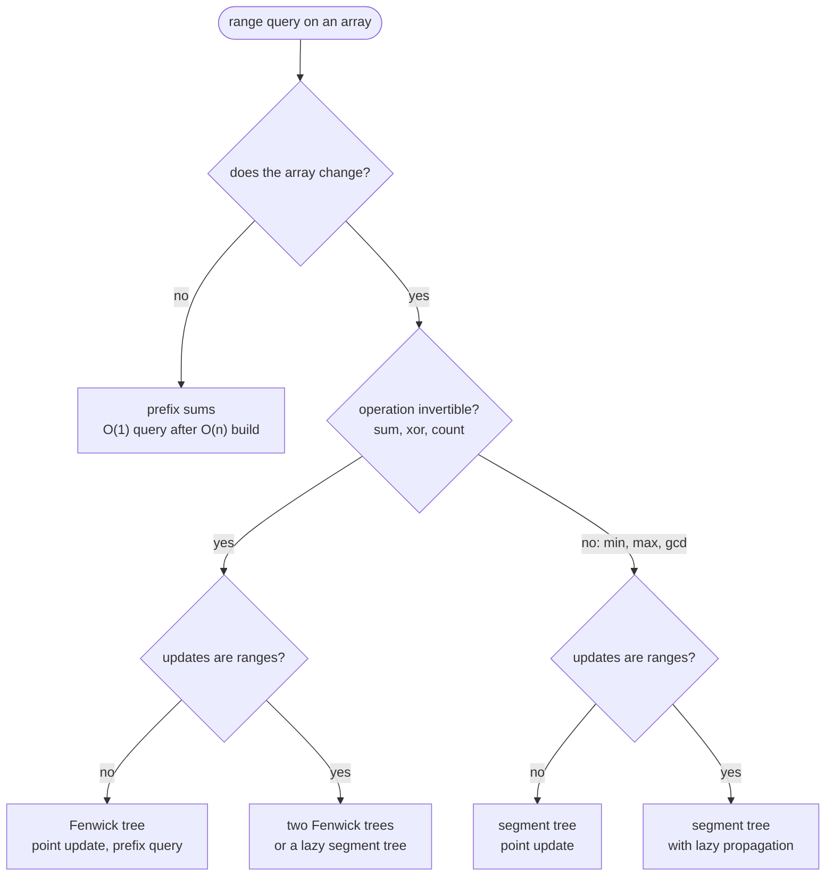
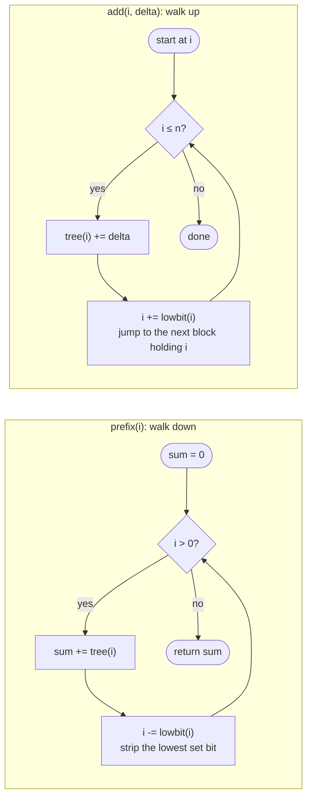

# Fenwick Trees

> [!abstract] In one sentence
> A Fenwick tree keeps prefix sums alive under point updates by storing, at index i, the sum of a block of `lowbit(i) = i & -i` elements ending at i; a prefix sum is the sum of at most log n such blocks found by stripping the lowest set bit of i again and again, and a point update fixes the at most log n blocks containing i by adding the lowest set bit again and again — two three-line loops, n + 1 longs, O(log n) each.

**Map:** [[Topics MOC]] → [[DSA Dashboard]]

> [!question] Predict before you read
> A prefix-sum array makes `sum(1..i)` O(1) but makes "add 4 to a[3]" O(n), because every prefix after 3 changes. Suppose instead each index stored the sum of a *block* ending at it, with block lengths 1, 2, 1, 4, 1, 2, 1, 8 for indices 1..8. Which blocks would you add to get `sum(1..7)`, and which blocks change when a[3] changes? Count them.

## Why this exists

[[Arrays & Hashing]] gives you prefix sums: one O(n) pass, then any range sum in O(1). The moment the array is *updated*, that breaks — one changed element shifts every prefix to its right. The [[Segment Trees]] note solves this in general, with a recursive tree of halves and about forty lines. The Fenwick tree solves the common special case — the operation has an inverse (sum, xor, count), updates are points, queries are prefixes — with an array of n + 1 numbers, two loops, and a constant factor that makes it 2–3× faster than a segment tree in practice. It is the structure you reach for *inside* another algorithm: a sweep that needs "how many of the values seen so far are below x", a leaderboard asked "what is the rank of this score" while scores change, a counter over buckets queried by prefix.

The signals in a statement are **point update + prefix or range sum, many times**, **"count the elements smaller than x seen so far"** (inversions, count of smaller numbers after self), **"the k-th smallest element with insertions"** when values are bounded or can be compressed, and **"rank of x"**. If the operation is min, max or gcd, stop: those have no inverse and a Fenwick tree cannot subtract a block back out (prefix max with values that only grow is the one exception). If the updates are ranges and the queries are sums, the difference-array trick below still works; if both are ranges with a non-invertible merge, you need lazy propagation on a segment tree.



> [!example]- Excalidraw version — the same diagram as an editable canvas
> ![[Fenwick Trees — Why this exists.excalidraw]]
> [[Fenwick Trees — Why this exists.excalidraw|Open in Excalidraw]] — needs the Excalidraw plugin (see [[Plugins to Install]]).

In a 45-minute round the Fenwick tree is almost never the headline — it is the ten lines you add to a sweep to turn O(n²) counting into O(n log n), and the answer to "do you know a lighter structure than a segment tree for this". Expect it as a follow-up to LeetCode 307 (range sum, mutable) and as one of the accepted answers to LeetCode 315 (count of smaller numbers after self).

## The idea from zero

Prefix sums store, at index i, the sum of *everything* up to i. That is why an update is expensive: index 3 is inside the prefix of every index after it. The Fenwick tree stores, at index i, the sum of a much shorter block ending at i, and chooses block lengths so cleverly that any prefix is a union of a few blocks *and* any element lies in only a few blocks. The rule, with 1-based indices: **index i owns the block of `lowbit(i)` elements ending at i**, where `lowbit(i)` is the value of the lowest set bit of i — 1 for odd i, 2 for 2, 6, 10 …, 4 for 4, 12, 20 …, 8 for 8, 24 …

> [!example] Fenwick tree over [3, 2, -1, 6, 5, 4, -3, 3]
> ![[Fenwick Trees — Fenwick tree over -3, 2, -1, 6, 5, 4, -3, 3-.excalidraw]]
> [[Fenwick Trees — Fenwick tree over -3, 2, -1, 6, 5, 4, -3, 3-.excalidraw|Open in Excalidraw]] — index i (1-based) stores the sum of the lowbit(i) elements ending at i: block lengths 1, 2, 1, 4, 1, 2, 1, 8

%% excalidraw-spec
{"kind": "fenwick", "title": "Fenwick tree over [3, 2, -1, 6, 5, 4, -3, 3]", "array": [3, 2, -1, 6, 5, 4, -3, 3], "caption": "index i (1-based) stores the sum of the lowbit(i) elements ending at i: block lengths 1, 2, 1, 4, 1, 2, 1, 8"}
%%

Take `a = [3, 2, -1, 6, 5, 4, -3, 3]` (1-based). Index 1 owns `[1,1]` = 3; index 2 owns `[1,2]` = 5; index 3 owns `[3,3]` = −1; index 4 owns `[1,4]` = 10; index 5 owns `[5,5]` = 5; index 6 owns `[5,6]` = 9; index 7 owns `[7,7]` = −3; index 8 owns `[1,8]` = 19. Powers of two own whole prefixes; odd indices own themselves; everything else is in between.

Now `sum(1..7)`. Index 7 owns `[7,7]`; what is left is `[1,6]`, and index 6 owns `[5,6]`; what is left is `[1,4]`, which index 4 owns whole. Three blocks: −3 + 9 + 10 = 16. Look at the indices: 7, 6, 4 — in binary 111, 110, 100. Each step removed the lowest set bit. That is not a coincidence: a block ending at i has length `lowbit(i)`, so the part of the prefix still uncovered after taking it ends at `i − lowbit(i)`, which is i with its lowest set bit cleared. A number has at most log₂ n set bits, so a prefix is at most log n blocks.

Now change `a[3]`. Which blocks contain index 3? `[3,3]` at index 3, `[1,4]` at index 4, `[1,8]` at index 8 — in binary 11, 100, 1000. Each step *added* the lowest set bit: 3 + 1 = 4, 4 + 4 = 8, 8 + 8 = 16 > n, stop. The next block containing index i always ends at `i + lowbit(i)`, and the climb has at most log n steps. Those two walks — strip the bit to query, add the bit to update — are the whole structure.

## The mechanism

### lowbit: `i & -i`

In two's complement, `-i` is `~i + 1`: flip every bit, then add one. Flipping turns the trailing zeros of i into ones and the lowest set bit into a zero; adding one carries through those ones and stops exactly at that position, setting it back to one, while everything above it stays complemented. So `i` and `-i` agree in exactly one bit — the lowest set bit — and `i & -i` isolates it.

> [!example] lowbit(6) = 6 & -6 isolates the lowest set bit
> ![[Fenwick Trees — lowbit(6) = 6 & -6 isolates the lowest set bit.excalidraw]]
> [[Fenwick Trees — lowbit(6) = 6 & -6 isolates the lowest set bit.excalidraw|Open in Excalidraw]]

%% excalidraw-spec
{"kind": "bits", "title": "lowbit(6) = 6 & -6 isolates the lowest set bit", "rows": [{"label": "i = 6", "bits": "00000110"}, {"label": "-i = ~i + 1", "bits": "11111010"}, {"label": "i & -i = 2", "bits": "00000010"}], "highlight_cols": [6]}
%%

This is the one piece of [[Bit Manipulation]] the structure needs. `Integer.lowestOneBit(i)` is the same thing with a name, if you prefer to say it out loud.

### What index i is responsible for

`tree[i] = a[i − lowbit(i) + 1] + … + a[i]`. Read the block length off the binary form of i: an index ending in k zero bits owns a block of 2^k elements. The array is 1-based for a reason — `lowbit(0) = 0`, so index 0 would own nothing and the update loop at 0 would never move.

> [!example] tree[] for [3, 2, -1, 6, 5, 4, -3, 3]
> ![[Fenwick Trees — tree-- for -3, 2, -1, 6, 5, 4, -3, 3-.excalidraw]]
> [[Fenwick Trees — tree-- for -3, 2, -1, 6, 5, 4, -3, 3-.excalidraw|Open in Excalidraw]] — cell i holds the sum of a[i - lowbit(i) + 1 .. i]; the highlighted powers of two hold whole prefixes

%% excalidraw-spec
{"kind": "array", "title": "tree[] for [3, 2, -1, 6, 5, 4, -3, 3]", "values": [0, 3, 5, -1, 10, 5, 9, -3, 19], "labels": {"0": "unused", "1": "[1,1]", "2": "[1,2]", "3": "[3,3]", "4": "[1,4]", "5": "[5,5]", "6": "[5,6]", "7": "[7,7]", "8": "[1,8]"}, "highlight": [2, 4, 8], "caption": "cell i holds the sum of a[i - lowbit(i) + 1 .. i]; the highlighted powers of two hold whole prefixes"}
%%

The picture to keep: it *is* a tree, but an implicit one. For queries, the "previous block" of i ends at `i − lowbit(i)`; for updates, the parent of i is `i + lowbit(i)`. Nobody stores children, nobody recurses — the bits do the navigation.

### Prefix query: strip the lowest set bit

`prefix(i)`: `sum = 0; while i > 0: sum += tree[i]; i -= i & -i`. The blocks you visit are disjoint and tile `[1, i]` exactly, because each block ends where the previous uncovered part ended.

> [!example] prefix(7) = tree[7] + tree[6] + tree[4]
> ![[Fenwick Trees — prefix(7) = tree-7- + tree-6- + tree-4-.excalidraw]]
> [[Fenwick Trees — prefix(7) = tree-7- + tree-6- + tree-4-.excalidraw|Open in Excalidraw]] — 7 = 111 -> 110 -> 100 -> 0: each step strips the lowest set bit; the blocks [7,7], [5,6], [1,4] tile [1,7]; sum = -3 + 9 + 10 = 16

%% excalidraw-spec
{"kind": "array", "title": "prefix(7) = tree[7] + tree[6] + tree[4]", "values": [0, 3, 5, -1, 10, 5, 9, -3, 19], "pointers": {"i=7": 7, "i=6": 6, "i=4": 4}, "highlight": [7, 6, 4], "caption": "7 = 111 -> 110 -> 100 -> 0: each step strips the lowest set bit; the blocks [7,7], [5,6], [1,4] tile [1,7]; sum = -3 + 9 + 10 = 16"}
%%

### Point update: add the lowest set bit

`add(i, delta)`: `while i ≤ n: tree[i] += delta; i += i & -i`. Every block containing i is visited exactly once and nothing else is. The intuition: adding `lowbit(i)` clears a run of low bits and carries into a higher one, which is precisely the next index whose block is long enough to reach back over i. The formal proof is in any algorithms text; in an interview the picture is enough.

> [!example] add(3, +4): climb 3 -> 4 -> 8
> ![[Fenwick Trees — add(3, +4)- climb 3 -- 4 -- 8.excalidraw]]
> [[Fenwick Trees — add(3, +4)- climb 3 -- 4 -- 8.excalidraw|Open in Excalidraw]] — 3 = 011 -> 100 -> 1000 -> 16 > n, stop: every block containing index 3 ([3,3], [1,4], [1,8]) grew by 4

%% excalidraw-spec
{"kind": "array", "title": "add(3, +4): climb 3 -> 4 -> 8", "values": [0, 3, 5, 3, 14, 5, 9, -3, 23], "pointers": {"i=3": 3, "i=4": 4, "i=8": 8}, "highlight": [3, 4, 8], "caption": "3 = 011 -> 100 -> 1000 -> 16 > n, stop: every block containing index 3 ([3,3], [1,4], [1,8]) grew by 4"}
%%



> [!example]- Excalidraw version — the same diagram as an editable canvas
> ![[Fenwick Trees — Point update- add the lowest set bit.excalidraw]]
> [[Fenwick Trees — Point update- add the lowest set bit.excalidraw|Open in Excalidraw]] — needs the Excalidraw plugin (see [[Plugins to Install]]).

### Build in O(n)

Calling `add` n times builds the tree in O(n log n), which is fine. The O(n) build is one loop: set `tree[i] = a[i]`, then for i from 1 to n push `tree[i]` into its parent `i + lowbit(i)` if that parent exists. Each node's total is complete by the time the loop reaches it, because every child index is smaller than its parent.

### Range sum, range update

`rangeSum(l, r) = prefix(r) − prefix(l − 1)` — this is where the inverse is used, and why min cannot be done this way.

**Range update, point query** — "add v to every `a[l..r]`, then ask for single values": keep the Fenwick tree over the *difference array* `d[i] = a[i] − a[i − 1]`. Adding v to `a[l..r]` changes only two differences: `d[l] += v` and `d[r + 1] −= v`. A point value is then `a[i] = d[1] + … + d[i] = prefix(i)`. Same two loops, different meaning.

**Range update, range sum** — both at once needs two trees. With `B1` over the difference array as above, `a[1] + … + a[i] = i · prefixB1(i) − prefixB2(i)` where `B2` receives `v · (l − 1)` at l and `−v · r` at r + 1. Derive it once on paper (sum the differences, count how many times each d[j] appears); in an interview, describe it as "the difference trick plus a correction tree" rather than deriving live.

**2-D Fenwick tree.** `tree[i][j]` with both loops nested: update and prefix-rectangle query cost O(log n · log m), and a rectangle sum is four prefix queries by inclusion–exclusion. That is the answer to "range sum query 2-D, mutable" (LeetCode 308), and the only time the structure gets two dimensions in interviews.

### Versus the segment tree

| | Fenwick tree | Segment tree |
|---|---|---|
| Code | ~15 lines, two loops | ~40 lines, three recursive functions with `(node, lo, hi)` |
| Memory | n + 1 numbers | 2n (iterative) to 4n (recursive) |
| Speed | tight loops, cache friendly | 2–3× slower in practice |
| Operations | invertible only: sum, xor, count; prefix max with values that only grow | any associative merge: min, max, gcd, custom node state |
| Range queries | prefix differences | direct decomposition, so arbitrary range min works |
| Range updates | difference trick (point query) or two trees (range sum) | lazy propagation, any combination |
| k-th element | binary lifting over powers of two | descend from the root |
| Pick it when | sums or counts with point updates, especially inside a sweep or after coordinate compression | the merge has no inverse, updates are ranges, or you need the tree itself |

## Java template

The class to type from memory. Everything is 1-based; convert at the boundary and say so.

```java
import java.util.*;

class Fenwick {
    private final int n;
    private final long[] tree;          // 1-indexed; tree[i] = sum of a[i - lowbit(i) + 1 .. i]

    Fenwick(int n) {                    // all zeros
        this.n = n;
        tree = new long[n + 1];
    }

    Fenwick(int[] a) {                  // O(n) build: push each node's total to its parent
        this(a.length);
        for (int i = 1; i <= n; i++) {
            tree[i] += a[i - 1];
            int parent = i + (i & -i);
            if (parent <= n) tree[parent] += tree[i];
        }
    }

    void add(int i, long delta) {       // a[i] += delta, i is 1-indexed
        for (; i <= n; i += i & -i) tree[i] += delta;
    }

    long prefix(int i) {                // a[1] + ... + a[i]
        long s = 0;
        for (; i > 0; i -= i & -i) s += tree[i];
        return s;
    }

    long rangeSum(int l, int r) { return prefix(r) - prefix(l - 1); }   // inclusive, 1-indexed
}
```

**Time** O(n) build · O(log n) add · O(log n) prefix or range sum · **Space** O(n)

Range update with the difference-array trick: the same loops over `d` instead of `a`.

```java
import java.util.*;

class RangeAddPointQuery {
    private final int n;
    private final long[] diff;          // Fenwick over the difference array d[i] = a[i] - a[i-1]

    RangeAddPointQuery(int n) { this.n = n; diff = new long[n + 1]; }

    private void add(int i, long v) { for (; i <= n; i += i & -i) diff[i] += v; }

    void rangeAdd(int l, int r, long v) {   // a[l..r] += v
        add(l, v);
        if (r + 1 <= n) add(r + 1, -v);     // cancel the effect past r
    }

    long pointQuery(int i) {                // a[i] = d[1] + ... + d[i]
        long s = 0;
        for (; i > 0; i -= i & -i) s += diff[i];
        return s;
    }
}
```

**Time** O(log n) per range add or point query · **Space** O(n)

Counting with a Fenwick tree over *values*: compress the values to ranks 1..m, sweep from the right, and before inserting each element ask how many smaller ranks have been seen. This is LeetCode 315, and the sum of its answers is the inversion count.

```java
import java.util.*;

class Solution {
    public List<Integer> countSmaller(int[] nums) {            // LeetCode 315
        int[] distinct = Arrays.stream(nums).distinct().sorted().toArray();   // value -> rank 1..m
        int m = distinct.length;
        long[] tree = new long[m + 1];                          // Fenwick of counts per rank
        Integer[] res = new Integer[nums.length];
        for (int i = nums.length - 1; i >= 0; i--) {            // sweep from the right
            int rank = Arrays.binarySearch(distinct, nums[i]) + 1;
            long smaller = 0;
            for (int j = rank - 1; j > 0; j -= j & -j) smaller += tree[j];   // ranks below: strictly smaller
            res[i] = (int) smaller;
            for (int j = rank; j <= m; j += j & -j) tree[j]++;              // record this value
        }
        return Arrays.asList(res);
    }

    long countInversions(int[] nums) {                          // pairs i < j with nums[i] > nums[j]
        long total = 0;
        for (int c : countSmaller(nums)) total += c;
        return total;
    }
}
```

**Time** O(n log n) · **Space** O(n)

## Complexity

| Operation | Time | Why |
|---|---|---|
| build from an array | O(n) | one pass pushing each total to its parent; n calls to `add` would be O(n log n) |
| add (point update) | O(log n) | at most one block per bit position above i |
| prefix / range sum | O(log n) | at most one block per set bit of i |
| k-th smallest (binary lifting) | O(log n) | one probe per power of two |
| 2-D update / rectangle query | O(log n · log m) | the two loops nest |
| space | O(n) | n + 1 numbers, nothing else |

The constants are what make it worth knowing next to the segment tree: the loops touch at most 17 cells for n = 10⁵, with no recursion, no branching on ranges and no identity values.

## The canonical shapes

| Shape | Recognition cue | One-line solution | Problems |
|---|---|---|---|
| Point update + range sum | "`update(i, v)` and `sumRange(l, r)` interleaved" | `add(i, v − old)`, `prefix(r) − prefix(l − 1)` | LeetCode 307 Range Sum Query – Mutable (plain text, not in NeetCode 150) |
| Count smaller to the right, inversions | "how many elements after i are smaller", "how many pairs are out of order" | compress values, sweep from the right, prefix count then add | LeetCode 315 Count of Smaller Numbers After Self, 493 Reverse Pairs, 1649 Create Sorted Array through Instructions |
| Order statistics on bounded values | "k-th smallest / median / k-th largest while elements arrive", values within ±10⁵ or compressible | Fenwick of counts over the value range; k-th by binary lifting | [[LC 295 Find Median from Data Stream]] and [[LC 703 Kth Largest Element in a Stream]] — could be solved with this; the heap answers are what interviewers expect |
| Counting pairs after a transform | "number of subarrays with sum in [lo, hi]" | prefix sums, then count earlier prefixes in a value window with a Fenwick over compressed prefix sums | LeetCode 327 Count of Range Sum |
| Range add, point query | "add v to `a[l..r]`, then read single cells" | Fenwick over the difference array | LeetCode 1109 Corporate Flight Bookings (offline, a plain difference array suffices; the Fenwick is for the online version) |
| 2-D sums with updates | "matrix, update a cell, sum a rectangle" | 2-D Fenwick, four prefix queries | LeetCode 308 Range Sum Query 2D – Mutable |

## Worked example

LeetCode 315 on `nums = [5, 2, 6, 1]`. Distinct sorted values `[1, 2, 5, 6]` give ranks 1→1, 2→2, 5→3, 6→4, so the Fenwick tree has four cells and counts how many of each rank have been seen. Sweep from the right:

| i | value | rank | prefix(rank − 1) | res[i] | add(rank) touches |
|---|---|---|---|---|---|
| 3 | 1 | 1 | prefix(0) = 0 | 0 | tree[1], tree[2], tree[4] → 1, 1, 1 |
| 2 | 6 | 4 | prefix(3) = tree[3] + tree[2] = 0 + 1 | 1 | tree[4] → 2 |
| 1 | 2 | 2 | prefix(1) = tree[1] = 1 | 1 | tree[2] → 2, tree[4] → 3 |
| 0 | 5 | 3 | prefix(2) = tree[2] = 2 | 2 | tree[3] → 1, tree[4] → 4 |

> [!example] Counts per rank just before processing 5 (rank 3)
> ![[Fenwick Trees — Counts per rank just before processing 5 (rank 3).excalidraw]]
> [[Fenwick Trees — Counts per rank just before processing 5 (rank 3).excalidraw|Open in Excalidraw]] — ranks 1..4 stand for the values 1, 2, 5, 6; prefix(2) = tree[2] = 2 elements of rank at most 2 were seen to the right of 5, so res[0] = 2

%% excalidraw-spec
{"kind": "array", "title": "Counts per rank just before processing 5 (rank 3)", "values": [0, 1, 2, 0, 3], "labels": {"0": "unused", "1": "[1,1]", "2": "[1,2]", "3": "[3,3]", "4": "[1,4]"}, "pointers": {"prefix(2)": 2}, "highlight": [2], "caption": "ranks 1..4 stand for the values 1, 2, 5, 6; prefix(2) = tree[2] = 2 elements of rank at most 2 were seen to the right of 5, so res[0] = 2"}
%%

The answer is `[2, 1, 1, 0]`, and 2 + 1 + 1 + 0 = 4 inversions: (5,2), (5,1), (2,1), (6,1). Notice what the structure did: a question about *positions* ("after i") became a sweep, and a question about *values* ("smaller") became a prefix query on an array indexed by rank. Both halves of that translation — sweep plus Fenwick over compressed values — recur in every problem of the second shape.

## Pitfalls

> [!warning] The mistakes people make
> - **Calling `add(0, …)`.** `lowbit(0) = 0`, so `i += i & -i` never moves and the loop never ends. The structure is 1-based; convert at the boundary (`add(idx + 1, …)`) and allocate `n + 1`.
> - **`prefix(l)` instead of `prefix(l − 1)`** in a range sum, which drops `a[l]`. Say "prefix of r minus prefix of l minus one" as you type it.
> - **Min or max with arbitrary updates.** There is no inverse, so `prefix(r) − prefix(l − 1)` is meaningless and an updated block cannot be recomputed from the tree alone. Use a segment tree.
> - **`int` sums.** Counts fit; sums of 10⁵ values up to 10⁹ do not. Store `long`.
> - **Compression with duplicates.** Compress to *distinct* values, or `rank − 1` lands among equal values and "strictly smaller" silently becomes "smaller or equal". Decide which comparison the problem wants, then pick `prefix(rank − 1)` or `prefix(rank)`.
> - **Range add without the `r + 1 ≤ n` guard** — index n + 1 is out of bounds.
> - **Building with n `add` calls and calling it O(n).** It is O(n log n); correct, but say so, or use the one-pass build.
> - **Trying to traverse it like a tree.** There are no child pointers and no ranges stored; the only navigation is `i − lowbit(i)` and `i + lowbit(i)`.

## Variations & follow-ups

**k-th smallest by binary lifting.** On a Fenwick tree of counts, find the smallest position p with `prefix(p) ≥ k` without binary search over queries: start at `pos = 0` and try adding the largest power of two ≤ n, then halve it; take a step whenever the block at `pos + step` still has fewer than k ones, subtracting its count from k. One pass of log n probes, each O(1) — this is what makes a Fenwick tree a sorted multiset with O(log n) insert, delete and select.

```java
// snippet
// smallest index p with prefix(p) >= k, on a Fenwick tree of counts (k is 1-based)
int kth(int k) {
    int pos = 0;
    for (int step = Integer.highestOneBit(n); step > 0; step >>= 1) {
        if (pos + step <= n && tree[pos + step] < k) {   // the whole block up to pos + step is still short of k
            pos += step;
            k -= tree[pos];
        }
    }
    return pos + 1;
}
```

**Offline sweeps.** Sort events by one coordinate, insert into the Fenwick tree by the other, answer each query at the moment its threshold is reached — the Fenwick version of "sort both arrays and sweep". Count of range sum, points-in-rectangle counting, and "number of intervals containing each point" all fit.

**Prefix maximum.** If values only ever increase, `tree[i] = max(tree[i], v)` on the update walk and `max` on the query walk give prefix maxima — useful for longest-increasing-subsequence variants over compressed values. Decreases are impossible, because a block's max cannot be recomputed after one element drops.

**Two trees for range add + range sum**, **2-D trees**, and **xor instead of sum** (same code, `^=` instead of `+=`, xor is its own inverse) are the other follow-ups to recognise by name.

## Interview script

The cue is a counting or summing question with updates, or a sweep that needs "how many seen so far are below x". Say: "I need prefix sums that survive point updates — a Fenwick tree gives both in O(log n) with an array of n + 1 longs; a segment tree would also work but is more code." Then:

1. State the rule: "index i stores the sum of the `lowbit(i)` elements ending at i; `lowbit` is `i & -i`, the lowest set bit."
2. Show the two walks on a small example: query strips the lowest set bit until zero, update adds it until past n. Say why each is at most log n steps.
3. If values are large, say "coordinate compression first: sort the distinct values, binary search for the rank, 1-based".
4. Code the class — two loops — then the sweep that uses it. Mention `long`.
5. Complexity: O(log n) per operation, O(n) space, O(n) build. If asked about range min, say "no inverse — segment tree".

What the interviewer is checking: that you can explain *why* `i & -i` is the lowest set bit and why the walks are logarithmic, that the 1-based indexing is deliberate, that you know the limit (invertible operations only), and that you can compare it honestly with a segment tree. Follow-ups: "range update?" (difference array), "k-th smallest?" (binary lifting), "2-D?" (nest the loops), "why not a segment tree?" (it is fine; this is shorter and faster), "why not a balanced BST or `TreeMap`?" (Java's `TreeMap` has no O(log n) rank: `headMap(x).size()` walks the view, so it is linear; the Fenwick gives exactly that operation).

## Spot the bug

```java
// snippet
void add(int i, long delta) {            // i is the 0-based index into nums
    for (; i <= n; i += i & -i) tree[i] += delta;
}
long prefix(int i) {
    long s = 0;
    for (; i >= 0; i -= i & -i) s += tree[i];
    return s;
}
```

> [!example]- The fix
> Both loops are written for a 0-based index, and `lowbit(0) = 0`. `add(0, …)` adds `delta` to `tree[0]` forever — `i += 0` never terminates — and `prefix` with `i >= 0` loops forever once `i` reaches 0 for the same reason. The structure only works 1-based: allocate `n + 1`, call `add(idx + 1, delta)`, loop `i <= n` in `add` and `i > 0` in `prefix`. Every Fenwick bug in practice is an indexing bug; the arithmetic itself has nowhere to go wrong.

## Related

### Prerequisites
- [[Bit Manipulation]] — `i & -i`, two's complement, `Integer.highestOneBit`
- [[Arrays & Hashing]] — prefix sums and the difference array are the static versions
- [[Trees]] — the implicit parent relation `i + lowbit(i)`
- [[Recursion]] — not needed here, which is the point; compare with the recursive segment tree

### Builds on this
- [[Segment Trees]] — the general sibling for non-invertible merges and range updates
- [[Sorting]] — coordinate compression is a sort and a binary search
- [[Heaps & Priority Queues]] — the structure interviewers expect for k-th and median questions; the Fenwick is the alternative when values are bounded

### Problems that use it
- [[LC 295 Find Median from Data Stream]] — could be solved with a Fenwick tree of counts over the value range and k-th by binary lifting
- [[LC 703 Kth Largest Element in a Stream]] — same idea; k-th largest is the (count − k + 1)-th smallest
- LeetCode 307 Range Sum Query – Mutable, 315 Count of Smaller Numbers After Self, 493 Reverse Pairs, 327 Count of Range Sum, 1649 Create Sorted Array through Instructions, 308 Range Sum Query 2D – Mutable — not in NeetCode 150, the practice set for this note
- [[DSA Patterns in Java]] — the template vault; the `Fenwick` class above belongs next to the prefix-sum template

## Personal understanding

> [!question] Explain it without the note
> Write your own explanation here, from memory, then compare with the sections above and note what you missed.

### Mastery checklist
- [ ] I can state the idea in one sentence
- [ ] I can re-derive the mechanism on a whiteboard
- [ ] I can name when NOT to use it
- [ ] I have solved three problems with it without hints
- [ ] I can explain it to a colleague in two minutes

## Open questions
- [ ] Can I prove, not just picture, that the update walk `i += lowbit(i)` visits exactly the indices whose block contains i?
- [ ] On a leaderboard at work where scores change and "rank of user x" is asked, would a Fenwick tree over score buckets beat the sorted-set approach in Redis, and at what scale?
