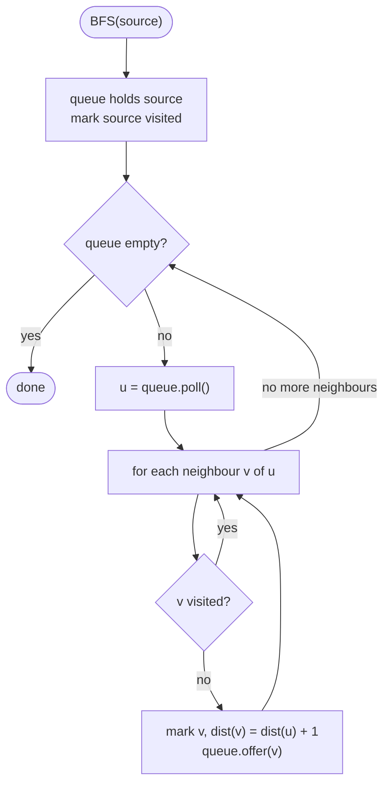

# Graphs

> [!abstract] In one sentence
> A graph is a set of nodes and the edges between them; BFS explores it in layers of increasing distance and DFS explores it to the end of each path before backing up, and every classic problem — islands, components, cycles, prerequisites, shortest moves — is one of those two walks with a specific piece of bookkeeping.

**Map:** [[Topics MOC]] → [[DSA Dashboard]]

> [!question] Predict before you read
> BFS visits nodes in order of distance from the start. If you mark a node as visited when you *take it out* of the queue instead of when you *put it in*, the answer is still correct — so why can the program become thousands of times slower?

## Why this exists

Trees are graphs with no cycles and one parent per node, and you already walk them. Graphs drop both guarantees: a node can be reached by many routes, and a route can loop back to where it started. That is why every graph walk needs a *visited* record, and why the only two things that change between problems are the order you explore in and what you record.

The signals in a statement are concrete nouns and verbs: **connected**, **reachable**, **neighbours**, **islands / regions / provinces**, **prerequisites / dependencies / order**, **minimum number of moves or steps**, **transform one thing into another by single changes** (word ladder), **clone**, and any **2-D grid** where you move between adjacent cells. "Minimum number of steps" with equal-cost moves means BFS. "Is there a valid order" or "can all be finished" means topological sort. "Count the regions" means DFS flood fill or [[Union-Find]].

You meet the same shapes at work: Spring instantiates beans in dependency order (a DFS post-order over the bean graph, where a circular reference is exactly a directed cycle), Gradle runs a build as a topological sort of task dependencies, and an outage blast radius is a reachability question.

## The idea from zero

A graph is a set of nodes (also called vertices) and a set of edges, each edge joining two nodes. If edges have a direction they are arrows (a *directed* graph, "1 depends on 0"); otherwise they are lines (*undirected*, "1 and 0 are friends"). Take five nodes `0..4` and the undirected edges `0-1`, `0-2`, `1-3`, `2-3`, `3-4`.

> [!example] BFS from 0: layers are distances
> ![[Graphs — BFS from 0- layers are distances.excalidraw]]
> [[Graphs — BFS from 0- layers are distances.excalidraw|Open in Excalidraw]] — level = number of edges from 0; the highlighted edges form the BFS tree, 2-3 is the edge BFS never needed

%% excalidraw-spec
{"kind": "graph", "title": "BFS from 0: layers are distances", "directed": false, "nodes": [{"id": "0", "label": "0", "level": 0}, {"id": "1", "label": "1", "level": 1}, {"id": "2", "label": "2", "level": 1}, {"id": "3", "label": "3", "level": 2}, {"id": "4", "label": "4", "level": 3}], "edges": [ ["0", "1"], ["0", "2"], ["1", "3"], ["2", "3"], ["3", "4"] ], "highlight_nodes": ["0"], "highlight_edges": [ ["0", "1"], ["0", "2"], ["1", "3"], ["3", "4"] ], "caption": "level = number of edges from 0; the highlighted edges form the BFS tree, 2-3 is the edge BFS never needed"}
%%

The program needs a way to ask "who are the neighbours of node u?" quickly. The **adjacency list** answers it: one list per node — here `0: [1, 2]`, `1: [0, 3]`, `2: [0, 3]`, `3: [1, 2, 4]`, `4: [3]`. Every undirected edge appears in two lists.

Now the two walks, in words. **BFS** (breadth-first) keeps a queue. Put `0` in. Repeatedly take the front node out and put every neighbour you have not seen before at the back. Because the queue is first-in-first-out, every node at distance 1 is taken out before any node at distance 2, and so on: the walk visits nodes in order of distance, which is why BFS *is* the shortest-path algorithm when every edge costs the same. **DFS** (depth-first) keeps a stack — usually the call stack. From `0`, go to the first unseen neighbour, then to *its* first unseen neighbour, and so on, backing up only when a node has no unseen neighbours left. DFS reaches the same nodes in path order, which is what you want for "explore this whole region", "does a path exist", and "finish everything below me before I finish".

The piece that makes both terminate on a graph with cycles is the visited record. In the picture, node `3` is reachable from `1` and from `2`; without `visited`, BFS would enqueue it twice and DFS would recurse forever around `0-1-3-2-0`.

## The mechanism

### Representations

The adjacency list has two common Java spellings. With nodes numbered `0..n-1`, a list of lists; with arbitrary node ids, a map of lists built with `computeIfAbsent`.

```java
// snippet
List<List<Integer>> adj = new ArrayList<>();
for (int i = 0; i < n; i++) adj.add(new ArrayList<>());
for (int[] e : edges) { adj.get(e[0]).add(e[1]); adj.get(e[1]).add(e[0]); }   // undirected: both ways
Map<Integer, List<Integer>> g = new HashMap<>();
for (int[] e : edges) g.computeIfAbsent(e[0], k -> new ArrayList<>()).add(e[1]);  // directed: one way
List<Integer> out = g.getOrDefault(u, List.of());                                   // never null
int[][] dirs = {{1, 0}, {-1, 0}, {0, 1}, {0, -1}};                                  // grid: down, up, right, left
```

| Representation | Neighbours of u | Edge check u-v | Use it when |
|---|---|---|---|
| `List<List<Integer>>` | O(deg u) | O(deg u) | nodes are `0..n-1` (almost always) |
| `Map<Integer, List<Integer>>` | O(deg u) | O(deg u) | sparse or non-contiguous ids, strings as nodes |
| `boolean[][]` matrix | O(V), so every traversal is O(V²) | O(1) | dense graphs, or V ≤ a few hundred and edge checks dominate |
| grid, implicit | 4 (or 8) via `dirs` | bounds check | any 2-D matrix problem |

A grid is a graph you never build: cell `(r, c)` is a node, and its neighbours are `(r + dr, c + dc)` for each direction, provided they are inside the grid and passable. The bounds check comes *before* reading the cell.

> [!example] A grid is an implicit graph
> ![[Graphs — A grid is an implicit graph.excalidraw]]
> [[Graphs — A grid is an implicit graph.excalidraw|Open in Excalidraw]] — cell (1,1) has four neighbours; only (0,1) and (1,2) are land, so the DFS from it continues there

%% excalidraw-spec
{"kind": "grid", "title": "A grid is an implicit graph", "col_labels": ["", "0", "1", "2", "3"], "row_labels": ["", "0", "1", "2"], "rows": [ [1, 1, 0, 1], [0, 1, 1, 0], [1, 0, 1, 1] ], "highlight": [ [1, 1], [0, 1], [1, 2] ], "arrows": [ [ [1, 1], [0, 1] ], [ [1, 1], [1, 2] ], [ [1, 1], [2, 1] ], [ [1, 1], [1, 0] ] ], "caption": "cell (1,1) has four neighbours; only (0,1) and (1,2) are land, so the DFS from it continues there"}
%%

### BFS: queue, visited on enqueue, level loop

1. Create the queue and the visited record. Put the source in **and mark it visited at the same moment**.
2. While the queue is not empty, take the front node `u`.
3. For every neighbour `v` of `u`: if `v` is already visited, skip; otherwise mark it visited, record `dist[v] = dist[u] + 1` (or `parent[v] = u`), and put it at the back.

Marking on enqueue is the invariant *every node is in the queue at most once*. Mark on dequeue instead and a node with many paths to it is enqueued once per path; on a dense graph or a grid that turns O(V + E) into something that looks exponential, and it is the usual reason a correct-looking BFS times out.



> [!example]- Excalidraw version — the same diagram as an editable canvas
> ![[Graphs — BFS- queue, visited on enqueue, level loop.excalidraw]]
> [[Graphs — BFS- queue, visited on enqueue, level loop.excalidraw|Open in Excalidraw]] — needs the Excalidraw plugin (see [[Plugins to Install]]).

When you need the layer number rather than a per-node distance — "how many minutes", "how many word transformations" — freeze `int size = queue.size()` at the top of each round and process exactly that many nodes: the *level loop*. Everything added during the round belongs to the next layer. The rotting-oranges template below does exactly this.

### DFS: recursive and iterative

Recursive DFS is three lines: mark `u`, then recurse into every unmarked neighbour. The call stack is the stack. Its one limit is depth: a 1000 × 1000 grid of land is a million-deep recursion in the worst case, and the JVM's default stack dies somewhere in the low tens of thousands of frames. The iterative version replaces the call stack with an `ArrayDeque`: push the start; pop `u`; if already seen, skip; mark it; push its unseen neighbours. The "skip if already seen" after the pop is needed because the same node can be pushed several times before it is popped.

### Connected components

Loop over every node; whenever one is unvisited, that is a new component — count it and run a DFS or BFS from it to mark the whole component. On a grid this is flood fill: [[LC 200 Number of Islands]] counts the flood fills, [[LC 695 Max Area of Island]] returns the size of the largest one, [[LC 323 Number of Connected Components in an Undirected Graph]] does the same on an edge list.

### Cycle detection: parent for undirected, colours for directed

In an undirected graph, the edge you just walked along looks like a cycle (`u-v` and then `v-u`). Pass the parent into the DFS and ignore the single neighbour equal to it; any *other* already-visited neighbour closes a real cycle. [[LC 261 Graph Valid Tree]] is "connected and no cycle", which with n nodes is equivalent to "exactly n − 1 edges and connected".

In a directed graph, "already visited" is not enough. Two paths can legitimately converge: `0 → 1 → 3` and `0 → 2 → 3` share `3` without a cycle. What proves a cycle is reaching a node that is *still on the current path*. Three colours record that: white = never seen, grey = on the current recursion path, black = fully finished. A grey neighbour is a back edge and a cycle; a black neighbour is a converging path and harmless.

> [!example] Directed DFS with colours
> ![[Graphs — Directed DFS with colours.excalidraw]]
> [[Graphs — Directed DFS with colours.excalidraw|Open in Excalidraw]] — the path 0-1-3 is grey; 3 sees 1 grey, so 3-1 is a back edge and there is a cycle. Later, 2 would see 3 black: a harmless join

%% excalidraw-spec
{"kind": "graph", "title": "Directed DFS with colours", "directed": true, "nodes": [{"id": "0", "label": "0 grey"}, {"id": "1", "label": "1 grey"}, {"id": "2", "label": "2 white"}, {"id": "3", "label": "3 grey"}], "edges": [ ["0", "1"], ["0", "2"], ["1", "3"], ["2", "3"], ["3", "1"] ], "highlight_nodes": ["0", "1", "3"], "highlight_edges": [ ["3", "1"] ], "caption": "the path 0-1-3 is grey; 3 sees 1 grey, so 3-1 is a back edge and there is a cycle. Later, 2 would see 3 black: a harmless join"}
%%

### Topological sort: Kahn and DFS post-order

A directed acyclic graph (DAG) has at least one order in which every edge points forward. **Kahn's algorithm** (BFS flavour): count each node's in-degree; put every node with in-degree 0 in a queue; pop a node, append it to the order, and decrement the in-degree of each node it points to, enqueuing any that hit 0. If the order ends up shorter than n, some nodes never reached in-degree 0 — a cycle. This is [[LC 207 Course Schedule]] (is the order complete?) and [[LC 210 Course Schedule II]] (return it).

**DFS post-order** is the coloured cycle DFS with one extra line: when a node turns black, append it to a list. A node is appended only after everything it points to, so the *reversed* list is a valid order; a grey hit during the DFS means a cycle and no order.

> [!example] Kahn on 5 courses: level = round in which the node was dequeued
> ![[Graphs — Kahn on 5 courses- level = round in which the node was dequeued.excalidraw]]
> [[Graphs — Kahn on 5 courses- level = round in which the node was dequeued.excalidraw|Open in Excalidraw]] — in-degrees start 0,1,1,2,1; order 0,1,2,3,4 (or 0,2,1,3,4 — any order that respects the arrows is valid)

%% excalidraw-spec
{"kind": "graph", "title": "Kahn on 5 courses: level = round in which the node was dequeued", "directed": true, "nodes": [{"id": "0", "label": "0", "level": 0}, {"id": "1", "label": "1", "level": 1}, {"id": "2", "label": "2", "level": 1}, {"id": "3", "label": "3", "level": 2}, {"id": "4", "label": "4", "level": 3}], "edges": [ ["0", "1"], ["0", "2"], ["1", "3"], ["2", "3"], ["3", "4"] ], "highlight_nodes": ["0"], "caption": "in-degrees start 0,1,1,2,1; order 0,1,2,3,4 (or 0,2,1,3,4 — any order that respects the arrows is valid)"}
%%

### Multi-source BFS, reverse thinking, bidirectional BFS

When many cells are "already rotten" or "already a gate", put *all* of them in the queue before the loop, each at distance 0. One BFS then computes the distance from every cell to its *nearest* source, because the layers expand from all sources at once. [[LC 994 Rotting Oranges]] counts the layers; [[LC 286 Walls and Gates]] writes the layer number into each cell.

Some problems are cheaper from the answer backwards. [[LC 130 Surrounded Regions]] asks which `O` regions are *not* connected to the border — so DFS from every border `O`, mark everything reachable as safe, and flip the rest. [[LC 417 Pacific Atlantic Water Flow]] asks from which cells water reaches both oceans — so start *at* each ocean and walk uphill (to neighbours of equal or greater height); a cell reached from both is an answer. A DFS per cell becomes two DFS runs in total.

[[LC 127 Word Ladder]] is BFS on an implicit graph: words are nodes, a one-letter change is an edge. The branching factor is large, so a BFS from both ends that always expands the smaller frontier and stops when they meet visits roughly the square root of what a one-sided BFS visits. Mention it as the follow-up; code the one-sided version first.

## Java template

Building, both traversals, and component counting in one place.

```java
import java.util.*;

class GraphBasics {
    // Undirected adjacency list from an edge list; drop the second add for a directed graph.
    static List<List<Integer>> build(int n, int[][] edges) {
        List<List<Integer>> adj = new ArrayList<>();
        for (int i = 0; i < n; i++) adj.add(new ArrayList<>());
        for (int[] e : edges) {
            adj.get(e[0]).add(e[1]);
            adj.get(e[1]).add(e[0]);
        }
        return adj;
    }
    // BFS: distance in edges from src to every node; -1 means unreachable.
    static int[] bfs(List<List<Integer>> adj, int src) {
        int[] dist = new int[adj.size()];
        Arrays.fill(dist, -1);
        Deque<Integer> queue = new ArrayDeque<>();
        dist[src] = 0;                               // dist != -1 doubles as "visited"
        queue.offer(src);
        while (!queue.isEmpty()) {
            int u = queue.poll();
            for (int v : adj.get(u)) {
                if (dist[v] != -1) continue;
                dist[v] = dist[u] + 1;               // mark on enqueue
                queue.offer(v);
            }
        }
        return dist;
    }
    // DFS, recursive: marks everything reachable from u.
    static void dfs(List<List<Integer>> adj, int u, boolean[] seen) {
        seen[u] = true;
        for (int v : adj.get(u)) if (!seen[v]) dfs(adj, v, seen);
    }
    // DFS, iterative: same reachability, no recursion depth limit.
    static void dfsIterative(List<List<Integer>> adj, int start, boolean[] seen) {
        Deque<Integer> stack = new ArrayDeque<>();
        stack.push(start);
        while (!stack.isEmpty()) {
            int u = stack.pop();
            if (seen[u]) continue;                   // a node can be pushed more than once
            seen[u] = true;
            for (int v : adj.get(u)) if (!seen[v]) stack.push(v);
        }
    }
    // Components = how many times a fresh DFS had to be started.
    static int countComponents(List<List<Integer>> adj) {
        boolean[] seen = new boolean[adj.size()];
        int count = 0;
        for (int u = 0; u < adj.size(); u++) {
            if (seen[u]) continue;
            count++;
            dfs(adj, u, seen);
        }
        return count;
    }
}
```

**Time** O(V + E) for each traversal · **Space** O(V) for the visited record plus the queue or stack

Cycle detection, both flavours.

```java
import java.util.*;

class Cycles {
    // Undirected: a seen neighbour that is not the node we came from closes a cycle.
    static boolean hasCycleUndirected(List<List<Integer>> adj) {
        boolean[] seen = new boolean[adj.size()];
        for (int u = 0; u < adj.size(); u++)
            if (!seen[u] && dfsU(adj, u, -1, seen)) return true;
        return false;
    }
    private static boolean dfsU(List<List<Integer>> adj, int u, int parent, boolean[] seen) {
        seen[u] = true;
        for (int v : adj.get(u)) {
            if (v == parent) continue;               // the edge we arrived by
            if (seen[v] || dfsU(adj, v, u, seen)) return true;
        }
        return false;
    }
    // Directed: 0 = white (unseen), 1 = grey (on the current path), 2 = black (finished).
    static boolean hasCycleDirected(List<List<Integer>> adj) {
        int[] colour = new int[adj.size()];
        for (int u = 0; u < adj.size(); u++)
            if (colour[u] == 0 && dfsD(adj, u, colour)) return true;
        return false;
    }
    private static boolean dfsD(List<List<Integer>> adj, int u, int[] colour) {
        colour[u] = 1;
        for (int v : adj.get(u)) {
            if (colour[v] == 1) return true;         // back edge onto the current path
            if (colour[v] == 0 && dfsD(adj, v, colour)) return true;
        }
        colour[u] = 2;                               // finished: later visits are harmless joins
        return false;                                // for topological order: post.add(u) here, reverse at the end
    }
}
```

**Time** O(V + E) · **Space** O(V)

Kahn's algorithm; an empty result means a cycle.

```java
import java.util.*;

class TopoSort {
    static List<Integer> kahn(List<List<Integer>> adj) {
        int n = adj.size();
        int[] indeg = new int[n];
        for (List<Integer> out : adj) for (int v : out) indeg[v]++;
        Deque<Integer> queue = new ArrayDeque<>();
        for (int u = 0; u < n; u++) if (indeg[u] == 0) queue.offer(u);
        List<Integer> order = new ArrayList<>();
        while (!queue.isEmpty()) {
            int u = queue.poll();
            order.add(u);
            for (int v : adj.get(u)) if (--indeg[v] == 0) queue.offer(v);   // one prerequisite fewer
        }
        return order.size() == n ? order : List.of();                       // shorter = cycle
    }
}
```

**Time** O(V + E) · **Space** O(V)

Multi-source BFS on a grid, with the level loop counting minutes.

```java
import java.util.*;

class Solution {
    public int orangesRotting(int[][] grid) {
        int m = grid.length, n = grid[0].length, fresh = 0;
        Deque<int[]> queue = new ArrayDeque<>();
        for (int r = 0; r < m; r++)
            for (int c = 0; c < n; c++) {
                if (grid[r][c] == 2) queue.offer(new int[]{r, c});   // every source at distance 0
                else if (grid[r][c] == 1) fresh++;
            }
        int[][] dirs = {{1, 0}, {-1, 0}, {0, 1}, {0, -1}};
        int minutes = 0;
        while (!queue.isEmpty() && fresh > 0) {
            int size = queue.size();                                  // one minute = one layer
            for (int i = 0; i < size; i++) {
                int[] cur = queue.poll();
                for (int[] d : dirs) {
                    int nr = cur[0] + d[0], nc = cur[1] + d[1];
                    if (nr < 0 || nc < 0 || nr >= m || nc >= n || grid[nr][nc] != 1) continue;
                    grid[nr][nc] = 2;                                 // mark on enqueue, in place
                    fresh--;
                    queue.offer(new int[]{nr, nc});
                }
            }
            minutes++;
        }
        return fresh == 0 ? minutes : -1;
    }
}
```

**Time** O(m · n) · **Space** O(m · n) for the queue in the worst case

## Complexity

| Algorithm | Time | Space | Why |
|---|---|---|---|
| build adjacency list | O(V + E) | O(V + E) | one list per node, one entry per edge end |
| BFS / DFS | O(V + E) | O(V) | each node enters the queue or stack once, each edge is looked at once per endpoint |
| grid traversal | O(m · n) | O(m · n) worst case | each cell is a node with at most four edges |
| connected components | O(V + E) | O(V) | the outer loop plus the traversals never revisit a node |
| cycle detection, topological sort | O(V + E) | O(V) | one DFS with an extra array, or Kahn touching each edge once |

## The canonical shapes

| Shape | Recognition cue | One-line solution | Problems |
|---|---|---|---|
| Flood fill / count regions | "islands", "area", "provinces" | for every unvisited land cell, DFS and mark the region | [[LC 200 Number of Islands]], [[LC 695 Max Area of Island]], [[LC 323 Number of Connected Components in an Undirected Graph]] |
| Copy a graph | "clone", "deep copy" | DFS with a `Map<Node, Node>` from original to copy; create before recursing | [[LC 133 Clone Graph]] |
| Nearest source | "distance to nearest gate", "minutes until all rot" | multi-source BFS, level loop | [[LC 286 Walls and Gates]], [[LC 994 Rotting Oranges]] |
| Start from the answer | "not connected to border", "reaches both oceans" | DFS from the border or the targets, then read off what was marked | [[LC 130 Surrounded Regions]], [[LC 417 Pacific Atlantic Water Flow]] |
| Dependency order | "prerequisites", "can finish", "return an order" | Kahn; order shorter than n means a cycle | [[LC 207 Course Schedule]], [[LC 210 Course Schedule II]] |
| Tree-ness and extra edges | "valid tree", "redundant connection" | n − 1 edges plus connectivity, or DSU to find the edge that closes a cycle | [[LC 261 Graph Valid Tree]], [[LC 684 Redundant Connection]] |
| Implicit graph | "transform word by one letter", "minimum operations" | BFS where neighbours are generated on the fly; wildcard buckets for words | [[LC 127 Word Ladder]] |

## Worked example

[[LC 994 Rotting Oranges]] on the grid below: `2` is rotten, `1` is fresh, `0` is empty. Every minute each rotten orange rots its fresh 4-neighbours.

> [!example] Minute 0: one source, six fresh
> ![[Graphs — Minute 0- one source, six fresh.excalidraw]]
> [[Graphs — Minute 0- one source, six fresh.excalidraw|Open in Excalidraw]] — queue = [(0,0)], fresh = 6

%% excalidraw-spec
{"kind": "grid", "title": "Minute 0: one source, six fresh", "col_labels": ["", "0", "1", "2"], "row_labels": ["", "0", "1", "2"], "rows": [ [2, 1, 1], [1, 1, 0], [0, 1, 1] ], "highlight": [ [0, 0] ], "caption": "queue = [(0,0)], fresh = 6"}
%%

| Minute | Dequeued this round | Newly rotten (enqueued) | fresh after |
|---|---|---|---|
| 0 → 1 | (0,0) | (0,1), (1,0) | 4 |
| 1 → 2 | (0,1), (1,0) | (0,2), (1,1) | 2 |
| 2 → 3 | (0,2), (1,1) | (2,1) | 1 |
| 3 → 4 | (2,1) | (2,2) | 0 |

> [!example] Minute 2: the second layer has rotted
> ![[Graphs — Minute 2- the second layer has rotted.excalidraw]]
> [[Graphs — Minute 2- the second layer has rotted.excalidraw|Open in Excalidraw]] — queue = [(0,2), (1,1)]; (2,1) is reached next minute, (2,2) the minute after: answer 4

%% excalidraw-spec
{"kind": "grid", "title": "Minute 2: the second layer has rotted", "col_labels": ["", "0", "1", "2"], "row_labels": ["", "0", "1", "2"], "rows": [ [2, 2, 2], [2, 2, 0], [0, 1, 1] ], "highlight": [ [0, 2], [1, 1] ], "caption": "queue = [(0,2), (1,1)]; (2,1) is reached next minute, (2,2) the minute after: answer 4"}
%%

The loop stops when `fresh` reaches 0 and returns 4. If a fresh orange were walled off by zeros it would never be dequeued, `fresh` would stay positive and the answer is −1 — the check at the end, not a special case inside the loop. Note the three ingredients: all sources enqueued at minute 0, mark-on-enqueue by writing `2` into the grid, and the frozen `size` that turns the queue into minutes.

## Pitfalls

> [!warning] The mistakes people make
> - **Visited on dequeue.** Correct output, exponential queue. Mark the node when you enqueue it, and mark the source before the loop.
> - **Plain `visited` for a directed cycle.** Converging paths look like cycles. Use three colours, or Kahn's algorithm, which needs no colours at all.
> - **Forgetting the parent in undirected cycle detection** — every edge becomes a cycle. The parent trick also breaks on parallel edges between the same two nodes; use [[Union-Find]] when the input is an edge list that may contain duplicates.
> - **Recursive DFS on a large grid.** A 1000 × 1000 grid can recurse a million deep and overflow the stack. Use BFS or the iterative DFS when the grid is big; say the limit out loud.
> - **Bounds check after the read.** `grid[nr][nc]` must come after `nr < 0 || nr >= m || ...` or you get an `ArrayIndexOutOfBoundsException` on the border.

## Variations & follow-ups

**Weighted edges.** BFS no longer finds the cheapest path; move to Dijkstra and friends in [[Advanced Graphs]]. Edge weights of only 0 and 1 allow 0-1 BFS with a deque (weight-0 neighbours go to the front).

**Dynamic connectivity.** "Count islands after each cell is added" is [[Union-Find]] territory; DFS would restart from scratch every time.

## Interview script

Open by naming the graph: "The cells are nodes and adjacent cells are edges, so this is a graph problem; the question is which traversal." Then:

1. Pick BFS or DFS and say why: BFS because the answer is a number of steps or layers; DFS because the answer is reachability, a region, or an order.
2. Name the bookkeeping before coding: visited array, in-degree array, colours, parent, or a distance array that doubles as visited.
3. State the complexity with the reason: "O(V + E) — each node is enqueued once, each edge examined once."
4. Code the template you know by heart and adapt three lines: the neighbour generation, the mark, and the stop condition.
5. Test on the smallest tricky input: a single node, a disconnected node, a cycle, a grid with a walled-off cell.

What the interviewer is checking: that you build the adjacency list correctly (both directions for undirected), that visited is marked at the right moment, that you handle disconnected inputs with an outer loop, and that you can say why Kahn's algorithm detects cycles. Follow-ups: "what if the grid is huge?" (iterative, or BFS), "what if edges have weights?" (Dijkstra), "what if nodes keep being added?" (Union-Find), "can you return the actual order or path?".

## Spot the bug

```java
// snippet
int[] bfs(List<List<Integer>> adj, int src) {
    int[] dist = new int[adj.size()];
    Arrays.fill(dist, -1);
    Deque<Integer> queue = new ArrayDeque<>();
    queue.offer(src);
    while (!queue.isEmpty()) {
        int u = queue.poll();
        if (dist[u] != -1) continue;
        dist[u] = (u == src) ? 0 : dist[u];
        for (int v : adj.get(u)) {
            if (dist[v] == -1) queue.offer(v);
        }
    }
    return dist;
}
```

> [!example]- The fix
> Two things are wrong, and both come from marking on dequeue. First, `dist[u]` is never computed for anything but the source: the distance has to be assigned when `v` is discovered, as `dist[u] + 1`. Second, every node is enqueued once per path leading to it, because nothing marks `v` at enqueue time. The fix is the template: set `dist[src] = 0` before the loop, and inside the neighbour loop do `if (dist[v] != -1) continue; dist[v] = dist[u] + 1; queue.offer(v);`. The `dist != -1` check then serves as the visited set, and the `if (dist[u] != -1) continue;` after the poll disappears.

## Related

### Prerequisites
- [[Recursion]] — DFS is recursion over neighbours; the depth limit comes from here
- [[Trees]] — a tree is a graph with no cycles; level-order traversal is BFS
- [[Hashing]] — `Map<Integer, List<Integer>>` and `HashSet` visited sets

### Builds on this
- [[Advanced Graphs]] — weights: Dijkstra, Bellman-Ford, MST, Eulerian paths
- [[Union-Find]] — components and cycles without a traversal
- [[Backtracking]] — grid DFS that must unmark on the way back

### Problems that use it
- [[LC 200 Number of Islands]]
- [[LC 695 Max Area of Island]]
- [[LC 133 Clone Graph]]
- [[LC 286 Walls and Gates]]
- [[LC 994 Rotting Oranges]]
- [[LC 417 Pacific Atlantic Water Flow]]
- [[LC 130 Surrounded Regions]]
- [[LC 207 Course Schedule]]
- [[LC 210 Course Schedule II]]
- [[LC 684 Redundant Connection]]
- [[LC 323 Number of Connected Components in an Undirected Graph]]
- [[LC 261 Graph Valid Tree]]
- [[LC 127 Word Ladder]]
- [[DSA Patterns in Java]] — BFS, DFS and topological sort templates
- [[Java Collections Cheat Sheet]] — `ArrayDeque` as queue and stack, `computeIfAbsent`, `getOrDefault`

## Personal understanding

> [!question] Explain it without the note
> Write your own explanation here, from memory, then compare with the sections above and note what you missed.

### Mastery checklist
- [ ] I can state the idea in one sentence
- [ ] I can re-derive the mechanism on a whiteboard
- [ ] I can name when NOT to use it
- [ ] I have solved three problems with it without hints
- [ ] I can explain it to a colleague in two minutes

## Open questions
- [ ] On the JVM I use, how deep can the recursive grid DFS go before `StackOverflowError`, and does `-Xss` change the answer enough to matter in a contest?
