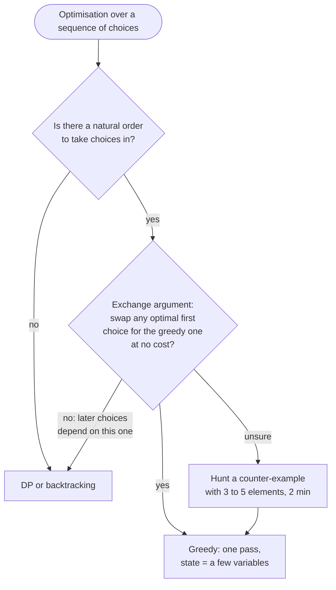

# Greedy

> [!abstract] In one sentence
> Make the choice that looks best right now, never undo it, and be able to say *why* no optimal solution is lost — the proof is the algorithm, the code is usually a single pass with two or three variables, and when the proof fails the honest fallback is [[Dynamic Programming]].

**Map:** [[Topics MOC]] → [[DSA Dashboard]]

> [!question] Predict before you read
> Coins `{1, 3, 4}`, amount 6. Greedy takes the largest coin that fits: 4, then 1, then 1 — three coins. What is the optimum, and what property of the coin system (which `{1, 5, 10, 25}` has and `{1, 3, 4}` lacks) decides whether greedy is safe?

## Why this exists

The problem class is optimisation over a sequence of decisions: minimum number of jumps, maximum subarray sum, can you complete the circuit, fewest partitions. [[Dynamic Programming]] answers these by trying every choice at every step and remembering the results; [[Backtracking]] tries every choice and remembers nothing. Greedy tries *one* choice per step. That is a huge saving — O(n) or O(n log n) instead of O(n · amount) or 2ⁿ — but it is only legal when the one choice is provably safe. The whole topic is therefore two skills: recognising the shape, and producing the two-sentence proof that lets you commit.

The signals in a statement: "minimum number of …", "maximum … you can get", "can you reach / complete", "partition into as many … as possible", and an input that has (or can be given) a natural order — by finish time, by size, by last occurrence, by position. Intervals ([[Intervals]]) are the purest case. If instead the choices interact across the whole input — the value of picking item 3 depends on whether you later pick item 7, as in 0/1 knapsack or coin change with arbitrary coins — greedy will be wrong on some input and you need DP.

## The idea from zero

Take the predict question. Amount 6 with coins `{1, 3, 4}`: greedy gives 4 + 1 + 1, the optimum is 3 + 3. The DP table below shows the true minimum for every amount next to what greedy produces; they agree everywhere except at 6, and one disagreement is all it takes.

> [!example] Coin change with {1, 3, 4}: optimal (DP) versus greedy, amounts 0 to 7
> ![[Greedy — Coin change with {1, 3, 4}- optimal (DP) versus greedy, amounts 0 to 7.excalidraw]]
> [[Greedy — Coin change with {1, 3, 4}- optimal (DP) versus greedy, amounts 0 to 7.excalidraw|Open in Excalidraw]] — greedy's first choice (the 4) is wrong at 6 because the two 3s cannot be rewritten to include a 4. US coins are canonical: every greedy choice can be exchanged into any optimal solution, so greedy is exact there. You cannot tell by looking; you need the argument

%% excalidraw-spec
{"kind": "grid", "title": "Coin change with {1, 3, 4}: optimal (DP) versus greedy, amounts 0 to 7", "col_labels": ["0", "1", "2", "3", "4", "5", "6", "7"], "row_labels": ["dp (optimal)", "greedy"], "rows": [ [0, 1, 2, 1, 1, 2, 2, 2], [0, 1, 2, 1, 1, 2, 3, 2] ], "highlight": [ [1, 6] ], "caption": "greedy's first choice (the 4) is wrong at 6 because the two 3s cannot be rewritten to include a 4. US coins are canonical: every greedy choice can be exchanged into any optimal solution, so greedy is exact there. You cannot tell by looking; you need the argument"}
%%

Why does greedy work for `{1, 5, 10, 25}` but not `{1, 3, 4}`? Because of the **exchange argument**. Suppose greedy picks choice `g` first and some optimal solution picks `o ≠ g` first. If you can always *swap* `o` for `g` in that optimal solution without making it worse, then there is an optimal solution that starts with `g`, and by induction greedy builds one. For US coins the swap always exists: an optimal solution never holds five 1s, two 5s, three 10s, or two 10s with a 5, because each of those bundles is replaceable by fewer coins; so whatever it holds below the largest coin sums to less than that coin, and it must use the largest coin that fits — greedy's choice. For `{1, 3, 4}` at 6 the swap does not exist: there is no way to turn `3 + 3` into something containing a 4 without adding a coin. That failure is the interviewer's favourite follow-up: "and if the coins were arbitrary?" — answer [[LC 322 Coin Change]], DP. The second proof shape is **greedy stays ahead**: after k steps greedy's partial solution is at least as good as *any* partial solution of k steps — after j jumps in [[LC 45 Jump Game II]] greedy has reached the farthest index anyone can reach in j jumps, so it needs no more jumps than anyone.

## The mechanism

A greedy solution is four decisions, and you should say them in this order in an interview: **the choice** (what is decided at each step — which index to extend to, whether to cut here, which card starts the next group); **the key** (the order in which choices are examined: sorted by end, smallest first, left to right — the wrong key is the most common greedy bug, see [[Intervals]]: sort by *end* to count removals, by *start* to merge); **the state** (the few variables that summarise everything committed: a frontier `far`, a running `tank`, an `end` of the current part, a `lo`/`hi` range); and **the proof** (exchange argument, greedy stays ahead, or a counter-example that sends you to DP).



> [!example]- Excalidraw version — the same diagram as an editable canvas
> ![[Greedy — The mechanism.excalidraw]]
> [[Greedy — The mechanism.excalidraw|Open in Excalidraw]] — needs the Excalidraw plugin (see [[Plugins to Install]]).

**Kadane ([[LC 53 Maximum Subarray]]) is greedy and DP at once.** `cur = max(nums[i], cur + nums[i])` is the DP transition "best subarray ending at i"; the greedy reading is "a negative running sum can never help whatever comes next, so drop it". Both views give the same line of code, and the interviewer accepts either name.

> [!example] Kadane on [-2, 1, -3, 4, -1, 2, 1, -5]
> ![[Greedy — Kadane on --2, 1, -3, 4, -1, 2, 1, -5-.excalidraw]]
> [[Greedy — Kadane on --2, 1, -3, 4, -1, 2, 1, -5-.excalidraw|Open in Excalidraw]] — cur restarts at 4 because 4 beats -2 + 4; best is the maximum cur ever seen, 6, for [4, -1, 2, 1]. Note cur and best start at nums[0], not 0 — the empty subarray is not allowed

%% excalidraw-spec
{"kind": "grid", "title": "Kadane on [-2, 1, -3, 4, -1, 2, 1, -5]", "col_labels": ["-2", "1", "-3", "4", "-1", "2", "1", "-5"], "row_labels": ["cur", "best"], "rows": [ [-2, 1, -2, 4, 3, 5, 6, 1], [-2, 1, 1, 4, 4, 5, 6, 6] ], "highlight": [ [0, 3], [1, 6] ], "caption": "cur restarts at 4 because 4 beats -2 + 4; best is the maximum cur ever seen, 6, for [4, -1, 2, 1]. Note cur and best start at nums[0], not 0 — the empty subarray is not allowed"}
%%

**The reachable frontier ([[LC 55 Jump Game]]) and BFS layers without a queue ([[LC 45 Jump Game II]]).** Walk left to right keeping `far`, the farthest index reachable so far; if `i > far` you are standing somewhere unreachable and the answer is false. Stays-ahead: `far` is exactly the maximum over all jump sequences, because every index up to `far` is reachable and each contributes `i + nums[i]`. For the *minimum* number of jumps treat indices as a graph where `i` has edges to `i+1 … i+nums[i]`; the answer is a BFS depth. Layer j is the index range `(end, far]`; while scanning the current layer you compute the next layer's `far`, and when `i` reaches `end` the layer is exhausted: `jumps++`, `end = far`.

> [!example] Jump Game II on [2, 3, 1, 1, 4]: BFS layers as index ranges
> ![[Greedy — Jump Game II on -2, 3, 1, 1, 4-- BFS layers as index ranges.excalidraw]]
> [[Greedy — Jump Game II on -2, 3, 1, 1, 4-- BFS layers as index ranges.excalidraw|Open in Excalidraw]] — layer 0 = {0}; from it the frontier is 2, so layer 1 = {1, 2}. Scanning layer 1, index 1 pushes far to 4, which covers the last index: two jumps. The loop stops at n - 2 so that the last index never starts a jump

%% excalidraw-spec
{"kind": "array", "title": "Jump Game II on [2, 3, 1, 1, 4]: BFS layers as index ranges", "values": [2, 3, 1, 1, 4], "pointers": {"i": 1, "end": 2, "far": 4}, "highlight": [1, 2], "labels": {"0": "layer 0", "3": "layer 2", "4": "layer 2"}, "caption": "layer 0 = {0}; from it the frontier is 2, so layer 1 = {1, 2}. Scanning layer 1, index 1 pushes far to 4, which covers the last index: two jumps. The loop stops at n - 2 so that the last index never starts a jump"}
%%

**Reset when the tank goes negative ([[LC 134 Gas Station]]).** Two facts. First, if total gas ≥ total cost a solution exists (LeetCode additionally promises it is unique — that is a property of their test data, not a theorem: `gas − cost = [1, 1]` has two valid starts). Second, if you start at `s` and the tank first goes negative after station `i`, then no station in `(s, i]` can be a valid start either — you arrived at each of them with a non-negative tank, so starting there with an empty tank only makes things worse. So set `start = i + 1`, reset the tank, and keep going: one pass, no second loop around the circle.

**Three one-sentence proofs.** *Smallest first* ([[LC 846 Hand of Straights]]): the smallest remaining card *must* start a group because nothing smaller is left to precede it, so take it from a `TreeMap` (`firstKey()` in O(log n)), demand the next `k − 1` consecutive values, and repeat — any valid grouping can be rearranged so that the smallest card begins a run. *Filtering* ([[LC 1899 Merge Triplets to Form Target Triplet]]): a merge takes coordinate-wise maxima, so any triplet that exceeds the target in *any* coordinate can never be used; throw those away, and among the survivors you only need one triplet matching the target in each coordinate, because the maxima of survivors cannot overshoot. *Last index* ([[LC 763 Partition Labels]]): a part containing character `c` must extend to the last occurrence of `c`; scan with `end = max(end, last[c])` and cut when `i == end`, because then nothing inside the part points beyond it, and cutting at the first legal place maximises the number of parts.

**Min and max open count ([[LC 678 Valid Parenthesis String]]).** Instead of branching on every `*` (2ⁿ), carry the *range* of possible open-bracket counts: `(` adds one to both bounds, `)` subtracts from both, `*` widens the range by one on each side. If `hi` drops below zero even the most generous reading fails; clamp `lo` at zero because a `*` cannot close what is not open; at the end the string is valid iff `lo == 0`.

## Java template

```java
import java.util.*;

class Solution {
    public int maxSubArray(int[] nums) {                       // LC 53, Kadane
        int cur = nums[0], best = nums[0];                     // start from the first element, not 0
        for (int i = 1; i < nums.length; i++) {
            cur = Math.max(nums[i], cur + nums[i]);            // a negative prefix never helps: drop it
            best = Math.max(best, cur);
        }
        return best;
    }
    public boolean canJump(int[] nums) {                       // LC 55, reachable frontier
        int far = 0;
        for (int i = 0; i < nums.length && i <= far; i++)      // i > far: the frontier never reached i
            far = Math.max(far, i + nums[i]);
        return far >= nums.length - 1;
    }
    public int jump(int[] nums) {                              // LC 45, BFS layers without a queue
        int jumps = 0, end = 0, far = 0;
        for (int i = 0; i < nums.length - 1; i++) {            // never jump from the last index
            far = Math.max(far, i + nums[i]);
            if (i == end) { jumps++; end = far; }              // the current layer is exhausted
        }
        return jumps;
    }
}
```

**Time** O(n) · **Space** O(1) for all three — one pass, two or three variables.

```java
import java.util.*;

class Solution {
    public int canCompleteCircuit(int[] gas, int[] cost) {     // LC 134, reset when negative
        int total = 0, tank = 0, start = 0;
        for (int i = 0; i < gas.length; i++) {
            total += gas[i] - cost[i];
            tank += gas[i] - cost[i];
            if (tank < 0) { start = i + 1; tank = 0; }         // every start in [start, i] fails: skip past i
        }
        return total >= 0 ? start : -1;                        // total decides existence, start decides where
    }
    public List<Integer> partitionLabels(String s) {           // LC 763, last index
        int[] last = new int[26];
        for (int i = 0; i < s.length(); i++) last[s.charAt(i) - 'a'] = i;
        List<Integer> sizes = new ArrayList<>();
        for (int i = 0, start = 0, end = 0; i < s.length(); i++) {
            end = Math.max(end, last[s.charAt(i) - 'a']);     // the part must stretch to the last copy
            if (i == end) { sizes.add(end - start + 1); start = i + 1; }   // nothing points beyond i
        }
        return sizes;
    }
    public boolean checkValidString(String s) {                // LC 678, min/max open count
        int lo = 0, hi = 0;
        for (char c : s.toCharArray()) {
            if (c == '(') { lo++; hi++; }
            else if (c == ')') { lo--; hi--; }
            else { lo--; hi++; }                               // '*' read as ')', as nothing, or as '('
            if (hi < 0) return false;                          // too many ')' even if every '*' is '('
            lo = Math.max(lo, 0);                              // a '*' cannot close more than is open
        }
        return lo == 0;
    }
}
```

**Time** O(n) · **Space** O(1) beyond the output — the `TreeMap` peel of [[LC 846 Hand of Straights]] and the filter of [[LC 1899 Merge Triplets to Form Target Triplet]] are in their problem notes; both are ten lines once the argument above is clear.

## Complexity

| Shape | Time | Space | Why |
|---|---|---|---|
| single pass with running state (Kadane, jump, gas, labels, `*` range) | O(n) | O(1) | each index is examined once; state is a constant number of ints |
| sort then sweep (intervals, scheduling, activity selection) | O(n log n) | O(1) or O(n) | the sort dominates; the sweep is linear |
| smallest-first with a `TreeMap` or heap (hand of straights, task scheduling) | O(n log n) | O(n) | each element enters and leaves the ordered structure once; the DP fallback (coin change) costs O(n · target) instead |

## The canonical shapes

| Shape | Recognition cue | One-line solution | Problem |
|---|---|---|---|
| Running sum restart | "maximum sum of a contiguous subarray" | `cur = max(x, cur + x)`, track best | [[LC 53 Maximum Subarray]] |
| Reachable frontier | "can you reach the last index" | `far = max(far, i + nums[i])`, fail if `i > far` | [[LC 55 Jump Game]] |
| BFS layers on an array | "minimum number of jumps" | `end`/`far` layers, count when `i == end` | [[LC 45 Jump Game II]] |
| Reset on negative | "circular route, start index, gas and cost" | total check + reset `start` when the tank dips below 0 | [[LC 134 Gas Station]] |
| Smallest first | "group into runs of k consecutive values" | `TreeMap` counts, peel from `firstKey()` | [[LC 846 Hand of Straights]] |
| Filter then match | "can the max of some subset equal the target" | discard anything that overshoots, then match each coordinate | [[LC 1899 Merge Triplets to Form Target Triplet]] |
| Last occurrence | "partition so each letter appears in one part" | `end = max(end, last[c])`, cut at `i == end` | [[LC 763 Partition Labels]] |
| Min/max range | "wildcard that can be `(`, `)` or empty" | carry `[lo, hi]` of open count, clamp `lo` at 0 | [[LC 678 Valid Parenthesis String]] |

## Worked example

[[LC 134 Gas Station]] with `gas = [1, 2, 3, 4, 5]` and `cost = [3, 4, 5, 1, 2]`, so `diff = [-2, -2, -2, 3, 3]`.

| i | diff | tank after | start | total | what happened |
|---|---|---|---|---|---|
| 0 | −2 | −2 → reset 0 | 1 | −2 | starting at 0 fails at 0 itself |
| 1 | −2 | −2 → reset 0 | 2 | −4 | starting at 1 fails too |
| 2 | −2 | −2 → reset 0 | 3 | −6 | and at 2 |
| 3 | +3 | 3 | 3 | −3 | from 3 the tank stays non-negative |
| 4 | +3 | 6 | 3 | 0 | end: total = 0 ≥ 0, answer 3 |

> [!example] gas - cost for the trace above, with the surviving start
> ![[Greedy — gas - cost for the trace above, with the surviving start.excalidraw]]
> [[Greedy — gas - cost for the trace above, with the surviving start.excalidraw|Open in Excalidraw]] — three resets move start to 3; the second pass around the circle is never simulated because total >= 0 already proves that the surplus from 3 and 4 (+6) covers the deficit of 0, 1, 2 (-6)

%% excalidraw-spec
{"kind": "array", "title": "gas - cost for the trace above, with the surviving start", "values": [-2, -2, -2, 3, 3], "pointers": {"start": 3}, "highlight": [3, 4], "caption": "three resets move start to 3; the second pass around the circle is never simulated because total >= 0 already proves that the surplus from 3 and 4 (+6) covers the deficit of 0, 1, 2 (-6)"}
%%

The two facts in action: the resets prove nothing in `[0, 2]` can be a start, the total proves *some* start exists, and the candidate left is 3 (a negative `total` returns −1 regardless of `start`). Why is the start after the *last* reset always valid when `total ≥ 0`? From it to the end of the array the tank never dips below zero (no further reset), and the surplus it holds at the end is at least the deficit of the prefix `[0, start)`, because the two add up to `total`.

## Pitfalls

> [!warning] The mistakes people make
> - **Greedy without the proof.** "Take the largest first" is a hypothesis, not an algorithm. Spend one minute looking for a 3-to-5-element counter-example before committing; coin change `{1, 3, 4}` at 6 is the one to remember.
> - **The wrong key.** Sorting by start when the proof needs end (fewest removals, activity selection), or by value when it needs last index. Say which key and why before sorting.
> - **Kadane initialised with 0.** `best = 0` returns 0 for `[-3, -1, -2]`; the empty subarray is not allowed. Initialise with `nums[0]`.
> - **Jump Game II counting a jump from the last index.** The loop must stop at `n − 2`; `[0]` and `[2, 3]` are the tests.
> - **Gas station without the total check** returns a `start` even when no circuit exists; with the check but without resets it is O(n²).
> - **Hand of straights with a `HashMap`.** You must take the *smallest* card first; hash order breaks the exchange argument. Use a `TreeMap` or sort. Likewise merge triplets *without filtering first* accepts triplets that overshoot another coordinate.
> - **Partition labels with first occurrence.** `last[c]` must be the final index, computed in a first pass; cut on `i == end`, not `i == last[c]`.
> - **Valid parenthesis string without the clamp.** `lo` going negative means you let a `*` close a bracket that was never opened; clamp after every character.

## Variations & follow-ups

"What if greedy is wrong here?" is the real follow-up: coin change becomes [[LC 322 Coin Change]], jumps with costs become a DP, and a knapsack with a weight limit is never greedy unless items are divisible (fractional knapsack). Kadane has three siblings: the circular subarray is `max(kadane, total − minKadane)`, the maximum *product* keeps both a running max and a running min because a negative flips them ([[LC 152 Maximum Product Subarray]]), and the 2-D version fixes a pair of rows and runs Kadane over column sums. Interval scheduling, meeting rooms and the minimum number of arrows are greedy by end time ([[LC 435 Non-overlapping Intervals]], [[Intervals]]). Scheduling with a cooldown ([[LC 621 Task Scheduler]]) is "most frequent first" with a heap, and Huffman coding is "two smallest first" with a heap — [[Heaps & Priority Queues]] is where most "smallest/largest first" greedies live. Gas station's follow-up is "return every valid start": the one-pass algorithm finds only the first start after the last reset, so for all of them you run the tank simulation once over a doubled array and report every index whose window of n stations never dips below zero.

## Interview script

Name the choice, the key and the invariant before any code: "At each index I keep `far`, the farthest reachable position; `far` is exactly the maximum over all jump sequences because each reachable index contributes `i + nums[i]`, so if I ever stand beyond it no sequence gets further — one pass, O(n)." For a sort-based greedy say the key and the exchange argument in one breath: "sorted by end; if an optimal solution keeps a different first interval I can swap in the earliest-ending one without creating an overlap, so greedy loses nothing."

What the interviewer is checking: that you *prove* rather than *assert*, that you can produce a counter-example on demand when greedy fails, that you know the DP fallback, and that the state you carry is minimal. Follow-ups they ask: "why is the start after the last reset guaranteed to work?", "what breaks if the coins are arbitrary?", "can you do Jump Game II without the BFS framing?", "what does `*` contribute to `lo` and `hi`, and why clamp?"

## Spot the bug

```java
// snippet
int cur = 0, best = 0;
for (int x : nums) { cur = Math.max(x, cur + x); best = Math.max(best, cur); }
return best;                                 // nums = [-3, -1, -2] ?
```

> [!example]- The fix
> With `best = 0` an all-negative array returns 0, the sum of the *empty* subarray, which the problem forbids; the correct answer for `[-3, -1, -2]` is −1. Start both `cur` and `best` at `nums[0]` and loop from index 1 (or start `best` at `Integer.MIN_VALUE`). The same bug appears in any "best so far" greedy whose neutral value is not a legal answer.

## Related

### Prerequisites
- [[Sorting]] — most greedies begin with "sort by the key"; [[Arrays & Hashing]] — the counting and last-index passes
- [[Heaps & Priority Queues]] — "smallest first" when the order changes as you go

### Builds on this
- [[Intervals]] (sort-and-sweep greedies), [[Dynamic Programming]] and [[DP Pattern Catalogue]] (the fallback when the exchange argument fails), [[Graphs]] and [[Advanced Graphs]] (Dijkstra, Prim and Kruskal are greedy with a proof)
- [[DSA Patterns in Java]], [[Java Collections Cheat Sheet]] (`TreeMap.firstKey`, `merge`), [[Java Pitfalls in Interviews]]

### Problems that use it
- [[LC 53 Maximum Subarray]], [[LC 55 Jump Game]], [[LC 45 Jump Game II]], [[LC 134 Gas Station]], [[LC 846 Hand of Straights]], [[LC 1899 Merge Triplets to Form Target Triplet]], [[LC 763 Partition Labels]], [[LC 678 Valid Parenthesis String]]; greedy in other categories: [[LC 435 Non-overlapping Intervals]], [[LC 621 Task Scheduler]], [[LC 1584 Min Cost to Connect All Points]]; the counter-example: [[LC 322 Coin Change]]

## Personal understanding

> [!question] Explain it without the note
> Write your own explanation here, from memory, then compare with the sections above and note what you missed.

### Mastery checklist
- [ ] I can state the idea in one sentence
- [ ] I can re-derive the mechanism on a whiteboard
- [ ] I can name when NOT to use it
- [ ] I have solved three problems with it without hints
- [ ] I can explain it to a colleague in two minutes

## Open questions
- [ ] Write the exchange argument for Hand of Straights in three sentences; then construct an input where two different starts complete the gas circuit and say what condition on `gas − cost` makes the start unique (LeetCode's promise).
