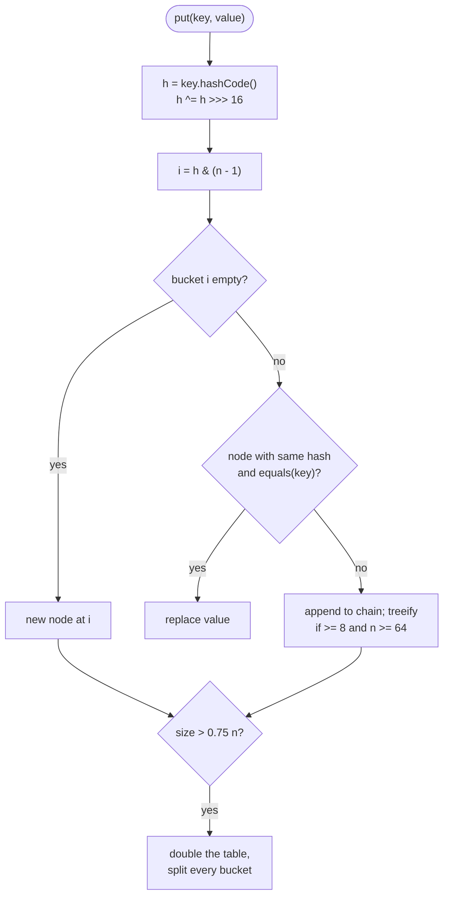

# Hashing

> [!abstract] In one sentence
> Hashing computes a bucket index from the key itself, so that storing and finding take constant expected time regardless of how many keys exist — provided the keys are immutable, `hashCode` and `equals` agree, and the hash spreads keys evenly, which is exactly what `HashMap` relies on and what an interviewer will ask you to explain.

**Map:** [[Topics MOC]] → [[DSA Dashboard]]

> [!question] Predict before you read
> Two distinct keys have the same `hashCode` but `equals` returns false. What does `HashMap.get` do to tell them apart? And if you `put` a key, then change one of its fields, why does `get` with the same object now return `null`?

## Why this exists

Every week-1 trick in [[Arrays & Hashing]] rests on one promise: "is this key present?" costs O(1). This note is what keeps the promise. It matters twice in an interview: once as the Java question that gets asked almost verbatim — "how does `HashMap` work internally?" — and once as the design skill of choosing a key (a sorted string, a count signature, a `record`, a packed `long`) so that two things you want to treat as equal actually land in the same bucket.

The signals that hashing is the trick: **have I seen this before**, **group by**, **count of each**, **pair that completes a sum**, **map old node to new node** (copying structures), **cache** (LRU is a hash map plus an order).

## The idea from zero

A key goes through a hash function to an integer, and the integer modulo the table size picks a bucket. Different keys can land in the same bucket — a collision — so each bucket holds a small chain, and a lookup hashes to the bucket and then compares with `equals` along the chain.

> [!example] Eight buckets after inserting cat, act, dog, god, pig
> ![[Hashing — Eight buckets after inserting cat, act, dog, god, pig.excalidraw]]
> [[Hashing — Eight buckets after inserting cat, act, dog, god, pig.excalidraw|Open in Excalidraw]] — cat and act collided in bucket 3; a lookup for act hashes to 3 and walks the chain comparing with equals

%% excalidraw-spec
{"kind": "grid", "title": "Eight buckets after inserting cat, act, dog, god, pig", "col_labels": ["bucket", "chain"], "row_labels": ["0", "1", "2", "3", "4", "5", "6", "7"], "rows": [ ["0", "-"], ["1", "dog"], ["2", "-"], ["3", "cat -> act"], ["4", "-"], ["5", "pig"], ["6", "god"], ["7", "-"] ], "highlight": [ [3, 1] ], "caption": "cat and act collided in bucket 3; a lookup for act hashes to 3 and walks the chain comparing with equals"}
%%

As long as chains stay short — n keys spread over about n buckets — the average lookup is a constant number of comparisons. Two things can break it: a hash function that sends many keys to one bucket, and a table that is too small for the number of keys. `HashMap` guards against the second by resizing and against the first by turning long chains into trees.

## The mechanism

**From key to index.** `HashMap` calls `key.hashCode()`, spreads it with `h ^ (h >>> 16)` so that high bits influence low bits, and takes `index = (n − 1) & h` where the table length `n` is always a power of two (default 16). The spread exists because the mask only looks at the low bits.

**Insert.** Walk the chain in that bucket; if a node has the same hash and `equals` the key, replace its value; otherwise append a new node. `HashSet` is a `HashMap` whose values are a shared dummy object.

**Resize.** After an insert, if `size > capacity × 0.75` (threshold 12 for 16), the table doubles and every node is rehashed — O(n) once, O(1) amortised ([[Complexity Analysis]]). Because the new mask exposes exactly one more bit, each old bucket splits into two: nodes stay at `i` or move to `i + oldCapacity`.

> [!example] Where a key lands as the table grows from 8 to 16
> ![[Hashing — Where a key lands as the table grows from 8 to 16.excalidraw]]
> [[Hashing — Where a key lands as the table grows from 8 to 16.excalidraw|Open in Excalidraw]] — index = hash & (n - 1); doubling n reads one more bit, so bucket 5 splits into 5 and 5 + 8 — half the chain moves, nothing is recomputed

%% excalidraw-spec
{"kind": "grid", "title": "Where a key lands as the table grows from 8 to 16", "col_labels": ["hash", "index at 8", "index at 16"], "row_labels": ["k1", "k2", "k3", "k4"], "rows": [ ["5", "5", "5"], ["13", "5", "13"], ["21", "5", "5"], ["29", "5", "13"] ], "highlight": [ [1, 2], [3, 2] ], "caption": "index = hash & (n - 1); doubling n reads one more bit, so bucket 5 splits into 5 and 5 + 8 — half the chain moves, nothing is recomputed"}
%%

**Treeify.** Java 8 onwards: when a chain reaches 8 nodes and the table has at least 64 buckets, that bin becomes a red-black tree, so a pathological bucket costs O(log n) instead of O(n); it turns back into a list when it shrinks to 6. Inside a tree bin keys are ordered by `compareTo` if they are `Comparable` (so `String` and `Integer` keys get the full log n guarantee), otherwise by class name and identity hash as a tie-break. Below 64 buckets a long chain triggers a resize instead.

**The contract.** `a.equals(b)` must imply `a.hashCode() == b.hashCode()`; the converse need not hold. Override both or neither — a class with `equals` but the default identity `hashCode` puts equal objects in different buckets and `get` misses. Keys must not change while in the map: the bucket was chosen from the old hash, and the object now hashes elsewhere. `record` generates both from all components, which is why it is the right key type for pairs. `String` caches its hash after the first call; `Integer.hashCode` is the value; `Arrays.hashCode(int[])` and `List.hashCode` compute the 31-based polynomial over elements — but `int[].hashCode()` itself is identity, so an array is never a usable key.



> [!example]- Excalidraw version — the same diagram as an editable canvas
> ![[Hashing — The mechanism.excalidraw]]
> [[Hashing — The mechanism.excalidraw|Open in Excalidraw]] — needs the Excalidraw plugin (see [[Plugins to Install]]).

**Designing keys.** Anagram groups: the sorted string (O(k log k)) or the 26-count signature joined with a separator (O(k)). Pairs of ints: a `record Point(int x, int y)` or a packed `long` (`(long) x << 32 | (y & 0xffffffffL)`); never `int[]`. Lists as keys: make an immutable copy (`List.copyOf`) because a later mutation breaks the map. Memo keys for `(i, j)` recursion: `i * (m + 1) + j` into an `int`, which also lets you use an array instead of a map.

## Java template

```java
import java.util.*;

class MiniHashMap<K, V> {
    private static class Node<K, V> {
        final K key; V value; Node<K, V> next;
        Node(K k, V v, Node<K, V> n) { key = k; value = v; next = n; }
    }
    private Node<K, V>[] table;
    private int size;

    MiniHashMap() { table = (Node<K, V>[]) new Node[16]; }

    private int index(Object key, int n) {
        int h = key.hashCode();
        return (h ^ (h >>> 16)) & (n - 1);                 // spread, then mask: n is a power of two
    }

    V get(K key) {
        for (Node<K, V> e = table[index(key, table.length)]; e != null; e = e.next)
            if (e.key.equals(key)) return e.value;         // same bucket is not enough: equals decides
        return null;
    }

    void put(K key, V value) {
        int i = index(key, table.length);
        for (Node<K, V> e = table[i]; e != null; e = e.next)
            if (e.key.equals(key)) { e.value = value; return; }
        table[i] = new Node<>(key, value, table[i]);       // prepend to the chain
        if (++size > table.length * 3 / 4) resize();        // load factor 0.75
    }

    private void resize() {
        Node<K, V>[] old = table;
        table = (Node<K, V>[]) new Node[old.length * 2];
        for (Node<K, V> e : old)
            for (; e != null; e = e.next) {                 // rehash every node into the bigger table
                int i = index(e.key, table.length);
                table[i] = new Node<>(e.key, e.value, table[i]);
            }
    }
}
```

**Time** O(1) average per `get`/`put`, O(n) for one resize · **Space** O(n)

```java
import java.util.*;

record Point(int x, int y) {}                              // equals and hashCode over both fields, immutable

class Solution {
    public List<List<String>> groupAnagrams(String[] strs) {
        Map<String, List<String>> groups = new HashMap<>();
        for (String s : strs) {
            int[] count = new int[26];
            for (char c : s.toCharArray()) count[c - 'a']++;
            String key = Arrays.toString(count);           // "[1, 0, 0, ...]": same letters, same key, O(k) to build
            groups.computeIfAbsent(key, k -> new ArrayList<>()).add(s);
        }
        return new ArrayList<>(groups.values());
    }

    int countPoints(int[][] pts) {
        Map<Point, Integer> seen = new HashMap<>();
        for (int[] p : pts) seen.merge(new Point(p[0], p[1]), 1, Integer::sum);
        return seen.getOrDefault(new Point(0, 0), 0);      // a fresh Point with equal fields finds the entry
    }
}
```

**Time** O(n · k) for grouping, O(n) for counting · **Space** O(n · k)

## Complexity

| Operation | Average | Worst | Why |
|---|---|---|---|
| `get`, `put`, `containsKey`, `remove` | O(1) | O(log n) in a tree bin with `Comparable` keys, O(n) otherwise | chain length is O(1) expected under a good hash |
| `put` that resizes | O(n) once | — | amortised O(1) over the sequence |
| hashing a `String` of length k | O(k) first time, O(1) after | — | the hash is cached in the object |
| hashing an `int[26]` signature, a `List` of size k | O(k) every time | — | not cached |
| `TreeMap` get, put, floorKey | O(log n) | O(log n) | the alternative when you need order |

## The canonical shapes

| Shape | Recognition cue | Key design | Problem |
|---|---|---|---|
| Complement lookup | "two numbers that sum to" | value → index, check `target − x` before inserting | [[LC 1 Two Sum]] |
| Canonical key | "group anagrams" | sorted string or count signature | [[LC 49 Group Anagrams]] |
| Seen set | "contains duplicate", "consecutive sequence" | the value itself | [[LC 217 Contains Duplicate]], [[LC 128 Longest Consecutive Sequence]] |
| Composite key | "valid sudoku" | `"r" + i + v`, or a `record` of the parts | [[LC 36 Valid Sudoku]] |
| Old → new mapping | "copy a structure with random pointers" | identity of the old node (default `hashCode` is fine here) | [[LC 138 Copy List with Random Pointer]] |
| Hash plus order | "LRU cache in O(1)" | key → node of a doubly linked list, or `LinkedHashMap` in access order | [[LC 146 LRU Cache]] |
| Point counting | "count squares / points" | `record Point` or packed `long` → count | [[LC 2013 Detect Squares]] |

## Worked example

[[LC 49 Group Anagrams]] on `["eat", "tea", "tan", "ate", "nat", "bat"]` with the count signature (shown here as the sorted string for brevity).

> [!example] groups after the six inserts
> ![[Hashing — groups after the six inserts.excalidraw]]
> [[Hashing — groups after the six inserts.excalidraw|Open in Excalidraw]] — three keys, three buckets: each string hashes its key in O(k) and joins its list in O(1)

%% excalidraw-spec
{"kind": "grid", "title": "groups after the six inserts", "col_labels": ["group"], "row_labels": ["key aet", "key ant", "key abt"], "rows": [ ["eat, tea, ate"], ["tan, nat"], ["bat"] ], "highlight": [ [0, 0] ], "caption": "three keys, three buckets: each string hashes its key in O(k) and joins its list in O(1)"}
%%

| Insert | Key | Action |
|---|---|---|
| eat | aet | new list `[eat]` |
| tea | aet | same hash, `equals` matches the existing key: append |
| tan, ate, nat, bat | ant, aet, ant, abt | new list, append, append, new list |

Total cost O(n · k): every string builds a key in O(k) and does one O(1) map operation. Sorting each string instead costs O(k log k) per key — also acceptable, and simpler to write under pressure; say which you chose and why.

## Pitfalls

> [!warning] The mistakes people make
> - **Mutable keys.** A `List` or your own class used as a key, then mutated: the entry is now in the wrong bucket, `get` returns `null`, `size()` still counts it. Copy or use a `record`.
> - **Arrays as keys.** `int[]` has identity `hashCode`/`equals`; `map.get(new int[]{1, 2})` never hits. Use `Arrays.toString`, a `record`, or a packed `long`.
> - **`equals` without `hashCode`.** Equal objects in different buckets. If you write one, write both — or use a `record`.
> - **Iteration-order assumptions, and modifying while iterating.** `HashMap` order depends on hashes and capacity and changes on resize (use `LinkedHashMap` or `TreeMap` when order matters); `map.remove(k)` inside a `for (var e : map.entrySet())` throws `ConcurrentModificationException` — use `entrySet().removeIf(...)` or collect the keys first.
> - **Boxing and nulls.** `Map<Character, Integer>` allocates on every `merge` where `int[26]` would do; `Objects.hash(a, b)` boxes through varargs; `int v = map.get(k)` on a missing key throws `NullPointerException`; `TreeMap` and `ConcurrentHashMap` reject `null` keys where `HashMap` accepts one.

## Variations & follow-ups

**LRU in ten lines**: `new LinkedHashMap<>(cap, 0.75f, true)` with `removeEldestEntry` overridden — then be ready to code the explicit doubly linked list, because that is what [[LC 146 LRU Cache]] is testing. **Need floor or ceiling?** `TreeMap` at O(log n), see [[Searching]]. **Multimap**: `computeIfAbsent(k, x -> new ArrayList<>())`. **Rolling hash** for substring matching lives in [[Strings]]. **Adversarial inputs**: an attacker who controls keys can force collisions; treeification caps the damage at O(log n), and `String.hashCode` is deterministic, which is why HTTP parameter maps once suffered hash-flooding attacks. **At work**: consistent hashing and bloom filters are the same idea at system scale — see the HLD vault, not this one. **Open addressing** (linear probing, used by Python's dict and Go's maps) is the alternative to chaining: better cache behaviour, deletion needs tombstones; know the name.

## Interview script

The sixty-second answer: "`HashMap` is an array of buckets whose length is a power of two. `put` hashes the key, spreads the high bits, masks to an index, and walks that bucket's chain comparing with `equals`; a chain past 8 nodes becomes a red-black tree. At load factor 0.75 the array doubles and each bucket splits in two by one more hash bit. Average O(1), worst O(log n) with a bad hash on comparable keys."

Then the contract: "keys must be immutable with `hashCode` consistent with `equals`, which is why I'm using a record here." What the interviewer is checking: that you know collisions are resolved by `equals`, not avoided; what the load factor does; why treeify exists; and whether you can pick a key that makes two things collide on purpose (the anagram signature). Follow-ups: "what if all keys hash to the same bucket?", "why a power of two?", "what breaks if `hashCode` is random per call?", "how would you make it thread-safe?" (`ConcurrentHashMap`, striped bins, no global lock).

## Spot the bug

```java
// snippet
Map<int[], Integer> firstIndex = new HashMap<>();
for (int i = 0; i < pts.length; i++) firstIndex.putIfAbsent(pts[i], i);
boolean seen = firstIndex.containsKey(new int[]{3, 4});   // always false
```

> [!example]- The fix
> Arrays do not override `hashCode` or `equals`, so every `int[]` is its own identity: two arrays with the same contents hash differently and never compare equal. Use a key with value semantics — `record Point(int x, int y)` is the cleanest; `Arrays.toString(p)` works; packing two ints into one `long` is fastest. The same bug hides in `Set<int[]>` and in `List<int[]>.contains`.

## Related

### Prerequisites
- [[Arrays & Hashing]] — the problems whose O(1) lookups this note explains
- [[Complexity Analysis]] — average versus worst, amortised resizing

### Builds on this
- [[Strings]] (rolling hash, string keys), [[Sorting]] (the sorted-string key versus the count signature), [[Searching]] (`TreeMap` when you need floor and ceiling instead of exact hits)
- [[Java Collections Cheat Sheet]] (`merge`, `computeIfAbsent`, `putIfAbsent`, `Map.Entry`), [[Java Pitfalls in Interviews]] (mutable keys, `Integer ==`), [[DSA Patterns in Java]]

### Problems that use it
- [[LC 1 Two Sum]], [[LC 49 Group Anagrams]], [[LC 217 Contains Duplicate]], [[LC 242 Valid Anagram]], [[LC 128 Longest Consecutive Sequence]], [[LC 36 Valid Sudoku]]
- [[LC 138 Copy List with Random Pointer]], [[LC 146 LRU Cache]], [[LC 2013 Detect Squares]], [[LC 3 Longest Substring Without Repeating Characters]]

## Personal understanding

> [!question] Explain it without the note
> Write your own explanation here, from memory, then compare with the sections above and note what you missed.

### Mastery checklist
- [ ] I can state the idea in one sentence
- [ ] I can re-derive the mechanism on a whiteboard
- [ ] I can name when NOT to use it
- [ ] I have solved three problems with it without hints
- [ ] I can explain it to a colleague in two minutes

## Open questions
- [ ] Build 10⁵ keys that all share the low 4 bits of their hash and time `get` with and without `Comparable` keys — how much does treeify actually recover? And where in my services is a `HashMap` keyed by a mutable DTO?
