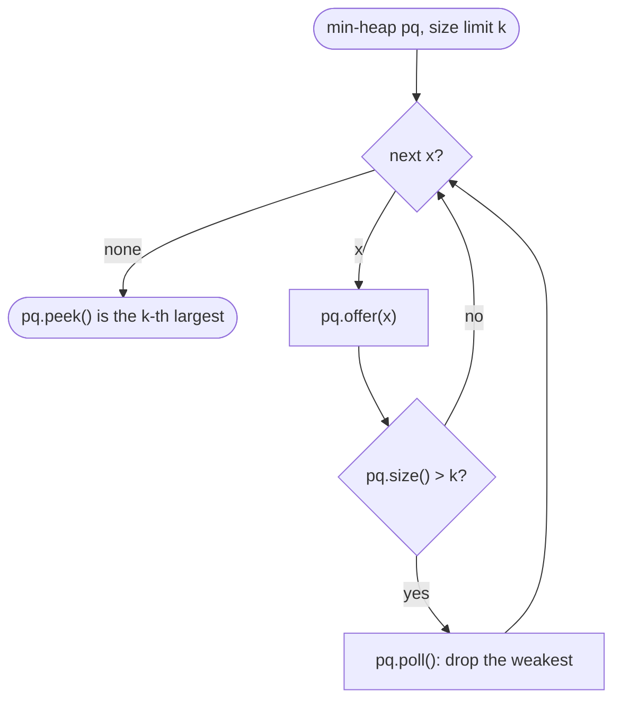

# Heaps & Priority Queues

> [!abstract] In one sentence
> A heap keeps only one promise — the root is the minimum (or maximum) and every subtree keeps the same promise — and because it is a complete tree it lives in an array with no pointers, so insertion is "append and bubble up" and removal is "replace the root with the last leaf and sink it", both O(log n), which is exactly the cost profile that makes top-k, two-heap medians, k-way merges and greedy schedulers fast.

**Map:** [[Topics MOC]] → [[DSA Dashboard]]

> [!question] Predict before you read
> You want the k *largest* elements of a stream of n numbers. Would you keep a max-heap or a min-heap, how big would it be, and why does the answer come out as O(n log k) rather than O(n log n)?

## Why this exists

A sorted array answers "what is the smallest?" in O(1) but costs O(n) per insertion; an unsorted array inserts in O(1) but finds the minimum in O(n). A heap sits in between: O(log n) for both, which is the right trade when elements keep arriving and you keep asking for the extreme one. The signals: **"k largest / smallest / closest / most frequent"**, **"median of a stream"**, **"merge k sorted"**, **"schedule / process in order of priority"**, **"next smallest end time"** (meeting rooms, [[Intervals]]), and the frontier of [[Advanced Graphs]] (Dijkstra, Prim).

## The idea from zero

Take `[1, 3, 2, 7, 4, 5, 9]` and read it as a tree level by level: index 0 is the root, the children of index `i` are `2i + 1` and `2i + 2`, the parent of `i` is `(i − 1) / 2`. Every parent is smaller than its children — that is the **min-heap property**, and it is all a heap guarantees. Nothing is said about siblings: 3 and 2 are in the "wrong" order for a sorted array and that is fine.

> [!example] The array [1,3,2,7,4,5,9] read as a complete binary tree
> ![[Heaps & Priority Queues — The array -1,3,2,7,4,5,9- read as a complete binary tree.excalidraw]]
> [[Heaps & Priority Queues — The array -1,3,2,7,4,5,9- read as a complete binary tree.excalidraw|Open in Excalidraw]] — min-heap: each parent <= its children; the root is the minimum; siblings are unordered

%% excalidraw-spec
{"kind": "tree", "title": "The array [1,3,2,7,4,5,9] read as a complete binary tree", "levels": [1, 3, 2, 7, 4, 5, 9], "highlight": [0], "caption": "min-heap: each parent <= its children; the root is the minimum; siblings are unordered"}
%%

> [!example] The same heap as it is actually stored
> ![[Heaps & Priority Queues — The same heap as it is actually stored.excalidraw]]
> [[Heaps & Priority Queues — The same heap as it is actually stored.excalidraw|Open in Excalidraw]] — children of i are 2i+1 and 2i+2, parent of i is (i-1)/2 with integer division; a complete tree has no gaps, so no pointers are needed

%% excalidraw-spec
{"kind": "array", "title": "The same heap as it is actually stored", "values": [1, 3, 2, 7, 4, 5, 9], "pointers": {"root": 0}, "labels": {"1": "children 3,4", "2": "children 5,6"}, "highlight": [1, 3, 4], "caption": "children of i are 2i+1 and 2i+2, parent of i is (i-1)/2 with integer division; a complete tree has no gaps, so no pointers are needed"}
%%

Insert 0: append it at index 7 (child of index 3, value 7), then **sift up** — swap with the parent while the parent is bigger: 7 → 3 → 1 → done, three swaps along one root-to-leaf path, so O(log n). Remove the minimum: take the root, move the *last* leaf into index 0 (the tree must stay complete), then **sift down** — swap with the smaller child while a child is smaller. Both operations touch only one path, which is the whole reason for the log.

## The mechanism

**Heapify in O(n).** Building a heap by n insertions costs O(n log n). Instead, call sift-down on every non-leaf from `n/2 − 1` down to 0: leaves are already heaps, and a node at height h sinks at most h levels. Summing h over the tree gives n/2 · 1 + n/4 · 2 + n/8 · 3 + … = O(n). Java does this when you call `new PriorityQueue<>(collection)`.

**Top-k with a size-k heap.** To keep the k largest, keep a *min*-heap of size k: the root is the weakest of your current best k, so a new element either beats it (push, then pop the root) or is discarded. The heap never grows past k, so each step is O(log k). The k-th largest is simply the root at the end. Mirror it for k smallest (max-heap of size k) and for k closest ([[LC 973 K Closest Points to Origin]]).

**Two heaps for the median.** Keep the lower half in a max-heap `low` and the upper half in a min-heap `high`, sizes differing by at most one. Push every new number through `low` and move its max to `high`, then rebalance so `low` has the extra element. The median is `low.peek()` or the mean of the two roots. Every element passes through at most two heaps: O(log n) per insertion, O(1) per query.



> [!example]- Excalidraw version — the same diagram as an editable canvas
> ![[Heaps & Priority Queues — The mechanism.excalidraw]]
> [[Heaps & Priority Queues — The mechanism.excalidraw|Open in Excalidraw]] — needs the Excalidraw plugin (see [[Plugins to Install]]).

**Greedy scheduling with a max-heap** ([[LC 621 Task Scheduler]]): keep the remaining counts in a max-heap, each tick run the most frequent *ready* task, park it in a FIFO `ArrayDeque<int[]>` of `{count, readyTime}` for n ticks, and idle when the heap is empty — running the most frequent task first is what leaves the fewest forced idles. The heap never holds more than 26 entries, so it is O(T).

**Java `PriorityQueue`.** It is a binary heap over an `Object[]`. Min-heap by default (natural order); `new PriorityQueue<>(Collections.reverseOrder())` for a max-heap; `new PriorityQueue<>((a, b) -> Integer.compare(b[1], a[1]))` or `Comparator.comparingInt(a -> a[1])` for records and `int[]` pairs; `new PriorityQueue<>(k, cmp)` to preset capacity. `offer`/`add` and `poll`/`remove()` are O(log n); `peek` O(1); `poll` returns null on an empty queue while `remove()` throws. Three traps: there is **no decrease-key**, so Dijkstra re-inserts and skips stale entries; **`remove(Object)` is O(n)** (a linear scan, then a sift); and **iteration, `toString` and `toArray` give array order, not sorted order** — the only sorted order is repeated `poll()`.

## Java template

```java
import java.util.*;

class MinHeap {                                             // know this cold; in interviews use PriorityQueue
    private int[] a; private int size;
    MinHeap(int[] values) {                                 // heapify: O(n), not O(n log n)
        a = values.clone(); size = a.length;
        for (int i = size / 2 - 1; i >= 0; i--) siftDown(i); // leaves are already heaps
    }
    int peek() { if (size == 0) throw new NoSuchElementException(); return a[0]; }
    void offer(int x) {
        if (size == a.length) a = Arrays.copyOf(a, size * 2);   // grow like ArrayList
        a[size] = x; siftUp(size++);
    }
    int poll() {
        int top = peek();
        a[0] = a[--size];                                   // the last leaf keeps the tree complete
        siftDown(0);
        return top;
    }
    private void siftUp(int i) {
        while (i > 0) {
            int p = (i - 1) / 2;
            if (a[p] <= a[i]) return;                       // parent already beats me
            swap(p, i); i = p;
        }
    }
    private void siftDown(int i) {
        while (true) {
            int l = 2 * i + 1, r = l + 1, m = i;
            if (l < size && a[l] < a[m]) m = l;
            if (r < size && a[r] < a[m]) m = r;             // pick the smaller child, then compare
            if (m == i) return;
            swap(m, i); i = m;
        }
    }
    private void swap(int i, int j) { int t = a[i]; a[i] = a[j]; a[j] = t; }
}
```

**Time** `offer`/`poll` O(log n), `peek` O(1), build O(n) · **Space** O(n)

```java
import java.util.*;

class Solution {
    public int findKthLargest(int[] nums, int k) {          // LC 215: min-heap of size k
        PriorityQueue<Integer> pq = new PriorityQueue<>();
        for (int x : nums) { pq.offer(x); if (pq.size() > k) pq.poll(); }  // evict the weakest
        return pq.peek();                                   // the k-th largest is the smallest kept
    }

    public int[][] kClosest(int[][] points, int k) {        // LC 973: max-heap by distance, size k
        PriorityQueue<int[]> pq = new PriorityQueue<>((p, q) ->
            Integer.compare(q[0] * q[0] + q[1] * q[1], p[0] * p[0] + p[1] * p[1]));   // reversed = max-heap
        for (int[] p : points) { pq.offer(p); if (pq.size() > k) pq.poll(); }
        return pq.toArray(new int[0][]);                    // any order is accepted; it is NOT sorted
    }
}

class MedianFinder {                                        // LC 295: two heaps
    private final PriorityQueue<Integer> low = new PriorityQueue<>(Collections.reverseOrder()); // max-heap, lower half
    private final PriorityQueue<Integer> high = new PriorityQueue<>();                          // min-heap, upper half

    public void addNum(int num) {
        low.offer(num);
        high.offer(low.poll());                             // push through low so every low <= every high
        if (high.size() > low.size()) low.offer(high.poll());   // low keeps the extra element
    }
    public double findMedian() {
        return low.size() > high.size() ? low.peek() : (low.peek() + high.peek()) / 2.0;
    }
}
```

**Time** O(n log k) for top-k, O(log n) per `addNum` · **Space** O(k) and O(n)

## Complexity

| Operation | Cost | Why |
|---|---|---|
| `peek` | O(1) | the root is the answer |
| `offer`, `poll` | O(log n) | one root-to-leaf path of height log n |
| build from n elements | O(n) with heapify, O(n log n) with n offers | lower nodes sink less far |
| `remove(Object)`, `contains` | O(n) | linear scan of the array |
| top-k over n elements | O(n log k) | the heap never exceeds k |

## The canonical shapes

| Shape | Recognition cue | One-line solution | Problem |
|---|---|---|---|
| k-th largest, streaming | "k-th largest after each add" | min-heap capped at k; answer is `peek()` | [[LC 703 Kth Largest Element in a Stream]] |
| Simulate "take the two biggest" | "smash the two heaviest stones" | max-heap, poll two, push the difference | [[LC 1046 Last Stone Weight]] |
| k closest / smallest | "k points closest to origin" | max-heap by distance capped at k | [[LC 973 K Closest Points to Origin]] |
| k-th largest, offline | "k-th largest element" | min-heap of size k, or quickselect O(n) average | [[LC 215 Kth Largest Element in an Array]] |
| k most frequent | "top k frequent" | count map, then min-heap of size k on counts (or bucket sort) | [[LC 347 Top K Frequent Elements]] |
| Priority scheduling with cooldown | "same task needs n idle slots between runs" | max-heap of counts + FIFO cooling queue | [[LC 621 Task Scheduler]] |
| Merge k sorted streams | "news feed from followed users", "k sorted lists" | heap holding one head per stream, keyed by time or value | [[LC 355 Design Twitter]], [[LC 23 Merge k Sorted Lists]] |
| Running median | "median after each insert" | two heaps, lower max-heap and upper min-heap | [[LC 295 Find Median from Data Stream]] |

## Worked example

[[LC 215 Kth Largest Element in an Array]] on `[3, 2, 1, 5, 6, 4]`, k = 2, with a min-heap capped at 2.

| x | after offer | size > 2? | after poll | root |
|---|---|---|---|---|
| 3 | {3} | no | — | 3 |
| 2 | {2, 3} | no | — | 2 |
| 1 | {1, 2, 3} | yes | {2, 3} | 2 |
| 5 | {2, 3, 5} | yes | {3, 5} | 3 |
| 6 | {3, 5, 6} | yes | {5, 6} | 5 |
| 4 | {4, 5, 6} | yes | {5, 6} | 5 |

> [!example] The two heaps of MedianFinder after inserting 5, 2, 8, 1, 9 — shown as the sorted halves they represent
> ![[Heaps & Priority Queues — The two heaps of MedianFinder after inserting 5, 2, 8, 1, 9 — shown as the sorted halves they .excalidraw]]
> [[Heaps & Priority Queues — The two heaps of MedianFinder after inserting 5, 2, 8, 1, 9 — shown as the sorted halves they .excalidraw|Open in Excalidraw]] — low = max-heap {5, 2, 1} (highlighted), high = min-heap {8, 9}; low has the extra element, so the median is low.peek() = 5. Only the two roots are ever compared

%% excalidraw-spec
{"kind": "array", "title": "The two heaps of MedianFinder after inserting 5, 2, 8, 1, 9 — shown as the sorted halves they represent", "values": [1, 2, 5, 8, 9], "pointers": {"low.peek": 2, "high.peek": 2}, "highlight": [0, 1, 2], "caption": "low = max-heap {5, 2, 1} (highlighted), high = min-heap {8, 9}; low has the extra element, so the median is low.peek() = 5. Only the two roots are ever compared"}
%%

## Pitfalls

> [!warning] The mistakes people make
> - **`(a, b) -> b - a` as a comparator.** Subtraction overflows for values near `Integer.MIN_VALUE`/`MAX_VALUE`; write `Integer.compare(b, a)` or `Collections.reverseOrder()`.
> - **Reading the heap as sorted.** `for (int x : pq)`, `pq.toString()` and `pq.toArray()` give the internal array order. Only repeated `poll()` is sorted — build the result by polling, and reverse if you need descending.
> - **Wrong heap direction for top-k.** For the k *largest* you keep a *min*-heap (evict the weakest). A max-heap of all n then k polls is O(n log n) and holds n elements.
> - **Expecting decrease-key.** `PriorityQueue` has none; push a fresh entry and skip stale ones when polled (`if (dist > best[u]) continue;`). `remove(Object)` is a linear scan.
> - **Mutating an element after it is in the heap.** The heap is not re-ordered; the invariant silently breaks. Poll, change, re-offer.
> - **Two heaps that drift.** Always insert through the same heap and rebalance; letting the sizes differ by two makes `findMedian` return the wrong root.

## Variations & follow-ups

**Quickselect** gives k-th largest in O(n) average and O(1) space — offer it as the follow-up to the heap answer. **Bucket sort** does top-k frequent in O(n) when counts are bounded by n. **Sliding-window median** needs removals: two heaps with lazy deletion (a map of pending removals), or a `TreeMap` multiset. **Dijkstra and Prim** are a heap of frontier edges keyed by distance or weight. **Meeting rooms II** is a min-heap of end times. **Design Twitter** is merge-k on followees' tweet lists, each newest-first, with a global timestamp as the key, pulling the ten newest. **Indexed heaps** (decrease-key in O(log n)) exist — name them, do not implement them in an interview.

## Interview script

Say the shape first: "I keep a min-heap of size k; the root is the weakest of the current best, so every element either replaces it or is discarded, and the heap never grows past k — O(n log k)." For the median: "lower half in a max-heap, upper half in a min-heap, sizes within one; the median is at the roots." Then name the library and its limits: "Java's `PriorityQueue` is a binary heap; min by default, comparator for anything else, no decrease-key, iteration is unordered."

What they are checking: that you choose the heap direction deliberately, that you state O(n log k) and not O(n log n), that you know heapify is O(n), and that you can code sift-up/sift-down if pushed. Follow-ups: "can you do it without a heap?" (quickselect, bucket sort), "what if elements can be removed?" (lazy deletion), "implement the heap yourself", "what if k is close to n?" (sort).

## Spot the bug

```java
// snippet
PriorityQueue<Integer> pq = new PriorityQueue<>((a, b) -> b - a);   // max-heap
for (int x : nums) pq.offer(x);
int[] top3 = new int[3];
int i = 0;
for (int x : pq) { if (i == 3) break; top3[i++] = x; }                 // "first three = largest three"
```

> [!example]- The fix
> Two bugs. Iteration walks the backing array level by level, so after the root the order is *not* descending — `top3[1]` can be any element of the second level. Poll instead: `for (int j = 0; j < 3; j++) top3[j] = pq.poll();`. And `b - a` overflows when `b` is large positive and `a` large negative; use `Integer.compare(b, a)` or `Collections.reverseOrder()`. A third improvement, not a bug: for the three largest you do not need all n in the heap — a min-heap capped at 3 is O(n log 3).

## Related

### Prerequisites
- [[Trees]] — a heap is a complete binary tree; the array layout is why it needs no `TreeNode`
- [[Sorting]] — heap sort, and when sorting beats a heap (k close to n)

### Builds on this
- [[Greedy]] (task scheduler, "always take the best available"), [[Intervals]] (meeting rooms II), [[Advanced Graphs]] (Dijkstra, Prim), [[Linked Lists]] (merge k lists)
- [[DSA Patterns in Java]], [[Java Collections Cheat Sheet]] (`PriorityQueue` forms, `Comparator`), [[Java Pitfalls in Interviews]]

### Problems that use it
- [[LC 703 Kth Largest Element in a Stream]], [[LC 1046 Last Stone Weight]], [[LC 973 K Closest Points to Origin]], [[LC 215 Kth Largest Element in an Array]]
- [[LC 621 Task Scheduler]], [[LC 355 Design Twitter]], [[LC 295 Find Median from Data Stream]], [[LC 347 Top K Frequent Elements]], [[LC 23 Merge k Sorted Lists]]

## Personal understanding

> [!question] Explain it without the note
> Write your own explanation here, from memory, then compare with the sections above and note what you missed.

### Mastery checklist
- [ ] I can state the idea in one sentence
- [ ] I can re-derive the mechanism on a whiteboard
- [ ] I can name when NOT to use it
- [ ] I have solved three problems with it without hints
- [ ] I can explain it to a colleague in two minutes

## Open questions
- [ ] Prove the O(n) heapify bound by writing out the sum of heights for a 15-node tree; then explain why the same argument does not make n insertions O(n).
