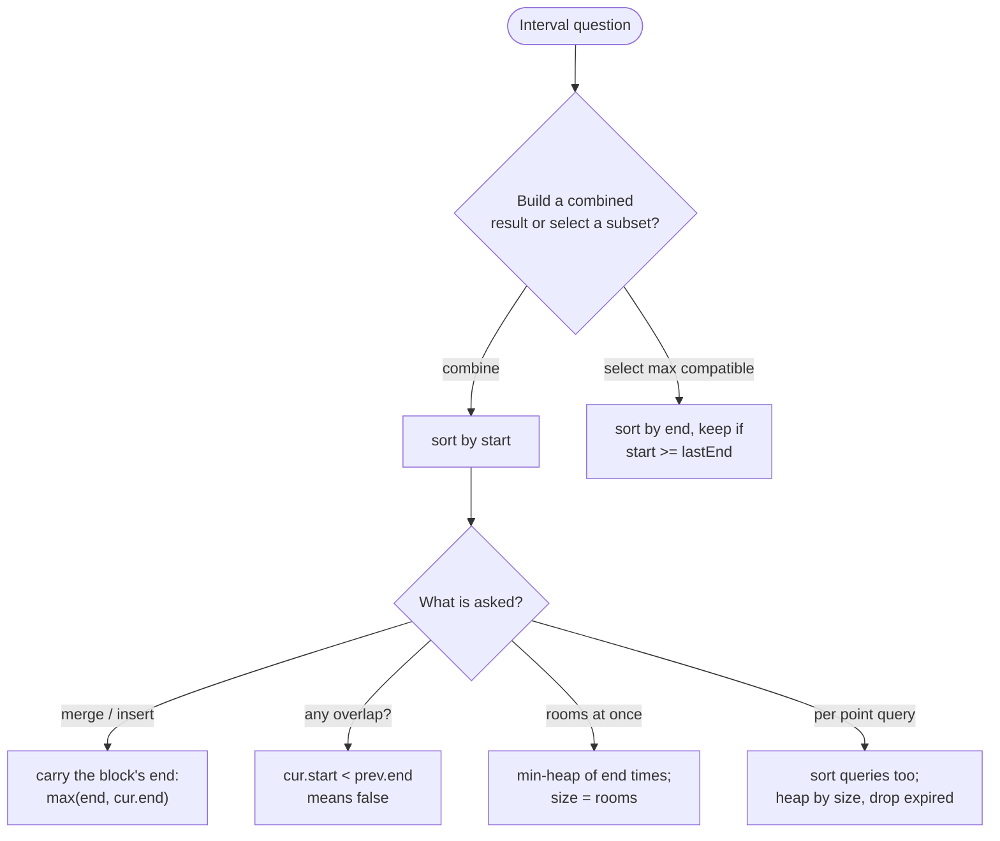

# Intervals

> [!abstract] In one sentence
> Sort the intervals by the endpoint the question cares about, sweep them once, and keep only what the next interval needs to compare against — the current merged end, the last kept end, or a heap of ends — so that n² pairwise overlap checks become one n log n sort plus a linear pass.

**Map:** [[Topics MOC]] → [[DSA Dashboard]]

> [!question] Predict before you read
> To remove the fewest intervals so that none overlap, you sort first. By start or by end? Try `[1,100], [2,3], [4,5]`: one order removes one interval, the other removes two. Which, and why?

## Why this exists

An interval is a pair `[start, end]`, and the questions are always about overlap: merge the overlapping ones, insert one, count how many must go, how many rooms are needed at once, which is the smallest interval covering a point. Checking every pair is O(n²). Sorting by one endpoint turns overlap into a *local* property — after sorting by start, interval `i` can only overlap the block that is currently being built, never something far back — so a single pass with O(1) or O(log n) state suffices. The signals: "intervals", "meetings", "`[start, end]` pairs", "merge", "overlap", "rooms", "schedule", "cover", "insert".

## The idea from zero

Two closed intervals `a` and `b` overlap iff `a.start <= b.end && b.start <= a.end`. After sorting by start that simplifies: `cur` overlaps the block being built iff `cur.start <= blockEnd`. Merging is then a single pass: extend the block's end with `max(blockEnd, cur.end)` or, if there is a gap, close the block and start a new one.

> [!example] Merging [1,3], [2,5], [6,7] on a time axis
> ![[Intervals — Merging -1,3-, -2,5-, -6,7- on a time axis.excalidraw]]
> [[Intervals — Merging -1,3-, -2,5-, -6,7- on a time axis.excalidraw|Open in Excalidraw]] — [2,5] starts at 2 <= 3, the block's end, so the block grows to 5; [6,7] starts at 6 > 5, a gap, so a new block begins. The merged row is [1,5], [6,7]

%% excalidraw-spec
{"kind": "grid", "title": "Merging [1,3], [2,5], [6,7] on a time axis", "col_labels": ["1", "2", "3", "4", "5", "6", "7", "8"], "row_labels": ["[1,3]", "[2,5]", "[6,7]", "merged"], "rows": [ ["x", "x", "x", "", "", "", "", ""], ["", "x", "x", "x", "x", "", "", ""], ["", "", "", "", "", "x", "x", ""], ["x", "x", "x", "x", "x", "x", "x", ""] ], "highlight": [ [3, 0], [3, 1], [3, 2], [3, 3], [3, 4] ], "caption": "[2,5] starts at 2 <= 3, the block's end, so the block grows to 5; [6,7] starts at 6 > 5, a gap, so a new block begins. The merged row is [1,5], [6,7]"}
%%

The predict question is the other half of the topic. Sorting by *start* and keeping `[1,100]` forces you to drop `[2,3]` and `[4,5]`; sorting by *end* keeps `[2,3]`, then `[4,5]`, and drops only `[1,100]`. The earliest-ending interval leaves the most room for everything after it — that is the exchange argument from [[Greedy]]: any optimal set can swap its first interval for the earliest-ending one without creating an overlap.

## The mechanism

**Which endpoint.** Sort by **start** when you are building something left to right (merge, insert, "can I attend all", count rooms). Sort by **end** when you are *selecting* a maximum set of compatible intervals (fewest removals, most non-overlapping meetings, fewest arrows). The decision tree:



> [!example]- Excalidraw version — the same diagram as an editable canvas
> ![[Intervals — The mechanism.excalidraw]]
> [[Intervals — The mechanism.excalidraw|Open in Excalidraw]] — needs the Excalidraw plugin (see [[Plugins to Install]]).

**Merge ([[LC 56 Merge Intervals]]).** Sort by start; for each interval, if it starts after the current block's end, push a new block; otherwise extend the block's end with `max`. The `max` matters: `[1,5], [2,3]` must stay `[1,5]`.

**Insert ([[LC 57 Insert Interval]]).** The input is already sorted and disjoint, so no sort: copy everything that ends before the new interval starts, absorb everything that starts before the new interval ends (widening the new interval with `min`/`max`), append the new interval, copy the rest. Three `while` loops over one index.

**Fewest removals ([[LC 435 Non-overlapping Intervals]]).** Sort by end, keep `lastEnd`; an interval is kept when `start >= lastEnd`, otherwise it is removed (it overlaps the kept one and ends no earlier). Touching intervals `[1,2], [2,3]` do not overlap here.

> [!example] Non-overlapping: [1,2], [2,3], [3,4], [1,3] sorted by end
> ![[Intervals — Non-overlapping- -1,2-, -2,3-, -3,4-, -1,3- sorted by end.excalidraw]]
> [[Intervals — Non-overlapping- -1,2-, -2,3-, -3,4-, -1,3- sorted by end.excalidraw|Open in Excalidraw]] — the cells hold the end times. Keep [1,2] (lastEnd 2), keep [2,3] (2 >= 2, lastEnd 3), [1,3] starts at 1 < 3 so it goes, keep [3,4]. One removal; sorting by start would have kept [1,3] and removed two

%% excalidraw-spec
{"kind": "array", "title": "Non-overlapping: [1,2], [2,3], [3,4], [1,3] sorted by end", "values": [2, 3, 3, 4], "labels": {"0": "[1,2]", "1": "[2,3]", "2": "[1,3]", "3": "[3,4]"}, "pointers": {"removed": 2}, "highlight": [2], "caption": "the cells hold the end times. Keep [1,2] (lastEnd 2), keep [2,3] (2 >= 2, lastEnd 3), [1,3] starts at 1 < 3 so it goes, keep [3,4]. One removal; sorting by start would have kept [1,3] and removed two"}
%%

**Any overlap ([[LC 252 Meeting Rooms]]).** Sort by start; if any meeting starts before the previous one ends, return false. One comparison per neighbour pair is enough because after sorting, the only interval that can overlap `i` without overlapping `i − 1` first is `i − 1` itself.

**Rooms needed ([[LC 253 Meeting Rooms II]]).** Sort by start and keep a min-heap of end times, one per occupied room. For each meeting, if the earliest-ending room is free (`peek() <= start`) pop it and reuse it; either way push this meeting's end. The heap never shrinks, so its final size is the peak occupancy. The sweep-line alternative sorts starts and ends into two arrays and walks them with two pointers: a start before the next end opens a room, otherwise a room closes.

> [!example] Sweep line for [0,30], [5,10], [15,20]: events in time order
> ![[Intervals — Sweep line for -0,30-, -5,10-, -15,20-- events in time order.excalidraw]]
> [[Intervals — Sweep line for -0,30-, -5,10-, -15,20-- events in time order.excalidraw|Open in Excalidraw]] — sorted starts [0, 5, 15], sorted ends [10, 20, 30]; a start before the next end opens a room, otherwise the earliest-ending meeting closes one. The peak, 2, is the answer. Ties: an end at time t frees its room before a start at t

%% excalidraw-spec
{"kind": "grid", "title": "Sweep line for [0,30], [5,10], [15,20]: events in time order", "col_labels": ["0", "5", "10", "15", "20", "30"], "row_labels": ["event", "rooms in use"], "rows": [ ["start", "start", "end", "start", "end", "end"], [1, 2, 1, 2, 1, 0] ], "highlight": [ [1, 1], [1, 3] ], "caption": "sorted starts [0, 5, 15], sorted ends [10, 20, 30]; a start before the next end opens a room, otherwise the earliest-ending meeting closes one. The peak, 2, is the answer. Ties: an end at time t frees its room before a start at t"}
%%

**Smallest interval per query ([[LC 1851 Minimum Interval to Include Each Query]]).** Sort intervals by start and queries ascending (remembering each query's original index). Walk the queries: push every interval whose start ≤ q into a min-heap keyed by *size*; pop while the top's end < q (it can never serve a later, larger query either); the top is the answer, or −1 if the heap is empty. Each interval is pushed and popped at most once.

**Representing intervals in Java.** `int[][]` with `Arrays.sort(intervals, (a, b) -> Integer.compare(a[0], b[0]))` — write `Integer.compare`, never `a[0] - b[0]`, which overflows near ±2·10⁹. Collect results in a `List<int[]>` and finish with `toArray(new int[0][])`. A `record Interval(int start, int end)` reads better in a design question but LeetCode hands you arrays, so practise with arrays. `PriorityQueue<Integer>` for ends; `PriorityQueue<int[]>` with a comparator on `a[0]` when you need `{size, end}` pairs.

## Java template

```java
import java.util.*;

class Solution {
    public int[][] merge(int[][] intervals) {                               // LC 56
        Arrays.sort(intervals, (a, b) -> Integer.compare(a[0], b[0]));     // by start; never a[0] - b[0]
        List<int[]> out = new ArrayList<>();
        for (int[] cur : intervals) {
            if (out.isEmpty() || cur[0] > out.get(out.size() - 1)[1])
                out.add(new int[]{cur[0], cur[1]});                         // gap: start a new block (a copy)
            else out.get(out.size() - 1)[1] = Math.max(out.get(out.size() - 1)[1], cur[1]);   // extend
        }
        return out.toArray(new int[0][]);
    }
    public int[][] insert(int[][] intervals, int[] add) {                  // LC 57: input sorted, disjoint
        List<int[]> out = new ArrayList<>();
        int i = 0, n = intervals.length;
        while (i < n && intervals[i][1] < add[0]) out.add(intervals[i++]);  // entirely to the left
        while (i < n && intervals[i][0] <= add[1]) {                        // overlapping: absorb into add
            add = new int[]{Math.min(add[0], intervals[i][0]), Math.max(add[1], intervals[i][1])};
            i++;
        }
        out.add(add);
        while (i < n) out.add(intervals[i++]);                              // entirely to the right
        return out.toArray(new int[0][]);
    }
}
```

**Time** O(n log n) for merge (the sort), O(n) for insert · **Space** O(n) for the output

```java
import java.util.*;

class Solution {
    public int eraseOverlapIntervals(int[][] intervals) {                  // LC 435: sort by END
        Arrays.sort(intervals, (a, b) -> Integer.compare(a[1], b[1]));
        int removed = 0, lastEnd = Integer.MIN_VALUE;
        for (int[] cur : intervals) {
            if (cur[0] >= lastEnd) lastEnd = cur[1];                        // compatible: keep, it ends earliest
            else removed++;                                                 // overlaps the kept one: drop cur
        }
        return removed;
    }
    public int minMeetingRooms(int[][] intervals) {                        // LC 253: min-heap of end times
        Arrays.sort(intervals, (a, b) -> Integer.compare(a[0], b[0]));
        PriorityQueue<Integer> ends = new PriorityQueue<>();               // one entry per occupied room
        for (int[] m : intervals) {
            if (!ends.isEmpty() && ends.peek() <= m[0]) ends.poll();        // earliest room is free: reuse it
            ends.offer(m[1]);
        }
        return ends.size();                                                 // the heap only ever grows
    }
    public int[] minInterval(int[][] intervals, int[] queries) {           // LC 1851
        Arrays.sort(intervals, (a, b) -> Integer.compare(a[0], b[0]));
        Integer[] order = new Integer[queries.length];                      // query indices, sorted by value
        for (int i = 0; i < order.length; i++) order[i] = i;
        Arrays.sort(order, (a, b) -> Integer.compare(queries[a], queries[b]));
        PriorityQueue<int[]> bySize = new PriorityQueue<>((a, b) -> Integer.compare(a[0], b[0]));  // {size, end}
        int[] ans = new int[queries.length];
        int i = 0;
        for (int qi : order) {
            int q = queries[qi];
            while (i < intervals.length && intervals[i][0] <= q) {         // every interval that has started by q
                bySize.offer(new int[]{intervals[i][1] - intervals[i][0] + 1, intervals[i][1]});
                i++;
            }
            while (!bySize.isEmpty() && bySize.peek()[1] < q) bySize.poll(); // ended before q: useless from now on
            ans[qi] = bySize.isEmpty() ? -1 : bySize.peek()[0];
        }
        return ans;
    }
}
```

**Time** O(n log n) each; for the queries O((n + q) log (n + q)) · **Space** O(n) for the heap. The sweep-line form of rooms is the fragment below: `starts` and `ends` sorted separately, two indices.

```java
// snippet
int inUse = 0, best = 0, s = 0, e = 0;
while (s < n) {
    if (starts[s] < ends[e]) { inUse++; s++; }      // a meeting starts before the earliest one ends
    else { inUse--; e++; }                          // the earliest-ending meeting frees its room
    best = Math.max(best, inUse);
}
```

## Complexity

| Shape | Time | Space | Why |
|---|---|---|---|
| merge, overlap check, fewest removals | O(n log n) | O(1) extra (output aside) | the sort; the sweep is one pass with one variable |
| insert into a sorted list | O(n) | O(n) output | three linear scans, no sort |
| rooms with a heap | O(n log n) | O(n) | each end is pushed and popped once |
| rooms with two sorted arrays | O(n log n) | O(n) | two sorts, one linear walk |
| per-query smallest interval | O((n + q) log (n + q)) | O(n + q) | sort both, each interval enters and leaves the heap once |

## The canonical shapes

| Shape | Recognition cue | One-line solution | Problem |
|---|---|---|---|
| Insert and merge | "sorted, non-overlapping, add one" | copy left, absorb overlaps with min/max, copy right | [[LC 57 Insert Interval]] |
| Merge | "merge all overlapping" | sort by start, extend `end` with max or push | [[LC 56 Merge Intervals]] |
| Fewest removals | "remove the minimum so none overlap" | sort by end, keep when `start >= lastEnd` | [[LC 435 Non-overlapping Intervals]] |
| Any conflict | "can one person attend all" | sort by start, compare neighbours | [[LC 252 Meeting Rooms]] |
| Peak concurrency | "minimum number of rooms" | heap of ends, or sweep two sorted arrays | [[LC 253 Meeting Rooms II]] |
| Smallest cover per point | "for each query, the smallest interval containing it" | sort both, heap by size, discard expired | [[LC 1851 Minimum Interval to Include Each Query]] |

## Worked example

[[LC 253 Meeting Rooms II]] on `[[0,30], [5,10], [15,20]]` with the heap.

| meeting | heap before | `peek() <= start`? | action | heap after |
|---|---|---|---|---|
| [0,30] | `[]` | empty | push 30 | `[30]` |
| [5,10] | `[30]` | 30 ≤ 5? no | push 10 | `[10, 30]` |
| [15,20] | `[10, 30]` | 10 ≤ 15? yes | pop 10, push 20 | `[20, 30]` |

The heap holds two ends at the end, so two rooms. The pop-then-push step is the reuse: the room whose meeting ended at 10 takes the meeting starting at 15, and the heap size records the peak rather than the current occupancy. Compare with the sweep grid above, where the same answer appears as the maximum of the "rooms in use" row.

For [[LC 1851 Minimum Interval to Include Each Query]] on intervals `[1,4], [2,4], [3,6], [4,4]` and queries `[2, 3, 4, 5]`: at q = 2 the heap holds sizes {4 for [1,4], 3 for [2,4]} → 3; at q = 3 add [3,6] (size 4) → 3; at q = 4 add [4,4] (size 1) → 1; at q = 5 pop everything ending before 5 (`[1,4]`, `[2,4]`, `[4,4]`) → [3,6] remains → 4. Answer `[3, 3, 1, 4]`.

## Pitfalls

> [!warning] The mistakes people make
> - **Sorting by start to count removals.** The exchange argument needs the earliest *end*. By start, `[1,100]` is kept and everything inside it is thrown away.
> - **`<` versus `<=` on touching intervals.** LC 56 merges `[1,4], [4,5]` (touching counts as overlap: use `cur[0] <= end`); LC 435 and meeting rooms treat `[1,2], [2,3]` as compatible (`start >= lastEnd`, `peek() <= start`). Decide per problem and say it.
> - **Extending with `cur[1]` instead of `max(end, cur[1])`.** `[1,5], [2,3]` becomes `[1,3]`.
> - **Forgetting the last block.** Any merge that pushes "when a gap appears" must push the final block after the loop — or, as above, keep the block *inside* the list and mutate its end.
> - **`a[0] - b[0]` comparators** overflow for values near `Integer.MAX_VALUE`; `Integer.compare`.
> - **Mutating the input.** Sorting `intervals` in place is fine on LeetCode; adding the input's own arrays to the output and then mutating them is not — copy when you extend.
> - **Queries without their original index.** Sorting `queries` loses the output order; sort an index array (or pairs) instead.
> - **Popping the wrong heap.** For the per-query problem the heap is keyed by *size*, and expired intervals are removed lazily from the top; they may stay buried deeper, which is fine because they can never become the top while a smaller valid interval exists.

## Variations & follow-ups

"How many intervals cover point t?" and "what is the maximum overlap anywhere?" are the sweep line with +1/−1 events sorted by time, ends before starts on ties ([[Arrays & Hashing]] prefix sums do it when coordinates are small). Interval list intersections walk two sorted lists with two pointers ([[Two Pointers]]): the intersection is `[max(starts), min(ends)]` when non-empty, and you advance the one that ends first. Employee free time is merge followed by reading the gaps. Minimum arrows to burst balloons is [[LC 435 Non-overlapping Intervals]] in disguise (count the kept ones). A calendar that must reject conflicting bookings online is a `TreeMap` keyed by start with `floorEntry`/`ceilingEntry` checks ([[Java Collections Cheat Sheet]]). With capacities (car pooling, rooms with sizes) the sweep carries a running sum instead of a count.

## Interview script

Say the key and the state before coding: "I sort by start so that each interval can only overlap the block I am currently building; I carry that block's end and extend it with max, or close it on a gap — n log n for the sort, then one pass." For rooms: "a min-heap of end times is the set of occupied rooms; when the earliest-ending room is free before this meeting starts I reuse it, so the heap size is the peak occupancy." For removals say the exchange argument in one sentence: "sorting by end and keeping the earliest-ending compatible interval never loses an optimal answer, because any optimal set can swap its first interval for that one."

What the interviewer is checking: the choice of endpoint and whether you can justify it, the `<` versus `<=` decision stated explicitly, the comparator written safely, and that you handle the empty input and the single interval. Follow-ups: "what if the intervals arrive as a stream?", "return the rooms assignment, not just the count", "what if ends are exclusive?", "do it without the heap" (the two-array sweep).

## Spot the bug

```java
// snippet
Arrays.sort(intervals, (a, b) -> a[0] - b[0]);
List<int[]> out = new ArrayList<>();
for (int[] cur : intervals) {
    if (out.isEmpty() || cur[0] > out.get(out.size() - 1)[1]) out.add(cur);
    else out.get(out.size() - 1)[1] = cur[1];                 // extend the block
}
```

> [!example]- The fix
> Two bugs. The comparator `a[0] - b[0]` overflows when starts straddle ±2³¹ (write `Integer.compare(a[0], b[0])`). The extension must be `Math.max(out.get(out.size() - 1)[1], cur[1])`: on `[1,5], [2,3]` the block's end would shrink from 5 to 3 and `[4,6]`, which should merge, would then be emitted separately.

## Related

### Prerequisites
- [[Sorting]] — the comparator forms for `int[][]`; [[Greedy]] — the exchange argument that picks the endpoint
- [[Heaps & Priority Queues]] — the heap of end times and the heap of sizes

### Builds on this
- [[Binary Search]] (floor/ceiling queries on sorted intervals), [[Arrays & Hashing]] (difference arrays for coverage counts), [[Two Pointers]] (intersecting two sorted interval lists)
- [[DSA Patterns in Java]], [[Java Collections Cheat Sheet]] (`Arrays.sort` with comparators, `toArray(new int[0][])`, `TreeMap.floorEntry`), [[Java Pitfalls in Interviews]]

### Problems that use it
- [[LC 57 Insert Interval]], [[LC 56 Merge Intervals]], [[LC 435 Non-overlapping Intervals]], [[LC 252 Meeting Rooms]], [[LC 253 Meeting Rooms II]], [[LC 1851 Minimum Interval to Include Each Query]]
- Same machinery elsewhere: [[LC 621 Task Scheduler]], [[LC 853 Car Fleet]], [[LC 1584 Min Cost to Connect All Points]]

## Personal understanding

> [!question] Explain it without the note
> Write your own explanation here, from memory, then compare with the sections above and note what you missed.

### Mastery checklist
- [ ] I can state the idea in one sentence
- [ ] I can re-derive the mechanism on a whiteboard
- [ ] I can name when NOT to use it
- [ ] I have solved three problems with it without hints
- [ ] I can explain it to a colleague in two minutes

## Open questions
- [ ] In the two-array sweep, why can the `ends` index never run past the `starts` index (so `ends[e]` is always valid), and what does that say about the sign of `inUse`?
