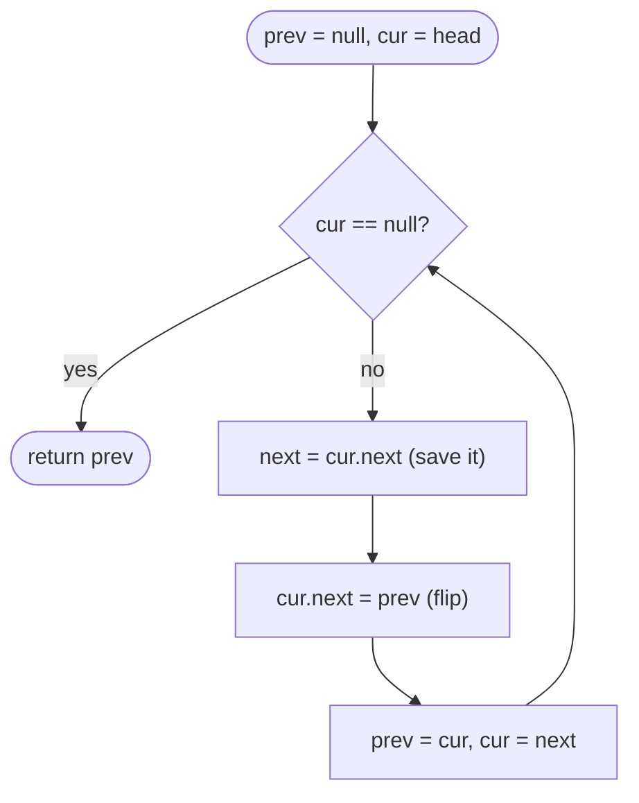

# Linked Lists

> [!abstract] In one sentence
> A linked list is a chain of nodes you can only walk forward and only change by rewriting `next` fields, so every problem reduces to a handful of rehearsed moves — a dummy head to make the first node ordinary, three-pointer reversal, two pointers with a fixed gap or a 2:1 speed ratio, and merge — plus the one rule that prevents every bug: save `next` before you overwrite it.

**Map:** [[Topics MOC]] → [[DSA Dashboard]]

> [!question] Predict before you read
> `slow` moves one node per step and `fast` two. If the list has a cycle, why must they meet exactly — not just "probably" — and once they meet, why does walking one pointer from the head and the other from the meeting point, one step at a time, land on the node where the cycle begins?

## Why this exists

Arrays give O(1) random access but O(n) insertion in the middle; a linked list is the opposite. Interviewers keep asking about them not because you will build one at Niyo, but because pointer manipulation exposes whether you can hold an invariant in your head while mutating state — the same skill as a safe migration or a lock-free queue. The signals: **`ListNode`** in the signature, **"in place" / "O(1) extra space"**, **"reverse"**, **"k-th from the end"**, **"cycle"**, **"merge sorted"**, **"reorder"**, and design problems that need **O(1) remove from the middle** ([[LC 146 LRU Cache]]).

## The idea from zero

A node is a value and a reference to the next node; the list is just the reference to the first node. `1 → 2 → 3 → null`: to delete 2 you set `1.next = 3`; to insert 9 after 1 you set `9.next = 1.next` and *then* `1.next = 9` — in that order, because the moment you overwrite `1.next` the rest of the list is reachable only through the pointer you saved. That ordering rule is the whole of linked-list correctness.

> [!example] Iterative reversal, mid-way: prev | cur | the untouched tail
> ![[Linked Lists — Iterative reversal, mid-way- prev - cur - the untouched tail.excalidraw]]
> [[Linked Lists — Iterative reversal, mid-way- prev - cur - the untouched tail.excalidraw|Open in Excalidraw]] — nodes 1 and 2 already point backwards (2 -> 1 -> null); cur = 3 is about to be flipped; next = 4 is saved so the tail is not lost

%% excalidraw-spec
{"kind": "list", "title": "Iterative reversal, mid-way: prev | cur | the untouched tail", "nodes": ["1", "2", "3", "4", "5"], "pointers": {"prev": 1, "cur": 2, "next": 3}, "caption": "nodes 1 and 2 already point backwards (2 -> 1 -> null); cur = 3 is about to be flipped; next = 4 is saved so the tail is not lost"}
%%

The first node is special in naive code (it has no predecessor), so you add a **dummy head** whose `next` is the real head. Now "remove the first node" and "remove the third node" are the same operation on `prev.next`, and you return `dummy.next` at the end.

## The mechanism

**In-place reversal** keeps three pointers: `prev` (reversed prefix), `cur` (the node being flipped), `next` (saved tail). Each step: save `next`, point `cur` back at `prev`, advance both. Invariant: *everything before `cur` is reversed, everything from `cur` on is untouched.* The recursive form trusts the call on `head.next` to return the reversed tail, then does `head.next.next = head; head.next = null` — the node after you now points back at you.

**Fast and slow.** With `slow` stepping once and `fast` twice, when `fast` runs off the end `slow` is at the middle (the second middle of an even list with the `fast != null && fast.next != null` guard; the first middle with `fast.next != null && fast.next.next != null`). In a cycle `fast` enters first and the gap between them shrinks by exactly one node per step, so they must meet — a gap that shrinks by one cannot be skipped. The **cycle start** follows from arithmetic: let the head-to-cycle distance be `a`, the cycle length `L`, and the meeting point `b` nodes into the cycle. `slow` walked `a + b`, `fast` walked `2(a + b)`, the difference `a + b` is a multiple of `L`, so `a ≡ −b (mod L)`: `a` steps from the meeting point lands on the cycle start, exactly as `a` steps from the head does. That reset phase is the whole of [[LC 287 Find the Duplicate Number]] once you read `i → nums[i]` as a list.

> [!example] Floyd's reset phase: a = 2 nodes to the cycle, the pointers meet inside it
> ![[Linked Lists — Floyd's reset phase- a = 2 nodes to the cycle, the pointers meet inside it.excalidraw]]
> [[Linked Lists — Floyd's reset phase- a = 2 nodes to the cycle, the pointers meet inside it.excalidraw|Open in Excalidraw]] — walk one pointer from head and one from the meeting point, one step each: after a = 2 steps both are on node 3, the cycle start

%% excalidraw-spec
{"kind": "list", "title": "Floyd's reset phase: a = 2 nodes to the cycle, the pointers meet inside it", "nodes": ["1", "2", "3", "4", "5", "6"], "pointers": {"head": 0, "meet": 4}, "cycle_to": 2, "caption": "walk one pointer from head and one from the meeting point, one step each: after a = 2 steps both are on node 3, the cycle start"}
%%

**Gap pointers.** To reach the k-th from the end, advance `lead` k steps, then move `lead` and `lag` together until `lead` is null. For *removal* start both at the dummy and advance `lead` k + 1 steps so `lag` stops on the node *before* the target.

**Merge** two sorted lists with a dummy tail: take the smaller head, advance that list, append the leftover. The rest is composition. **Reorder** = first middle, cut (`slow.next = null`), reverse the second half, interleave. **Add two numbers** = one carry loop with `while (a != null || b != null || carry != 0)` so the carry can mint a last node. **Copy with random pointer** = a `HashMap<Node, Node>` old → new filled in pass one and wired in pass two (`map.get(null)` is null, so no special case), or in O(1) extra space by interleaving `A → A' → B → B'`, setting `copy.random = cur.random.next`, then unweaving — restoring the original. **Merge k** = a heap holding one head per list ([[Heaps & Priority Queues]]), or pairwise divide and conquer; both O(N log k). **Reverse k-group** = count k nodes, reverse them with `prev` initialised to the node *after* the group, splice, move on.



> [!example]- Excalidraw version — the same diagram as an editable canvas
> ![[Linked Lists — The mechanism.excalidraw]]
> [[Linked Lists — The mechanism.excalidraw|Open in Excalidraw]] — needs the Excalidraw plugin (see [[Plugins to Install]]).

## Java template

```java
import java.util.*;

class ListNode { int val; ListNode next; ListNode(int v) { val = v; } }

class Solution {
    ListNode reverse(ListNode head) {                      // LC 206, iterative
        ListNode prev = null, cur = head;
        while (cur != null) {
            ListNode next = cur.next;                      // save before you cut
            cur.next = prev;
            prev = cur; cur = next;
        }
        return prev;                                       // the old tail is the new head
    }

    ListNode cycleStart(ListNode head) {                   // LC 141 answers slow == fast; this adds the reset
        ListNode slow = head, fast = head;
        while (fast != null && fast.next != null) {
            slow = slow.next; fast = fast.next.next;
            if (slow == fast) {
                ListNode p = head;
                while (p != slow) { p = p.next; slow = slow.next; }
                return p;
            }
        }
        return null;
    }

    ListNode mergeTwo(ListNode a, ListNode b) {            // LC 21
        ListNode dummy = new ListNode(0), tail = dummy;
        while (a != null && b != null) {
            if (a.val <= b.val) { tail.next = a; a = a.next; }
            else { tail.next = b; b = b.next; }
            tail = tail.next;
        }
        tail.next = a != null ? a : b;                     // append the leftover in one move
        return dummy.next;
    }

    public ListNode removeNthFromEnd(ListNode head, int n) {   // LC 19: gap pointers from a dummy
        ListNode dummy = new ListNode(0); dummy.next = head;
        ListNode lead = dummy, lag = dummy;
        for (int i = 0; i <= n; i++) lead = lead.next;     // gap n + 1 so lag stops before the target
        while (lead != null) { lead = lead.next; lag = lag.next; }
        lag.next = lag.next.next;
        return dummy.next;                                 // works even when the head is removed
    }

    public ListNode reverseKGroup(ListNode head, int k) {   // LC 25
        ListNode dummy = new ListNode(0); dummy.next = head;
        ListNode groupPrev = dummy;
        while (true) {
            ListNode kth = groupPrev;
            for (int i = 0; i < k && kth != null; i++) kth = kth.next;
            if (kth == null) return dummy.next;            // fewer than k left: leave them alone
            ListNode groupNext = kth.next;
            ListNode prev = groupNext, cur = groupPrev.next;   // prev starts past the group, not at null
            while (cur != groupNext) { ListNode nx = cur.next; cur.next = prev; prev = cur; cur = nx; }
            ListNode oldFirst = groupPrev.next;            // becomes the group's tail after the flip
            groupPrev.next = kth;
            groupPrev = oldFirst;
        }
    }
}
```

**Time** O(n) each · **Space** O(1) — the recursive reversal (`newHead = rev(head.next); head.next.next = head; head.next = null;`) costs O(n) stack

```java
import java.util.*;

class LRUCache {
    private static class Node { int key, val; Node prev, next; Node(int k, int v) { key = k; val = v; } }
    private final int capacity;
    private final Map<Integer, Node> map = new HashMap<>();
    private final Node head = new Node(0, 0), tail = new Node(0, 0);   // sentinels: no null checks anywhere

    LRUCache(int capacity) { this.capacity = capacity; head.next = tail; tail.prev = head; }

    public int get(int key) {
        Node n = map.get(key);
        if (n == null) return -1;
        unlink(n); addFront(n);                            // a touch moves the node to the front
        return n.val;
    }

    public void put(int key, int value) {
        Node n = map.get(key);
        if (n != null) { n.val = value; unlink(n); addFront(n); return; }
        if (map.size() == capacity) {                      // evict the node just before the tail sentinel
            Node lru = tail.prev; unlink(lru); map.remove(lru.key);   // the node must know its key
        }
        n = new Node(key, value); addFront(n); map.put(key, n);
    }

    private void unlink(Node n) { n.prev.next = n.next; n.next.prev = n.prev; }
    private void addFront(Node n) { n.next = head.next; n.prev = head; head.next.prev = n; head.next = n; }
}
```

**Time** O(1) `get` and `put` · **Space** O(capacity) — the map finds the node, the doubly linked list unlinks it in O(1); neither alone can do both. The library shortcut is `new LinkedHashMap<>(16, 0.75f, true)` (access order) with `removeEldestEntry` overridden to `return size() > capacity;` — mention it, then write the real one.

## Complexity

| Operation | Singly linked | Doubly linked | Array | Why |
|---|---|---|---|---|
| access by index | O(n) | O(n) | O(1) | you must walk from the head |
| insert / delete after a known node | O(1) | O(1) | O(n) | pointer rewrite only |
| delete a known node itself | O(n), needs its predecessor | O(1) | O(n) | `prev` is what LRU needs |
| reverse, middle, k-th from end, cycle | O(n) time, O(1) space | same | — | one or two passes |

## The canonical shapes

| Shape | Recognition cue | One-line solution | Problem |
|---|---|---|---|
| Reverse | "reverse the list", "in place" | prev/cur/next loop | [[LC 206 Reverse Linked List]] |
| Merge sorted | "two sorted lists into one" | dummy tail, take the smaller head | [[LC 21 Merge Two Sorted Lists]] |
| Cycle | "does it loop", O(1) space | slow/fast meet | [[LC 141 Linked List Cycle]] |
| Reorder | "L0 Ln L1 Ln-1 …" | middle + reverse half + interleave | [[LC 143 Reorder List]] |
| k-th from end | "remove the n-th from the end in one pass" | gap of n + 1 from a dummy | [[LC 19 Remove Nth Node From End of List]] |
| Deep copy with extra pointer | "random pointer", "clone" | map old → new, or interleave copies | [[LC 138 Copy List with Random Pointer]] |
| Digit arithmetic | "numbers stored as digits" | carry loop that also runs while `carry != 0` | [[LC 2 Add Two Numbers]] |
| Hidden list | "n + 1 values in 1..n, find the duplicate, no extra space" | `i → nums[i]` is a list with a cycle | [[LC 287 Find the Duplicate Number]] |
| O(1) touch + evict | "cache with capacity, least recently used" | HashMap + doubly linked list with sentinels | [[LC 146 LRU Cache]] |
| Merge many | "k sorted lists" | heap of heads or pairwise merge | [[LC 23 Merge k Sorted Lists]] |
| Reverse in chunks | "reverse every k nodes" | count k, reverse with `prev = groupNext`, splice | [[LC 25 Reverse Nodes in k-Group]] |

## Worked example

[[LC 19 Remove Nth Node From End of List]] on `1 → 2 → 3 → 4 → 5`, n = 2. Both pointers start on the dummy; `lead` advances n + 1 = 3 steps to node 3. Then both move until `lead` is null: `lead` takes two more steps (4, 5, null), so `lag` takes two (1, 2). `lag` is on 2, the node *before* the target 4, and `lag.next = lag.next.next` removes it.

> [!example] Gap pointers after the advance phase, before the joint walk
> ![[Linked Lists — Gap pointers after the advance phase, before the joint walk.excalidraw]]
> [[Linked Lists — Gap pointers after the advance phase, before the joint walk.excalidraw|Open in Excalidraw]] — the gap is n + 1 = 3 nodes; when lead falls off the end, lag is on node 2 and node 4 (highlighted) is unlinked. Starting from the dummy is what makes n = 5 (remove the head) need no special case

%% excalidraw-spec
{"kind": "list", "title": "Gap pointers after the advance phase, before the joint walk", "nodes": ["dummy", "1", "2", "3", "4", "5"], "pointers": {"lag": 0, "lead": 3}, "highlight": [4], "caption": "the gap is n + 1 = 3 nodes; when lead falls off the end, lag is on node 2 and node 4 (highlighted) is unlinked. Starting from the dummy is what makes n = 5 (remove the head) need no special case"}
%%

## Pitfalls

> [!warning] The mistakes people make
> - **Overwriting `next` before saving it.** Every reversal and splice bug is this. Write `ListNode next = cur.next;` as the first line of the loop body, always.
> - **No dummy head.** Removing or inserting at position 0 becomes a special case you will get wrong under pressure. A dummy costs one allocation and one `return dummy.next`.
> - **The fast-pointer guard in the wrong order.** `while (fast != null && fast.next != null)` — testing `fast.next` first is a `NullPointerException` on the last node.
> - **Forgetting to cut.** In reorder, `slow.next = null` before reversing the second half; otherwise the halves stay joined and the interleave loops.
> - **Recursive reversal on 10⁴ nodes.** Java's default stack handles roughly 10k frames; know the iterative form cold and offer the recursive one as a remark.
> - **LRU node without its key.** On eviction you must `map.remove(lru.key)`; a node that stores only the value cannot be removed from the map.
> - **Mutating input you were not allowed to.** Interleaving in copy-with-random-pointer must restore the original list in the third pass.

## Variations & follow-ups

**Reverse between positions m and n** is reversal with a dummy and `prev` parked at m − 1. **Palindrome list** is middle + reverse second half + compare (and, if asked, restore). **Odd-even list** separates by index parity with two tails. **Remove duplicates from a sorted list** is the read/write pointer from [[Two Pointers]]. **Rotate right by k** finds the length, closes the ring, cuts it at n − k mod n. **Sort a list** is merge sort with the middle split — O(n log n) time, O(log n) stack, the one sort that is natural on a list. **Skip lists** come up when the interviewer wants O(log n) search on a linked structure — recognise, do not implement.

## Interview script

Name the move before writing it: "I will put a dummy before the head so the first node is not special, then reverse with three pointers — save next, flip, advance — and return `prev`." For fast/slow: "the gap closes by one per step, so they must meet inside the cycle; the reset phase works because the head-to-start distance and the meeting-point-to-start distance are congruent modulo the cycle length." For LRU: "the map gives O(1) lookup, the doubly linked list gives O(1) unlink and move-to-front; sentinels remove every null check."

What they are checking: whether you draw the list before coding, whether you state the loop invariant, whether every branch advances a pointer, and whether you test on an empty list, one node, two nodes. Follow-ups: "do it recursively", "do it in one pass", "O(1) extra space", "what if the list is doubly linked", "what does `LinkedHashMap` give you for free".

## Spot the bug

```java
// snippet
ListNode slow = head, fast = head;
while (fast.next != null && fast != null) {
    slow = slow.next;
    fast = fast.next.next;
}
return slow;
```

> [!example]- The fix
> The guard is evaluated left to right, so `fast.next` is dereferenced before `fast` is checked: on an even-length list `fast` becomes null after the last double step, the next iteration evaluates `fast.next` and throws. Swap the operands — `while (fast != null && fast.next != null)` — so the short-circuit `&&` protects the second test. Then decide which middle you want: this guard returns the second middle of an even list, which [[LC 143 Reorder List]] does *not* want (it uses `fast.next != null && fast.next.next != null` to land on the first middle).

## Related

### Prerequisites
- [[Two Pointers]] — fast/slow and gap pointers are the same idea on a chain
- [[Recursion]] — the recursive reversal and why stack depth matters

### Builds on this
- [[Heaps & Priority Queues]] (merge k lists), [[Trees]] (the same pointer discipline with two children), [[Sorting]] (merge sort on a list)
- [[DSA Patterns in Java]], [[Java Collections Cheat Sheet]] (`LinkedHashMap`, `ArrayDeque`), [[Java Pitfalls in Interviews]]

### Problems that use it
- [[LC 206 Reverse Linked List]], [[LC 21 Merge Two Sorted Lists]], [[LC 141 Linked List Cycle]], [[LC 143 Reorder List]], [[LC 19 Remove Nth Node From End of List]], [[LC 138 Copy List with Random Pointer]]
- [[LC 2 Add Two Numbers]], [[LC 287 Find the Duplicate Number]], [[LC 146 LRU Cache]], [[LC 23 Merge k Sorted Lists]], [[LC 25 Reverse Nodes in k-Group]]

## Personal understanding

> [!question] Explain it without the note
> Write your own explanation here, from memory, then compare with the sections above and note what you missed.

### Mastery checklist
- [ ] I can state the idea in one sentence
- [ ] I can re-derive the mechanism on a whiteboard
- [ ] I can name when NOT to use it
- [ ] I have solved three problems with it without hints
- [ ] I can explain it to a colleague in two minutes

## Open questions
- [ ] Write the copy-with-random-pointer interleaving version from memory and explain why pass 3 must restore the original list; then write `reverseKGroup` without looking and check where `prev` starts.
