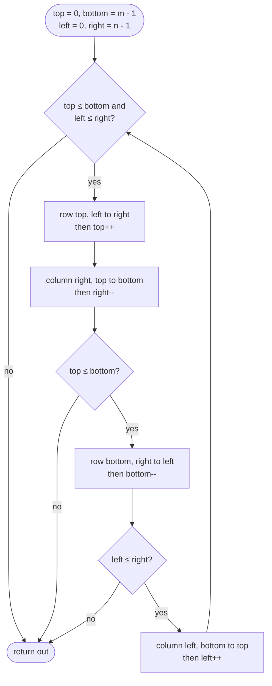

# Math & Geometry

> [!abstract] In one sentence
> This category is index arithmetic and digit arithmetic done carefully: a rotation is two reflections, a spiral is four boundaries that shrink, a big number is an array of digits with a carry, x^n is log n squarings — and every one of them is lost to an overflow or an off-by-one unless you follow a handful of habits.

**Map:** [[Topics MOC]] → [[DSA Dashboard]]

> [!question] Predict before you read
> Rotate an n × n matrix 90° clockwise in place. Where does the cell at (i, j) end up, and which two reflections — each a few lines of swaps — compose into exactly that move?

## Why this exists

The problem class is statements that are not about a data structure at all but about *coordinates* and *numbers*: rotate, spiral or zero a matrix in place; add one to a number stored as digits; multiply two numbers too long for `long`; compute x^n for a negative n; decide whether a digit process ever ends; count squares among points. There is no clever algorithm to recall — the brute force usually *is* the algorithm — so the difficulty is bookkeeping, and the interviewer is measuring care: do you state the index formula before coding, do you reach for `long` before the product, do you test the all-nines and the single-row cases unprompted. These problems sit late in NeetCode (week 7 here) because they are not hard to understand; they are easy to get wrong. The signals: "in place", "constant extra space", "without converting the string to an integer", "n can be negative", "the digits of", "x raised to", "m × n matrix", "points on a plane" — when you see them, slow down rather than speed up.

## The idea from zero

Three primitives carry the eight problems. **A matrix move is a function on indices.** Clockwise rotation of an n × n matrix sends `(i, j)` to `(j, n − 1 − i)`: the row index becomes the column index, and the old row counted from the bottom becomes the new column counted from the left. Applying that formula directly in place means moving four cells around a cycle with one temporary — correct but fiddly. Instead compose two reflections that are trivial in place: **transpose** (`(i, j) → (j, i)`, swap each pair across the main diagonal once) and then **reverse every row** (`(i, j) → (i, n − 1 − j)`). Chain them: `(i, j) → (j, i) → (j, n − 1 − i)`, which is the rotation.

> [!example] Clockwise rotation moves cells in 4-cycles: (i, j) goes to (j, n - 1 - i)
> ![[Math & Geometry — Clockwise rotation moves cells in 4-cycles- (i, j) goes to (j, n - 1 - i).excalidraw]]
> [[Math & Geometry — Clockwise rotation moves cells in 4-cycles- (i, j) goes to (j, n - 1 - i).excalidraw|Open in Excalidraw]] — the four corners rotate as one cycle, the four edge-middles as another, the centre stays; transpose then reverse-rows produces every cycle at once without tracking any of them

%% excalidraw-spec
{"kind": "grid", "title": "Clockwise rotation moves cells in 4-cycles: (i, j) goes to (j, n - 1 - i)", "col_labels": ["j = 0", "j = 1", "j = 2"], "row_labels": ["i = 0", "i = 1", "i = 2"], "rows": [ [1, 2, 3], [4, 5, 6], [7, 8, 9] ], "highlight": [ [0, 0], [0, 2], [2, 2], [2, 0] ], "arrows": [ [ [0, 0], [0, 2] ], [ [0, 2], [2, 2] ], [ [2, 2], [2, 0] ], [ [2, 0], [0, 0] ] ], "caption": "the four corners rotate as one cycle, the four edge-middles as another, the centre stays; transpose then reverse-rows produces every cycle at once without tracking any of them"}
%%

**A number is a digit array with a carry.** 999 + 1: each 9 becomes 0 and the carry moves left; it only survives past the front when every digit was a 9, the one case where the answer gains a digit. Multiplying two digit strings is the same idea in two dimensions — each pair of digits lands in a fixed cell and carries left.

**x^n is log n squarings.** x¹³ = x⁸ · x⁴ · x¹ because 13 = 1101 in binary: square x repeatedly and multiply the result by the squares whose bit is set. Twelve multiplications become three squarings plus three multiplies, and for n = 2³¹ that is thirty-one steps instead of two billion.

## The mechanism

**Rotate ([[LC 48 Rotate Image]]).** Transpose with the inner loop starting at `j = i + 1`, so each pair above the diagonal is swapped once with its mirror — start at `j = 0` and everything is swapped twice, which is the identity. Then reverse each row with two indices walking inward. Anticlockwise is transpose then reverse each *column*; 180° is reverse rows then reverse columns. Say the index formula aloud before you code: it proves you are not guessing.

**Spiral ([[LC 54 Spiral Matrix]]).** Keep four boundaries. Each lap reads the top row left to right, the right column top to bottom, then — only if a row still remains — the bottom row right to left, then — only if a column still remains — the left column bottom to top; each read shrinks its own boundary by one. The two guards are the whole problem: without them a single remaining row is read forwards and then backwards, which is the bug in most first attempts. The flowchart is the code, line for line.



> [!example]- Excalidraw version — the same diagram as an editable canvas
> ![[Math & Geometry — The mechanism.excalidraw]]
> [[Math & Geometry — The mechanism.excalidraw|Open in Excalidraw]] — needs the Excalidraw plugin (see [[Plugins to Install]]).

**Set zeroes in O(1) extra space ([[LC 73 Set Matrix Zeroes]]).** The honest first answer keeps a `boolean[]` per row and per column, O(m + n) space. To reach O(1), store those flags *inside the matrix*: `m[i][0] == 0` means "zero row i" and `m[0][j] == 0` means "zero column j". The two flag lines collide at `m[0][0]`, which can only speak for one of them — keep one extra boolean for the first column. Then apply the flags walking from the bottom-right towards the top-left, so the flag row and flag column are read before they are overwritten.

**Digit loops ([[LC 66 Plus One]], [[LC 202 Happy Number]]).** Plus one walks from the right: the first digit below 9 absorbs the carry and you return at once; every 9 you pass becomes 0; if the loop finishes, every digit was 9, so allocate `n + 1` cells with a leading 1 (Java has already zeroed the rest). Happy number is a digit loop inside a cycle check: the digit-square map takes a d-digit number to at most 81d, which is below the number itself once d ≥ 4, so every sequence falls into a bounded set and must either reach 1 or repeat — and "does it repeat?" is [[LC 141 Linked List Cycle]] on an implicit list, Floyd's slow/fast with `next(n)` as the step, O(1) space.

**Fast power ([[LC 50 Pow(x, n)]]).** While the exponent is positive: if its lowest bit is set, multiply the result by the current base; square the base; shift the exponent right. The base runs through x, x², x⁴, x⁸ and the result collects the ones whose bit is 1 (for 13 = 1101: x, then x⁴, then x⁸). For negative n, invert x and negate n — in a `long`, because `-Integer.MIN_VALUE` is still negative. The recursive form `half = pow(x, n / 2)` is the same algorithm; either way the explanation is "the exponent loses a bit per step, so O(log n)".

**Multiply strings ([[LC 43 Multiply Strings]]).** Long multiplication without the staircase of partial rows: in an answer array of length m + n, the product of digit `a[i]` and digit `b[j]` lands at position `i + j + 1` and carries into `i + j` (positions counted from the left). Loop both strings from the right, add the product to what the cell already holds, write `sum % 10`, push `sum / 10` one cell left. Strip leading zeros at the end and return `"0"` when nothing remains.

> [!example] 12 x 34 in a 4-cell answer array, one row per digit pair
> ![[Math & Geometry — 12 x 34 in a 4-cell answer array, one row per digit pair.excalidraw]]
> [[Math & Geometry — 12 x 34 in a 4-cell answer array, one row per digit pair.excalidraw|Open in Excalidraw]] — pair (i, j) writes to pos i + j + 1; the third pair adds 4 to the 6 already at pos 2, writes 0 and carries 1 into pos 1; the final array 0408 reads as 408 once the leading zero is stripped

%% excalidraw-spec
{"kind": "grid", "title": "12 x 34 in a 4-cell answer array, one row per digit pair", "col_labels": ["pos 0", "pos 1", "pos 2", "pos 3"], "row_labels": ["2 x 4 = 8", "2 x 3 = 6", "1 x 4 = 4", "1 x 3 = 3"], "rows": [ [0, 0, 0, 8], [0, 0, 6, 8], [0, 1, 0, 8], [0, 4, 0, 8] ], "highlight": [ [2, 1], [2, 2] ], "caption": "pair (i, j) writes to pos i + j + 1; the third pair adds 4 to the 6 already at pos 2, writes 0 and carries 1 into pos 1; the final array 0408 reads as 408 once the leading zero is stripped"}
%%

**Detect squares ([[LC 2013 Detect Squares]]).** Count points in a map keyed by `x * 1001 + y`. For a query (px, py) scan the stored points in the same column, (px, y) with `y ≠ py`; the side is `d = y − py`, the other two corners are `(px + d, py)` and `(px + d, y)` plus the mirrored pair at `px − d`; add the product of the three counts for each side. Duplicates count by multiplicity, which is what the problem wants, and O(n) per query is what the constraints allow.

**gcd, lcm, modular arithmetic, overflow.** Euclid: `gcd(a, b) = gcd(b, a % b)`, O(log min(a, b)) steps; `lcm = a / gcd(a, b) * b` — divide *first* or the product overflows. Modular answers (the 10⁹ + 7 problems) reduce after every `+` and `*` with `long` operands; `%` keeps the dividend's sign in Java, so negatives need `Math.floorMod`; the modular inverse is `a^(M − 2) mod M` for prime M (Fermat) — recognise it, you will rarely code it. The overflow habits, which apply to every category: cast *before* multiplying (`(long) a * b`), a `long` accumulator for 10⁵ values up to 10⁹, `lo + (hi - lo) / 2`, never negate or `abs` an `int` that may be `Integer.MIN_VALUE`, `Integer.compare` instead of subtraction in comparators.

## Java template

```java
import java.util.*;

class Solution {
    public void rotate(int[][] m) {                                 // LC 48: transpose, then reverse each row
        int n = m.length;
        for (int i = 0; i < n; i++)
            for (int j = i + 1; j < n; j++) {                       // j from i + 1: each pair swapped exactly once
                int t = m[i][j]; m[i][j] = m[j][i]; m[j][i] = t;
            }
        for (int[] row : m)
            for (int l = 0, r = n - 1; l < r; l++, r--) { int t = row[l]; row[l] = row[r]; row[r] = t; }
    }
    public void setZeroes(int[][] m) {                              // LC 73: first row and column as flags
        int rows = m.length, cols = m[0].length;
        boolean firstColZero = false;
        for (int i = 0; i < rows; i++) {
            if (m[i][0] == 0) firstColZero = true;                  // m[0][0] cannot flag both lines
            for (int j = 1; j < cols; j++) if (m[i][j] == 0) { m[i][0] = 0; m[0][j] = 0; }
        }
        for (int i = rows - 1; i >= 0; i--) {                       // bottom-up: read the flags before clearing them
            for (int j = cols - 1; j >= 1; j--) if (m[i][0] == 0 || m[0][j] == 0) m[i][j] = 0;
            if (firstColZero) m[i][0] = 0;
        }
    }
}
```

**Time** O(n²) and O(mn) · **Space** O(1) — every cell is touched a constant number of times; the spiral code is the flowchart above, in [[LC 54 Spiral Matrix]].

```java
import java.util.*;

class Solution {
    public double myPow(double x, int n) {                          // LC 50: binary exponentiation
        long e = n;                                                 // long: -Integer.MIN_VALUE overflows an int
        if (e < 0) { x = 1 / x; e = -e; }
        double result = 1;
        for (; e > 0; e >>= 1) {
            if ((e & 1) == 1) result *= x;                          // this exponent bit is set: multiply in x^(2^k)
            x *= x;                                                 // x, x^2, x^4, ...
        }
        return result;
    }
    public int[] plusOne(int[] digits) {                            // LC 66: carry from the right
        for (int i = digits.length - 1; i >= 0; i--) {
            if (digits[i] < 9) { digits[i]++; return digits; }      // the carry is absorbed: done
            digits[i] = 0;                                          // a 9 becomes 0, the carry moves left
        }
        int[] out = new int[digits.length + 1];                     // every digit was 9: 999 + 1 = 1000
        out[0] = 1;
        return out;
    }
    public String multiply(String a, String b) {                    // LC 43: a[i] * b[j] lands at i + j + 1
        int m = a.length(), n = b.length();
        int[] pos = new int[m + n];                                 // the product has at most m + n digits
        for (int i = m - 1; i >= 0; i--)
            for (int j = n - 1; j >= 0; j--) {
                int sum = (a.charAt(i) - '0') * (b.charAt(j) - '0') + pos[i + j + 1];
                pos[i + j + 1] = sum % 10;
                pos[i + j] += sum / 10;                             // carry into the cell to the left
            }
        StringBuilder sb = new StringBuilder();
        for (int d : pos) if (sb.length() > 0 || d != 0) sb.append(d);   // strip leading zeros
        return sb.length() == 0 ? "0" : sb.toString();
    }
}
```

**Time** O(log n) for pow, O(d) for plus one, O(mn) for multiply · **Space** O(1), O(m + n) for the multiply array. Floyd on the happy sequence and the count map of [[LC 2013 Detect Squares]] are each ten lines in their problem notes once the arguments above are clear.

## Complexity

| Shape | Time | Space | Why |
|---|---|---|---|
| in-place matrix transform (rotate, spiral, zeroes) | O(mn) | O(1) | every cell is read or written a constant number of times; boundaries or flag lines replace any extra structure |
| digit loop (plus one, a happy step, reverse digits) | O(d) = O(log₁₀ n) | O(1) | one pass over the digits; the happy sequence is bounded, so the cycle check is a constant number of steps |
| binary exponentiation | O(log n) | O(1) iterative, O(log n) recursive | the exponent loses one bit per step |
| schoolbook string multiply; detect squares | O(mn); O(n) per query | O(m + n); O(n) | every digit pair is multiplied once (Karatsuba's O(n^1.58) is a name to know, not to code); the column scan touches each stored point once per query |

## The canonical shapes

| Shape | Recognition cue | One-line solution | Problem |
|---|---|---|---|
| Rotate in place | "rotate the image 90°, no second matrix" | transpose, then reverse each row | [[LC 48 Rotate Image]] |
| Spiral walk | "return elements in spiral order" | four boundaries, two guards | [[LC 54 Spiral Matrix]] |
| Flags inside the data | "set the row and column to zero, O(1) space" | first row and column as flags plus one boolean | [[LC 73 Set Matrix Zeroes]] |
| Hidden cycle | "repeat the process until it reaches 1 or loops" | Floyd's slow/fast on the digit map | [[LC 202 Happy Number]] |
| Carry from the right | "digits of a number, add one" | first non-9 absorbs the carry; all-9s grows the array | [[LC 66 Plus One]] |
| Binary exponentiation | "x^n, n may be negative, n up to 2³¹" | square the base, multiply on set bits, `long` for −n | [[LC 50 Pow(x, n)]] |
| Digit grid | "multiply two numbers given as strings" | `pos[i + j + 1]` plus carry, strip zeros | [[LC 43 Multiply Strings]] |
| Count-map geometry | "count axis-aligned squares with this point" | scan the column, multiply three counts | [[LC 2013 Detect Squares]] |

## Worked example

[[LC 73 Set Matrix Zeroes]] on the 3 × 3 matrix of ones with a single 0 at (1, 1). Pass one scans every cell from column 1 onward and, on finding the 0, writes the two flags `m[1][0] = 0` and `m[0][1] = 0`; `firstColZero` stays false because column 0 held no zero of its own.

> [!example] After pass one: the flags live in row 0 and column 0
> ![[Math & Geometry — After pass one- the flags live in row 0 and column 0.excalidraw]]
> [[Math & Geometry — After pass one- the flags live in row 0 and column 0.excalidraw|Open in Excalidraw]] — amber cells are flags, not data: row 0 says 'zero column 1', column 0 says 'zero row 1'; m[0][0] is untouched because neither the first row nor the first column held a zero. Pass two turns (1, 2) and (2, 1) to 0 and leaves the cross through (1, 1) zeroed

%% excalidraw-spec
{"kind": "grid", "title": "After pass one: the flags live in row 0 and column 0", "col_labels": ["col 0", "col 1", "col 2"], "row_labels": ["row 0", "row 1", "row 2"], "rows": [ [1, 0, 1], [0, 0, 1], [1, 1, 1] ], "highlight": [ [0, 1], [1, 0] ], "caption": "amber cells are flags, not data: row 0 says 'zero column 1', column 0 says 'zero row 1'; m[0][0] is untouched because neither the first row nor the first column held a zero. Pass two turns (1, 2) and (2, 1) to 0 and leaves the cross through (1, 1) zeroed"}
%%

Pass two walks from (2, 2) back to (0, 1), zeroing any cell whose row flag or column flag is 0, and finishes each row by applying `firstColZero` to its first cell; the result is the cross through (1, 1). Walking bottom-up matters: if row 0 were processed first, `m[0][1]` would be cleared before rows 1 and 2 could read it — harmless here because it is 0 anyway, fatal on a matrix whose first row holds a zero of its own. Before declaring victory, test the shapes the flags make awkward: a zero only in row 0 (`m[0][0]` becomes the row flag, `firstColZero` stays false), a zero only in column 0 (`firstColZero` true, `m[0][0]` unchanged), and the 1 × 1 matrix holding a single 0.

## Pitfalls

> [!warning] The mistakes people make
> - **Transpose with `j` from 0.** Every pair is swapped twice and the matrix is unchanged; start at `j = i + 1`.
> - **Spiral without the two guards.** A lone remaining row or column is read twice. Test on a 1 × n, an n × 1 and a 3 × 4.
> - **Set zeroes with `m[0][0]` as both flags**, or applying the flags top-down so a flag is cleared before it is read. Test a zero in row 0 and a zero in column 0 separately.
> - **`n = -n` for the exponent.** `-Integer.MIN_VALUE` is `Integer.MIN_VALUE`; copy n into a `long` first. The same overflow hides in `Math.abs` and in `lcm = a * b / gcd` — divide first.
> - **Converting the digits to a number.** Plus one's array can be 100 digits and multiply's strings 200; they are arrays, not numbers, and `Long.parseLong` is the answer the interviewer is screening out. Likewise a happy-number loop capped at "100 iterations" passes the tests and tells the interviewer you did not see the cycle; use Floyd or a set.
> - **Detect squares counting rotated squares.** Ask; the problem means axis-aligned, and the column scan assumes it.

## Variations & follow-ups

Rotation comes back as anticlockwise (transpose, reverse columns), 180° (reverse rows and columns) and non-square matrices (not possible in place; allocate `n × m`). Spiral has a sibling that *generates* the spiral (fill 1..n² with the same four boundaries). Set zeroes is usually asked in two stages — O(m + n) first, then "can you do O(1)?" — so hold the flag version as the second answer, not the first. Happy number's real question is "why does it terminate?": give the 81d bound. Fast power becomes modular power (reduce after each multiply in `long`) and then matrix exponentiation for Fibonacci in O(log n), which you should recognise but not code. Multiply strings pairs with [[LC 2 Add Two Numbers]], where the carry walks a linked list instead of an array. Detect squares' follow-up is rotated squares or rectangles — a different, harder problem; say so rather than bending the column scan.

## Interview script

State the index map before the code: "A clockwise rotation sends (i, j) to (j, n − 1 − i). Transposing sends it to (j, i), reversing the row then sends it to (j, n − 1 − i), so transpose plus reverse-rows is the rotation; both are in place, O(n²) time, O(1) space." For a digit problem, say what the array *is* before touching it: "This is a number held as digits, not an `int`; I walk from the least significant end with a carry." For pow: "Binary exponentiation — I square the base and multiply in the squares whose exponent bit is set, O(log n); n goes into a `long` first because negating `Integer.MIN_VALUE` overflows."

What the interviewer is checking: that you state the formula and the guards before coding, that overflow is a reflex rather than an afterthought, and that you test the degenerate shapes (1 × n, all nines, n = 0, negative n) without prompting. Follow-ups they ask: "anticlockwise?", "non-square?", "why does the happy sequence always cycle?", "can you do zeroes in O(1)?", "and modulo 10⁹ + 7?", "how many digits can the product of two 200-digit numbers have?" — m + n, the length of your array.

## Spot the bug

```java
// snippet
public double myPow(double x, int n) {
    if (n < 0) { x = 1 / x; n = -n; }                 // x = 2, n = Integer.MIN_VALUE ?
    double r = 1;
    while (n > 0) { if ((n & 1) == 1) r *= x; x *= x; n >>= 1; }
    return r;
}
```

> [!example]- The fix
> `-Integer.MIN_VALUE` overflows back to `Integer.MIN_VALUE`, so `n` is still negative, the loop never runs and the method returns 1 instead of 2^(−2³¹), which is 0 in a `double`. Widen before negating: `long e = n; if (e < 0) { x = 1 / x; e = -e; }` and loop on `e`. The same trap sits in `Math.abs(Integer.MIN_VALUE)` and in [[LC 7 Reverse Integer]], where the overflow check must happen *before* the multiply, not after.

## Related

### Prerequisites
- [[Arrays & Hashing]] — in-place marking and the output-array-as-workspace trick that the flag technique generalises
- [[Recursion]] — the recursive form of fast power and the "halve the exponent" argument

### Builds on this
- [[Bit Manipulation]] — the exponent's bits drive fast power; `>>`, `& 1` and two's complement explain the negation overflow; [[Linked Lists]] — Floyd's cycle detection, reused on the happy-number sequence; [[Hashing]] — the count map behind detect squares
- [[Java Pitfalls in Interviews]] (overflow, `%` with negatives, `Math.abs`), [[Java Collections Cheat Sheet]], [[DSA Patterns in Java]] (the matrix direction array)

### Problems that use it
- [[LC 48 Rotate Image]], [[LC 54 Spiral Matrix]], [[LC 73 Set Matrix Zeroes]], [[LC 202 Happy Number]], [[LC 66 Plus One]], [[LC 50 Pow(x, n)]], [[LC 43 Multiply Strings]], [[LC 2013 Detect Squares]]
- Index arithmetic elsewhere: [[LC 36 Valid Sudoku]] (box index `(r / 3) * 3 + c / 3`), [[LC 74 Search a 2D Matrix]] (flat index to row and column), [[LC 2 Add Two Numbers]] (carry on a list), [[LC 7 Reverse Integer]] (overflow before the multiply)

## Personal understanding

> [!question] Explain it without the note
> Write your own explanation here, from memory, then compare with the sections above and note what you missed.

### Mastery checklist
- [ ] I can state the idea in one sentence
- [ ] I can re-derive the mechanism on a whiteboard
- [ ] I can name when NOT to use it
- [ ] I have solved three problems with it without hints
- [ ] I can explain it to a colleague in two minutes

## Open questions
- [ ] Derive the anticlockwise rotation as a composition of two reflections and check it on the 4-cycle grid above; then work out why the happy-number bound 81d beats a d-digit number only from d = 4 and what that means for the largest value the sequence can ever visit.
