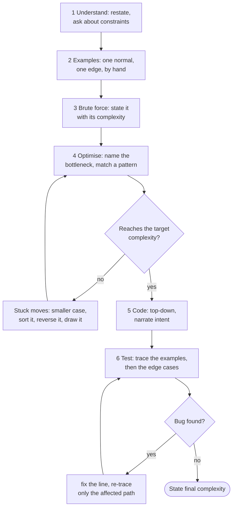

# Problem-Solving Framework

> [!abstract] In one sentence
> Run every problem through the same six stages in the same order — restate and ask, build examples, state the brute force and its cost, find the bottleneck and match it to a pattern, code top-down while narrating, test by tracing — because a fixed protocol is what keeps the first ten minutes productive when the problem is unfamiliar and the clock is loud.

**Map:** [[Topics MOC]] → [[DSA Dashboard]]

> [!question] Predict before you read
> You have 45 minutes and a medium you have never seen. How many of those minutes should pass before you type the first line of real code — and what must you have said out loud by then?

## Why this exists

Most failed rounds are not failed by lack of knowledge. They are failed by coding at minute 3 on a misread problem, by silence while thinking, by an O(n²) solution delivered to an n = 10⁵ constraint, or by freezing when the first idea dies. A protocol removes those four failure modes by deciding in advance what you do in each minute. It is the same reason a runbook exists for an incident: the decisions were made calmly, earlier.

The protocol is a version of UMPIRE (Understand, Match, Plan, Implement, Review, Evaluate), reshaped around what interviewers at product companies actually score: communication, correctness, complexity awareness, and recovery when stuck.

## The idea from zero

Forty-five minutes split into six stages with budgets. The budgets are not decoration: when a stage overruns, that is your signal to say so and move on, not to push harder.

> [!example] The 45-minute round as six stages
> ![[Problem-Solving Framework — The 45-minute round as six stages.excalidraw]]
> [[Problem-Solving Framework — The 45-minute round as six stages.excalidraw|Open in Excalidraw]] — the amber stage is where the round is won; nothing is typed before minute 15 except examples and notes

%% excalidraw-spec
{"kind": "array", "title": "The 45-minute round as six stages", "values": ["Understand", "Examples", "Brute force", "Optimise", "Code", "Test"], "labels": {"0": "3-5 min", "1": "2-3 min", "2": "3-5 min", "3": "8-10 min", "4": "15 min", "5": "5-8 min"}, "pointers": {"first code": 4}, "highlight": [3], "caption": "the amber stage is where the round is won; nothing is typed before minute 15 except examples and notes"}
%%

The one rule that outranks the budgets: **never go silent for more than 20 seconds**. Thinking aloud is the interview; the code is the evidence.

## The mechanism



> [!example]- Excalidraw version — the same diagram as an editable canvas
> ![[Problem-Solving Framework — The mechanism.excalidraw]]
> [[Problem-Solving Framework — The mechanism.excalidraw|Open in Excalidraw]] — needs the Excalidraw plugin (see [[Plugins to Install]]).

**1 — Understand.** Restate the problem in your own words and get a nod. Then ask the questions that change the algorithm: size of n (sets the target complexity, see [[Complexity Analysis]]); value range (overflow, counting arrays); duplicates; negatives or zeros; sorted or not; empty input; what to return when there is no answer; one answer or all answers; can the input be modified. Write the constraints on the board — you will read them again at step 4.

**2 — Examples.** Work one ordinary example *by hand* and write the expected output; then build one edge example yourself (empty, single element, all equal, already sorted). Doing it by hand is where the algorithm first shows itself: watch what your brain does to get the answer.

**3 — Brute force.** Say it even if it is obvious: "try every pair, O(n²)". It proves you understood the problem, gives you a fallback to code if everything else fails, and — most importantly — tells you *where the wasted work is*, which is the input to the next step.

**4 — Optimise.** Ask "what does the brute force recompute?" and "which constraint is the hint?" (n ≤ 20 says exponential is fine; 10⁵ says n log n; values ≤ 10⁴ says counting array). Then match the cue to a pattern with the table below. Say the plan in three sentences and the complexity before coding, and get agreement — the interviewer will often steer here, and a steer is free information.

**5 — Code.** Top-down: the main function first with helper calls to functions that do not exist yet, then the helpers. Name variables for their meaning (`left`, `need`, `bestLen`), not `i2`. Narrate intent, not syntax: "now I shrink the window until it is valid again", not "while loop, l plus plus". When you are unsure of an API, say so and write what you mean; interviewers forgive `getOrDefault` spelled wrong, not silence.

**6 — Test.** Do not say "I think it works". Trace the ordinary example line by line with the actual variable values, then run the edge cases through the code in your head: empty, one element, all equal, the maximum size (does anything overflow or recurse too deep?). Fix the line, not the design.

**When stuck** (and you will be): shrink the input to size 2 or 3 and solve that; sort the input and see whether the problem becomes easier; look at the problem backwards (from the end, from the answer); draw the state after each step; ask what information the brute force throws away; name the constraint out loud. If three moves fail, say "I'll implement the brute force cleanly and optimise if there is time" — a working O(n²) beats a broken O(n).

## Java template

The skeleton you type for every problem, with the four places the protocol lands.

```java
import java.util.*;

class Solution {
    public int solve(int[] nums, int k) {
        // 1. guards for the edge cases you agreed on (empty input, k out of range)
        if (nums == null || nums.length == 0) return 0;
        // 2. state: name every variable for its meaning, initialise with intent
        int best = 0;
        Map<Integer, Integer> seen = new HashMap<>();
        // 3. one main loop that maintains an invariant you can say in a sentence
        for (int i = 0; i < nums.length; i++) {
            int need = k - nums[i];
            if (seen.containsKey(need)) best = Math.max(best, i - seen.get(need));
            seen.putIfAbsent(nums[i], i);          // keep the earliest index for the widest gap
        }
        // 4. return exactly what was asked (index vs value, -1 vs empty, count vs list)
        return best;
    }
}
```

**Time** O(n) · **Space** O(n)

## Complexity

The optimise step starts from the constraint, not from the idea. The full table lives in [[Complexity Analysis]]; the four lines you must know by heart:

| n in the constraints | Budget | What that allows |
|---|---|---|
| ≤ 20 | 2ⁿ · n | backtracking, bitmask DP — try everything |
| ≤ 5·10³ | n² | nested loops, 2-D DP |
| ≤ 10⁵ – 10⁶ | n log n or n | sort / heap / binary search, or hashing / two pointers / sliding window |
| values ≤ 10⁹, 10¹⁸ | log V | binary search on the answer, fast power |

## The canonical shapes

The cue-to-pattern table, the heart of step 4. The long version with 30 rows is [[Pattern Recognition Table]].

| Cue in the statement | Pattern | Read | Start with |
|---|---|---|---|
| count, frequency, duplicate, anagram | array/map counting | [[Arrays & Hashing]], [[Hashing]] | [[LC 242 Valid Anagram]] |
| sorted array, pair with sum, palindrome, in-place | opposite-end or read/write pointers | [[Two Pointers]] | [[LC 167 Two Sum II Input Array Is Sorted]] |
| longest/shortest substring or subarray with property | variable window | [[Sliding Window]] | [[LC 3 Longest Substring Without Repeating Characters]] |
| next greater / smaller, matching brackets, expression | stack, monotonic stack | [[Stack & Monotonic Stack]] | [[LC 739 Daily Temperatures]] |
| sorted, rotated, "minimum x such that", answer in a range | binary search, on index or on answer | [[Binary Search]] | [[LC 875 Koko Eating Bananas]] |
| k largest, top-k, median of a stream, merge k | heap | [[Heaps & Priority Queues]] | [[LC 215 Kth Largest Element in an Array]] |
| intervals, meetings, scheduling | sort by start, sweep | [[Intervals]], [[Greedy]] | [[LC 56 Merge Intervals]] |
| all subsets / combinations / permutations | backtracking | [[Backtracking]] | [[LC 78 Subsets]] |
| grid regions, connected, shortest unweighted path | BFS / DFS | [[Graphs]] | [[LC 200 Number of Islands]] |
| prerequisites, ordering with dependencies | topological sort | [[Graphs]] | [[LC 207 Course Schedule]] |
| weighted shortest path, min cost to connect | Dijkstra, MST | [[Advanced Graphs]] | [[LC 743 Network Delay Time]] |
| number of ways, min cost, can you reach — with choices | DP | [[Dynamic Programming]] | [[LC 70 Climbing Stairs]] |
| two strings / sequences compared | 2-D DP | [[2-D Dynamic Programming]] | [[LC 1143 Longest Common Subsequence]] |
| prefix, autocomplete, many words | trie | [[Tries]] | [[LC 208 Implement Trie Prefix Tree]] |
| XOR, single number, bits, powers of two | bit tricks | [[Bit Manipulation]] | [[LC 136 Single Number]] |

## Worked example

[[LC 238 Product of Array Except Self]] on `nums = [1, 2, 3, 4]`, through the protocol.

| Minute | Stage | What you say and do |
|---|---|---|
| 0–3 | Understand | "Return an array where position i holds the product of every other element. No division allowed, O(n) expected, zeros can appear, n ≥ 2, products fit in 32 bits." |
| 3–5 | Examples | `[1,2,3,4] → [24,12,8,6]`; edge `[0, 4] → [4, 0]`; `[0, 0] → [0, 0]`. |
| 5–8 | Brute force | "For each i multiply everything else: O(n²). Wasted work: each product recomputes the same prefix over and over." |
| 8–15 | Optimise | "The answer at i is (product of everything left of i) × (product of everything right of i). Both are prefix products, computable in one pass each: O(n). Reuse the output array for the prefixes and carry the suffix in a variable for O(1) extra space." |
| 15–30 | Code | left pass writing prefixes into `out`, right pass multiplying by a running `suffix`. |
| 30–38 | Test | trace `[1,2,3,4]`: `out` after pass 1 `[1,1,2,6]`; suffix walk 1, 4, 12, 24 → `[24,12,8,6]`. Then `[0,4]`. |

> [!example] After the left pass: out[i] = product of nums[0..i-1]
> ![[Problem-Solving Framework — After the left pass- out-i- = product of nums-0..i-1-.excalidraw]]
> [[Problem-Solving Framework — After the left pass- out-i- = product of nums-0..i-1-.excalidraw|Open in Excalidraw]] — out[3] = 1 * 2 * 3; nothing to the right has been multiplied in yet

%% excalidraw-spec
{"kind": "array", "title": "After the left pass: out[i] = product of nums[0..i-1]", "values": [1, 1, 2, 6], "highlight": [3], "caption": "out[3] = 1 * 2 * 3; nothing to the right has been multiplied in yet"}
%%

> [!example] Right pass with a running suffix, walking i from 3 down to 0
> ![[Problem-Solving Framework — Right pass with a running suffix, walking i from 3 down to 0.excalidraw]]
> [[Problem-Solving Framework — Right pass with a running suffix, walking i from 3 down to 0.excalidraw|Open in Excalidraw]] — out[i] *= suffix, then suffix *= nums[i]; the order of those two lines is the whole trick

%% excalidraw-spec
{"kind": "array", "title": "Right pass with a running suffix, walking i from 3 down to 0", "values": [24, 12, 8, 6], "pointers": {"i": 0}, "labels": {"0": "suffix 24", "1": "suffix 12", "2": "suffix 4", "3": "suffix 1"}, "caption": "out[i] *= suffix, then suffix *= nums[i]; the order of those two lines is the whole trick"}
%%

```java
import java.util.*;

class Solution {
    public int[] productExceptSelf(int[] nums) {
        int n = nums.length;
        int[] out = new int[n];
        out[0] = 1;
        for (int i = 1; i < n; i++) out[i] = out[i - 1] * nums[i - 1];   // prefix products
        int suffix = 1;
        for (int i = n - 1; i >= 0; i--) {
            out[i] *= suffix;                                            // multiply by product of the right side
            suffix *= nums[i];                                           // then extend the suffix to include i
        }
        return out;
    }
}
```

**Time** O(n) · **Space** O(1) extra, the output array not counted

## Pitfalls

> [!warning] The mistakes people make
> - **Coding at minute 3.** You will solve a slightly different problem than the one asked (values instead of indices, "subsequence" read as "subarray"). Restate first.
> - **Silent thinking.** Thirty seconds of silence reads as "stuck"; the same thirty seconds spent saying "the brute force is n², the wasted work is …" reads as progress.
> - **Skipping the brute force.** It is your fallback and your diagnostic; interviewers never penalise stating it.
> - **Optimising past the target.** The constraint said n log n; you spent 15 minutes chasing O(n) and coded nothing.
> - **Ignoring a hint.** When the interviewer says "what if the array were sorted?", that is the answer, not a question. Take it immediately.
> - **Testing by assertion.** "It should work" is not a test; a traced example with real variable values is.
> - **Rewriting from scratch after a bug.** Fix the line. A redesign at minute 35 ends with nothing compiled.

## Variations & follow-ups

The follow-ups are predictable, so prepare the shape of each answer: **"the input is a stream"** (keep a running structure: heap, counts, window); **"it does not fit in memory"** (external sort, chunking, counting by key — say the HLD words); **"generalise to k"** (heap or bucket instead of a pair of variables); **"make it thread-safe"** (immutability, or a lock around the shared structure — one sentence, not a lecture); **"can you drop the extra space?"** (reuse the output array, in-place marking from [[Arrays & Hashing]]); and **a second, harder problem** in the same slot, which is why the first one must be finished by minute 35.

## Interview script

The phrases, one per stage: "Let me restate it to make sure I have it." — "I'll do a small example by hand first." — "The brute force is …, which is O(…); the wasted work is …" — "n is up to 10⁵, so I'm aiming for n log n; the pattern here looks like … because …" — "I'll write the main function first and fill in the helper." — "Let me trace the example through the code with real values." — "Final complexity: O(…) time, O(…) space, because …"

What the interviewer is checking, in order of weight at most product companies: did you understand before coding, did you communicate the plan, is the code correct and clean, did you know the complexity, did you recover when stuck. Four of those five are decided before the code exists.

## Spot the bug

```java
// snippet
// "Return the indices of the two numbers that add up to target."
for (int i = 0; i < nums.length; i++)
    for (int j = i; j < nums.length; j++)
        if (nums[i] + nums[j] == target) return new int[]{nums[i], nums[j]};
```

> [!example]- The fix
> Two protocol failures, not two typos. The loop starts `j = i`, so an element pairs with itself — the understand step should have established "two distinct indices" and the inner loop must start at `j = i + 1`. And it returns the *values* where the statement asked for *indices*: `return new int[]{i, j};`. Both would have been caught at stage 2 by writing the expected output for `[3, 3], target 6` by hand before coding, which is why the examples stage exists.

## Related

### Prerequisites
- [[Complexity Analysis]] — the constraint-to-target reading that drives the optimise step

### Builds on this
- [[Pattern Recognition Table]] — the 30-row version of the cue table
- [[Interview Day Protocol]] — the same 45 minutes, minute by minute, with what to say
- [[Mistakes Log]] and [[Spaced Repetition Protocol]] — where the misreads and missed edge cases go afterwards
- [[8-Week DSA Plan]] — the weekly schedule this protocol is practised in
- [[DSA Patterns in Java]], [[Java Collections Cheat Sheet]], [[Java Pitfalls in Interviews]] — so that the code stage is typing, not remembering

### Problems that use it
- [[LC 238 Product of Array Except Self]] — the worked example
- [[LC 1 Two Sum]] — the shortest full run of the protocol; do it in 10 minutes aloud
- [[LC 3 Longest Substring Without Repeating Characters]] and [[LC 347 Top K Frequent Elements]] — brute force to pattern in one step

## Personal understanding

> [!question] Explain it without the note
> Write your own explanation here, from memory, then compare with the sections above and note what you missed.

### Mastery checklist
- [ ] I can state the idea in one sentence
- [ ] I can re-derive the mechanism on a whiteboard
- [ ] I can name when NOT to use it
- [ ] I have solved three problems with it without hints
- [ ] I can explain it to a colleague in two minutes

## Open questions
- [ ] Record myself doing one medium with the protocol: where does the silence actually happen, and which stage do I skip under pressure?
- [ ] Which of the stuck moves has rescued me most often in the last ten problems — and which one have I never tried?
