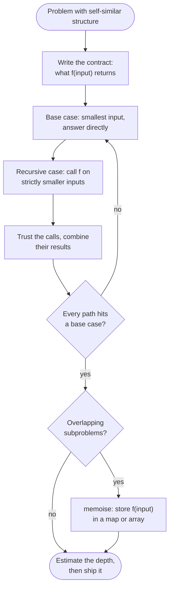

# Recursion

> [!abstract] In one sentence
> A recursive function answers the question for an input by assuming it can already answer it for smaller inputs, so the work you write is only the base case and the one combining step, while the call stack silently remembers every unfinished call — which is both the power (trees, DFS, backtracking, DP all fall out of it) and the cost (depth is memory, and Java will not optimise it away).

**Map:** [[Topics MOC]] → [[DSA Dashboard]]

> [!question] Predict before you read
> `fib(n) = fib(n-1) + fib(n-2)` with `fib(0) = 0, fib(1) = 1`. Roughly how many calls does `fib(40)` make, and what single change makes it 40 calls? Separately: why does reversing a 10⁵-node linked list recursively crash in Java when the same loop does not?

## Why this exists

Some problems are *defined* in terms of smaller copies of themselves: a subtree is a tree, the subsets of n items are the subsets of n − 1 items with and without the last one, a sorted array is two sorted halves merged. For these, a loop forces you to manage the bookkeeping (what is pending, where to resume) by hand; recursion lets the language do it. Every topic from week 3 onwards — [[Trees]], [[Backtracking]], [[Graphs]] (DFS), [[Dynamic Programming]] (memoised recursion), merge sort in [[Sorting]] — is recursion plus one idea.

The signals in a statement: **tree** or **nested** structure, **all combinations / subsets / permutations**, **divide the array and combine**, **defined by a recurrence** (climbing stairs, decode ways), and **explore a grid or graph** from a cell.

## The idea from zero

`sum(n)` = the sum of 1..n. The smallest input is answered directly: `sum(0) = 0`. Any other input is answered by a smaller one: `sum(n) = n + sum(n − 1)`. Calling `sum(3)` does not compute anything until `sum(0)` answers; every unfinished call waits in a frame on the call stack holding its own `n` and where to resume.

> [!example] Call stack at the deepest point of sum(3)
> ![[Recursion — Call stack at the deepest point of sum(3).excalidraw]]
> [[Recursion — Call stack at the deepest point of sum(3).excalidraw|Open in Excalidraw]] — sum(0) returns 0; then sum(1) resumes and returns 1 + 0; frames pop in reverse order of pushing

%% excalidraw-spec
{"kind": "array", "title": "Call stack at the deepest point of sum(3)", "values": ["sum(3)", "sum(2)", "sum(1)", "sum(0)"], "pointers": {"bottom": 0, "top": 3}, "highlight": [3], "caption": "sum(0) returns 0; then sum(1) resumes and returns 1 + 0; frames pop in reverse order of pushing"}
%%

Two recursive calls per level make a *tree* of calls, and the tree can repeat work. `fib(4)` computes `fib(2)` twice and `fib(1)` three times.

> [!example] Recursion tree of fib(4)
> ![[Recursion tree of fib(4).excalidraw]]
> [[Recursion tree of fib(4).excalidraw|Open in Excalidraw]] — node count = time (about 1.618^n), height = stack space (n); the two amber fib(2) subtrees are identical work, and remembering the first answer removes the second — that is memoisation

%% excalidraw-spec
{"kind": "tree", "title": "Recursion tree of fib(4)", "nodes": [{"id": "r", "label": "fib(4)", "children": ["a", "b"]}, {"id": "a", "label": "fib(3)", "children": ["c", "d"]}, {"id": "b", "label": "fib(2)", "children": ["e", "f"]}, {"id": "c", "label": "fib(2)", "children": ["g", "h"]}, {"id": "d", "label": "fib(1)", "children": []}, {"id": "e", "label": "fib(1)", "children": []}, {"id": "f", "label": "fib(0)", "children": []}, {"id": "g", "label": "fib(1)", "children": []}, {"id": "h", "label": "fib(0)", "children": []}], "root": "r", "highlight": ["b", "c"], "caption": "node count = time (about 1.618^n), height = stack space (n); the two amber fib(2) subtrees are identical work, and remembering the first answer removes the second — that is memoisation"}
%%

## The mechanism

### Designing a recursive function

1. **Write the contract first**, as a sentence: "`depth(node)` returns the number of nodes on the longest path from `node` down to a leaf, and 0 for `null`." Most recursive bugs are an unclear contract, not a wrong line.
2. **Base case**: the inputs so small you can answer without recursing — `null`, empty range, `n == 0`. There may be two (`fib(0)` and `fib(1)`).
3. **Recursive case**: call yourself on *strictly smaller* inputs, **trust that those calls fulfil the contract** — do not mentally unroll them — and combine the results. This leap is the skill; if you catch yourself tracing three levels deep, go back to the contract.
4. **Check the three questions**: does every path reach a base case? does every recursive call shrink the input? does the combining step use only the contract, not the internals?



> [!example]- Excalidraw version — the same diagram as an editable canvas
> ![[Recursion — Designing a recursive function.excalidraw]]
> [[Recursion — Designing a recursive function.excalidraw|Open in Excalidraw]] — needs the Excalidraw plugin (see [[Plugins to Install]]).

### What a call really costs

Each call pushes a frame (parameters, locals, return address). The JVM gives a thread a fixed stack — 1 MB by default on 64-bit Linux (`-Xss`) — so depth is bounded: for small frames that is somewhere between 10⁴ and 2·10⁴ frames before `StackOverflowError`. LeetCode's Java runner usually survives depths of 10⁴ and often more, but you cannot rely on it. Rule: depth up to 10⁴ (balanced trees, backtracking, memoised DP over n ≤ 5·10³) is fine; a 10⁵-long chain (a linked list, a path-shaped graph, a 300×300 grid DFS in the worst case) needs the iterative form.

**Java does no tail-call optimisation.** `return f(n - 1)` with nothing left to do still pushes a frame — the JVM has no TCO, unlike Scheme or Kotlin's `tailrec`. A tail-recursive function is just a loop you have not written yet: carry the accumulator in local variables and `while`. (Escape hatch when a judge forces depth 10⁵: `new Thread(null, runnable, "", 1 << 26).start()` asks for a 64 MB stack. Know it exists; prefer the loop.)

**Recursion to iteration with an explicit stack.** The stack frames held "what to do when this call returns". Replace them with your own `ArrayDeque` of pending work. For a linear recursion that becomes a plain loop; for tree recursion the deque holds nodes still to be visited, and the order you push decides the traversal.

> [!example] Explicit stack during iterative inorder on BST [4,2,6,1,3]
> ![[Recursion — Explicit stack during iterative inorder on BST -4,2,6,1,3-.excalidraw]]
> [[Recursion — Explicit stack during iterative inorder on BST -4,2,6,1,3-.excalidraw|Open in Excalidraw]] — walk left pushing nodes; pop 1 (visit), pop 2 (visit), then push 3; the deque replaces the call stack frame for frame

%% excalidraw-spec
{"kind": "array", "title": "Explicit stack during iterative inorder on BST [4,2,6,1,3]", "values": ["4", "2", "1"], "pointers": {"top": 2}, "highlight": [2], "caption": "walk left pushing nodes; pop 1 (visit), pop 2 (visit), then push 3; the deque replaces the call stack frame for frame"}
%%

**Memoisation, the preview.** When the recursion tree repeats subtrees (the amber `fib(2)` above), store each answer the first time and return it afterwards. The tree collapses to one node per distinct input: `fib` goes from 1.618ⁿ to n calls. That is the whole of top-down [[Dynamic Programming]]; the hard part there is only choosing what "the input" is.

## Java template

Linear recursion, its loop form, and memoisation on the same tiny function.

```java
import java.util.*;

class Recursion {
    int sum(int n) {                              // contract: sum of 1..n, 0 for n <= 0
        if (n <= 0) return 0;                     // base case
        return n + sum(n - 1);                    // trust sum(n - 1), combine
    }

    private final Map<Integer, Long> memo = new HashMap<>();
    long fib(int n) {                             // O(n) calls instead of O(1.618^n)
        if (n <= 1) return n;
        Long cached = memo.get(n);
        if (cached != null) return cached;        // never unbox a possibly-null Long with ==
        long v = fib(n - 1) + fib(n - 2);
        memo.put(n, v);
        return v;
    }
}
```

**Time** O(n) for both · **Space** O(n) stack — the loop form `while (n > 0) acc += n--;` is O(1)

Tree recursion and its explicit-stack equivalent.

```java
import java.util.*;

class TreeNode {
    int val; TreeNode left, right;
    TreeNode(int v) { val = v; }
}

class Solution {
    int maxDepth(TreeNode root) {                 // contract: nodes on the longest root-to-leaf path
        if (root == null) return 0;
        return 1 + Math.max(maxDepth(root.left), maxDepth(root.right));
    }

    List<Integer> inorder(TreeNode root) {        // recursion replaced by a deque of pending nodes
        List<Integer> out = new ArrayList<>();
        Deque<TreeNode> stack = new ArrayDeque<>();
        TreeNode cur = root;
        while (cur != null || !stack.isEmpty()) {
            while (cur != null) { stack.push(cur); cur = cur.left; }   // "call" on the left child
            cur = stack.pop();                                         // "return": visit this node
            out.add(cur.val);
            cur = cur.right;                                           // then "call" on the right
        }
        return out;
    }
}
```

**Time** O(n) · **Space** O(h) — the height, which is O(log n) balanced and O(n) for a chain

## Complexity

| Function | Calls × work per call | Depth (stack space) |
|---|---|---|
| `fib(n)` naive | O(1.618ⁿ) × O(1) | n |
| `fib(n)` memoised | n distinct inputs × O(1) = O(n) | n |
| tree DFS | n × O(1) = O(n) | height h |
| merge sort | O(n log n) total | log n (plus O(n) buffer) |
| subsets of n items | O(2ⁿ) leaves × O(n) to copy = O(2ⁿ · n) | n |

## The canonical shapes

| Shape | Recognition cue | One-line solution | Problems |
|---|---|---|---|
| Linear recursion | one smaller call, list or number | base at `null`/0, combine with the head | [[LC 206 Reverse Linked List]], [[LC 21 Merge Two Sorted Lists]] |
| Tree recursion | binary tree, "depth / same / invert / balanced" | base `null`, recurse left and right, combine | [[LC 104 Maximum Depth of Binary Tree]], [[LC 226 Invert Binary Tree]], [[LC 110 Balanced Binary Tree]] |
| Divide and conquer | split range, solve halves, merge | recurse on halves, O(n) merge | [[LC 23 Merge k Sorted Lists]], [[LC 105 Construct Binary Tree from Preorder and Inorder Traversal]] |
| Backtracking | "all subsets / combinations / permutations" | choose, recurse, un-choose | [[LC 78 Subsets]], [[LC 22 Generate Parentheses]] |
| Memoised recurrence | "number of ways", "minimum cost", overlapping calls | memo array/map in front of the recursion | [[LC 70 Climbing Stairs]], [[LC 322 Coin Change]] |
| Flood fill / DFS | grid or graph, "connected" | mark visited, recurse on neighbours | [[LC 200 Number of Islands]] |

## Worked example

[[LC 104 Maximum Depth of Binary Tree]] on `[3, 9, 20, null, null, 15, 7]`. Contract: `maxDepth(node)` = number of nodes on the longest downward path, 0 for `null`.

> [!example] maxDepth on [3,9,20,null,null,15,7]
> ![[Recursion — maxDepth on -3,9,20,null,null,15,7-.excalidraw]]
> [[Recursion — maxDepth on -3,9,20,null,null,15,7-.excalidraw|Open in Excalidraw]] — the amber node 20 returns 1 + max(1, 1) = 2; the root returns 1 + max(1, 2) = 3

%% excalidraw-spec
{"kind": "tree", "title": "maxDepth on [3,9,20,null,null,15,7]", "levels": [3, 9, 20, null, null, 15, 7], "highlight": [2], "caption": "the amber node 20 returns 1 + max(1, 1) = 2; the root returns 1 + max(1, 2) = 3"}
%%

| Call | left returns | right returns | returns |
|---|---|---|---|
| maxDepth(9) | 0 (null) | 0 (null) | 1 |
| maxDepth(15), maxDepth(7) | 0 | 0 | 1 each |
| maxDepth(20) | 1 | 1 | 2 |
| maxDepth(3) | 1 | 2 | 3 |

Notice what you never did: trace into `maxDepth(20)` while thinking about `maxDepth(3)`. The root only needs the contract to hold for its children. The deepest stack here is 3 frames (3 → 20 → 15 → null is 4 including the null call); on a skewed tree of 10⁵ nodes it would be 10⁵ frames, which is why [[Trees]] also teaches the iterative level-order form.

## Pitfalls

> [!warning] The mistakes people make
> - **A base case that is not reached.** `if (n == 1)` with a call on `n = 0`, or `if (lo == hi)` when `lo` can jump past `hi`. Write the base case as `<=` / `>=` when the input can overshoot.
> - **Forgetting `return` on the recursive call.** `helper(n - 1);` instead of `return helper(n - 1);` compiles and returns garbage.
> - **Shared mutable state without undo.** A `List` passed down and mutated must be restored on the way back (backtracking) or copied at the leaf — otherwise sibling calls see each other's edits.
> - **Memo keyed on the wrong thing, or unboxed blindly.** The key must be exactly the parameters that change the answer (a memo on `i` when the result depends on `(i, remaining)` is silently wrong), and `if (memo.get(n) == 0)` NPEs on a missing entry — compare with `null`, or use an array with a −1 sentinel.
> - **Depth you did not estimate.** A recursive DFS over a 1000×1000 grid or a 10⁵-node chain overflows; say the depth before you choose recursion.

## Variations & follow-ups

**"Make it iterative."** Linear recursion becomes a loop with the accumulator; tree recursion becomes a deque of nodes (preorder: push right then left; postorder: two stacks or a visited flag); memoised recursion becomes a table filled in dependency order — bottom-up DP.

**"Return more than one value."** Use an `int[]` or a small `record` (`record Info(int height, boolean balanced) {}`) so one traversal computes both; [[LC 110 Balanced Binary Tree]] and [[LC 543 Diameter of Binary Tree]] are exactly this.

**Recursion over two indices.** `f(i, j)` on two strings or a range — the shape of [[2-D Dynamic Programming]]; the memo becomes a 2-D array.

## Interview script

Say the contract before the code: "`solve(i)` returns the best answer for the suffix starting at `i`; for `i == n` it is 0." Then the base case, then the recursive case with the word "assume": "assuming `solve(i + 1)` is right, the answer at `i` is …". Then the cost: "n distinct calls, each O(1) after memoisation, O(n) stack — n is at most 5·10³ here, so the depth is safe."

What the interviewer is checking: a precise contract, a base case that is actually reached, awareness that depth is memory and that Java has no tail-call optimisation, and whether you can convert to a loop when asked. Follow-ups: "what is the recursion depth?", "can you do it iteratively?", "where does the repeated work come from, and how would you cache it?"

## Spot the bug

```java
// snippet
int fib(int n) {
    if (n == 1) return 1;
    return fib(n - 1) + fib(n - 2);
}
```

> [!example]- The fix
> Two bugs. `fib(2)` calls `fib(0)`, which is not a base case: it recurses into `fib(-1)`, `fib(-2)`, … until `StackOverflowError`. The base case must cover every input the recursion can produce: `if (n <= 1) return n;`. Second, even when it terminates the result overflows `int` from n = 47 — return `long`. And without a memo it is still exponential; add `long[] memo` with a −1 sentinel, which is the opening move of [[Dynamic Programming]].

## Related

### Prerequisites
- [[Complexity Analysis]] — recurrence shapes and why depth is space

### Builds on this
- [[Trees]], [[Backtracking]], [[Graphs]], [[Linked Lists]], [[Sorting]] — tree recursion, choose/explore/unchoose, DFS, linear recursion, merge sort's divide and conquer
- [[Dynamic Programming]] and [[2-D Dynamic Programming]] — memoised recursion made systematic
- [[DSA Patterns in Java]], [[Java Pitfalls in Interviews]] (recursion depth, boxed `Long` equality), [[Java Collections Cheat Sheet]] (`ArrayDeque` as the explicit stack)

### Problems that use it
- [[LC 104 Maximum Depth of Binary Tree]], [[LC 226 Invert Binary Tree]], [[LC 110 Balanced Binary Tree]], [[LC 543 Diameter of Binary Tree]]
- [[LC 206 Reverse Linked List]], [[LC 21 Merge Two Sorted Lists]], [[LC 23 Merge k Sorted Lists]]
- [[LC 78 Subsets]], [[LC 22 Generate Parentheses]], [[LC 200 Number of Islands]], [[LC 70 Climbing Stairs]], [[LC 322 Coin Change]]

## Personal understanding

> [!question] Explain it without the note
> Write your own explanation here, from memory, then compare with the sections above and note what you missed.

### Mastery checklist
- [ ] I can state the idea in one sentence
- [ ] I can re-derive the mechanism on a whiteboard
- [ ] I can name when NOT to use it
- [ ] I have solved three problems with it without hints
- [ ] I can explain it to a colleague in two minutes

## Open questions
- [ ] Measure the real frame limit: at what depth does a trivial recursive method overflow on my JVM with the default `-Xss`, and with `-Xss8m`? And which iterative postorder form do I actually remember under pressure — two stacks, or one stack with a last-visited pointer?
