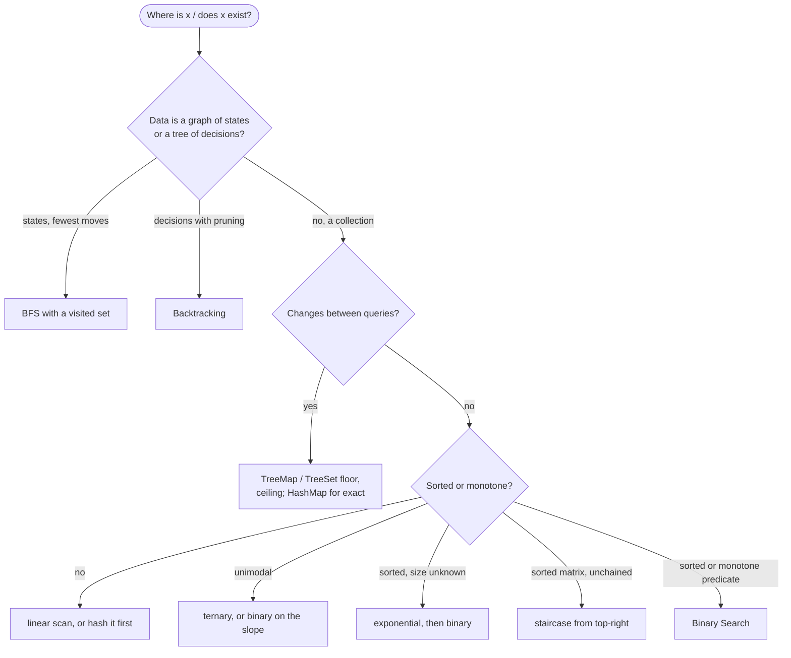

# Searching

> [!abstract] In one sentence
> Every search is a loop that discards candidates it has proven cannot be the answer, and the structure of the data decides how many it can discard per step: none (linear), half (binary on a monotone predicate), a third (ternary on a unimodal function), a row or column (sorted matrix), everything already visited (BFS/DFS over states), or a whole subtree (backtracking with pruning).

**Map:** [[Topics MOC]] → [[DSA Dashboard]]

> [!question] Predict before you read
> A matrix has every row sorted and every column sorted, but the rows are not chained (the last of row 0 may be bigger than the first of row 1). Flattening it and binary searching fails — why? And from which corner does one comparison always let you discard an entire row or an entire column?

## Why this exists

"Find x" is the most common sub-step in any algorithm, and the cost of that sub-step is usually what decides the total: a `list.contains` inside a loop makes it O(n²), a `HashSet` makes it O(n), a sorted array with binary search makes it O(n log n) with less memory. This note is the index you consult when the question is *where* or *whether* something is — it names each search, when its precondition holds, and sends you to the note that owns it: [[Binary Search]] for the monotone case, [[Graphs]] for BFS and DFS, [[Backtracking]] for decision trees, [[Hashing]] for exact-match lookups, [[Trees]] for ordered descents.

The signals: **sorted** (fully, rotated, per row and column), **unimodal / peak / first increases then decreases**, **unbounded or infinite**, **shortest number of moves / transformations** (a search over states), **exists a path / arrangement** (a search over decisions), **largest ≤ x / smallest ≥ x** (floor and ceiling), and the absence of any of these, which means linear.

## The idea from zero

Linear search is the baseline: look at each element, O(n), no precondition, and correct for everything. Every faster search buys speed with a precondition that lets it skip. The clearest picture is the sorted matrix: rows and columns both sorted, rows not chained. Start at the top-right corner. If the value is bigger than the target, the whole column below it is bigger — discard the column, step left. If it is smaller, the whole row to its left is smaller — discard the row, step down.

> [!example] Staircase search for 9: start top-right, each step kills a row or a column
> ![[Searching — Staircase search for 9- start top-right, each step kills a row or a column.excalidraw]]
> [[Searching — Staircase search for 9- start top-right, each step kills a row or a column.excalidraw|Open in Excalidraw]] — 11 > 9: column 3 is out, go left; 7 < 9: row 0 is out, go down; 8 < 9: row 1 out, go down; 9 found — at most rows + cols steps

%% excalidraw-spec
{"kind": "grid", "title": "Staircase search for 9: start top-right, each step kills a row or a column", "col_labels": ["c0", "c1", "c2", "c3"], "row_labels": ["r0", "r1", "r2", "r3"], "rows": [ [1, 4, 7, 11], [2, 5, 8, 12], [3, 6, 9, 16], [10, 13, 14, 17] ], "highlight": [ [0, 3], [0, 2], [1, 2], [2, 2] ], "arrows": [ [ [0, 3], [0, 2] ], [ [0, 2], [1, 2] ], [ [1, 2], [2, 2] ] ], "caption": "11 > 9: column 3 is out, go left; 7 < 9: row 0 is out, go down; 8 < 9: row 1 out, go down; 9 found — at most rows + cols steps"}
%%

That is the whole family in one example: find the comparison that proves a large set of candidates impossible, and make it the loop step.

## The mechanism

**Linear.** Unsorted, no structure, or a one-off query: O(n). Also the right answer when n ≤ 100 and anything cleverer costs a bug. Inside a loop, replace it with a `HashSet` or a sorted array plus binary search — the fix for most accidental O(n²).

**Binary.** A predicate that is false then true over the range — a sorted array, a rotated one, a feasibility check over candidate answers. O(log n). Owned by [[Binary Search]] with its three templates.

**Ternary.** A *strictly* unimodal function (increasing then decreasing, or the reverse) has a maximum you can find by evaluating two interior points `m1 = lo + (hi − lo) / 3` and `m2 = hi − (hi − lo) / 3`: the maximum cannot lie beyond the smaller of the two, so discard that third. O(log n) with base 3/2. Plateaus break it (equal values give no direction). On integers the simpler equivalent is binary search on the slope — "is `f(mid + 1) > f(mid)`?" is monotone for a unimodal function — which is how peak-element problems are usually solved.

> [!example] Ternary step on a unimodal array
> ![[Searching — Ternary step on a unimodal array.excalidraw]]
> [[Searching — Ternary step on a unimodal array.excalidraw|Open in Excalidraw]] — f(m1) = 7 < f(m2) = 14, so the peak is right of m1: the amber third [lo, m1] is discarded and lo becomes 3

%% excalidraw-spec
{"kind": "array", "title": "Ternary step on a unimodal array", "values": [1, 3, 7, 12, 15, 14, 9, 4], "pointers": {"lo": 0, "m1": 2, "m2": 5, "hi": 7}, "highlight": [0, 1, 2], "caption": "f(m1) = 7 < f(m2) = 14, so the peak is right of m1: the amber third [lo, m1] is discarded and lo becomes 3"}
%%

**Exponential (galloping).** A sorted array whose size you do not know, or a target expected near the front: probe indices 1, 2, 4, 8, … until the value exceeds the target (or the index runs off the end), then binary search inside the last bracket. O(log p) where p is the target's position — better than O(log n) when p ≪ n, and the trick behind searching an infinite sorted stream.

> [!example] Exponential search for 21
> ![[Searching — Exponential search for 21.excalidraw]]
> [[Searching — Exponential search for 21.excalidraw|Open in Excalidraw]] — probes at 1, 2, 4, 8 (amber) take four steps; 21 lies in [4, 8], which a binary search finishes in two more

%% excalidraw-spec
{"kind": "array", "title": "Exponential search for 21", "values": [1, 2, 3, 5, 8, 13, 21, 34, 55, 89], "pointers": {"probe": 8}, "highlight": [1, 2, 4, 8], "labels": {"8": "55 > 21: stop"}, "caption": "probes at 1, 2, 4, 8 (amber) take four steps; 21 lies in [4, 8], which a binary search finishes in two more"}
%%

**Staircase on a sorted matrix.** Rows and columns sorted, rows not chained: start at the top-right (or bottom-left), move left on "too big" and down on "too small", O(rows + cols). When rows *are* chained ([[LC 74 Search a 2D Matrix]]) the matrix is one sorted array and binary search on the flat index is O(log(rows × cols)) — know which matrix you have.

**BFS and DFS as search over states.** When the "data" is implicit — words that differ by one letter, positions of a puzzle, cells of a grid — the search space is a graph whose nodes are states and whose edges are moves. BFS finds the state with the fewest moves ([[LC 127 Word Ladder]]); DFS finds whether a state is reachable at all. The `visited` set is what makes either terminate, and the state encoding (a string, an `int` bitmask, a `record`) is what makes the set cheap. Owned by [[Graphs]].

**Backtracking as search over decisions.** When the space is a tree of partial choices — place a letter, pick a cell — search is DFS over partial solutions with pruning that cuts whole subtrees: [[LC 79 Word Search]] abandons a path on the first mismatched letter. Owned by [[Backtracking]].

**Ordered-set searches.** When the data changes between queries, keep it in a `TreeMap`/`TreeSet` (a red-black tree): `floorKey(x)` is the largest key ≤ x, `ceilingKey(x)` the smallest ≥ x, `lowerKey`/`higherKey` strict, `headMap`/`tailMap`/`subMap` give ranges — all O(log n) per operation, each returning `null` when nothing qualifies. A BST descent ([[Trees]]) is the same search without the library: go left when the target is smaller, right when larger, which is also how [[LC 235 Lowest Common Ancestor of a Binary Search Tree]] finds the split point in O(h).



> [!example]- Excalidraw version — the same diagram as an editable canvas
> ![[Searching — The mechanism.excalidraw]]
> [[Searching — The mechanism.excalidraw|Open in Excalidraw]] — needs the Excalidraw plugin (see [[Plugins to Install]]).

## Java template

```java
import java.util.*;

class Searches {
    boolean staircase(int[][] m, int target) {             // rows and columns sorted, rows not chained
        int r = 0, c = m[0].length - 1;                     // top-right corner
        while (r < m.length && c >= 0) {
            if (m[r][c] == target) return true;
            if (m[r][c] > target) c--;                      // whole column below is larger
            else r++;                                       // whole row to the left is smaller
        }
        return false;
    }

    int exponential(int[] a, int target) {                  // sorted; -1 if absent
        if (a.length == 0) return -1;
        int bound = 1;
        while (bound < a.length && a[bound] < target) bound *= 2;      // gallop: 1, 2, 4, 8, ...
        int lo = bound / 2, hi = Math.min(bound, a.length - 1);
        while (lo <= hi) {                                  // ordinary exact binary search in the bracket
            int mid = lo + (hi - lo) / 2;
            if (a[mid] == target) return mid;
            if (a[mid] < target) lo = mid + 1; else hi = mid - 1;
        }
        return -1;
    }
}
```

**Time** O(rows + cols) for the staircase, O(log p) for exponential search where p is the target's position · **Space** O(1)

```java
import java.util.*;

class Searches {
    int peakIndex(int[] a) {                                // strictly increasing then strictly decreasing
        int lo = 0, hi = a.length - 1;
        while (lo < hi) {
            int mid = lo + (hi - lo) / 2;
            if (a[mid] < a[mid + 1]) lo = mid + 1;          // still climbing: peak is to the right
            else hi = mid;                                  // descending or at the peak
        }
        return lo;
    }

    String latestVersionAtOrBefore(TreeMap<Integer, String> versions, int t) {
        Map.Entry<Integer, String> e = versions.floorEntry(t);        // largest key <= t, or null
        return e == null ? "" : e.getValue();
    }

    Integer smallestAtLeast(TreeSet<Integer> set, int x) {
        return set.ceiling(x);                              // null when every element is smaller than x
    }
}
```

**Time** O(log n) each · **Space** O(1) beyond the tree

## Complexity

| Search | Precondition | Time | Owner |
|---|---|---|---|
| linear; hash lookup | none; exact-match keys with a good `hashCode` | O(n); O(1) average | this note; [[Hashing]] |
| binary | monotone predicate (sorted, rotated, feasibility) | O(log n) | [[Binary Search]] |
| ternary / slope | strictly unimodal | O(log n) | this note |
| exponential | sorted, unbounded or target near the front | O(log p) | this note |
| staircase | matrix sorted by rows and columns | O(rows + cols) | this note |
| BFS / DFS over states | states enumerable, moves cheap | O(states + moves) | [[Graphs]] |
| backtracking | decision tree with pruning | exponential, pruned | [[Backtracking]] |
| `TreeMap` floor / ceiling, BST descent | ordered keys, balanced tree | O(log n) | [[Trees]] |

## The canonical shapes

| Shape | Recognition cue | One-line solution | Problem |
|---|---|---|---|
| Sorted array | "sorted, find target" | exact binary search | [[LC 704 Binary Search]] |
| Chained rows | "each row sorted, first of row > last of previous" | flat index binary search | [[LC 74 Search a 2D Matrix]] |
| Rotated | "sorted then rotated" | binary search on the sorted half | [[LC 33 Search in Rotated Sorted Array]] |
| Latest ≤ t | "value as of timestamp" | last-true or `floorEntry` | [[LC 981 Time Based Key-Value Store]] |
| Smallest feasible | "minimum speed / time such that" | binary search on the answer | [[LC 875 Koko Eating Bananas]] |
| Fewest transformations | "shortest sequence of one-letter changes" | BFS over words with a visited set | [[LC 127 Word Ladder]] |
| Exists an arrangement | "can the word be traced in the grid" | backtracking with early pruning | [[LC 79 Word Search]] |
| Ordered descent | "LCA in a BST", "k-th smallest in a BST" | go left or right by comparison; inorder walk | [[LC 235 Lowest Common Ancestor of a Binary Search Tree]], [[LC 230 Kth Smallest Element in a BST]] |

## Worked example

Staircase search for 9 in the matrix drawn above (`{{1,4,7,11}, {2,5,8,12}, {3,6,9,16}, {10,13,14,17}}` as a Java literal).

| step | position | value | compare | move | discarded |
|---|---|---|---|---|---|
| 1 | (0, 3) | 11 | > 9 | left | column 3 |
| 2 | (0, 2) | 7 | < 9 | down | row 0 |
| 3 | (1, 2) | 8 | < 9 | down | row 1 |
| 4 | (2, 2) | 9 | = 9 | found | — |

Four comparisons for sixteen cells; the bound is `rows + cols − 1 = 7`. A flat binary search would have read `[1, 4, 7, 11, 2, …]` as sorted and gone wrong at the first `11 > 2`. Starting from the top-left corner would not work either: both neighbours of `1` are larger, so a comparison there discards nothing — the corner must be the one where the two directions disagree.

## Pitfalls

> [!warning] The mistakes people make
> - **Confusing the two matrix problems.** Chained rows → one flat binary search; merely row-and-column sorted → staircase. Check the first element of row 1 against the last of row 0.
> - **Staircase from the wrong corner.** Top-left and bottom-right give no information; top-right and bottom-left do.
> - **Binary search on data sorted by a different key.** `Arrays.sort(intervals, by start)` then searching by end is wrong; ternary on a function with plateaus returns a plateau edge, not the peak.
> - **`floorKey` / `ceiling` returning `null`.** Unboxing it into an `int` throws; check for `null` first.
> - **Linear search hidden in a loop.** `list.contains`, `list.indexOf`, `String.indexOf` inside a `for` — the O(n²) you did not mean to write.
> - **State search without a visited set, or with a slow state key.** BFS over strings must store the visited strings in a `HashSet`; a `List` makes each check O(n) and the whole search quadratic.

## Variations & follow-ups

**K-th smallest in a sorted matrix** is binary search on the *value* with a staircase count of entries `<= mid` per step: O((rows + cols) · log(range)). **Infinite sorted array** is exponential search. **Peak element** on a general array (not unimodal) still works with the slope test because any ascent leads to some peak. **Search in a stream** keeps a `TreeSet` (or two heaps for the median). **Interpolation search** guesses the position from the value's proportion — O(log log n) on uniform data, O(n) on skewed — and **jump search** probes every √n: both are names to recognise, not tools to use in interviews. **Meet in the middle** halves an exponential search space ([[Backtracking]] territory, n ≈ 40).

## Interview script

Classify out loud before choosing: "the rows are sorted and the columns are sorted but rows are not chained, so this is the staircase walk, O(m + n), not a binary search." Or: "the states are words one letter apart and I want the fewest steps, so this is a BFS over an implicit graph with a visited set." Then name the precondition you depend on and the cost.

What the interviewer is checking: that you can tell *which* structure the data has and pick the matching search, that you know the precondition each search needs, and that you spot a linear search hidden inside a loop. Follow-ups: "what if the matrix rows are chained?", "what if the array is infinite?", "what if the function has a plateau?", "what if values are inserted between queries?" (`TreeMap`).

## Spot the bug

```java
// snippet
int r = 0, c = 0;                                    // top-left
while (r < m.length && c < m[0].length) {
    if (m[r][c] == target) return true;
    if (m[r][c] < target) c++; else r++;
}
return false;
```

> [!example]- The fix
> From the top-left both the row to the right and the column below are *larger*, so "value smaller than target" does not tell you which way to go — the loop walks a diagonal and misses targets like 10 in the matrix above. Start at the top-right (`c = cols − 1`): larger than target means the whole column is too big (`c--`), smaller means the whole row is too small (`r++`). Bottom-left works symmetrically.

## Related

### Prerequisites
- [[Binary Search]] — the monotone-predicate search this note keeps pointing at
- [[Sorting]] — most searches need the data sorted first, and sorting costs n log n

### Builds on this
- [[Graphs]] (BFS and DFS over state spaces), [[Backtracking]] (search over decisions), [[Trees]] (BST descents, `TreeMap` as a balanced tree), [[Hashing]] (exact-match lookups in O(1))
- [[Java Collections Cheat Sheet]] (`TreeMap` floor, ceiling, head and tail maps; `Arrays.binarySearch`), [[DSA Patterns in Java]], [[Java Pitfalls in Interviews]] (unboxing a `null` from `floorKey`)

### Problems that use it
- [[LC 704 Binary Search]], [[LC 74 Search a 2D Matrix]], [[LC 33 Search in Rotated Sorted Array]], [[LC 981 Time Based Key-Value Store]], [[LC 875 Koko Eating Bananas]]
- [[LC 127 Word Ladder]], [[LC 79 Word Search]], [[LC 235 Lowest Common Ancestor of a Binary Search Tree]], [[LC 230 Kth Smallest Element in a BST]]

## Personal understanding

> [!question] Explain it without the note
> Write your own explanation here, from memory, then compare with the sections above and note what you missed.

### Mastery checklist
- [ ] I can state the idea in one sentence
- [ ] I can re-derive the mechanism on a whiteboard
- [ ] I can name when NOT to use it
- [ ] I have solved three problems with it without hints
- [ ] I can explain it to a colleague in two minutes

## Open questions
- [ ] Write the k-th-smallest-in-a-sorted-matrix solution (binary search on value plus staircase count) from memory and check its complexity against the heap version; and find the linear `contains` hiding inside a loop in my own services.
