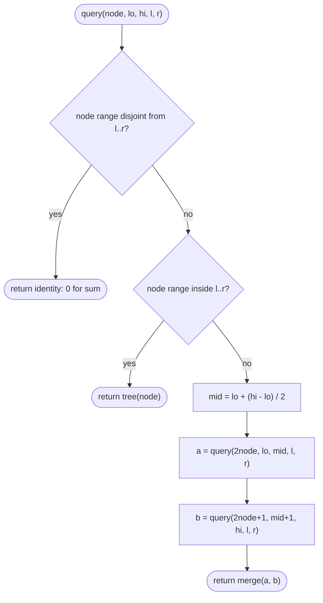

# Segment Trees

> [!abstract] In one sentence
> A segment tree is a binary tree over the halves of an array in which every node stores the answer (sum, min, max, gcd …) for its own range, so any query on `[l, r]` is assembled from at most about 2 log n stored answers and a change to one element refreshes only the log n nodes above it — turning "range query on an array that keeps changing" from O(n) per operation into O(log n).

**Map:** [[Topics MOC]] → [[DSA Dashboard]]

> [!question] Predict before you read
> An array of 10⁵ numbers receives 10⁵ mixed operations: "set a[i] = v" and "sum of a[l..r]". Prefix sums make the query O(1) but one update invalidates O(n) prefixes; a bare array makes the update O(1) but the query O(n). Which partial sums would you keep so that *both* cost O(log n), and how many of them do you need?

## Why this exists

Prefix sums from [[Arrays & Hashing]] answer a static range sum in O(1) after one O(n) pass. They break the moment the array changes: setting one element shifts every prefix to its right, so each update costs O(n), and a stream of n updates mixed with n queries costs O(n²). The segment tree is the structure for exactly that situation — **range questions on an array that keeps changing** — and gives O(log n) for both operations, for any associative operation (sum, min, max, gcd, xor, count), not only sums.

The signals in a statement are **"update … then query … many times"**, a class with methods like `update(i, v)` and `sumRange(l, r)`, **range minimum / maximum with modifications**, **"for each element, how many elements to its right are smaller"** (a range count over *values* after coordinate compression), **"the k-th remaining element after deletions"**, and **intervals painted onto a number line** where you must answer per point. If the array never changes you do not need it; if only sums with point updates are needed, the shorter [[Fenwick Trees]] wins; the segment tree is the general tool when the operation cannot be undone (min, max, gcd) or when the updates are themselves ranges. The decision flowchart for choosing between the three lives in [[Fenwick Trees]]; the short form:

| Question shape | Prefix sums | Fenwick tree | Segment tree |
|---|---|---|---|
| static array, range sum | O(1) per query after O(n) — use this | overkill | overkill |
| point update + range sum / xor / count | O(n) per update | O(log n), about 15 lines | O(log n), about 40 lines |
| point update + range min / max / gcd | no | no — min cannot be subtracted back out | O(log n), same code, different merge |
| range add + range sum | no | two Fenwick trees (the trick is in that note) | lazy propagation |
| range add + range min, range assign | no | no | lazy propagation |
| "first index where the prefix reaches k" | binary search on static prefixes | binary lifting on the tree | descend from the root |

**How often interviewers ask it.** In a 45-minute SDE-2 round a segment tree is rarely the *expected* solution — every array question in NeetCode 150 yields to prefix sums, a deque, a heap or sorting. It appears as the follow-up ("now the array can change — what breaks?"), as the design problem "range sum query, mutable" (LeetCode 307), as one of the two accepted answers for counting smaller elements to the right (LeetCode 315, the other being merge sort), and as a "do you know this structure" probe. The bar is: explain the picture, code the recursive point-update version in about ten minutes, state the complexities, and *describe* lazy propagation convincingly. Coding lazy propagation under time pressure is a bonus, not the baseline.

At work the same shape is "sum over a time window while late corrections keep arriving", a leaderboard asked "how many scores are at most x" while scores change, and per-bucket rate counters queried over arbitrary windows.

## The idea from zero

Take `[2, 1, 5, 3]`. The sum of the whole array is 11; the sum of the left half `[2, 1]` is 3 and of the right half `[5, 3]` is 8; halve again and you reach single elements. Write those sums down as a tree: the root holds 11, its children 3 and 8, and the four leaves hold the elements themselves.

> [!example] Sum tree over [2, 1, 5, 3]
> ![[Segment Trees — Sum tree over -2, 1, 5, 3-.excalidraw]]
> [[Segment Trees — Sum tree over -2, 1, 5, 3-.excalidraw|Open in Excalidraw]] — root 11 = 3 + 8; query(1, 2) = 1 + 5 is assembled from the two shaded leaves

%% excalidraw-spec
{"kind": "segtree", "title": "Sum tree over [2, 1, 5, 3]", "array": [2, 1, 5, 3], "op": "sum", "highlight_range": [1, 2], "caption": "root 11 = 3 + 8; query(1, 2) = 1 + 5 is assembled from the two shaded leaves"}
%%

Now ask for the sum of `[1, 2]` (the elements 1 and 5). Neither half contains the whole range, so split: in the left half only element 1 is wanted — that is a leaf; in the right half only element 5 — another leaf. The answer is 1 + 5 = 6, built from two stored values. A range such as `[0, 2]` would take the whole left half as one piece (3) plus one leaf (5). Whatever the range, at every level of the tree at most two nodes are *partly* inside it (the ones containing the range's two ends); every other node is either entirely in or entirely out. So a query touches O(log n) nodes.

Now set element 2 from 5 to 9. Which stored sums are now wrong? Only those whose range contains index 2: the leaf, the right half, the root — one node per level, log n + 1 in total. Fix the leaf and re-add the two children of each ancestor on the way up.

That is the entire idea, and it has three rules:

1. **A node's value is the merge of its two children** (here `+`; it can be `min`, `max`, `gcd`, anything associative).
2. **A query takes a node whole if the node's range lies inside `[l, r]`, ignores it if the two ranges are disjoint, and splits it otherwise.**
3. **An update changes one leaf and re-merges its ancestors.**

Everything else in this note is bookkeeping about where the nodes live, and the one real extension — making range *updates* fast.

## The mechanism

### The array layout: size 4n

Nothing is allocated per node. Like a binary heap, the nodes live in one array numbered from 1: node `i` has children `2i` and `2i + 1` and parent `i / 2`. The *range* a node covers is stored nowhere — the recursion carries it as `(node, lo, hi)`. The root is `(1, 0, n − 1)`; its children are `(2, lo, mid)` and `(3, mid + 1, hi)` with `mid = lo + (hi − lo) / 2`, and so on down to the leaves, where `lo == hi`.

For `[2, 1, 5, 3, 4]` (a fifth element added) the flat array looks like this:

> [!example] Flat layout of the sum tree over [2, 1, 5, 3, 4] (n = 5)
> ![[Segment Trees — Flat layout of the sum tree over -2, 1, 5, 3, 4- (n = 5).excalidraw]]
> [[Segment Trees — Flat layout of the sum tree over -2, 1, 5, 3, 4- (n = 5).excalidraw|Open in Excalidraw]] — node i has children 2i and 2i+1; the deepest index here is 9, but for n = 6 it would be 13 > 2n, so allocate 4n

%% excalidraw-spec
{"kind": "array", "title": "Flat layout of the sum tree over [2, 1, 5, 3, 4] (n = 5)", "values": [0, 15, 8, 7, 3, 5, 3, 4, 2, 1], "labels": {"0": "unused", "1": "root [0,4]", "2": "[0,2]", "3": "[3,4]", "4": "[0,1]", "5": "[2,2]", "6": "[3,3]", "7": "[4,4]", "8": "[0,0]", "9": "[1,1]"}, "highlight": [1, 2, 3], "caption": "node i has children 2i and 2i+1; the deepest index here is 9, but for n = 6 it would be 13 > 2n, so allocate 4n"}
%%

Why `4n`? With `n` elements the recursion goes ⌈log₂ n⌉ levels deep, and node numbers on the deepest level reach up to 2^(depth + 1) − 1, which is below `4n` but can exceed `2n`: for `n = 6` the recursion hands index 13 to a leaf, so an array of 12 throws. `4n` wastes memory but is never wrong; `2 · nextPowerOfTwo(n)` is the tight bound if you care. Index 0 stays unused. Note that node 5 above is a leaf at depth 2 while nodes 8 and 9 are leaves at depth 3 — uneven halves are normal, and harmless.

Filling the array is `build(node, lo, hi)`: if `lo == hi`, copy the element into `tree[node]`; otherwise build both children and *pull* — `tree[node] = merge(tree[2node], tree[2node + 1])`. Every node is visited once and there are `2n − 1` of them, so build is O(n), not O(n log n).

### Query: the (node, lo, hi, l, r) signature

The query carries two ranges: `[lo, hi]`, which the current node covers, and `[l, r]`, which is being asked for. Three cases, always checked in this order:



> [!example]- Excalidraw version — the same diagram as an editable canvas
> ![[Segment Trees — Query- the (node, lo, hi, l, r) signature.excalidraw]]
> [[Segment Trees — Query- the (node, lo, hi, l, r) signature.excalidraw|Open in Excalidraw]] — needs the Excalidraw plugin (see [[Plugins to Install]]).

The identity (0 for sum, +∞ for min) is what a disjoint node contributes; returning it instead of special-casing keeps the merge uniform. The picture for `query(2, 5)` on an eight-element array:

> [!example] query(2, 5) on [5, 3, 7, 1, 4, 6, 2, 8]
> ![[Segment Trees — query(2, 5) on -5, 3, 7, 1, 4, 6, 2, 8-.excalidraw]]
> [[Segment Trees — query(2, 5) on -5, 3, 7, 1, 4, 6, 2, 8-.excalidraw|Open in Excalidraw]] — the shaded nodes [2,3] = 8 and [4,5] = 10 are taken whole: 18; their parents are split, every other node is skipped

%% excalidraw-spec
{"kind": "segtree", "title": "query(2, 5) on [5, 3, 7, 1, 4, 6, 2, 8]", "array": [5, 3, 7, 1, 4, 6, 2, 8], "op": "sum", "highlight_range": [2, 5], "caption": "the shaded nodes [2,3] = 8 and [4,5] = 10 are taken whole: 18; their parents are split, every other node is skipped"}
%%

Why O(log n): a node is *split* only if `l` or `r` cuts through its range, and on each level at most two nodes contain a cut point (one around `l`, one around `r`). So at most four nodes are visited per level and at most two are taken, giving at most 4 log n calls and 2 log n merges.

### Point update

`update(node, lo, hi, idx, v)`: descend into the child whose range contains `idx` (left if `idx ≤ mid`), set the leaf, then pull on the way back. One root-to-leaf path of length log n; nothing else changes.

> [!question] What changes if the operation is min instead of sum?
> Exactly two lines: the identity returned for a disjoint node (`Long.MAX_VALUE` instead of `0`) and the merge (`Math.min` instead of `+`). Nothing about the layout, the recursion or the update changes. The same two lines give max (`Long.MIN_VALUE`, `Math.max`), gcd (`0`, `gcd`), xor (`0`, `^`) and counts (`0`, `+`). The operation only has to be associative — it does *not* have to be invertible, which is what prefix sums and plain Fenwick trees require. That is the whole reason this structure handles min, max and gcd and those two do not.

### The iterative bottom-up variant: size 2n

A shorter, faster version with no recursion: put the leaves at `t[n .. 2n − 1]` in order and let `t[i] = merge(t[2i], t[2i + 1])` for `i` from `n − 1` down to 1. Update: set `t[idx + n]` and climb with `i /= 2`, re-merging. Query on the half-open leaf interval `[l + n, r + n + 1)`: climb both ends one level per step; whenever `l` is odd it is a right child, so its parent would include a leaf left of the range — take `t[l]` itself and step `l` right; whenever `r` is odd, the node just before it, `t[r − 1]`, lies wholly inside — take it and step `r` left. Stop when `l ≥ r`.

> [!example] Bottom-up layout (size 2n) over [2, 1, 5, 3, 4]
> ![[Segment Trees — Bottom-up layout (size 2n) over -2, 1, 5, 3, 4-.excalidraw]]
> [[Segment Trees — Bottom-up layout (size 2n) over -2, 1, 5, 3, 4-.excalidraw|Open in Excalidraw]] — leaves sit at n..2n-1; t[2] = t[4] + t[5] mixes elements 3, 4 and 0, which is harmless because the query loop only takes a node when all of its leaves lie inside the range

%% excalidraw-spec
{"kind": "array", "title": "Bottom-up layout (size 2n) over [2, 1, 5, 3, 4]", "values": [0, 15, 9, 6, 7, 2, 1, 5, 3, 4], "labels": {"0": "unused", "1": "t2+t3", "2": "t4+t5", "3": "t6+t7", "4": "t8+t9", "5": "a0", "6": "a1", "7": "a2", "8": "a3", "9": "a4"}, "highlight": [5, 6, 7, 8, 9], "caption": "leaves sit at n..2n-1; t[2] = t[4] + t[5] mixes elements 3, 4 and 0, which is harmless because the query loop only takes a node when all of its leaves lie inside the range"}
%%

When `n` is not a power of two the internal nodes stop being contiguous ranges (`t[2]` above mixes elements 3 and 4 with element 0), but the loop never takes a node unless all of its leaves are inside the query, so the answers stay correct for any `n`. For a non-commutative merge (string concatenation, matrix product) keep two accumulators, one for pieces taken from the left end and one for pieces taken from the right end, and merge them at the end. Range *updates* are awkward in this layout; use it for point update + range query.

### Lazy propagation: range add + range sum

Range *updates* are the second half of the topic. "Add `v` to every element of `[l, r]`" touches O(n) leaves if done honestly. The idea: when a node's range lies entirely inside the update range, change its sum in one go — `sum += v × (hi − lo + 1)` — and do *not* descend; instead record in `lazy[node]` that every element below still owes `+v`. The debt is paid later, one level at a time, by `push`: before anyone descends into a node's children (during a later update *or* a query), apply the node's pending value to both children (their sums and their own `lazy`) and clear it. After the recursion returns, pull as usual. So `rangeAdd` is the query flowchart above with two extra steps: the "inside" case calls `apply` instead of returning a value, and the "split" case does `push` *before* recursing and `pull` *after*.

The invariant that makes it correct: `sum[node]` is right for its range *including* `lazy[node]` but *excluding* any pending value on its ancestors. A query never reads a child without pushing from the parent first, so every value it reads has every ancestor's debt applied. A trace of `rangeAdd(1, 3, +2)` followed by `rangeSum(3, 3)` on `[2, 1, 5, 3]`, node by node (node 1 covers `[0,3]`, node 2 `[0,1]`, node 3 `[2,3]`, nodes 4–7 are the leaves):

> [!example] Lazy trace: rangeAdd(1, 3, +2) then rangeSum(3, 3) on [2, 1, 5, 3]
> ![[Segment Trees — Lazy trace- rangeAdd(1, 3, +2) then rangeSum(3, 3) on -2, 1, 5, 3-.excalidraw]]
> [[Segment Trees — Lazy trace- rangeAdd(1, 3, +2) then rangeSum(3, 3) on -2, 1, 5, 3-.excalidraw|Open in Excalidraw]] — after the add, n3 is correct (12) and owes 2 to n6 and n7, which still show the stale 5 and 3; the query pushes that debt before reading n7

%% excalidraw-spec
{"kind": "grid", "title": "Lazy trace: rangeAdd(1, 3, +2) then rangeSum(3, 3) on [2, 1, 5, 3]", "col_labels": ["", "n1 [0,3]", "n2 [0,1]", "n3 [2,3]", "n4 [0,0]", "n5 [1,1]", "n6 [2,2]", "n7 [3,3]"], "row_labels": ["", "sum at start", "sum after add", "lazy after add", "sum after query", "lazy after query"], "rows": [ [11, 3, 8, 2, 1, 5, 3], [17, 5, 12, 2, 3, 5, 3], [0, 0, 2, 0, 0, 0, 0], [17, 5, 12, 2, 3, 7, 5], [0, 0, 0, 0, 0, 0, 0] ], "highlight": [ [1, 2], [2, 2], [3, 5], [3, 6] ], "caption": "after the add, n3 is correct (12) and owes 2 to n6 and n7, which still show the stale 5 and 3; the query pushes that debt before reading n7"}
%%

After the update, node 3 holds the correct 12 and a debt of 2; its children 6 and 7 still show the old 5 and 3. The query for index 3 pushes that debt on its way down, so node 7 reads 5 — the right answer, 3 + 2 — and node 6 is repaired as a side effect. Leaves never carry a debt: there is nobody below them to pay. Node 5, covered whole by the update as a leaf, simply became 3.

## Java template

The recursive point-update tree — the version to type from memory. `long` sums, because 10⁵ values of 10⁹ overflow `int`.

```java
import java.util.*;

class SegmentTree {
    private final int n;
    private final long[] tree;          // 1-indexed: node i has children 2i and 2i + 1

    SegmentTree(int[] a) {
        n = a.length;
        tree = new long[4 * n];         // safe upper bound on the deepest node index
        build(1, 0, n - 1, a);
    }

    private void build(int node, int lo, int hi, int[] a) {
        if (lo == hi) { tree[node] = a[lo]; return; }           // a leaf holds one element
        int mid = lo + (hi - lo) / 2;
        build(2 * node, lo, mid, a);
        build(2 * node + 1, mid + 1, hi, a);
        tree[node] = tree[2 * node] + tree[2 * node + 1];      // pull: parent = merge(children)
    }

    long query(int l, int r) { return query(1, 0, n - 1, l, r); }     // inclusive [l, r]
    private long query(int node, int lo, int hi, int l, int r) {
        if (r < lo || hi < l) return 0;                         // disjoint: the identity of the merge
        if (l <= lo && hi <= r) return tree[node];              // fully covered: use the stored value
        int mid = lo + (hi - lo) / 2;
        return query(2 * node, lo, mid, l, r) + query(2 * node + 1, mid + 1, hi, l, r);
    }

    void update(int idx, int value) { update(1, 0, n - 1, idx, value); }
    private void update(int node, int lo, int hi, int idx, int value) {
        if (lo == hi) { tree[node] = value; return; }
        int mid = lo + (hi - lo) / 2;
        if (idx <= mid) update(2 * node, lo, mid, idx, value);
        else update(2 * node + 1, mid + 1, hi, idx, value);
        tree[node] = tree[2 * node] + tree[2 * node + 1];      // re-pull on the way back up
    }
}
```

**Time** O(n) build · O(log n) query · O(log n) update · **Space** O(4n)

The bottom-up version: half the memory, no recursion, the one to use when the problem is "point update + range query" and nothing more.

```java
import java.util.*;

class IterativeSegmentTree {
    private final int n;
    private final long[] t;             // t[n .. 2n-1] are the leaves; t[i] = t[2i] + t[2i+1]

    IterativeSegmentTree(int[] a) {
        n = a.length;
        t = new long[2 * n];
        for (int i = 0; i < n; i++) t[n + i] = a[i];
        for (int i = n - 1; i >= 1; i--) t[i] = t[2 * i] + t[2 * i + 1];
    }

    void update(int idx, int value) {
        int i = idx + n;
        t[i] = value;
        for (i /= 2; i >= 1; i /= 2) t[i] = t[2 * i] + t[2 * i + 1];   // climb to the root
    }

    long query(int l, int r) {          // inclusive [l, r]
        long res = 0;
        for (l += n, r += n + 1; l < r; l /= 2, r /= 2) {   // half-open [l, r) over leaf indices
            if ((l & 1) == 1) res += t[l++];                // l is a right child: take it, step right
            if ((r & 1) == 1) res += t[--r];                // r is a right child: take the node before it
        }
        return res;
    }
}
```

**Time** O(n) build · O(log n) query · O(log n) update · **Space** O(2n)

Lazy propagation for range add + range sum. `apply` changes one node and records the debt; `push` pays it to the children.

```java
import java.util.*;

class LazySegmentTree {
    private final int n;
    private final long[] sum, lazy;     // lazy[node] = pending add for every element under node

    LazySegmentTree(int[] a) {
        n = a.length;
        sum = new long[4 * n];
        lazy = new long[4 * n];
        build(1, 0, n - 1, a);
    }

    private void build(int node, int lo, int hi, int[] a) {
        if (lo == hi) { sum[node] = a[lo]; return; }
        int mid = lo + (hi - lo) / 2;
        build(2 * node, lo, mid, a);
        build(2 * node + 1, mid + 1, hi, a);
        sum[node] = sum[2 * node] + sum[2 * node + 1];
    }

    private void apply(int node, int lo, int hi, long v) {   // add v to every element of [lo, hi]
        sum[node] += v * (hi - lo + 1);
        if (lo != hi) lazy[node] += v;                        // a leaf has nobody below to owe
    }

    private void push(int node, int lo, int hi) {            // hand the debt down one level
        if (lazy[node] == 0) return;
        int mid = lo + (hi - lo) / 2;
        apply(2 * node, lo, mid, lazy[node]);
        apply(2 * node + 1, mid + 1, hi, lazy[node]);
        lazy[node] = 0;
    }

    void rangeAdd(int l, int r, long v) { rangeAdd(1, 0, n - 1, l, r, v); }
    private void rangeAdd(int node, int lo, int hi, int l, int r, long v) {
        if (r < lo || hi < l) return;
        if (l <= lo && hi <= r) { apply(node, lo, hi, v); return; }   // covered: stop here
        push(node, lo, hi);
        int mid = lo + (hi - lo) / 2;
        rangeAdd(2 * node, lo, mid, l, r, v);
        rangeAdd(2 * node + 1, mid + 1, hi, l, r, v);
        sum[node] = sum[2 * node] + sum[2 * node + 1];
    }

    long rangeSum(int l, int r) { return rangeSum(1, 0, n - 1, l, r); }
    private long rangeSum(int node, int lo, int hi, int l, int r) {
        if (r < lo || hi < l) return 0;
        if (l <= lo && hi <= r) return sum[node];
        push(node, lo, hi);                                   // children must be current before reading them
        int mid = lo + (hi - lo) / 2;
        return rangeSum(2 * node, lo, mid, l, r) + rangeSum(2 * node + 1, mid + 1, hi, l, r);
    }
}
```

**Time** O(log n) per range add or range sum · **Space** O(8n)

Range add + range *min* is the same code with `sum[node] += v` (no length factor), `Math.min` as the pull and `Long.MAX_VALUE` as the identity. Range *assign* needs a boolean "has pending" flag beside the value, because 0 is a legitimate assignment, and when assign and add mix, an assign wipes any pending add below it while an add after an assign is kept separately and applied second.

## Complexity

| Operation | Time | Why |
|---|---|---|
| build | O(n) | 2n − 1 nodes, each pulled once |
| point update | O(log n) | one root-to-leaf path, re-pull on the way back |
| range query | O(log n) | at most 4 nodes visited per level, 2 taken |
| range update, lazy | O(log n) | same decomposition as a query; push and pull are O(1) per node — without lazy it is O(n), every covered leaf |
| space | O(4n) recursive, O(2n) iterative | the index bound; recursion depth is only log n ≈ 17 for 10⁵, never a stack problem |

The log n factor is small: 10⁵ operations on 10⁵ elements is about 2 × 10⁶ node visits. Prefix sums remain the answer for a static array, and a Fenwick tree is 2–3× faster in practice for sums because its loop touches log n memory locations with no recursion.

## The canonical shapes

| Shape | Recognition cue | One-line solution | Problems |
|---|---|---|---|
| Range sum with point updates | "`update(i, v)` and `sumRange(l, r)`, both called many times" | sum tree, point update; or a Fenwick tree | LeetCode 307 Range Sum Query – Mutable (plain text, not in NeetCode 150) |
| Count smaller to the right / inversions | "for each element, how many after it are smaller" | compress values to ranks, sweep from the right, tree of counts over ranks, prefix query before each insert | LeetCode 315 Count of Smaller Numbers After Self; LeetCode 493 Reverse Pairs |
| Range minimum / maximum | "max of every window", "min over `[l, r]` while values change" | min / max tree, identity ±∞ | [[LC 239 Sliding Window Maximum]] — could be solved with a max tree in O(n log n); the monotonic deque is the expected O(n) answer |
| Intervals onto points, coordinate compression | "intervals and queries on points", "paint segments, then ask per point" | compress endpoints, range update over compressed indices, point query | [[LC 1851 Minimum Interval to Include Each Query]] — could be solved with range-min updates sorted by interval length; the sorted sweep with a heap is the usual answer |
| k-th remaining element | "remove the k-th remaining element repeatedly", "seat the k-th free seat" | tree of ones; descend from the root into the child whose count reaches k | LeetCode 1649 Create Sorted Array through Instructions (count side); Josephus-style problems |
| Range add + range sum | "add v to every element in `[l, r]`, then sum" repeatedly | lazy propagation | LeetCode 2569 Handling Sum Queries After Update; "corporate flight bookings" (offline, a difference array suffices) |

The second shape is the one worth owning, because it converts a problem that *looks* like it has nothing to do with ranges into one. Counting how many earlier-seen values are smaller than `x` is a prefix query on a tree indexed by *value*: sweep from the right, query the count of ranks below `x`, then add one at `x`'s rank. Coordinate compression (sort the distinct values, replace each by its position) makes the value range as small as the input. The full code — twelve lines with a Fenwick tree, the same loop with `IterativeSegmentTree` above — is in [[Fenwick Trees]].

## Worked example

LeetCode 307 on `[5, 3, 7, 1, 4, 6, 2, 8]`: `sumRange(2, 5)`, then `update(3, 10)`, then `sumRange(2, 5)` again. The tree before any update is the eight-element picture in the mechanism section: root 36, `[0,3]` = 16, `[4,7]` = 20, `[0,1]` = 8, `[2,3]` = 8, `[4,5]` = 10, `[6,7]` = 10.

`query(2, 5)` makes seven calls: (1, 0..7) splits → (2, 0..3) splits → (4, 0..1) is disjoint and returns 0, (5, 2..3) is inside and returns 8 → (3, 4..7) splits → (6, 4..5) is inside and returns 10, (7, 6..7) is disjoint and returns 0. Two stored values used, answer 8 + 10 = 18 = 7 + 1 + 4 + 6. Now `update(3, 10)`: the path is (1, 0..7) → (2, 0..3) because 3 ≤ mid = 3 → (5, 2..3) → (11, 3..3) because 3 > mid = 2. The leaf becomes 10, then the pulls on the way back: node 5 = 7 + 10 = 17, node 2 = 8 + 17 = 25, node 1 = 25 + 20 = 45. Nothing on the right side of the tree was visited.

> [!example] After update(3, 10): query(2, 5) on [5, 3, 7, 10, 4, 6, 2, 8]
> ![[Segment Trees — After update(3, 10)- query(2, 5) on -5, 3, 7, 10, 4, 6, 2, 8-.excalidraw]]
> [[Segment Trees — After update(3, 10)- query(2, 5) on -5, 3, 7, 10, 4, 6, 2, 8-.excalidraw|Open in Excalidraw]] — only the leaf for index 3 and its three ancestors changed; [2,3] now reads 17 and [4,5] still 10, so query(2, 5) = 27

%% excalidraw-spec
{"kind": "segtree", "title": "After update(3, 10): query(2, 5) on [5, 3, 7, 10, 4, 6, 2, 8]", "array": [5, 3, 7, 10, 4, 6, 2, 8], "op": "sum", "highlight_range": [2, 5], "caption": "only the leaf for index 3 and its three ancestors changed; [2,3] now reads 17 and [4,5] still 10, so query(2, 5) = 27"}
%%

The second `sumRange(2, 5)` follows exactly the same seven calls and returns 17 + 10 = 27. The point to notice: the query never looked at the leaf that changed. It read node 5, which the update had already repaired. That separation — updates fix ancestors, queries trust ancestors — is why both stay logarithmic.

## Pitfalls

> [!warning] The mistakes people make
> - **The right child starts at `mid`, not `mid + 1`.** With `[lo, mid]` and `[mid, hi]` the element at `mid` is counted twice, and on a two-element range the right call never shrinks — infinite recursion. The children are `[lo, mid]` and `[mid + 1, hi]`, always.
> - **Allocating `2n` for the recursive layout.** It works for every power of two, which is what you test on, and throws for `n = 6`. Allocate `4n`.
> - **Returning `0` for a disjoint node in a min tree.** The identity must match the merge: `Long.MAX_VALUE` for min, `Long.MIN_VALUE` for max.
> - **Forgetting the pull after a point update.** The leaf is right, every ancestor is stale, and the first query exposes it. The pull line is the last line of both `build` and `update`.
> - **Reading children without pushing** in a lazy tree — see Spot the bug. And **`int` sums**: 10⁵ elements of 10⁹ overflow, so store `long` and accept `int` input.
> - **Iterative query with an inclusive `r`.** The loop works on half-open leaf indices: `r += n + 1`, not `r += n`. And a non-commutative merge there needs a left and a right accumulator, or the pieces come out in the wrong order.
> - **Coordinate compression off by one.** `binarySearch` returns a 0-based rank; a 1-indexed Fenwick needs `+ 1`, a 0-indexed segment tree does not. Decide once and say it out loud. An empty query (`l > r`, after `rank − 1` becomes `−1`) returns the identity in the recursive version and simply skips the loop in the iterative one.

## Variations & follow-ups

**Descending the tree.** "Find the first index whose prefix sum reaches k" (the k-th one, the k-th free seat) does not need a binary search over queries: at each node compare `k` with the left child's count, go left if it is enough, otherwise subtract it and go right — O(log n), one recursive function of the same `(node, lo, hi)` shape.

**Range update, point query, no push.** When every query is a single point, you do not need `push` at all: apply the update to the covering nodes and let a point query combine every node on its root-to-leaf path (sum them for range add, take the min for range chmin). That is the clean way to do [[LC 1851 Minimum Interval to Include Each Query]] offline: process intervals from longest to shortest, each as a range-min update of its length, then read each query point.

**Merge with extra state.** Maximum subarray sum over a range needs four numbers per node (total, best prefix, best suffix, best inside); the merge is five lines and the rest of the tree is unchanged. Range gcd, range count of a value and "number of distinct values" (offline) follow the same pattern: enrich the node, keep the skeleton.

**Names to recognise.** A *dynamic* (sparse) segment tree creates nodes on demand with explicit child pointers when coordinates reach 10⁹ and compression is not possible online. *Merge sort trees*, *persistent* segment trees and *2-D* segment trees add range order statistics, queries on past versions and rectangle sums; none is SDE-2 interview material, and each is a segment tree whose nodes store something heavier.

## Interview script

The cue is an array, operations that *change* it, and questions about ranges — or a counting question that becomes a range count after compression. Say: "the array changes between queries, so prefix sums break; I want O(log n) for both operations, which is a segment tree — or a Fenwick tree if it is only sums." Then:

1. Draw the picture: the array, the halves, one node per range, the root at the top. Say what a node stores and that children are `2i` and `2i + 1` in a flat array of size `4n`.
2. State the three cases of a query — disjoint, inside, split — and why only O(log n) nodes are touched (two boundary nodes per level); then the update: one path down, re-merge on the way up.
3. Code `build`, `query`, `update` with the `(node, lo, hi)` signature; say the identity and the merge as you write them, and say `long`.
4. Complexity: O(n) build, O(log n) per operation, O(4n) space. Mention the `2n` iterative version exists if they ask about memory.
5. If they add range updates: describe lazy propagation — "mark the covering node with a pending value, push it down only when someone descends" — and code it only if invited.

What the interviewer is checking: that you can explain *why* the query is logarithmic rather than just asserting it, that you know when a Fenwick tree or plain prefix sums would do, that `mid + 1` and `4n` come out right without prompting, and that you can adapt the merge to min or max on the spot. Follow-ups: "what if the operation is min?", "what if updates are ranges?", "what if values go up to 10⁹?" (compress, or a dynamic tree), "what is the recursion depth?" (log n, never a problem), "why not a balanced BST?" (it could, but the implicit layout has no pointers and no rotations).

## Spot the bug

```java
// snippet
private long rangeSum(int node, int lo, int hi, int l, int r) {
    if (r < lo || hi < l) return 0;
    if (l <= lo && hi <= r) return sum[node];
    int mid = lo + (hi - lo) / 2;
    return rangeSum(2 * node, lo, mid, l, r) + rangeSum(2 * node + 1, mid + 1, hi, l, r);
}
```

> [!example]- The fix
> This is the lazy tree's query with the `push` missing. The covering node is correct, but its children may still hold stale sums: after `rangeAdd(1, 3, +2)` in the trace above, node 3 reads 12 while nodes 6 and 7 still read 5 and 3. `rangeSum(3, 3)` splits node 3 and returns 3 instead of 5. Insert `push(node, lo, hi);` before computing `mid` — every descent, in a query or an update, must pay the parent's debt first. The same omission in `rangeAdd` corrupts the pull: `sum[node] = sum[2node] + sum[2node+1]` would add two stale children and *lose* the pending value.

## Related

### Prerequisites
- [[Recursion]] — build, query and update are one recursive shape with the `(node, lo, hi)` signature
- [[Arrays & Hashing]] — prefix sums are the static version this replaces
- [[Trees]] — a complete binary tree stored implicitly, like a heap
- [[Bit Manipulation]] — the iterative version lives on the parity of node indices

### Builds on this
- [[Fenwick Trees]] — the compact sibling for invertible operations; the comparison table is there
- [[Intervals]] — coordinate compression (a sort plus a binary search) and sweeps turn interval problems into range updates

### Problems that use it
- [[LC 239 Sliding Window Maximum]] — could be solved with a max tree; the deque is the expected answer
- [[LC 1851 Minimum Interval to Include Each Query]] — could be solved with range-min updates over compressed points
- LeetCode 307 Range Sum Query – Mutable, 315 Count of Smaller Numbers After Self, 493 Reverse Pairs, 1649 Create Sorted Array through Instructions, 2569 Handling Sum Queries After Update — not in NeetCode 150, the practice set for this note
- [[DSA Patterns in Java]] — the template vault; add the recursive class there once you can type it from memory

## Personal understanding

> [!question] Explain it without the note
> Write your own explanation here, from memory, then compare with the sections above and note what you missed.

### Mastery checklist
- [ ] I can state the idea in one sentence
- [ ] I can re-derive the mechanism on a whiteboard
- [ ] I can name when NOT to use it
- [ ] I have solved three problems with it without hints
- [ ] I can explain it to a colleague in two minutes

## Open questions
- [ ] Measured on 10⁶ operations, how much faster is the iterative tree than the recursive one in Java, and does the JIT close the gap?
- [ ] Which of my work metrics are "range sum over time with late corrections" that a segment tree over time buckets would serve better than recomputation?
