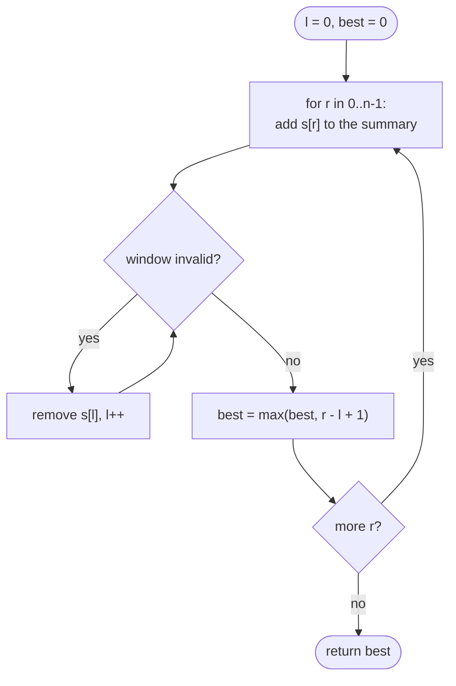

# Sliding Window

> [!abstract] In one sentence
> Instead of re-examining every subarray, keep one window and a running summary of its contents: extend the right end by one, repair the window by moving the left end forward while a validity condition is broken, and read the answer after each step — the left end never moves backwards because validity is monotone, so the total work is O(n).

**Map:** [[Topics MOC]] → [[DSA Dashboard]]

> [!question] Predict before you read
> Longest substring without repeating characters, `"abcabcbb"`. The right end reaches the second `a`. How far must the left end move, why never further than one past the earlier `a`, and what single piece of information makes that jump O(1)?

## Why this exists

"Longest substring with …", "shortest subarray whose …", "does `s2` contain a permutation of `s1`", "maximum of every window of size k": the brute force enumerates O(n²) ranges and spends O(n) checking each, O(n³) in total. The window technique observes that when the range moves by one position, its summary changes by one element in and one element out — so the check is O(1) and the whole scan O(n). It is [[Two Pointers]] with both pointers moving right and an invariant about what lies between them.

The signals: **substring**, **subarray**, **contiguous**, **window of size k**, **longest / shortest / count of** ranges with a property, **at most k distinct**, **anagram or permutation inside a string**, **max or min of each window**.

## The idea from zero

A fixed window of size 3 over `[2, 1, 5, 1, 3, 2]`: the first window sums to 8. Sliding one step adds `a[3]` and removes `a[0]` — two operations, not three.

> [!example] Fixed window of size 3 slides one step: + a[3], - a[0]
> ![[Sliding Window — Fixed window of size 3 slides one step- + a-3-, - a-0-.excalidraw]]
> [[Sliding Window — Fixed window of size 3 slides one step- + a-3-, - a-0-.excalidraw|Open in Excalidraw]] — sum goes 8 -> 8 - 2 + 1 = 7 without re-adding the middle; every slide is O(1)

%% excalidraw-spec
{"kind": "array", "title": "Fixed window of size 3 slides one step: + a[3], - a[0]", "values": [2, 1, 5, 1, 3, 2], "pointers": {"l": 1, "r": 3}, "highlight": [1, 2, 3], "labels": {"0": "left", "3": "entered"}, "caption": "sum goes 8 -> 8 - 2 + 1 = 7 without re-adding the middle; every slide is O(1)"}
%%

A variable window does the same with a condition instead of a size. Extend `r`; if the window became invalid, advance `l` until it is valid again; now `[l, r]` is the widest valid window ending at `r`, so record its length. For "no repeated characters" the summary is the last index of every character: when `s[r]` was last seen at position p ≥ l, the window must start at p + 1.

> [!example] abcabcbb at r = 3: the second a forces l past the first a
> ![[Sliding Window — abcabcbb at r = 3- the second a forces l past the first a.excalidraw]]
> [[Sliding Window — abcabcbb at r = 3- the second a forces l past the first a.excalidraw|Open in Excalidraw]] — last[a] = 0 >= l, so l = 1; window bca has length 3; best stays 3

%% excalidraw-spec
{"kind": "array", "title": "abcabcbb at r = 3: the second a forces l past the first a", "values": ["a", "b", "c", "a", "b", "c", "b", "b"], "pointers": {"l": 1, "r": 3}, "highlight": [1, 2, 3], "labels": {"0": "last a = 0"}, "caption": "last[a] = 0 >= l, so l = 1; window bca has length 3; best stays 3"}
%%

## The mechanism

**The template.** `for r in 0..n−1`: add `s[r]` to the summary; `while` the window is invalid, remove `s[l]` and `l++`; then update the answer with `r − l + 1`. The loop invariant after the `while`: *`[l, r]` is the longest valid window that ends at `r`*. Since every valid window ends somewhere, taking the max over all `r` covers them all.

**Why `l` never goes back — the monotonicity requirement.** The template is correct only when *every window containing an invalid window is itself invalid* (equivalently, shrinking a valid window keeps it valid). "No repeats", "at most k distinct", "sum ≤ S with non-negative values" all satisfy it. "Sum equals k with negative numbers" does not — adding elements can fix a too-large sum — and then you need prefix sums with a hash map ([[Arrays & Hashing]]). "Exactly k distinct" does not either; use `atMost(k) − atMost(k − 1)`.

**Shortest instead of longest.** Flip the roles: `while` the window is *valid*, record `r − l + 1` and shrink. [[LC 76 Minimum Window Substring]] is this with a `need[]` count array for `t` and a `formed` counter of how many characters currently satisfy `have[c] >= need[c]`; the window is valid when `formed == required`, and `formed` changes only when a count crosses its requirement, so each step stays O(1).

**Counts.** `int[26]` or `int[128]` instead of `Map<Character, Integer>`: no boxing, and comparing two windows is `Arrays.equals` over 26 ints ([[LC 567 Permutation in String]]). For [[LC 424 Longest Repeating Character Replacement]] the window is valid when `len − maxFreq ≤ k`; `maxFreq` is the largest count seen in *any* window so far and is never decreased — a stale value can only keep the window from growing until a genuinely larger `maxFreq` appears, and the answer only improves when `maxFreq` does, so the result is still correct.

**Maximum of every window — the monotonic deque.** For [[LC 239 Sliding Window Maximum]] keep a deque of *indices* whose values are decreasing from front to back. On each `r`: pop from the back every index whose value is ≤ `nums[r]` (it can never be a maximum again while `r` is in the window), push `r`; pop the front if it fell out of the window; the front is the answer. Each index enters and leaves once, so O(n). This is the deque cousin of the [[Stack & Monotonic Stack]].

> [!example] Deque of indices for nums = [1,3,-1,-3,5,3,6,7], k = 3, after r = 5
> ![[Sliding Window — Deque of indices for nums = -1,3,-1,-3,5,3,6,7-, k = 3, after r = 5.excalidraw]]
> [[Sliding Window — Deque of indices for nums = -1,3,-1,-3,5,3,6,7-, k = 3, after r = 5.excalidraw|Open in Excalidraw]] — deque holds [4, 5]: 5 and 3, decreasing; indices 2 and 3 were popped when 5 arrived; window max is nums[4] = 5

%% excalidraw-spec
{"kind": "array", "title": "Deque of indices for nums = [1,3,-1,-3,5,3,6,7], k = 3, after r = 5", "values": [1, 3, -1, -3, 5, 3, 6, 7], "pointers": {"front": 4, "back": 5}, "highlight": [4, 5], "labels": {"3": "popped by 5", "4": "max"}, "caption": "deque holds [4, 5]: 5 and 3, decreasing; indices 2 and 3 were popped when 5 arrived; window max is nums[4] = 5"}
%%



> [!example]- Excalidraw version — the same diagram as an editable canvas
> ![[Sliding Window — The mechanism.excalidraw]]
> [[Sliding Window — The mechanism.excalidraw|Open in Excalidraw]] — needs the Excalidraw plugin (see [[Plugins to Install]]).

## Java template

```java
import java.util.*;

class Solution {
    public int lengthOfLongestSubstring(String s) {
        int[] last = new int[128];                           // last index + 1 of each char; 0 = never seen
        int best = 0, l = 0;
        for (int r = 0; r < s.length(); r++) {
            char c = s.charAt(r);
            l = Math.max(l, last[c]);                        // jump l past the previous occurrence, never backwards
            last[c] = r + 1;
            best = Math.max(best, r - l + 1);
        }
        return best;
    }
}
```

**Time** O(n) · **Space** O(1) — the fixed-size variant ([[LC 567 Permutation in String]]) is the same loop with `have[in]++`, `have[out]--` and `Arrays.equals(need, have)` after each slide

```java
import java.util.*;

class Solution {
    public String minWindow(String s, String t) {
        int[] need = new int[128], have = new int[128];
        int required = 0;
        for (char c : t.toCharArray()) if (need[c]++ == 0) required++;   // distinct chars that must be satisfied
        int formed = 0, l = 0, bestLen = Integer.MAX_VALUE, bestL = 0;
        for (int r = 0; r < s.length(); r++) {
            char c = s.charAt(r);
            if (++have[c] == need[c]) formed++;                           // crossed the requirement upwards
            while (formed == required) {                                  // valid: record, then try to shrink
                if (r - l + 1 < bestLen) { bestLen = r - l + 1; bestL = l; }
                char out = s.charAt(l++);
                if (have[out]-- == need[out]) formed--;                   // crossed it downwards
            }
        }
        return bestLen == Integer.MAX_VALUE ? "" : s.substring(bestL, bestL + bestLen);
    }
}
```

**Time** O(|s| + |t|) · **Space** O(1) — two 128-entry arrays

```java
import java.util.*;

class Solution {
    public int[] maxSlidingWindow(int[] nums, int k) {
        int n = nums.length;
        int[] out = new int[n - k + 1];
        Deque<Integer> dq = new ArrayDeque<>();                           // indices, values decreasing front to back
        for (int r = 0; r < n; r++) {
            while (!dq.isEmpty() && nums[dq.peekLast()] <= nums[r]) dq.pollLast();   // dominated: never a max again
            dq.offerLast(r);
            if (dq.peekFirst() <= r - k) dq.pollFirst();                  // front fell out of the window
            if (r >= k - 1) out[r - k + 1] = nums[dq.peekFirst()];
        }
        return out;
    }
}
```

**Time** O(n) · **Space** O(k)

## Complexity

| Window | Time | Space | Why |
|---|---|---|---|
| fixed size k, numeric summary | O(n) | O(1) | one add, one remove per slide |
| variable, count-based validity | O(n) | O(alphabet) | `l` and `r` each advance at most n times |
| minimum window with `formed` | O(n + m) | O(alphabet) | validity check is a counter compare, not a scan over 26 |
| window max with a deque | O(n) | O(k) | each index pushed once and popped once |
| the brute force these replace | O(n²) to O(n³) | O(1) | every range, re-scanned |

## The canonical shapes

| Shape | Recognition cue | One-line solution | Problem |
|---|---|---|---|
| Best pair with order | "buy before you sell" | running minimum as the window's left side, profit at each `r` | [[LC 121 Best Time to Buy and Sell Stock]] |
| Longest with no repeats | "longest substring without repeating" | last-index array, jump `l` | [[LC 3 Longest Substring Without Repeating Characters]] |
| Longest with k edits | "replace at most k characters" | valid iff `len − maxFreq ≤ k` | [[LC 424 Longest Repeating Character Replacement]] |
| Fixed-size anagram | "contains a permutation of" | window of size `|s1|`, compare 26 counts | [[LC 567 Permutation in String]] |
| Shortest covering | "minimum window containing all of t" | shrink while valid, `formed` counter | [[LC 76 Minimum Window Substring]] |
| Window extremum | "max of each window of size k" | monotonic deque of indices | [[LC 239 Sliding Window Maximum]] |

## Worked example

[[LC 3 Longest Substring Without Repeating Characters]] on `"abcabcbb"`, with `last[c]` holding index + 1.

| r | char | last[c] before | l after | window | best |
|---|---|---|---|---|---|
| 0, 1, 2 | a, b, c | 0, 0, 0 | 0 | abc | 3 |
| 3 | a | 1 | 1 | bca | 3 |
| 4 | b | 2 | 2 | cab | 3 |
| 5 | c | 3 | 3 | abc | 3 |
| 6 | b | 5 | 5 | cb | 3 |
| 7 | b | 7 | 7 | b | 3 |

> [!example] r = 6: the b at index 4 pushes l to 5
> ![[Sliding Window — r = 6- the b at index 4 pushes l to 5.excalidraw]]
> [[Sliding Window — r = 6- the b at index 4 pushes l to 5.excalidraw|Open in Excalidraw]] — l = max(l, last[b]) = max(3, 5) = 5. The max() is the subtle line: without it a stale small last[] value, for a character last seen before the current l, would drag l backwards and admit a repeat

%% excalidraw-spec
{"kind": "array", "title": "r = 6: the b at index 4 pushes l to 5", "values": ["a", "b", "c", "a", "b", "c", "b", "b"], "pointers": {"l": 5, "r": 6}, "highlight": [5, 6], "labels": {"4": "last b = 4"}, "caption": "l = max(l, last[b]) = max(3, 5) = 5. The max() is the subtle line: without it a stale small last[] value, for a character last seen before the current l, would drag l backwards and admit a repeat"}
%%

## Pitfalls

> [!warning] The mistakes people make
> - **`if` instead of `while` when shrinking.** One removal may not restore validity; the window then carries an invalid state forward and reports lengths that are too long.
> - **Recording at the wrong moment.** For *longest*, update after the shrink loop (window valid). For *shortest*, update inside the loop while the window is valid, before shrinking.
> - **Applying the template to a non-monotone condition.** Sums with negative numbers, "exactly k", "sum equals target" — the left pointer would need to go back. Use prefix sums or `atMost(k) − atMost(k − 1)`.
> - **Map bookkeeping.** With a `HashMap` of counts, remove a key when its count hits 0 or `map.size()` is not the number of distinct characters; and compare boxed counts with `equals`, not `==`.
> - **Deque holding values instead of indices.** You cannot tell when a value has left the window; store indices and evict by `index <= r − k`.
> - **Off-by-one on length.** The window `[l, r]` has `r − l + 1` elements; the first full window of size k ends at `r = k − 1`.

## Variations & follow-ups

**Exactly k** of anything is `atMost(k) − atMost(k − 1)`. **Counting subarrays** that satisfy a monotone property: after the shrink, every window ending at `r` and starting at or after `l` is valid, so add `r − l + 1`. **Window minimum** is the same deque with the comparison flipped; **both max and min** (e.g. "longest subarray with max − min ≤ limit") needs two deques. **Two-string windows** ([[LC 567 Permutation in String]], anagram positions) use a fixed size equal to the pattern length. **Streams**: a fixed-size window over a time series is the rate limiter and moving average from the HLD vault — the deque is the same data structure.

## Interview script

Say the invariant: "I keep a window `[l, r]` and the counts inside it; after processing `r`, the window is the longest valid one ending at `r`, so the answer is the max of its length over all `r`." Then the monotonicity: "shrinking never needs to undo, because a window containing an invalid window is invalid — that is what makes `l` move only forward and the whole thing O(n)." For the deque problem: "indices in decreasing value order; a new element evicts everything smaller behind it, because those can never be the maximum again."

What the interviewer is checking: whether you can state the condition that makes the technique valid, whether you record the answer at the right point (longest vs shortest), and whether your summary is O(1) to update and to test. Follow-ups: "what if the numbers can be negative?", "count the subarrays instead of finding the longest", "what if the alphabet is Unicode?" (map instead of `int[26]`), "stream the input — what do you keep?"

## Spot the bug

```java
// snippet
for (int r = 0; r < s.length(); r++) {
    count[s.charAt(r)]++;
    if (distinct(count) > k) {          // "shrink"
        count[s.charAt(l)]--;
        l++;
    }
    best = Math.max(best, r - l + 1);
}
```

> [!example]- The fix
> Removing one character may leave the window still over k distinct (the removed character may have had count 2), so the `if` must be a `while (distinct(count) > k)`. The second problem is `distinct(count)` as a scan over the array on every step — keep a `distinct` counter that changes only when a count moves between 0 and 1 (`if (count[c]++ == 0) distinct++;` and `if (--count[c] == 0) distinct--;`), so each step is O(1) and the whole loop O(n).

## Related

### Prerequisites
- [[Two Pointers]] — the same two indices, moving the same way
- [[Arrays & Hashing]] — counting with `int[26]`, and the prefix-sum fallback for non-monotone conditions

### Builds on this
- [[Stack & Monotonic Stack]] — the monotonic deque is its two-ended cousin
- [[Strings]] — char arithmetic, anagram signatures, `StringBuilder`
- [[DSA Patterns in Java]], [[Java Collections Cheat Sheet]] (`ArrayDeque` methods: `offerLast`, `pollFirst`, `peekLast`), [[Java Pitfalls in Interviews]]

### Problems that use it
- [[LC 121 Best Time to Buy and Sell Stock]], [[LC 3 Longest Substring Without Repeating Characters]], [[LC 424 Longest Repeating Character Replacement]]
- [[LC 567 Permutation in String]], [[LC 76 Minimum Window Substring]], [[LC 239 Sliding Window Maximum]]

## Personal understanding

> [!question] Explain it without the note
> Write your own explanation here, from memory, then compare with the sections above and note what you missed.

### Mastery checklist
- [ ] I can state the idea in one sentence
- [ ] I can re-derive the mechanism on a whiteboard
- [ ] I can name when NOT to use it
- [ ] I have solved three problems with it without hints
- [ ] I can explain it to a colleague in two minutes

## Open questions
- [ ] Write out, in three lines, why the never-decreasing `maxFreq` in LC 424 cannot produce a wrong answer — then test it on `"AABABBA", k = 1` by hand. And which of my services computes a moving average or a rate limit with a full re-scan where a deque would do?
