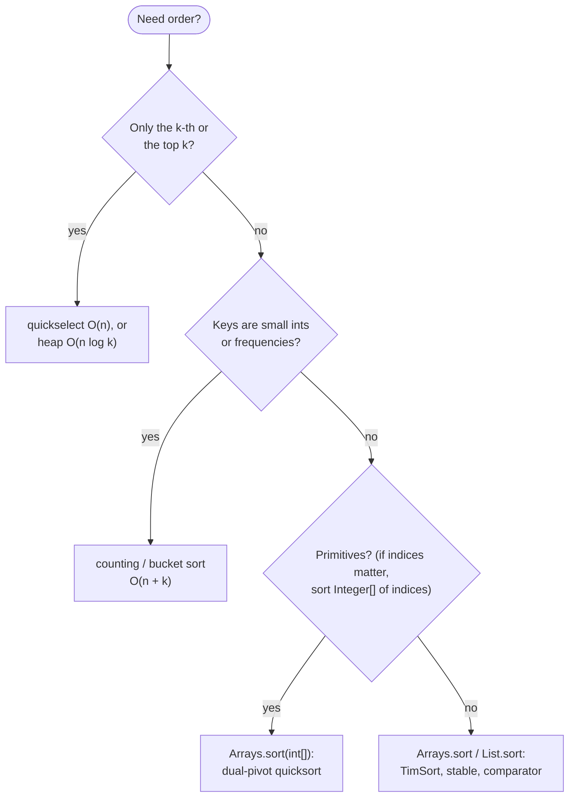

# Sorting

> [!abstract] In one sentence
> Sorting costs O(n log n) once and buys ordered access forever after — adjacent elements are the closest, overlapping intervals are neighbours, the k-th element is at index k — so most of the time you do not implement a sort, you *choose* one (library, counting, quickselect, heap) and write a comparator that is correct for the key, the direction and the ties.

**Map:** [[Topics MOC]] → [[DSA Dashboard]]

> [!question] Predict before you read
> `Arrays.sort(nums, (a, b) -> a - b)` on an `Integer[]` containing `Integer.MAX_VALUE` and `-5`. What order comes out, and why does it compile and run without an exception? Separately: why can you not pass a comparator to `Arrays.sort(int[])` at all?

## Why this exists

A surprising number of medium problems are "sort, then one linear pass": merge intervals, schedule meetings, count fleets, find triplets, connect points cheaply. The sort is what makes the pass *correct* — after sorting, the only candidates that matter are adjacent — and n log n is the price. You rarely write a sorting algorithm in an interview, but you must know what the library does (stable or not, worst case or not), when a non-comparison sort beats it (small integer ranges, frequencies), and when you do not need a full sort at all (top-k, the k-th element). The signals: **intervals / meetings / events**, **pairs or triplets with a condition**, **k-th largest / smallest**, **closest / adjacent / consecutive**, **custom order** ("sort by frequency, then value"), **relative order must be preserved** (stability), **counting inversions**.

## The idea from zero

Merge sort is the sort you can prove in your head: split the array in half, sort each half (trust the recursion, see [[Recursion]]), then merge two sorted halves in one pass by always taking the smaller front element.

> [!example] Merge sort recursion on [5,2,4,7,1,3]
> ![[Sorting — Merge sort recursion on -5,2,4,7,1,3-.excalidraw]]
> [[Sorting — Merge sort recursion on -5,2,4,7,1,3-.excalidraw|Open in Excalidraw]] — log n levels, O(n) merging work per level: n log n. Merging 2 4 5 with 1 3 7 gives 1 2 3 4 5 7. Every comparison sort meets the same bound, which is a lower bound: n! orderings need log2(n!) = about n log n yes/no answers to tell apart; only non-comparing sorts (counting, radix, bucket) beat it, and only for small integer keys

%% excalidraw-spec
{"kind": "tree", "title": "Merge sort recursion on [5,2,4,7,1,3]", "nodes": [{"id": "r", "label": "5 2 4 7 1 3", "children": ["a", "b"]}, {"id": "a", "label": "5 2 4", "children": ["c", "d"]}, {"id": "b", "label": "7 1 3", "children": ["e", "f"]}, {"id": "c", "label": "5", "children": []}, {"id": "d", "label": "2 4", "children": ["g", "h"]}, {"id": "e", "label": "7", "children": []}, {"id": "f", "label": "1 3", "children": ["i", "j"]}, {"id": "g", "label": "2", "children": []}, {"id": "h", "label": "4", "children": []}, {"id": "i", "label": "1", "children": []}, {"id": "j", "label": "3", "children": []}], "root": "r", "highlight": ["a", "b"], "caption": "log n levels, O(n) merging work per level: n log n. Merging 2 4 5 with 1 3 7 gives 1 2 3 4 5 7. Every comparison sort meets the same bound, which is a lower bound: n! orderings need log2(n!) = about n log n yes/no answers to tell apart; only non-comparing sorts (counting, radix, bucket) beat it, and only for small integer keys"}
%%

## The mechanism

**Merge sort.** Stable, O(n log n) always, O(n) extra space; natural for linked lists (no extra space, no random access needed) and for **counting inversions**: while merging, every time an element from the right half is taken before the remaining left elements, those `mid − i + 1` left elements each form an inversion with it.

**Quicksort and quickselect.** Pick a pivot, partition so that smaller elements are left of it and larger right (Lomuto: a single write pointer `i` sweeps `j`, swapping in elements smaller than the pivot), and recurse into both sides. O(n log n) average, O(n²) if the pivot is always extreme — sorted input with "last element as pivot" — so pick it at random. Quick**select** recurses into *one* side only, the one containing the index you want: O(n) expected, which is how [[LC 215 Kth Largest Element in an Array]] beats the n log n sort.

> [!example] Lomuto partition with pivot 4 on [3,2,1,5,6,4]: after the sweep, before the final swap
> ![[Sorting — Lomuto partition with pivot 4 on -3,2,1,5,6,4-- after the sweep, before the final swap.excalidraw]]
> [[Sorting — Lomuto partition with pivot 4 on -3,2,1,5,6,4-- after the sweep, before the final swap.excalidraw|Open in Excalidraw]] — everything in [lo, i) is < 4; swap(i, hi) puts 4 at index 3, its final position; sides [3,2,1] and [6,5] are then sorted independently

%% excalidraw-spec
{"kind": "array", "title": "Lomuto partition with pivot 4 on [3,2,1,5,6,4]: after the sweep, before the final swap", "values": [3, 2, 1, 5, 6, 4], "pointers": {"i": 3, "j": 5, "pivot": 5}, "highlight": [0, 1, 2], "caption": "everything in [lo, i) is < 4; swap(i, hi) puts 4 at index 3, its final position; sides [3,2,1] and [6,5] are then sorted independently"}
%%

**Heap sort, counting and bucket sort.** Heap sort builds a max-heap in O(n) and pops the maximum n times: O(n log n), in place, not stable; in interviews you use the heap for *partial* sorting instead — top-k in O(n log k) with a `PriorityQueue` ([[Heaps & Priority Queues]]). When keys are integers in a small range `0..k`: count occurrences, prefix-sum the counts into positions, place each element — O(n + k), stable if you place from the back. Bucket sort by *frequency* is [[LC 347 Top K Frequent Elements]]: frequencies lie in `1..n`, so index a list of buckets by frequency ([[Arrays & Hashing]]). Radix sort is counting sort per digit, O(d · (n + k)).

> [!example] Counting sort of [3,1,3,7,3,1] with keys 0..7: count[] then prefix positions
> ![[Sorting — Counting sort of -3,1,3,7,3,1- with keys 0..7- count-- then prefix positions.excalidraw]]
> [[Sorting — Counting sort of -3,1,3,7,3,1- with keys 0..7- count-- then prefix positions.excalidraw|Open in Excalidraw]] — prefix sums turn counts into end positions [0,2,2,5,5,5,5,6]; placing from the back keeps equal keys in input order

%% excalidraw-spec
{"kind": "array", "title": "Counting sort of [3,1,3,7,3,1] with keys 0..7: count[] then prefix positions", "values": [0, 2, 0, 3, 0, 0, 0, 1], "highlight": [1, 3, 7], "labels": {"1": "1 x2", "3": "3 x3", "7": "7 x1"}, "caption": "prefix sums turn counts into end positions [0,2,2,5,5,5,5,6]; placing from the back keeps equal keys in input order"}
%%

**What Java actually runs.** `Arrays.sort(int[])` (and `long[]`, `char[]`, …) is dual-pivot quicksort with insertion sort for tiny ranges and, since JDK 14, a heap-sort fallback when recursion gets deep — so O(n log n) worst case, in place, not stable (stability is meaningless for primitives anyway). `Arrays.sort(T[])`, `Arrays.sort(T[], Comparator)`, `List.sort`, `Collections.sort` run **TimSort**: a merge sort that finds already-sorted runs, O(n log n) worst, O(n) on nearly sorted input, **stable**, O(n) extra space. TimSort also *detects* an inconsistent comparator and throws `IllegalArgumentException: Comparison method violates its general contract!` — which is how a subtraction overflow sometimes surfaces, and sometimes silently does not.

**Comparators.** `Integer.compare(a, b)`, never `a − b` (overflow when the signs differ and the magnitudes are large). Build multi-key orders with `Comparator.comparingInt(...).thenComparing(...)` and flip with `.reversed()` — on the *whole* comparator or on one key, and know which you meant. `int[]` has no comparator overload: sort ascending and read backwards, or sort an `Integer[]`. `int[][]` is an array of objects, so `Arrays.sort(intervals, (a, b) -> Integer.compare(a[0], b[0]))` is legal and ties keep their input order.

**Sorting as the first move.** Intervals: sort by start, then overlapping ones are adjacent ([[Intervals]]). Greedy: sort by end time, deadline, or ratio, then take in order ([[Greedy]]). Pairs: sort, then [[Two Pointers]] or [[Binary Search]]. Graphs: Kruskal sorts the edges, then unions ([[Advanced Graphs]], [[Union-Find]]). Grouping: sort each string to make an anagram key ([[Hashing]]). Car fleet: sort by position, then one stack pass ([[Stack & Monotonic Stack]]). **When a full sort is the wrong move:** you only need the k-th or the top k (quickselect O(n), heap O(n log k)); keys are small integers (counting, O(n + k)); the input is a stream (heap, `TreeMap`); indices matter and sorting would lose them (sort an `Integer[]` of indices, or pairs); n is 10⁷ and n log n is the bottleneck (counting or radix); or the problem only needs a `HashSet` and sorting is an n log n detour to an O(n) answer.



> [!example]- Excalidraw version — the same diagram as an editable canvas
> ![[Sorting — The mechanism.excalidraw]]
> [[Sorting — The mechanism.excalidraw|Open in Excalidraw]] — needs the Excalidraw plugin (see [[Plugins to Install]]).

## Java template

```java
import java.util.*;

class Sorts {
    long inversions = 0;                                        // pairs i < j with a[i] > a[j]

    void mergeSort(int[] a) { if (a.length > 1) sort(a, 0, a.length - 1, new int[a.length]); }

    private void sort(int[] a, int lo, int hi, int[] buf) {
        if (lo >= hi) return;
        int mid = lo + (hi - lo) / 2;
        sort(a, lo, mid, buf);
        sort(a, mid + 1, hi, buf);
        int i = lo, j = mid + 1, k = lo;
        while (i <= mid && j <= hi) {
            if (a[i] <= a[j]) buf[k++] = a[i++];                // <= keeps equal elements in order: stable
            else { buf[k++] = a[j++]; inversions += mid - i + 1; }   // a[j] is smaller than every remaining left element
        }
        while (i <= mid) buf[k++] = a[i++];
        while (j <= hi) buf[k++] = a[j++];
        System.arraycopy(buf, lo, a, lo, hi - lo + 1);
    }
}
```

**Time** O(n log n) · **Space** O(n) for the buffer — counting sort is four lines: `count[x]++`, prefix-sum the counts, then `out[--count[a[i]]] = a[i]` walking `i` from the back

```java
import java.util.*;

class Solution {
    private final Random rnd = new Random();

    public int findKthLargest(int[] a, int k) {
        int lo = 0, hi = a.length - 1, target = a.length - k;   // k-th largest sits at index n - k once sorted
        while (lo < hi) {
            int p = partition(a, lo, hi);
            if (p == target) return a[p];
            if (p < target) lo = p + 1; else hi = p - 1;       // descend into one side only
        }
        return a[lo];
    }

    private int partition(int[] a, int lo, int hi) {           // Lomuto; returns the pivot's final index
        swap(a, lo + rnd.nextInt(hi - lo + 1), hi);            // random pivot: defeats sorted-input worst case
        int pivot = a[hi], i = lo;                             // invariant: a[lo..i) < pivot
        for (int j = lo; j < hi; j++) if (a[j] < pivot) swap(a, i++, j);
        swap(a, i, hi);
        return i;
    }

    private void swap(int[] a, int i, int j) { int t = a[i]; a[i] = a[j]; a[j] = t; }
}
```

**Time** O(n) expected, O(n²) worst (vanishingly unlikely with a random pivot) · **Space** O(1)

```java
import java.util.*;

record Job(String name, int priority, int deadline) {}

class ComparatorCookbook {
    void examples(int[][] intervals, Integer[] boxed, List<Job> jobs, Map<String, Integer> freq) {
        Arrays.sort(intervals, (a, b) -> Integer.compare(a[0], b[0]));   // int[] rows are objects: comparator allowed, ties stable
        Arrays.sort(boxed, Collections.reverseOrder());                  // descending needs Integer[]; int[] has no comparator overload
        jobs.sort(Comparator.comparingInt(Job::priority).reversed()      // highest priority first ...
                            .thenComparingInt(Job::deadline)             // ... then earliest deadline ...
                            .thenComparing(Job::name));                  // ... then name, for a deterministic order
        List<Map.Entry<String, Integer>> byCount = new ArrayList<>(freq.entrySet());
        byCount.sort(Map.Entry.<String, Integer>comparingByValue().reversed());   // explicit type args: inference fails through reversed()
        int[] primitivesDesc = Arrays.stream(boxed).mapToInt(Integer::intValue).toArray();   // back to int[] after sorting boxed
    }
}
```

**Time** O(n log n) each · **Space** O(n) for TimSort's buffer

## Complexity

| Algorithm | Average | Worst | Extra space | Stable | Use it when |
|---|---|---|---|---|---|
| merge sort | n log n | n log n | O(n) | yes | linked lists, inversion counting, you must prove the bound |
| quicksort (random pivot); dual-pivot `Arrays.sort(int[])` | n log n | n²; n log n since JDK 14 | O(log n) | no | in place; primitives |
| quickselect | n | n² | O(1) | — | the k-th element, top-k without full order |
| heap sort | n log n | n log n | O(1) | no | guaranteed bound in place; top-k via `PriorityQueue` in n log k |
| counting / bucket | n + k | n + k | O(k) | yes | small integer keys, frequencies |
| TimSort (`Arrays.sort(T[])`) | n log n | n log n | O(n) | yes | objects, comparators, nearly sorted input runs in O(n) |

## The canonical shapes

Sorting as the first move, with what the sort makes adjacent.

| Shape | Recognition cue | After sorting … | Problem |
|---|---|---|---|
| Overlapping intervals; interval scheduling | "merge", "overlap"; "minimum removals", "max non-overlapping" | by start: an interval overlaps only its neighbour; by end: greedy keeps the earliest-ending | [[LC 56 Merge Intervals]], [[LC 252 Meeting Rooms]]; [[LC 435 Non-overlapping Intervals]] |
| Minimum spanning tree | "min cost to connect all points" | edges by weight: Kruskal with [[Union-Find]] | [[LC 1584 Min Cost to Connect All Points]] |
| Consecutive groups | "hand of k consecutive cards" | by value (or `TreeMap`): build each group from its smallest card | [[LC 846 Hand of Straights]] |
| Positions then one pass | "cars merge into fleets" | by position: a stack of fleet times | [[LC 853 Car Fleet]] |
| Pairs by two pointers | "triplets summing to zero" | by value: fix one, walk two pointers | [[LC 15 3Sum]] |
| Partial order only | "k-th largest", "k most frequent", "k closest" | not at all: quickselect, bucket sort by count, or a heap of size k | [[LC 215 Kth Largest Element in an Array]], [[LC 347 Top K Frequent Elements]], [[LC 973 K Closest Points to Origin]] |
| Canonical key | "group anagrams" | each string's letters: equal keys mean anagrams | [[LC 49 Group Anagrams]] |

## Worked example

[[LC 215 Kth Largest Element in an Array]] on `[3, 2, 1, 5, 6, 4]`, `k = 2`, so the target index is `6 − 2 = 4`. Suppose the random pivot picks 4 first.

| lo | hi | pivot | after partition | p | compare with 4 | next |
|---|---|---|---|---|---|---|
| 0 | 5 | 4 | `[3, 2, 1, 4, 6, 5]` | 3 | p < target | lo = 4 |
| 4 | 5 | 5 | `[3, 2, 1, 4, 5, 6]` | 4 | p == target | return a[4] = 5 |

> [!example] After the first partition: only the right side can hold index 4
> ![[Sorting — After the first partition- only the right side can hold index 4.excalidraw]]
> [[Sorting — After the first partition- only the right side can hold index 4.excalidraw|Open in Excalidraw]] — the pivot is final at index 3 < 4, so the whole left side is discarded; the next partition touches two elements instead of six. n + n/2 + n/4 + ... = 2n on average: the O(n) of quickselect, versus n log n for a full sort and n log k for a heap of size k

%% excalidraw-spec
{"kind": "array", "title": "After the first partition: only the right side can hold index 4", "values": [3, 2, 1, 4, 6, 5], "pointers": {"p": 3, "target": 4}, "highlight": [4, 5], "caption": "the pivot is final at index 3 < 4, so the whole left side is discarded; the next partition touches two elements instead of six. n + n/2 + n/4 + ... = 2n on average: the O(n) of quickselect, versus n log n for a full sort and n log k for a heap of size k"}
%%

## Pitfalls

> [!warning] The mistakes people make
> - **`a − b` in a comparator.** Overflows when the signs differ: `Integer.MAX_VALUE − (−5)` is negative, so MAX sorts *before* −5. Use `Integer.compare`, `Long.compare`, `Comparator.comparingInt`. The overflow sometimes surfaces as TimSort's "Comparison method violates its general contract" — any non-transitive comparator does — and sometimes silently does not.
> - **Descending primitives.** `Arrays.sort(int[], comparator)` does not exist; `Collections.reverseOrder()` works on `Integer[]` and `List<Integer>` only. Sort ascending and read from the end.
> - **`.reversed()` in the wrong place.** `comparingInt(k1).thenComparingInt(k2).reversed()` reverses *both* keys; put `.reversed()` right after the key it applies to, and check with a two-element example.
> - **Sorting mutates the input — or never happened.** If the caller needs the original order or indices, sort a copy or an `Integer[]` of indices; and two pointers, interval sweeps and greedy choices are silently wrong on unsorted input, where the sample test case is often already sorted.
> - **`String` order is lexicographic.** `"10".compareTo("9")` is negative; sort numbers as numbers, and for "largest number" compare `a + b` against `b + a`.

## Variations & follow-ups

**Sort a linked list** — merge sort with the fast/slow split, O(1) extra space, the one case where you write the whole sort. **Sort colours** (three values) is the Dutch-flag partition, O(n) and in place ([[Two Pointers]]). **Merge k sorted lists** is a heap of heads, O(N log k) ([[LC 23 Merge k Sorted Lists]]). **External sort** — chunks that fit in memory, sorted and k-way merged — is the HLD answer to "it does not fit". **`Arrays.parallelSort`** and **`Comparator.nullsFirst`** are names to recognise. **Custom total orders** such as [[LC 269 Alien Dictionary]] are not sorting problems but graph problems: the order itself is the unknown.

## Interview script

Lead with the decision, not the algorithm: "I'll sort by start time, n log n, and then overlaps are adjacent so one pass finishes it — total n log n." For the k-th element: "a full sort is n log n; quickselect is expected O(n) by partitioning and recursing into one side; a min-heap of size k is n log k and worst-case safe — I'll write quickselect and mention the heap as the alternative." When using the library, say what it is: "`Arrays.sort` on objects is TimSort, stable, so equal start times keep their input order, which this problem needs."

What the interviewer is checking: that you know the library's guarantees (stable? worst case?), that your comparator is overflow-safe and reads correctly for ties and direction, that you can explain why the sort makes the next pass correct, and that you recognise when sorting is unnecessary (top-k, small ranges, a `HashSet`). Follow-ups: "is this stable, and does it matter here?", "can you avoid the full sort?", "what is the worst case of your quickselect?", "sort by two keys".

## Spot the bug

```java
// snippet
Integer[] a = {Integer.MAX_VALUE, -5, 7};
Arrays.sort(a, (x, y) -> x - y);          // ascending?
```

> [!example]- The fix
> `x − y` with `x = Integer.MAX_VALUE` and `y = −5` overflows to a negative number, so the comparator claims MAX_VALUE < −5. On three elements TimSort uses insertion sort and will not detect the inconsistency, so you get a silently wrong order such as `[MAX_VALUE, -5, 7]`. Write `Integer.compare(x, y)`, or `Comparator.naturalOrder()`, or drop the comparator entirely for natural ascending order. The same bug hides in `(a, b) -> a[0] - b[0]` on coordinates that can be ±10⁹, and in `PriorityQueue` comparators.

## Related

### Prerequisites
- [[Complexity Analysis]] (the n log n lower bound, recurrences for merge sort and quickselect), [[Recursion]] (divide and conquer, trusting the recursive sort)

### Builds on this
- [[Intervals]], [[Greedy]], [[Two Pointers]], [[Binary Search]] (the passes that sorting makes correct), [[Heaps & Priority Queues]] (partial sorting, top-k), [[Arrays & Hashing]] (bucket sort by frequency), [[Advanced Graphs]] (Kruskal sorts the edges)
- [[Java Collections Cheat Sheet]] (`Arrays.sort` overloads, `Comparator` builders, `Map.Entry.comparingByValue`), [[DSA Patterns in Java]], [[Java Pitfalls in Interviews]] (subtraction overflow, descending primitives)

### Problems that use it
- [[LC 56 Merge Intervals]], [[LC 435 Non-overlapping Intervals]], [[LC 252 Meeting Rooms]], [[LC 253 Meeting Rooms II]], [[LC 1584 Min Cost to Connect All Points]]
- [[LC 846 Hand of Straights]], [[LC 853 Car Fleet]], [[LC 15 3Sum]], [[LC 215 Kth Largest Element in an Array]], [[LC 347 Top K Frequent Elements]], [[LC 973 K Closest Points to Origin]], [[LC 49 Group Anagrams]]

## Personal understanding

> [!question] Explain it without the note
> Write your own explanation here, from memory, then compare with the sections above and note what you missed.

### Mastery checklist
- [ ] I can state the idea in one sentence
- [ ] I can re-derive the mechanism on a whiteboard
- [ ] I can name when NOT to use it
- [ ] I have solved three problems with it without hints
- [ ] I can explain it to a colleague in two minutes

## Open questions
- [ ] Time `Arrays.sort(int[])` against `Arrays.sort(Integer[])` on 10⁶ random values on my JVM — how large is the boxing penalty? And build a three-key comparator with `.reversed()` on the middle key only, verified on four hand-made records.
