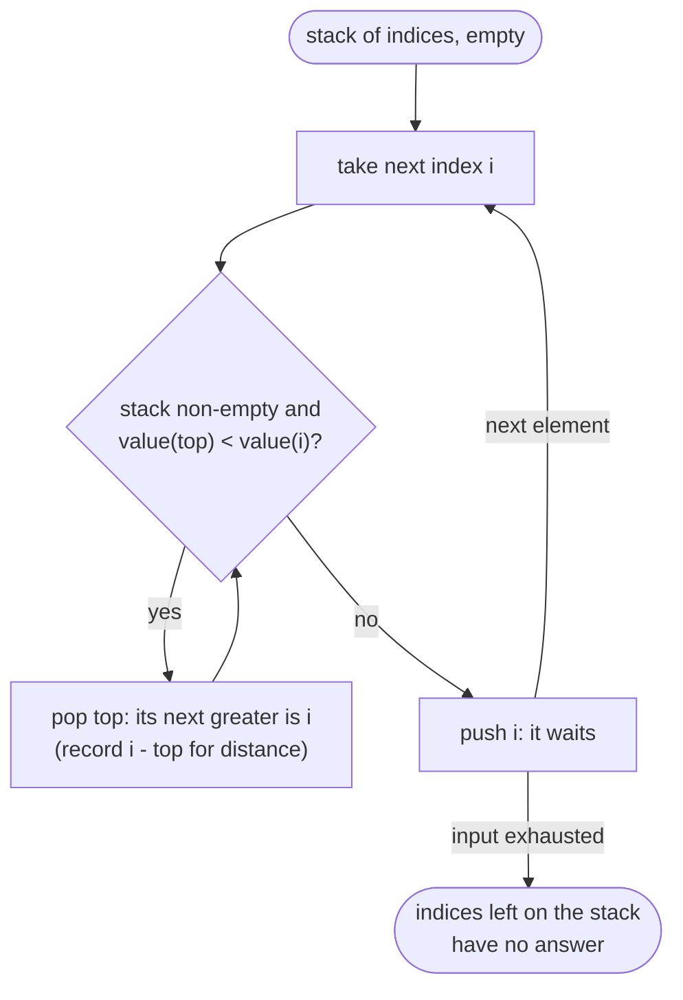

# Stack & Monotonic Stack

> [!abstract] In one sentence
> A stack keeps the things that are still *waiting* — an open bracket waiting for its close, a bar waiting for the first shorter bar to its right — and a monotonic stack is a stack whose waiting elements are kept sorted by popping everyone the newcomer beats, so that every element is pushed once, popped once, and settled at the moment it is popped.

**Map:** [[Topics MOC]] → [[DSA Dashboard]]

> [!question] Predict before you read
> For each day's temperature you want the number of days until a warmer one. Scanning forward from each day is O(n²). When day `i` arrives, which earlier days can be settled right now, and why can every other earlier day stay unsettled without ever being looked at again?

## Why this exists

Two families of problems. The first has **nesting**: brackets, expression evaluation, directory paths, recursive structure flattened into a sequence. The last thing opened is the first thing that must close, which is exactly LIFO, and [[Recursion]] is the same stack managed by the JVM.

The second is **"nearest element to the left or right that is greater (or smaller)"** — next warmer day, previous smaller bar, the span of a stock. The brute force scans outward from each element, O(n²). A monotonic stack keeps only the elements that could still be *someone's* answer, in sorted order, so each new element settles a batch of earlier ones in amortised O(1). The signals: **parentheses / brackets / valid**, **evaluate**, **nested**, **next greater / smaller**, **previous greater / smaller**, **how many days until**, **largest rectangle / area under bars**, **span**, **remove k to make smallest**, and anything where elements are processed in order and "cancel" earlier ones.

## The idea from zero

Read `"( [ { } ] )"`. Each opener is pushed; each closer must match the most recent unclosed opener — the top. After `( [ {` the stack holds three openers; `}` pops `{`, `]` pops `[`, `)` pops `(`, and an empty stack at the end means valid.

> [!example] Stack after reading ( [ {
> ![[Stack & Monotonic Stack — Stack after reading ( - {.excalidraw]]
> [[Stack & Monotonic Stack — Stack after reading ( - {.excalidraw|Open in Excalidraw]] — the next closer must match the top; a mismatch, a closer on an empty stack, or leftovers at the end all mean invalid

%% excalidraw-spec
{"kind": "array", "title": "Stack after reading ( [ {", "values": ["(", "[", "{"], "pointers": {"top": 2}, "highlight": [2], "caption": "the next closer must match the top; a mismatch, a closer on an empty stack, or leftovers at the end all mean invalid"}
%%

Now the second family. Next greater element of `[2, 1, 2, 4, 3]`. Walk left to right keeping a stack of indices whose answers are *unknown*. When `4` arrives at index 3, the waiting elements `2` (index 0) and `2` (index 2) are both smaller than 4 — so 4 *is* their next greater, and they are popped and answered. Then 4 waits.

> [!example] Next greater: state when i = 3 (value 4) arrives
> ![[Stack & Monotonic Stack — Next greater- state when i = 3 (value 4) arrives.excalidraw]]
> [[Stack & Monotonic Stack — Next greater- state when i = 3 (value 4) arrives.excalidraw|Open in Excalidraw]] — index 1 was already settled by index 2; now 4 pops indices 2 and 0 (both <= 4) and answers them; the stack becomes [3]. The stack is always decreasing bottom to top: a waiting element smaller than one above it would already have been popped — that ordering is what makes pop-while-smaller correct

%% excalidraw-spec
{"kind": "array", "title": "Next greater: state when i = 3 (value 4) arrives", "values": [2, 1, 2, 4, 3], "pointers": {"i": 3}, "highlight": [0, 2], "labels": {"0": "waiting", "1": "done: 2", "2": "waiting"}, "caption": "index 1 was already settled by index 2; now 4 pops indices 2 and 0 (both <= 4) and answers them; the stack becomes [3]. The stack is always decreasing bottom to top: a waiting element smaller than one above it would already have been popped — that ordering is what makes pop-while-smaller correct"}
%%

## The mechanism

**Matching and parsing.** Push openers; on a closer, the stack must be non-empty and its top must be the matching opener, else invalid; at the end the stack must be empty. Reverse Polish notation: push numbers; on an operator pop the *right* operand first (`b`), then the left (`a`), push `a op b`. Nested structures (`"3[a2[c]]"`, paths, calculators) push the current state when a group opens and restore it when it closes — the explicit version of a recursive call. A **min stack** is the same idea: each entry stores `(value, minSoFar)`, so the minimum is always the top's second field and popping restores the previous minimum for free, because every entry remembers the state of the world when it was pushed.

**Monotonic stacks.** Keep indices. For *next greater*: while the top's value is less than the newcomer, pop it — the newcomer is its answer — then push the newcomer; the stack stays decreasing. For *next smaller* flip the comparison and the stack stays increasing. For *previous* greater or smaller, the answer for the newcomer is simply the top *after* popping, *before* pushing. Elements still on the stack at the end have no answer (−1 or n). Each index is pushed once and popped at most once, so the nested `while` costs O(n) total — the argument from [[Complexity Analysis]].

**Histogram.** [[LC 84 Largest Rectangle in Histogram]] uses an increasing stack of indices. When a bar shorter than the top arrives at `i`, every taller bar on the stack is popped, and the popped bar's rectangle is `height × width` with `width = i − (new top) − 1` (or `i` if the stack is now empty): it extends right up to `i − 1` and left down to just after the previous shorter bar. Append a sentinel bar of height 0 so everything is flushed at the end.

> [!example] Histogram [2,1,5,6,2,3]: i = 4 (height 2) pops the 6 and the 5
> ![[Stack & Monotonic Stack — Histogram -2,1,5,6,2,3-- i = 4 (height 2) pops the 6 and the 5.excalidraw]]
> [[Stack & Monotonic Stack — Histogram -2,1,5,6,2,3-- i = 4 (height 2) pops the 6 and the 5.excalidraw|Open in Excalidraw]] — 6 pops first: width = 4 - 2 - 1 = 1; then 5 pops: new top is index 1, width = 4 - 1 - 1 = 2, area 10 — the answer

%% excalidraw-spec
{"kind": "array", "title": "Histogram [2,1,5,6,2,3]: i = 4 (height 2) pops the 6 and the 5", "values": [2, 1, 5, 6, 2, 3], "pointers": {"i": 4}, "highlight": [2, 3], "labels": {"2": "5 x 2 = 10", "3": "6 x 1 = 6"}, "caption": "6 pops first: width = 4 - 2 - 1 = 1; then 5 pops: new top is index 1, width = 4 - 1 - 1 = 2, area 10 — the answer"}
%%



> [!example]- Excalidraw version — the same diagram as an editable canvas
> ![[Stack & Monotonic Stack — The mechanism.excalidraw]]
> [[Stack & Monotonic Stack — The mechanism.excalidraw|Open in Excalidraw]] — needs the Excalidraw plugin (see [[Plugins to Install]]).

## Java template

```java
import java.util.*;

class Solution {
    public boolean isValid(String s) {
        Deque<Character> st = new ArrayDeque<>();
        for (char c : s.toCharArray()) {
            if (c == '(' || c == '[' || c == '{') st.push(c);
            else {
                if (st.isEmpty()) return false;                        // closer with nothing open
                char open = st.pop();
                if ((c == ')' && open != '(') || (c == ']' && open != '[') || (c == '}' && open != '{')) return false;
            }
        }
        return st.isEmpty();                                           // leftovers mean unclosed openers
    }

    public int evalRPN(String[] tokens) {
        Deque<Integer> st = new ArrayDeque<>();
        for (String t : tokens) {
            switch (t) {
                case "+" -> st.push(st.pop() + st.pop());
                case "*" -> st.push(st.pop() * st.pop());
                case "-" -> { int b = st.pop(), a = st.pop(); st.push(a - b); }   // right operand pops first
                case "/" -> { int b = st.pop(), a = st.pop(); st.push(a / b); }   // Java truncates toward zero, as required
                default -> st.push(Integer.parseInt(t));               // handles "-3" as a number
            }
        }
        return st.pop();
    }
}
```

**Time** O(n) · **Space** O(n)

```java
import java.util.*;

class MinStack {
    private final Deque<int[]> st = new ArrayDeque<>();              // {value, min at the time of pushing}
    public void push(int val) { st.push(new int[]{val, st.isEmpty() ? val : Math.min(val, st.peek()[1])}); }
    public void pop() { st.pop(); }
    public int top() { return st.peek()[0]; }
    public int getMin() { return st.peek()[1]; }
}

class Solution {
    public int[] dailyTemperatures(int[] t) {
        int n = t.length;
        int[] ans = new int[n];                                        // default 0 = no warmer day
        Deque<Integer> st = new ArrayDeque<>();                        // indices with unknown answers, temps decreasing
        for (int i = 0; i < n; i++) {
            while (!st.isEmpty() && t[st.peek()] < t[i]) {             // i is the first warmer day for everyone popped
                int j = st.pop();
                ans[j] = i - j;
            }
            st.push(i);
        }
        return ans;
    }

    public int largestRectangleArea(int[] h) {
        Deque<Integer> st = new ArrayDeque<>();                        // indices, heights increasing
        int best = 0;
        for (int i = 0; i <= h.length; i++) {
            int cur = i == h.length ? 0 : h[i];                        // sentinel 0 flushes the stack at the end
            while (!st.isEmpty() && h[st.peek()] >= cur) {
                int height = h[st.pop()];
                int width = st.isEmpty() ? i : i - st.peek() - 1;      // spans from after the previous shorter bar to i - 1
                best = Math.max(best, height * width);
            }
            st.push(i);
        }
        return best;
    }
}
```

**Time** O(n) for all three structures · **Space** O(n)

## Complexity

| Problem | Time | Space | Why |
|---|---|---|---|
| bracket matching, RPN; min stack operations | O(n); O(1) each | O(n) | one push or pop per token; the min travels with the entry |
| next greater / daily temperatures | O(n) | O(n) | each index pushed once, popped at most once |
| largest rectangle | O(n) | O(n) | same amortised argument, plus one sentinel |
| car fleet | O(n log n) | O(n) | the sort dominates; the stack pass is linear — the brute force for all of these scans outward from each element, O(n²) |

## The canonical shapes

| Shape | Recognition cue | One-line solution | Problem |
|---|---|---|---|
| Matching | "valid parentheses", "balanced" | push openers, pop and compare on closers, empty at the end | [[LC 20 Valid Parentheses]] |
| Running minimum | "stack with O(1) getMin" | store `(value, minSoFar)` pairs | [[LC 155 Min Stack]] |
| Postfix evaluation | "Reverse Polish notation" | push numbers, pop two on operators (right first) | [[LC 150 Evaluate Reverse Polish Notation]] |
| Generate nested structure | "all valid combinations of n pairs" | this is [[Backtracking]] with open/close counts, the stack being the recursion | [[LC 22 Generate Parentheses]] |
| Next greater | "days until a warmer temperature" | decreasing stack of indices, answer on pop | [[LC 739 Daily Temperatures]] |
| Sort then stack | "cars that merge into fleets" | sort by position descending, compute time to target, push a new fleet only when slower than the fleet ahead (the stack never pops, so a counter works too) | [[LC 853 Car Fleet]] |
| Widest span bounded by smaller | "largest rectangle in a histogram" | increasing stack, area on pop, sentinel | [[LC 84 Largest Rectangle in Histogram]] |

## Worked example

[[LC 739 Daily Temperatures]] on `[73, 74, 75, 71, 69, 72, 76, 73]`.

| i | temp | pops (index: answer) | stack after (indices) |
|---|---|---|---|
| 0, 1, 2 | 73, 74, 75 | 0: 1, then 1: 1 | [2] |
| 3, 4 | 71, 69 | — | [2, 3, 4] |
| 5 | 72 | 4: 1, 3: 2 | [2, 5] |
| 6 | 76 | 5: 1, 2: 4 | [6] |
| 7 | 73 | — | [6, 7] → both stay 0 |

> [!example] i = 5 (72) arrives with stack [2, 3, 4] = temps 75, 71, 69
> ![[Stack & Monotonic Stack — i = 5 (72) arrives with stack -2, 3, 4- = temps 75, 71, 69.excalidraw]]
> [[Stack & Monotonic Stack — i = 5 (72) arrives with stack -2, 3, 4- = temps 75, 71, 69.excalidraw|Open in Excalidraw]] — 69 and 71 are popped and answered in one step; 75 keeps waiting until 76 arrives at i = 6. Final answer [1,1,4,2,1,1,0,0]: eight pushes, six pops, no element examined twice — that is amortised O(1) in practice

%% excalidraw-spec
{"kind": "array", "title": "i = 5 (72) arrives with stack [2, 3, 4] = temps 75, 71, 69", "values": [73, 74, 75, 71, 69, 72, 76, 73], "pointers": {"i": 5}, "highlight": [3, 4], "labels": {"2": "stays: 75 > 72", "3": "ans 2", "4": "ans 1"}, "caption": "69 and 71 are popped and answered in one step; 75 keeps waiting until 76 arrives at i = 6. Final answer [1,1,4,2,1,1,0,0]: eight pushes, six pops, no element examined twice — that is amortised O(1) in practice"}
%%

## Pitfalls

> [!warning] The mistakes people make
> - **`java.util.Stack`.** It is a synchronised `Vector` from Java 1.0; use `Deque<T> st = new ArrayDeque<>()` with `push`/`pop`/`peek`. `ArrayDeque` rejects `null`, so never push `null` as a sentinel.
> - **Popping or peeking an empty deque.** `pop()` and `peek()` on `ArrayDeque`: `pop` throws `NoSuchElementException`, `peek` returns `null`; guard with `isEmpty()` in every `while` condition.
> - **Values instead of indices, and the wrong comparison.** Distances and widths need indices, so store `i` and look up `nums[i]`; and decide strict versus non-strict per problem — pop on `<` for next *strictly* greater, on `>=` in the histogram so equal bars collapse correctly.
> - **No sentinel flush.** Bars left on the stack at the end of the histogram are the rectangles you forgot; the `i == n` iteration with height 0 handles them.
> - **RPN operand order and `-` tokens.** The first pop is the right operand; `"-3"` is a number, not an operator, which `Integer.parseInt` in the `default` branch handles.

## Variations & follow-ups

**Previous greater/smaller** is the top after popping; both sides in one pass give each bar its left and right boundary. **Circular arrays** (next greater in a ring) iterate `i` from 0 to 2n − 1 with `i % n`. **Stock span** is "distance to previous greater". **Remove k digits to make the smallest number** pops while the top is larger than the newcomer and k > 0 — a monotonic *increasing* stack with a budget. **Asteroid collision** pops while the top moves right and is smaller. **Maximal rectangle in a binary matrix** runs the histogram per row with heights accumulated downwards ([[2-D Dynamic Programming]] territory). **Trapping rain water** has a stack solution that pops bars bounded on both sides — the [[Two Pointers]] version is shorter.

## Interview script

For nesting: "the most recently opened thing must close first, so a stack of openers; invalid if a closer finds a mismatch or an empty stack, or if anything is left at the end." For next greater: "I keep a stack of indices whose answer I do not know yet; it is decreasing, because anything smaller than a newcomer gets answered and popped. Each index is pushed once and popped once, so O(n)." Then say what is stored — indices — and what the leftover elements mean.

What the interviewer is checking: that you use `ArrayDeque`, that you can explain the amortised bound rather than assert it, that you know whether the stack is increasing or decreasing and why, and that you handle the end of input (sentinel or leftover loop). Follow-ups: "previous smaller instead of next greater?", "what if the array is circular?", "largest rectangle in a 0/1 matrix?", "do it with O(1) extra space?" (usually not possible; say so).

## Spot the bug

```java
// snippet
case "-" -> st.push(st.pop() - st.pop());
case "/" -> st.push(st.pop() / st.pop());
```

> [!example]- The fix
> The first `pop()` returns the *right* operand (it was pushed last), so `st.pop() - st.pop()` computes `b − a`. `["4", "13", "5", "/", "+"]` must evaluate 13 / 5 = 2, and this code computes 5 / 13 = 0. Pop into named variables: `int b = st.pop(), a = st.pop(); st.push(a - b);` — the same fix for division, where Java's truncation toward zero already matches the problem's requirement.

## Related

### Prerequisites
- [[Recursion]] — the call stack is this stack, managed for you
- [[Sorting]] — car fleet is a sort followed by one stack pass

### Builds on this
- [[Sliding Window]] (the monotonic deque for window maxima is this stack opened at both ends), [[Backtracking]] (generate-parentheses is the recursive form of the bracket stack), [[2-D Dynamic Programming]] (maximal rectangle reuses the histogram per row)
- [[DSA Patterns in Java]], [[Java Collections Cheat Sheet]] (`ArrayDeque` as a stack: `push`, `pop`, `peek`), [[Java Pitfalls in Interviews]]

### Problems that use it
- [[LC 20 Valid Parentheses]], [[LC 155 Min Stack]], [[LC 150 Evaluate Reverse Polish Notation]], [[LC 22 Generate Parentheses]]
- [[LC 739 Daily Temperatures]], [[LC 853 Car Fleet]], [[LC 84 Largest Rectangle in Histogram]], [[LC 42 Trapping Rain Water]] (stack variant)

## Personal understanding

> [!question] Explain it without the note
> Write your own explanation here, from memory, then compare with the sections above and note what you missed.

### Mastery checklist
- [ ] I can state the idea in one sentence
- [ ] I can re-derive the mechanism on a whiteboard
- [ ] I can name when NOT to use it
- [ ] I have solved three problems with it without hints
- [ ] I can explain it to a colleague in two minutes

## Open questions
- [ ] Derive the histogram width formula `i − top − 1` from scratch on `[2, 1, 2]` without the note, including the empty-stack case; and where does an explicit stack replace recursion in code I have shipped (JSON parsing, expression evaluation, directory walks)?
