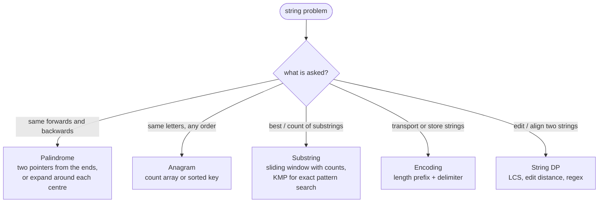

# Strings

> [!abstract] In one sentence
> A Java `String` is a read-only `char[]` with a cache of its hash; once you see it that way, palindromes become two pointers, anagrams become 26-slot count arrays, substring questions become windows or prefix-function tables, and the only genuinely string-specific thing left to remember is that building text with `+` in a loop is quadratic.

**Map:** [[Topics MOC]] → [[DSA Dashboard]]

> [!question] Predict before you read
> `String s = ""; for (int i = 0; i < n; i++) s += 'a';` — how many characters are copied in total, and what is the Big-O? Now guess what `StringBuilder` changes and why.

## Why this exists

Roughly a third of NeetCode 150 takes a string as input, yet almost none of it needs string theory. What it needs is (1) the Java-specific mechanics — immutability, `charAt` vs `toCharArray`, `StringBuilder`, character arithmetic — so that you do not lose ten minutes to an API you half remember, and (2) recognising four recurring shapes. Signals in a statement: "palindrome", "anagram", "substring", "subsequence", "encode/decode", "longest … substring without …", "pattern occurs in text", "valid parentheses/expression". Each maps to a tool you already have from [[Two Pointers]], [[Sliding Window]], [[Hashing]] or [[Dynamic Programming]].

## The idea from zero

A string is a sequence of characters; in Java a `char` is an unsigned 16-bit number, and arithmetic on it is arithmetic on that number. `'a'` is 97, `'z'` is 122, so `c - 'a'` is a 0-based index into a 26-slot array, and `(char) ('a' + 3)` is `'d'`. That single fact turns every "count letters" problem into an `int[26]` and every "shift letters" problem into addition modulo 26.

> [!example] "racecar" as an index-addressed array of chars
> ![[Strings — -racecar- as an index-addressed array of chars.excalidraw]]
> [[Strings — -racecar- as an index-addressed array of chars.excalidraw|Open in Excalidraw]] — two pointers walking inwards compare s[lo] with s[hi]; the shaded centre is where they meet

%% excalidraw-spec
{"kind": "array", "title": "\"racecar\" as an index-addressed array of chars", "values": ["r", "a", "c", "e", "c", "a", "r"], "pointers": {"lo": 0, "hi": 6}, "highlight": [3], "caption": "two pointers walking inwards compare s[lo] with s[hi]; the shaded centre is where they meet"}
%%

Immutability: `s.toUpperCase()`, `s.substring(1)`, `s + "x"` all return *new* strings and leave `s` untouched. That is why `s += c` inside a loop copies the whole string every iteration — `1 + 2 + … + n = O(n²)` characters moved. `StringBuilder` keeps a growable `char[]` and appends in amortised O(1), exactly like `ArrayList`.

## The mechanism

### Reading characters

- `s.charAt(i)` — O(1), no allocation; the default inside loops.
- `s.toCharArray()` — O(n) copy, but then you can mutate (sorting, swapping, in-place reversal) — do it once, outside the loop.
- `s.length()` is O(1); `s.chars()` gives an `IntStream` (fine for one-liners such as counting, slow in tight loops).
- Comparing: `s.equals(t)` (never `==`, which compares references), `s.compareTo(t)` for lexicographic order, `s.equalsIgnoreCase`.

### Building strings

- `StringBuilder sb = new StringBuilder(); sb.append(c); sb.insert(0, c); sb.deleteCharAt(sb.length() - 1); sb.reverse(); sb.setLength(k); sb.toString()`.
- `String.join(",", list)`, `String.valueOf(charArray)`, `new String(chars, from, len)`.
- `"%d-%s".formatted(a, b)` or `String.format` for readable output in tests, not in hot loops.

### Characters as numbers

- `c - 'a'` index; `(char) (x + 'a')` back to a letter; `Character.isLetterOrDigit(c)`, `Character.toLowerCase(c)`, `Character.getNumericValue(c)` / `c - '0'` for digits.
- Counting: `int[] cnt = new int[26]; cnt[c - 'a']++;` — for arbitrary Unicode use `int[128]`/`int[256]` or a `HashMap<Character, Integer>`.
- A count array *is* a key: two strings are anagrams iff their count arrays are equal (`Arrays.equals`), and `Arrays.toString(cnt)` or a sorted `char[]` serves as a `HashMap` key for grouping.

### The four shapes



> [!example]- Excalidraw version — the same diagram as an editable canvas
> ![[Strings — The four shapes.excalidraw]]
> [[Strings — The four shapes.excalidraw|Open in Excalidraw]] — needs the Excalidraw plugin (see [[Plugins to Install]]).

**Palindromes.** Checking: `lo` and `hi` walk inwards, skipping non-alphanumerics if asked ([[LC 125 Valid Palindrome]]). Finding the longest palindromic substring: expand around each of the `2n − 1` centres (each character, and each gap) — O(n²) and simpler than the DP table ([[LC 5 Longest Palindromic Substring]], [[LC 647 Palindromic Substrings]]).

> [!example] Expand around centre for "abacaba": centre index 3 grows to the whole string
> ![[Strings — Expand around centre for -abacaba-- centre index 3 grows to the whole string.excalidraw]]
> [[Strings — Expand around centre for -abacaba-- centre index 3 grows to the whole string.excalidraw|Open in Excalidraw]] — while s[l] == s[r], step l left and r right; the shaded span is the palindrome found so far

%% excalidraw-spec
{"kind": "array", "title": "Expand around centre for \"abacaba\": centre index 3 grows to the whole string", "values": ["a", "b", "a", "c", "a", "b", "a"], "pointers": {"l": 1, "r": 5}, "highlight": [1, 2, 3, 4, 5], "labels": {"3": "centre"}, "caption": "while s[l] == s[r], step l left and r right; the shaded span is the palindrome found so far"}
%%

**Anagrams.** Key by counts: `int[26]` compared with `Arrays.equals` ([[LC 242 Valid Anagram]]); group by a canonical key — the sorted string (O(k log k) per word) or the count array rendered as a string (O(k)) ([[LC 49 Group Anagrams]]); detect an anagram window inside a text with a fixed-size sliding window and a running count of matched letters ([[LC 567 Permutation in String]]).

**Substrings.** "Longest substring with property P" where P is monotone under shrinking → variable [[Sliding Window]] with a count map ([[LC 3 Longest Substring Without Repeating Characters]], [[LC 424 Longest Repeating Character Replacement]], [[LC 76 Minimum Window Substring]]). "Does pattern `p` occur in text `t`" → `t.indexOf(p)` in practice, KMP in theory (below). "Can `s` be segmented into dictionary words" → [[Dynamic Programming]] over prefixes ([[LC 139 Word Break]]).

**Encoding.** Joining strings with a delimiter breaks when the delimiter can appear inside a string; prefixing each piece with its length (`5#hello`) makes decoding unambiguous and O(n) ([[LC 271 Encode and Decode Strings]]). The same idea serialises trees ([[LC 297 Serialize and Deserialize Binary Tree]]).

### KMP in one paragraph (recognise, and be able to code it)

The failure function `fail[i]` = length of the longest proper prefix of `p[0..i]` that is also a suffix of it. It is built in O(m) by reusing previous values (when `p[i] != p[len]`, fall back to `len = fail[len − 1]`). Searching then never moves the text pointer backwards: on a mismatch, slide the pattern using `fail` instead of restarting. Total O(n + m). Interviewers rarely demand it in a 45-minute round; they do expect you to say "KMP or Z-algorithm gives linear time" and to know that `indexOf` is the practical call.

### Rolling hash (recognise)

Treat a substring as a number in base `B` modulo a prime; moving a window one step right updates the hash in O(1) (`h = (h − s[i]·B^(k−1))·B + s[i+k]`). Rabin–Karp finds a pattern in expected O(n + m) and lets you compare substrings in O(1) after O(n) preprocessing — the tool for "longest duplicate substring" (binary search on length + hash set). Collisions are the risk; a 64-bit modulus or two moduli make them negligible.

## Java template

```java
import java.util.*;

class StringTemplates {
    // palindrome check on alphanumerics only, case-insensitive
    static boolean isPalindrome(String s) {
        int lo = 0, hi = s.length() - 1;
        while (lo < hi) {
            while (lo < hi && !Character.isLetterOrDigit(s.charAt(lo))) lo++;
            while (lo < hi && !Character.isLetterOrDigit(s.charAt(hi))) hi--;
            if (Character.toLowerCase(s.charAt(lo)) != Character.toLowerCase(s.charAt(hi))) return false;
            lo++; hi--;
        }
        return true;
    }

    // expand around centre: longest palindromic substring
    static String longestPalindrome(String s) {
        int bestL = 0, bestR = 0;
        for (int c = 0; c < s.length(); c++) {
            for (int gap = 0; gap <= 1; gap++) {          // odd centre (gap 0) and even centre (gap 1)
                int l = c, r = c + gap;
                while (l >= 0 && r < s.length() && s.charAt(l) == s.charAt(r)) { l--; r++; }
                if (r - l - 2 > bestR - bestL) { bestL = l + 1; bestR = r - 1; }
            }
        }
        return s.substring(bestL, bestR + 1);
    }

    // anagram key: counts rendered as a string (O(k) per word)
    static String countKey(String w) {
        int[] cnt = new int[26];
        for (int i = 0; i < w.length(); i++) cnt[w.charAt(i) - 'a']++;
        StringBuilder sb = new StringBuilder();
        for (int x : cnt) sb.append(x).append(',');
        return sb.toString();
    }

    // KMP failure function and search
    static int[] failure(String p) {
        int[] f = new int[p.length()];
        for (int i = 1, len = 0; i < p.length(); ) {
            if (p.charAt(i) == p.charAt(len)) f[i++] = ++len;
            else if (len > 0) len = f[len - 1];
            else f[i++] = 0;
        }
        return f;
    }

    static int kmpSearch(String t, String p) {
        if (p.isEmpty()) return 0;
        int[] f = failure(p);
        for (int i = 0, j = 0; i < t.length(); ) {
            if (t.charAt(i) == p.charAt(j)) {
                i++; j++;
                if (j == p.length()) return i - j;       // match ends at i - 1
            } else if (j > 0) j = f[j - 1];
            else i++;
        }
        return -1;
    }

    // length-prefixed encoding
    static String encode(List<String> words) {
        StringBuilder sb = new StringBuilder();
        for (String w : words) sb.append(w.length()).append('#').append(w);
        return sb.toString();
    }

    static List<String> decode(String s) {
        List<String> out = new ArrayList<>();
        int i = 0;
        while (i < s.length()) {
            int hash = s.indexOf('#', i);
            int len = Integer.parseInt(s.substring(i, hash));
            out.add(s.substring(hash + 1, hash + 1 + len));
            i = hash + 1 + len;
        }
        return out;
    }
}
```

## Complexity

| Operation | Cost | Why |
|---|---|---|
| `charAt`, `length` | O(1) | index into the backing array |
| `substring(a, b)` | O(b − a) | copies since Java 7u6 (no shared backing array) |
| `s + t`, `concat` | O(len s + len t) | new string each time; quadratic in a loop |
| `StringBuilder.append` | amortised O(1) | doubling buffer |
| `equals`, `compareTo` | O(min length) | character by character; `hashCode` is cached after first use |
| `indexOf(p)` | O(n·m) worst, fast in practice | naive search in the JDK with intrinsics |
| `toCharArray`, `chars()` | O(n) | copy / stream |
| expand-around-centre | O(n²) time, O(1) space | 2n − 1 centres, each expansion ≤ n |
| KMP / Z | O(n + m) | failure function reuses prefix knowledge |
| count-array anagram check | O(n + 26) | one pass plus a constant comparison |

## The canonical shapes

| Shape | Recognition cue | Tool | First problem |
|---|---|---|---|
| Palindrome check | "reads the same backwards", ignore punctuation | two pointers from the ends | [[LC 125 Valid Palindrome]] |
| Longest / count palindromic substrings | "palindromic substring(s)" | expand around 2n − 1 centres | [[LC 5 Longest Palindromic Substring]], [[LC 647 Palindromic Substrings]] |
| Anagram test / grouping | "rearranged", "same letters" | `int[26]` count key | [[LC 242 Valid Anagram]], [[LC 49 Group Anagrams]] |
| Anagram inside a text | "permutation of s1 in s2" | fixed sliding window + matched count | [[LC 567 Permutation in String]] |
| Longest substring with a property | "longest substring without / with at most k" | variable sliding window | [[LC 3 Longest Substring Without Repeating Characters]], [[LC 424 Longest Repeating Character Replacement]] |
| Smallest window covering a multiset | "minimum window containing all of t" | window with have/need counters | [[LC 76 Minimum Window Substring]] |
| Segmentation | "can be split into dictionary words" | prefix DP | [[LC 139 Word Break]] |
| Encode / decode | "serialise a list of strings" | length prefix | [[LC 271 Encode and Decode Strings]] |
| Digit strings as numbers | "multiply / add strings" | digit arrays with carries | [[LC 43 Multiply Strings]] |

## Worked example

[[LC 567 Permutation in String]]: does any window of `s2` of length `|s1|` have the same letter counts as `s1`? Build `need[26]` from `s1`; slide a window of that length over `s2`, maintaining `have[26]` and a counter `matches` of indices where `have[i] == need[i]`. When a letter enters or leaves, update at most two `matches` entries. `matches == 26` at any point means a permutation is present. O(n) with O(1) extra space — the anagram idea plus the window idea, nothing else.

> [!example] Window of length 2 sliding over "eidbaooo" looking for a permutation of "ab"
> ![[Strings — Window of length 2 sliding over -eidbaooo- looking for a permutation of -ab-.excalidraw]]
> [[Strings — Window of length 2 sliding over -eidbaooo- looking for a permutation of -ab-.excalidraw|Open in Excalidraw]] — when the window is [b, a] the counts equal those of "ab": found

%% excalidraw-spec
{"kind": "array", "title": "Window of length 2 sliding over \"eidbaooo\" looking for a permutation of \"ab\"", "values": ["e", "i", "d", "b", "a", "o", "o", "o"], "pointers": {"L": 3, "R": 4}, "highlight": [3, 4], "caption": "when the window is [b, a] the counts equal those of \"ab\": found"}
%%

## Pitfalls

> [!warning] What goes wrong
> - `s == t` compiles and sometimes even works (interned literals) — then fails in production. Always `equals`.
> - `s += c` in a loop: O(n²). Use `StringBuilder`.
> - `substring` in a loop (`s = s.substring(1)`): O(n²) copies; move an index instead.
> - `c - 'a'` on uppercase or non-letters: negative or out-of-range index. Normalise first or use `int[128]`.
> - `Character.getNumericValue('a')` is 10, not an error — use `c - '0'` only after checking `isDigit`.
> - `split("|")` or `split(".")`: regex metacharacters; escape them (`"\\|"`) or use `indexOf`.
> - `StringBuilder.reverse()` reverses in place and returns `this` — a common surprise when chaining.
> - Sorting a `String`: `char[] a = s.toCharArray(); Arrays.sort(a); new String(a)` — there is no `Collections.sort` for strings' characters.
> - Unicode outside the BMP (emoji) is two `char`s; `length()` counts code units. Say it if the interviewer asks about "characters".

## Variations & follow-ups

- Case-insensitive or locale-aware comparisons (`compareToIgnoreCase`, `Collator`) — mention, do not implement.
- Streaming input: KMP works online; expand-around-centre does not (needs random access).
- Very long strings: hashing (Rabin–Karp) for substring equality in O(1); suffix arrays for "longest repeated substring" in O(n log n).
- Many patterns at once: Aho–Corasick (a trie plus failure links, see [[Tries]]).
- Counting distinct substrings / palindromes: suffix automaton or Manacher's algorithm — name them, do not derive them in a round.

## Interview script

When a string problem appears: "I'll treat it as a `char` array — `charAt` for reads, a `StringBuilder` for the output, and `c − 'a'` for counting." Then classify out loud: "this is a palindrome / anagram / substring / encoding question", name the tool (two pointers, count key, sliding window, length prefix), and state the complexity before coding. If asked about pattern search: "`indexOf` in practice; KMP or Z for guaranteed linear time; rolling hash when I need O(1) substring comparisons." Typical follow-ups: Unicode, streaming input, memory for huge strings, and "can you do it without extra space" (two pointers and counts usually can).

## Spot the bug

```java
// snippet
static boolean isAnagram(String s, String t) {
    int[] cnt = new int[26];
    for (char c : s.toCharArray()) cnt[c - 'a']++;
    for (char c : t.toCharArray()) cnt[c - 'a']--;
    for (int x : cnt) if (x != 0) return false;
    return true;
}
```

> [!example]- The fix
> Different lengths are caught (a surplus letter leaves a non-zero count), so the logic is right for lowercase input — the bug is robustness: any uppercase letter or space throws `ArrayIndexOutOfBoundsException`. Normalise (`toLowerCase`, skip non-letters) or use `int[128]`. A second, subtler issue: `toCharArray()` copies both strings; `charAt` in an index loop avoids the allocation.

## Related

### Prerequisites
- [[Arrays & Hashing]] — count arrays and index-as-key tricks
- [[Two Pointers]] — palindromes from both ends
- [[Sliding Window]] — substring problems with counts

### Builds on this
- [[Hashing]] — canonical keys for grouping
- [[Dynamic Programming]] and [[2-D Dynamic Programming]] — string DP (LCS, edit distance, regex)
- [[Tries]] — prefix structures over many strings

### Problems that use it
- [[LC 125 Valid Palindrome]] · [[LC 242 Valid Anagram]] · [[LC 49 Group Anagrams]] · [[LC 271 Encode and Decode Strings]] · [[LC 3 Longest Substring Without Repeating Characters]] · [[LC 424 Longest Repeating Character Replacement]] · [[LC 567 Permutation in String]] · [[LC 76 Minimum Window Substring]] · [[LC 5 Longest Palindromic Substring]] · [[LC 647 Palindromic Substrings]] · [[LC 139 Word Break]] · [[LC 43 Multiply Strings]] · [[LC 297 Serialize and Deserialize Binary Tree]]

### Java refresher
- [[Java Collections Cheat Sheet]] (`String`, `StringBuilder`, `Character` tables) · [[DSA Patterns in Java]] · [[Java Pitfalls in Interviews]]

## Personal understanding

> [!question] Explain it without the note
> Write your own explanation here, from memory, then compare with the sections above and note what you missed.

### Mastery checklist
- [ ] I can state the idea in one sentence
- [ ] I can re-derive the mechanism on a whiteboard
- [ ] I can name when NOT to use it
- [ ] I have solved three problems with it without hints
- [ ] I can explain it to a colleague in two minutes

## Open questions
- [ ] Trace the KMP failure function for `"aabaaab"` by hand and check it against the code.
- [ ] Why does expand-around-centre need `2n − 1` centres? What would be missed with only `n`?
