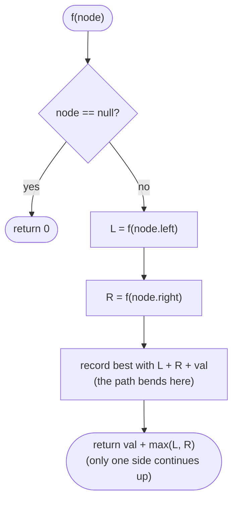

# Trees

> [!abstract] In one sentence
> A tree is a recursive structure, so the solution is a recursive function in which you decide three things — what each call returns to its parent, what it records in a shared variable, and what it receives from above — and once you can name those three for a problem, the code is five lines; BFS with a frozen level size handles everything that is about levels, and BSTs add one extra invariant: inorder visits keys in sorted order.

**Map:** [[Topics MOC]] → [[DSA Dashboard]]

> [!question] Predict before you read
> To validate a BST, why is it not enough to check at every node that `left.val < val < right.val`? Draw the smallest counter-example before reading on, then say what extra information each call must receive from its parent.

## Why this exists

Trees are the data structure of hierarchy — file systems, JSON, DOMs, B-tree indexes in Postgres, the call stack itself — and they are the gentlest introduction to thinking recursively on a structure, which is why fifteen NeetCode problems live here and why [[Graphs]] and [[Dynamic Programming]] feel impossible to anyone who skipped them. The signals: **`TreeNode`** in the signature, **"depth / height / diameter / balanced"**, **"level order / left view / right view"**, **"path sum"**, **"lowest common ancestor"**, **"BST"** (which means *sorted*), **"construct from traversals"**, **"serialize"**.

## The idea from zero

A `TreeNode` has a value and two children; a subtree is itself a tree, so whatever you can compute for a tree you can compute for its children first and combine. Take `[1, 2, 3, 4, 5, null, 6]` in LeetCode's level-order encoding.

> [!example] The example tree [1,2,3,4,5,null,6] and its four traversals
> ![[Trees — The example tree -1,2,3,4,5,null,6- and its four traversals.excalidraw]]
> [[Trees — The example tree -1,2,3,4,5,null,6- and its four traversals.excalidraw|Open in Excalidraw]] — preorder 1 2 4 5 3 6 (node, left, right) · inorder 4 2 5 1 3 6 (left, node, right) · postorder 4 5 2 6 3 1 (left, right, node) · level order 1 | 2 3 | 4 5 6

%% excalidraw-spec
{"kind": "tree", "title": "The example tree [1,2,3,4,5,null,6] and its four traversals", "levels": [1, 2, 3, 4, 5, null, 6], "highlight": [0], "caption": "preorder 1 2 4 5 3 6 (node, left, right) · inorder 4 2 5 1 3 6 (left, node, right) · postorder 4 5 2 6 3 1 (left, right, node) · level order 1 | 2 3 | 4 5 6"}
%%

The three DFS orders differ only in *when* you handle the node relative to its children. **Preorder** is for copying, serialising, passing information down (the parent is handled before the children). **Postorder** is for computing bottom-up (height, diameter, balance, path sums: the children are known before the node). **Inorder** on a BST yields sorted order. **BFS** uses a queue and processes one level at a time by freezing `q.size()` before the inner loop.

## The mechanism

**The three questions.** For any tree recursion decide: (1) *what does a call return to its parent?* — usually one number about the subtree, e.g. its height; (2) *what does it record globally?* — the answer when it involves *both* children, e.g. the diameter `l + r`; (3) *what does it receive from above?* — a bound, a running max, a path sum so far. Depth, diameter and balance are the same post-order function with different records; "good nodes" is a preorder function that passes the running maximum down; validating a BST passes an open interval `(lo, hi)` down and shrinks it at each step.



> [!example]- Excalidraw version — the same diagram as an editable canvas
> ![[Trees — The mechanism.excalidraw]]
> [[Trees — The mechanism.excalidraw|Open in Excalidraw]] — needs the Excalidraw plugin (see [[Plugins to Install]]).

**Return one side, record both.** This is the trick behind [[LC 543 Diameter of Binary Tree]] and [[LC 124 Binary Tree Maximum Path Sum]]. A path through a node may use both children, but the value handed to the parent may use only one (a path cannot fork). So every call records `l + r (+ val)` into a field and returns `max(l, r) (+ val)`. For the max path sum, clamp negative child gains to 0 — dropping a losing branch is always allowed.

**BST invariants.** Every key in the left subtree is smaller than the node and every key in the right subtree larger — *the whole subtree*, not just the child. Hence validation passes bounds, inorder is sorted (k-th smallest = the k-th inorder visit, stop early with an explicit stack), and the LCA of `p` and `q` is the first node where they split: go left while both are smaller, right while both are larger, otherwise stop.

> [!example] Why a local check is not enough: [5,1,4,null,null,3,6] passes left < node < right at every node
> ![[Trees — Why a local check is not enough- -5,1,4,null,null,3,6- passes left - node - right at every node.excalidraw]]
> [[Trees — Why a local check is not enough- -5,1,4,null,null,3,6- passes left - node - right at every node.excalidraw|Open in Excalidraw]] — node 4 receives the bounds (5, +inf) from its parent, so 3 is rejected; a check that only compares 3 with its parent 4 would wrongly accept this tree

%% excalidraw-spec
{"kind": "tree", "title": "Why a local check is not enough: [5,1,4,null,null,3,6] passes left < node < right at every node", "levels": [5, 1, 4, null, null, 3, 6], "highlight": [5], "caption": "node 4 receives the bounds (5, +inf) from its parent, so 3 is rejected; a check that only compares 3 with its parent 4 would wrongly accept this tree"}
%%

**Construction from preorder + inorder.** Preorder hands out roots in order; inorder tells you which keys go left (everything before the root's inorder index) and which go right. Keep a global preorder cursor and a `HashMap` value → inorder index, and build the left subtree *before* the right so the cursor is consumed in the right order. **Serialisation** is preorder with explicit null markers; deserialisation consumes tokens in the same order, so no index arithmetic is needed.

## Java template

```java
import java.util.*;

class TreeNode { int val; TreeNode left, right; TreeNode(int v) { val = v; } }

class Solution {
    List<List<Integer>> levelOrder(TreeNode root) {        // LC 102; LC 199 keeps the last value per level
        List<List<Integer>> out = new ArrayList<>();
        if (root == null) return out;
        Deque<TreeNode> q = new ArrayDeque<>(); q.offer(root);
        while (!q.isEmpty()) {
            int size = q.size(); List<Integer> level = new ArrayList<>();   // freeze the level before adding
            for (int i = 0; i < size; i++) {
                TreeNode n = q.poll(); level.add(n.val);
                if (n.left != null) q.offer(n.left);
                if (n.right != null) q.offer(n.right);
            }
            out.add(level);
        }
        return out;
    }

    int diameter = 0;
    int height(TreeNode n) {                                // LC 104 / LC 543 / LC 110 in one post-order pass
        if (n == null) return 0;
        int l = height(n.left), r = height(n.right);
        diameter = Math.max(diameter, l + r);               // record: the path bends through n
        return 1 + Math.max(l, r);                          // return: one-sided height (return -1 for "unbalanced")
    }

    boolean isSameTree(TreeNode a, TreeNode b) {            // LC 100; LC 572 calls it at every node of the big tree
        if (a == null || b == null) return a == b;
        return a.val == b.val && isSameTree(a.left, b.left) && isSameTree(a.right, b.right);
    }

    boolean isValidBST(TreeNode n, long lo, long hi) {      // LC 98: call with Long.MIN_VALUE, Long.MAX_VALUE
        if (n == null) return true;
        if (n.val <= lo || n.val >= hi) return false;       // strict: equal keys are not allowed
        return isValidBST(n.left, lo, n.val) && isValidBST(n.right, n.val, hi);
    }

    int goodNodes(TreeNode n, int maxSoFar) {               // LC 1448: pass the running max down (preorder)
        if (n == null) return 0;
        int self = n.val >= maxSoFar ? 1 : 0;
        int m = Math.max(maxSoFar, n.val);
        return self + goodNodes(n.left, m) + goodNodes(n.right, m);
    }
}
```

**Time** O(n) for every function (each node once) · **Space** O(h) recursion, O(w) queue for BFS. The k-th smallest is the inorder template with an explicit `ArrayDeque` stack — push left spine, pop, `if (--k == 0) return`, go right — O(h + k); the BST LCA is a `while (root != null)` walk: both smaller go left, both larger go right, otherwise return.

```java
import java.util.*;

class TreeNode { int val; TreeNode left, right; TreeNode(int v) { val = v; } }

class Solution {
    private final Map<Integer, Integer> inIdx = new HashMap<>();
    private int pre = 0;
    public TreeNode buildTree(int[] preorder, int[] inorder) {  // LC 105
        for (int i = 0; i < inorder.length; i++) inIdx.put(inorder[i], i);
        return build(preorder, 0, inorder.length - 1);
    }
    private TreeNode build(int[] preorder, int lo, int hi) {    // lo..hi = this subtree's window in inorder
        if (lo > hi) return null;
        TreeNode n = new TreeNode(preorder[pre++]);         // preorder hands out roots in order
        int m = inIdx.get(n.val);
        n.left = build(preorder, lo, m - 1);                // left first: it consumes the next preorder values
        n.right = build(preorder, m + 1, hi);
        return n;
    }

    private int best = Integer.MIN_VALUE;
    public int maxPathSum(TreeNode root) { gain(root); return best; }   // LC 124
    private int gain(TreeNode n) {
        if (n == null) return 0;
        int l = Math.max(0, gain(n.left)), r = Math.max(0, gain(n.right));   // a negative branch is dropped
        best = Math.max(best, n.val + l + r);               // record: both sides meet at n
        return n.val + Math.max(l, r);                      // return: only one side can continue upward
    }
}
```

**Time** O(n) each · **Space** O(n) for the index map, O(h) stack. Serialisation is the same recursion: append `val,` or `#,` in preorder; deserialise with `new ArrayDeque<>(Arrays.asList(data.split(",")))`, poll a token, return null on `#`, else build the node and recurse left then right — the tokens are consumed in exactly the order they were written, so no indices are needed.

## Complexity

| Operation | Balanced tree | Skewed tree | Why |
|---|---|---|---|
| any single DFS / BFS | O(n) time | O(n) time | each node is visited once |
| recursion stack | O(log n) | O(n) | the stack is as deep as the tree |
| BFS queue | O(n) (the widest level is n/2) | O(1) | one level at a time |
| BST search / insert | O(log n) | O(n) | a BST is only fast when balanced — which is why `TreeMap` is a red-black tree |
| k-th smallest with early stop | O(h + k) | O(n) | h steps down, then k inorder visits |

## The canonical shapes

| Shape | Recognition cue | One-line solution | Problem |
|---|---|---|---|
| Mirror | "invert", "mirror" | swap children, recurse | [[LC 226 Invert Binary Tree]] |
| Bottom-up number | "depth", "height", "balanced" | post-order, return height (or −1 for unbalanced) | [[LC 104 Maximum Depth of Binary Tree]], [[LC 110 Balanced Binary Tree]] |
| Record both, return one | "diameter", "longest path", "max path sum" | post-order, record `l + r`, return `max(l, r)` | [[LC 543 Diameter of Binary Tree]], [[LC 124 Binary Tree Maximum Path Sum]] |
| Structural equality | "same tree", "subtree of another" | compare node by node; subtree = `same` at every node | [[LC 100 Same Tree]], [[LC 572 Subtree of Another Tree]] |
| Levels | "level order", "right side view", "zigzag" | BFS with frozen `q.size()`; right view = last of each level | [[LC 102 Binary Tree Level Order Traversal]], [[LC 199 Binary Tree Right Side View]] |
| Pass down | "nodes with no greater ancestor", "path sum = target" | preorder with a parameter (running max, remaining sum) | [[LC 1448 Count Good Nodes in Binary Tree]] |
| BST bounds | "is it a valid BST" | pass `(lo, hi)` as `long` | [[LC 98 Validate Binary Search Tree]] |
| BST order | "k-th smallest", "sorted output" | inorder, stop at k | [[LC 230 Kth Smallest Element in a BST]] |
| BST split point | "lowest common ancestor in a BST" | walk down until p and q are on different sides | [[LC 235 Lowest Common Ancestor of a Binary Search Tree]] |
| Build | "construct from preorder and inorder" | preorder cursor + inorder index map | [[LC 105 Construct Binary Tree from Preorder and Inorder Traversal]] |
| Encode | "serialize / deserialize" | preorder with `#` for null, recursive consume | [[LC 297 Serialize and Deserialize Binary Tree]] |

## Worked example

[[LC 124 Binary Tree Maximum Path Sum]] on `[-10, 9, 20, null, null, 15, 7]`. Post-order: `gain(9) = 9` (records 9); `gain(15) = 15`, `gain(7) = 7`; at 20: `l = 15, r = 7`, record `20 + 15 + 7 = 42`, return `20 + 15 = 35`; at −10: `l = 9, r = 35`, record `−10 + 9 + 35 = 34` (worse than 42), return `−10 + 35 = 25`. Answer 42 — a path that bends at 20 and never reaches the root.

> [!example] Max path sum: the best path 15 - 20 - 7 bends at 20 and excludes the root
> ![[Trees — Max path sum- the best path 15 - 20 - 7 bends at 20 and excludes the root.excalidraw]]
> [[Trees — Max path sum- the best path 15 - 20 - 7 bends at 20 and excludes the root.excalidraw|Open in Excalidraw]] — at 20 the call records 15 + 20 + 7 = 42 but returns only 20 + 15 = 35 to its parent, because a path continuing upward can use one child only

%% excalidraw-spec
{"kind": "tree", "title": "Max path sum: the best path 15 - 20 - 7 bends at 20 and excludes the root", "levels": [-10, 9, 20, null, null, 15, 7], "highlight": [2, 5, 6], "caption": "at 20 the call records 15 + 20 + 7 = 42 but returns only 20 + 15 = 35 to its parent, because a path continuing upward can use one child only"}
%%

## Pitfalls

> [!warning] The mistakes people make
> - **Local BST check.** Comparing a node only with its children accepts `[5,1,4,null,null,3,6]`. Pass bounds, and use `long` (or `Integer` nulls) because node values may equal `Integer.MIN_VALUE`/`MAX_VALUE`.
> - **Global state that leaks.** A field like `diameter` or `best` must be reset per top-level call; in [[LC 572 Subtree of Another Tree]] the helper is called at every node, so never rely on a field there.
> - **Not freezing the level.** `for (int i = 0; i < q.size(); i++)` reads a size that grows as you add children. Copy it to a local first.
> - **Right side view as "right children only".** A left child deeper than any right child is visible. Take the last node of each BFS level.
> - **Returning both sides up.** In diameter / path sum, returning `l + r` to the parent builds a forked path. Return `max(l, r)`.
> - **Building right before left.** With a shared preorder cursor the order of the two recursive calls is the algorithm; swap them and the tree is wrong.
> - **Recursion depth.** A skewed tree of 10⁴ nodes is fine; 10⁵ may overflow the default stack — mention the iterative version with an explicit `ArrayDeque`.

## Variations & follow-ups

**LCA in a plain binary tree** returns `root` when it is `p` or `q`, otherwise the non-null side (both non-null means this is the split). **Balanced check in O(n)** returns −1 upward as a sentinel for "already unbalanced". **Iterative inorder** is the stack template above; **Morris traversal** does it in O(1) space by threading — recognise the name. **Zigzag / left view / bottom-up levels** are BFS with a flag. **Path sum variants**: root-to-leaf (pass remaining target down), any downward path (prefix-sum map on the recursion stack), any path (the record/return trick). **Flatten to a linked list** is a reversed preorder keeping a `prev`. **Subtree in O(n + m)**: serialise both with null markers and run KMP ([[Strings]]). **Threaded trees, AVL rotations, red-black** — know what `TreeMap` is, do not implement.

## Interview script

Name the three decisions out loud: "post-order, each call returns the height of its subtree to the parent, and records the diameter `l + r` in a field because the diameter uses both children but a path upward can use only one." For BST problems say the invariant before the code: "a BST means every key in the left subtree is less than the node, so I pass an open interval down; inorder is sorted so k-th smallest is the k-th inorder visit." For BFS: "I freeze the queue size so each inner loop is exactly one level."

What they are checking: that you choose the traversal order for a reason, that you handle `null` as the base case rather than checking children, that you state O(n) time and O(h) stack and know h can be n, and that you test on an empty tree, a single node, and a skewed chain. Follow-ups: "iteratively?", "O(1) extra space?", "what if the tree is huge — can you stream it?", "generalise to n-ary".

## Spot the bug

```java
// snippet
boolean isValidBST(TreeNode n) {
    if (n == null) return true;
    if (n.left != null && n.left.val >= n.val) return false;
    if (n.right != null && n.right.val <= n.val) return false;
    return isValidBST(n.left) && isValidBST(n.right);
}
```

> [!example]- The fix
> It only compares each node with its direct children, so `[5,1,4,null,null,3,6]` is accepted although 3 sits in the right subtree of 5. Every node must satisfy a bound inherited from *all* its ancestors: `valid(n, lo, hi)` with `n.val <= lo || n.val >= hi` rejecting, recursing with `(lo, n.val)` on the left and `(n.val, hi)` on the right, starting from `Long.MIN_VALUE, Long.MAX_VALUE` — `long`, because a node may hold `Integer.MAX_VALUE` and an `int` bound would then reject a valid tree.

## Related

### Prerequisites
- [[Recursion]] — base case on `null`, the call stack as the implicit traversal stack
- [[Linked Lists]] — pointer discipline with one child; trees add the second

### Builds on this
- [[Graphs]] (a tree is a connected acyclic graph; DFS/BFS generalise), [[Tries]] (a tree keyed by characters), [[Heaps & Priority Queues]] (a complete tree in an array), [[Dynamic Programming]] (tree DP is the record/return trick with memo)
- [[DSA Patterns in Java]], [[Java Collections Cheat Sheet]] (`ArrayDeque` as queue and stack, `TreeMap`), [[Java Pitfalls in Interviews]]

### Problems that use it
- [[LC 226 Invert Binary Tree]], [[LC 104 Maximum Depth of Binary Tree]], [[LC 543 Diameter of Binary Tree]], [[LC 110 Balanced Binary Tree]], [[LC 100 Same Tree]], [[LC 572 Subtree of Another Tree]], [[LC 235 Lowest Common Ancestor of a Binary Search Tree]], [[LC 102 Binary Tree Level Order Traversal]]
- [[LC 199 Binary Tree Right Side View]], [[LC 1448 Count Good Nodes in Binary Tree]], [[LC 98 Validate Binary Search Tree]], [[LC 230 Kth Smallest Element in a BST]], [[LC 105 Construct Binary Tree from Preorder and Inorder Traversal]], [[LC 124 Binary Tree Maximum Path Sum]], [[LC 297 Serialize and Deserialize Binary Tree]]

## Personal understanding

> [!question] Explain it without the note
> Write your own explanation here, from memory, then compare with the sections above and note what you missed.

### Mastery checklist
- [ ] I can state the idea in one sentence
- [ ] I can re-derive the mechanism on a whiteboard
- [ ] I can name when NOT to use it
- [ ] I have solved three problems with it without hints
- [ ] I can explain it to a colleague in two minutes

## Open questions
- [ ] Why can a tree be rebuilt from preorder + inorder but not from preorder + postorder alone? Give the two-node counter-example; then explain why serialising with null markers removes the ambiguity.
