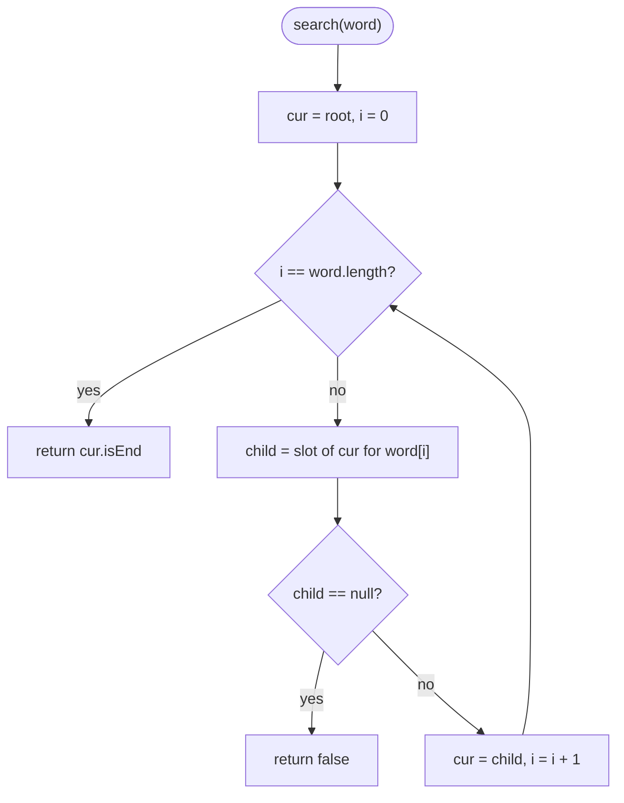
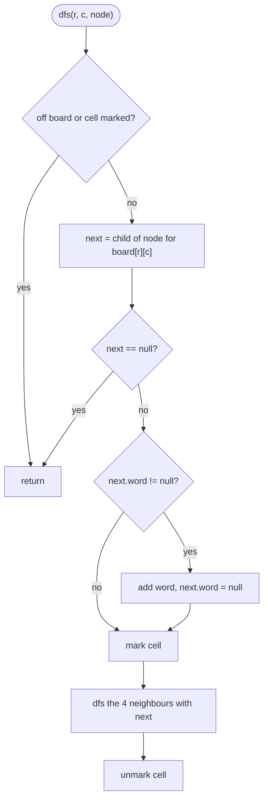

# Tries

> [!abstract] In one sentence
> A trie is a tree in which each edge carries one character and each root-to-node path spells a prefix, so a whole dictionary is stored with every shared prefix written exactly once and any word or prefix is checked by walking one node per character.

**Map:** [[Topics MOC]] → [[DSA Dashboard]]

> [!question] Predict before you read
> A `HashSet<String>` answers "is `cat` in the set?" in O(1). Why can it not answer "is there any word that starts with `ca`?" without scanning every word — and what shape of structure would make that question cost exactly two steps?

## Why this exists

A hash set treats a string as an opaque blob: it hashes all of `cat` and either finds that exact blob or not. The moment a question is about the *inside* of the strings — "which words start with `ca`", "does `c.t` match anything", "which of these 5,000 words appear on this board" — the hash set has nothing to offer but a scan. A trie (pronounced "try", from re*trie*val) exposes the inside: the structure *is* the prefixes. Walking two edges from the root, `c` then `a`, lands you on a node that represents the prefix `ca`; everything below it is every word that starts with `ca`, and the walk cost two steps regardless of whether the dictionary holds ten words or ten million.

The signals in a problem statement that point here are the words **prefix**, **starts with**, **autocomplete**, **dictionary with wildcard**, **search many words at once**, and **longest common prefix**. Less obviously: a grid search for *many* words (one DFS that follows the trie instead of one DFS per word), "maximum XOR of two numbers" (a trie over the 31 bits of each number), and "stream of characters, does any suffix match a word" (a trie of reversed words). In your own stack, HTTP routers such as Go's `httprouter` and Fastify's `find-my-way` match URL paths with a radix tree, which is a trie with single-child chains collapsed into one edge — the same idea, compressed.

The three NeetCode problems are the three canonical uses: build the structure ([[LC 208 Implement Trie Prefix Tree]]), search it with a wildcard ([[LC 211 Design Add and Search Words Data Structure]]), and use it to prune a backtracking search ([[LC 212 Word Search II]]).

## The idea from zero

Take three words: `car`, `cat`, `dog`. Written one under the other, `car` and `cat` share `ca`. A trie writes that shared part once. The root is an empty prefix; each child edge adds one character; a node is a prefix; a node *marked* as terminal is a word.

> [!example] Trie of car, cat, dog
> ![[Tries — Trie of car, cat, dog.excalidraw]]
> [[Tries — Trie of car, cat, dog.excalidraw|Open in Excalidraw]] — c-a is stored once and shared by car and cat; the highlighted path spells cat

%% excalidraw-spec
{"kind": "trie", "title": "Trie of car, cat, dog", "words": ["car", "cat", "dog"], "highlight_word": "cat", "caption": "c-a is stored once and shared by car and cat; the highlighted path spells cat"}
%%

Three operations fall out of the picture. To **insert** a word, walk down from the root one character at a time, creating any child that does not exist yet, and mark the last node as the end of a word. To **search** a word, walk the same path; if a child is missing, the word is absent; if you arrive, the word is present only if that node is marked. To check **startsWith**, walk the path and return whether you arrived — no mark needed, because every node is a prefix of something.

The mark matters more than it looks. Insert `card` into the trie above and the node for `car` now has a child `d`. Without a terminal flag on `r`, nothing would distinguish "`car` is a word" from "`car` is just the first three letters of `card`" — and `search("car")` would wrongly return true after inserting only `card`.

> [!example] Nodes of the trie for car, card, cat
> ![[Tries — Nodes of the trie for car, card, cat.excalidraw]]
> [[Tries — Nodes of the trie for car, card, cat.excalidraw|Open in Excalidraw]] — r carries the end flag and still has a child: car is a word and also a prefix of card

%% excalidraw-spec
{"kind": "tree", "title": "Nodes of the trie for car, card, cat", "nodes": [{"id": "root", "label": "root", "children": ["c"]}, {"id": "c", "label": "c", "children": ["a"]}, {"id": "a", "label": "a", "children": ["r", "t"]}, {"id": "r", "label": "r (end)", "children": ["d"]}, {"id": "t", "label": "t (end)", "children": []}, {"id": "d", "label": "d (end)", "children": []}], "root": "root", "highlight": ["r"], "caption": "r carries the end flag and still has a child: car is a word and also a prefix of card"}
%%

That is the whole data structure: a node holds its children and a boolean. Everything else in this note is about how to lay the children out, and how to walk the trie in lockstep with something else (a pattern with wildcards, a grid).

## The mechanism

### Node layout

A node needs "the child for character `c`, or null". There are two honest ways to store that, and the choice is the first thing an interviewer listens for.

| Layout | Child lookup | Memory per node | Use when |
|---|---|---|---|
| `TrieNode[26] children` | `children[c - 'a']`, one array index | 26 references whether used or not (roughly 120 bytes per node on a 64-bit JVM with compressed references, header included) | lowercase `a`–`z` only, which is every LeetCode trie problem |
| `Map<Character, TrieNode> children` | `children.get(c)`, a hash lookup with boxing | a `HashMap` object plus one entry object per *present* child (roughly 50 bytes for the map plus about 40 per child) | Unicode, mixed case, digits, or very sparse branching deep in the trie |

The array is faster and simpler and wastes memory on nodes with one child (most nodes deep in a trie have exactly one child). The map spends nothing on absent children but pays an object and a boxed `Character` for each present one, and iterating "every child" for a wildcard costs a map traversal. For an interview, write the array and *say* that a map would be the choice for a wider alphabet. Store the terminal flag as `boolean isEnd`, or — in Word Search II — store the whole word (`String word`) at the terminal node so you never have to rebuild it from the path.

### Insert, search, startsWith

All three are the same walk with a different ending:

1. Start at `cur = root`.
2. For each character `c` of the input, compute the slot `i = c - 'a'`; let `child = cur.children[i]`.
3. Insert: if `child` is null, create it. Search and startsWith: if `child` is null, return false.
4. Move: `cur = child`.
5. At the end — insert: `cur.isEnd = true`. Search: return `cur.isEnd`. StartsWith: return true.



> [!example]- Excalidraw version — the same diagram as an editable canvas
> ![[Tries — Insert, search, startsWith.excalidraw]]
> [[Tries — Insert, search, startsWith.excalidraw|Open in Excalidraw]] — needs the Excalidraw plugin (see [[Plugins to Install]]).

The invariant that makes this correct: *after processing k characters, `cur` is the unique node representing the first k characters of the input*. Uniqueness is why insert never creates duplicates and why two words with a shared prefix share nodes.

### Wildcard search: walk the trie and the pattern together

[[LC 211 Design Add and Search Words Data Structure]] adds a `.` that matches any single character. A `.` means "I do not know which child to take, so try all of them" — a DFS with the pattern position as depth. The recursion `dfs(word, pos, node)` returns true if the suffix `word[pos..]` can be matched starting at `node`: if `pos` is at the end, the answer is `node.isEnd`; if `word[pos]` is a letter, follow exactly that child; if it is `.`, try every non-null child and succeed if any does.

> [!example] search(".ad") over bad, dad, mad
> ![[Tries — search(-.ad-) over bad, dad, mad.excalidraw]]
> [[Tries — search(-.ad-) over bad, dad, mad.excalidraw|Open in Excalidraw]] — the dot fans out to b, d and m; the first branch already reaches an end node, so the DFS stops

%% excalidraw-spec
{"kind": "tree", "title": "search(\".ad\") over bad, dad, mad", "nodes": [{"id": "root", "label": "root", "children": ["b", "d", "m"]}, {"id": "b", "label": "b", "children": ["ba"]}, {"id": "d", "label": "d", "children": ["da"]}, {"id": "m", "label": "m", "children": ["ma"]}, {"id": "ba", "label": "a", "children": ["bad"]}, {"id": "da", "label": "a", "children": ["dad"]}, {"id": "ma", "label": "a", "children": ["mad"]}, {"id": "bad", "label": "d (end)", "children": []}, {"id": "dad", "label": "d (end)", "children": []}, {"id": "mad", "label": "d (end)", "children": []}], "root": "root", "highlight": ["b", "ba", "bad"], "caption": "the dot fans out to b, d and m; the first branch already reaches an end node, so the DFS stops"}
%%

Each `.` multiplies the work by the branching factor, so a pattern of all dots costs up to 26 to the power of its length — acceptable because the problem caps patterns at a handful of dots. A pattern longer than every stored word fails fast: the walk runs out of nodes.

### Trie-guided backtracking: Word Search II

[[LC 212 Word Search II]] asks which of up to 30,000 words can be traced on a grid by adjacent moves. Running [[LC 79 Word Search]] once per word is a DFS per word per cell — far too slow. The trie turns it around: do **one** DFS from each cell, and at each step move down the trie by the letter in the current cell. If the trie has no child for that letter, no word in the dictionary continues this way, so stop — that single `null` check is what prunes the search from "every path on the board" down to "every path that is a prefix of some word". When the trie node you reach holds a word, report it and clear it from the node, so a word reachable by two paths is reported once.



> [!example]- Excalidraw version — the same diagram as an editable canvas
> ![[Tries — Trie-guided backtracking- Word Search II.excalidraw]]
> [[Tries — Trie-guided backtracking- Word Search II.excalidraw|Open in Excalidraw]] — needs the Excalidraw plugin (see [[Plugins to Install]]).

Two refinements interviewers like to hear: mark the cell in place (`board[r][c] = '#'`) instead of carrying a `boolean[][]`, and after exploring a node that has no children and no word left, detach it from its parent so later DFS calls never enter a dead subtree. The second one is what makes the worst-case boards pass on LeetCode.

## Java template

The array-based trie is the one to type from memory.

```java
import java.util.*;

class Trie {
    private static class Node {
        Node[] children = new Node[26];   // one slot per lowercase letter
        boolean isEnd;                     // a word ends here, not just a prefix
    }
    private final Node root = new Node();

    public void insert(String word) {
        Node cur = root;
        for (char c : word.toCharArray()) {
            int i = c - 'a';
            if (cur.children[i] == null) cur.children[i] = new Node();
            cur = cur.children[i];
        }
        cur.isEnd = true;
    }

    public boolean search(String word) {
        Node n = walk(word);
        return n != null && n.isEnd;       // arriving is not enough
    }

    public boolean startsWith(String prefix) {
        return walk(prefix) != null;       // arriving is enough
    }

    private Node walk(String s) {          // follow the path; null if it breaks
        Node cur = root;
        for (char c : s.toCharArray()) {
            cur = cur.children[c - 'a'];
            if (cur == null) return null;
        }
        return cur;
    }
}
```

**Time** O(L) per operation for a word of length L · **Space** O(total characters inserted) nodes

The map-based variant changes only the child lookup; `computeIfAbsent` creates the child in one line.

```java
import java.util.*;

class TrieMap {
    private static class Node {
        Map<Character, Node> children = new HashMap<>();
        boolean isEnd;
    }
    private final Node root = new Node();

    public void insert(String word) {
        Node cur = root;
        for (char c : word.toCharArray())
            cur = cur.children.computeIfAbsent(c, k -> new Node());  // create on demand
        cur.isEnd = true;
    }

    public boolean search(String word) {
        Node cur = root;
        for (char c : word.toCharArray()) {
            cur = cur.children.get(c);
            if (cur == null) return false;
        }
        return cur.isEnd;
    }
}
```

**Time** O(L) expected · **Space** proportional to present children only

Wildcard search is the trie walk turned into a DFS.

```java
import java.util.*;

class WordDictionary {
    private static class Node {
        Node[] children = new Node[26];
        boolean isEnd;
    }
    private final Node root = new Node();

    public void addWord(String word) {
        Node cur = root;
        for (char c : word.toCharArray()) {
            int i = c - 'a';
            if (cur.children[i] == null) cur.children[i] = new Node();
            cur = cur.children[i];
        }
        cur.isEnd = true;
    }

    public boolean search(String word) { return dfs(word, 0, root); }

    private boolean dfs(String word, int pos, Node node) {
        if (node == null) return false;
        if (pos == word.length()) return node.isEnd;
        char c = word.charAt(pos);
        if (c != '.') return dfs(word, pos + 1, node.children[c - 'a']);
        for (Node child : node.children)              // wildcard: try every branch
            if (child != null && dfs(word, pos + 1, child)) return true;
        return false;
    }
}
```

**Time** O(L) for a plain word, O(26^d · L) worst case with d dots · **Space** O(L) recursion

Word Search II walks the board and the trie in lockstep.

```java
import java.util.*;

class Solution {
    private static class Node {
        Node[] children = new Node[26];
        String word;                               // non-null only where a word ends
    }

    public List<String> findWords(char[][] board, String[] words) {
        Node root = new Node();
        for (String w : words) {                   // 1. one trie for the whole dictionary
            Node cur = root;
            for (char c : w.toCharArray()) {
                int i = c - 'a';
                if (cur.children[i] == null) cur.children[i] = new Node();
                cur = cur.children[i];
            }
            cur.word = w;
        }
        List<String> found = new ArrayList<>();
        for (int r = 0; r < board.length; r++)
            for (int c = 0; c < board[0].length; c++)
                dfs(board, r, c, root, found);     // 2. one DFS per cell, guided by the trie
        return found;
    }

    private void dfs(char[][] board, int r, int c, Node node, List<String> found) {
        if (r < 0 || c < 0 || r >= board.length || c >= board[0].length) return;
        char ch = board[r][c];
        if (ch == '#') return;                     // already on the current path
        Node next = node.children[ch - 'a'];
        if (next == null) return;                  // prune: no word continues with this letter
        if (next.word != null) {
            found.add(next.word);
            next.word = null;                      // report each word once
        }
        board[r][c] = '#';                         // mark, explore, unmark
        dfs(board, r + 1, c, next, found);
        dfs(board, r - 1, c, next, found);
        dfs(board, r, c + 1, next, found);
        dfs(board, r, c - 1, next, found);
        board[r][c] = ch;
    }
}
```

**Time** O(W · L) to build plus O(R · C · 3^(L−1)) worst-case DFS, far less in practice because of pruning · **Space** O(W · L) trie plus O(L) recursion

## Complexity

| Operation | Time | Space | Why |
|---|---|---|---|
| insert(word) | O(L) | up to L new nodes | one step per character, creating at most one node each |
| search / startsWith | O(L) | O(1) | one array index per character; independent of the number of words |
| wildcard search with d dots | O(26^d · L) worst | O(L) stack | each dot fans out to at most 26 children |
| build a trie of W words | O(W · L) | O(W · L · 26) references worst case | shared prefixes reduce it; the 26-slot array is the cost of O(1) child lookup |
| Word Search II | O(R · C · 3^(L−1)) worst | O(W · L) | one DFS per cell, each step limited to paths that are prefixes of a word |

Compare with a `HashSet<String>`: membership is O(L) too (hashing reads every character), so the trie is not faster for exact lookup — it is *equal* for lookup and *strictly better* for anything prefix-shaped.

## The canonical shapes

| Shape | Recognition cue | One-line solution | Problems |
|---|---|---|---|
| Build the dictionary | "implement insert, search, startsWith" | array-of-26 nodes with an end flag; three walks | [[LC 208 Implement Trie Prefix Tree]] |
| Wildcard lookup | "`.` can match any letter" | DFS over the trie; a dot tries every non-null child | [[LC 211 Design Add and Search Words Data Structure]] |
| Many words on a board | "find all words from the list in the grid" | trie of the words; one DFS per cell that descends the trie and prunes on null | [[LC 212 Word Search II]] |
| Prefix statistics | "how many words start with", "autocomplete top k" | a counter (or a small sorted list) stored on every node, updated during insert | no NeetCode 150 problem; appears in design rounds |
| Bitwise trie | "maximum XOR of two numbers" | trie over the 31 bits of each number, greedily take the opposite bit | no NeetCode 150 problem; recognise only |

## Worked example

Word Search II on a two-row board with the words `oat`, `eat`, `tea`, `ate`:

> [!example] Board for Word Search II
> ![[Tries — Board for Word Search II.excalidraw]]
> [[Tries — Board for Word Search II.excalidraw|Open in Excalidraw]] — one of the two paths that spell eat: (1,0) up to (0,1), right to (0,2)

%% excalidraw-spec
{"kind": "grid", "title": "Board for Word Search II", "col_labels": ["", "0", "1", "2"], "row_labels": ["", "0", "1"], "rows": [ ["o", "a", "t"], ["e", "a", "t"] ], "highlight": [ [1, 0], [0, 1], [0, 2] ], "arrows": [ [ [1, 0], [0, 1] ], [ [0, 1], [0, 2] ] ], "caption": "one of the two paths that spell eat: (1,0) up to (0,1), right to (0,2)"}
%%

> [!example] Trie of oat, eat, tea, ate
> ![[Tries — Trie of oat, eat, tea, ate.excalidraw]]
> [[Tries — Trie of oat, eat, tea, ate.excalidraw|Open in Excalidraw]] — the DFS descends this trie while it walks the board

%% excalidraw-spec
{"kind": "trie", "title": "Trie of oat, eat, tea, ate", "words": ["oat", "eat", "tea", "ate"], "highlight_word": "eat", "caption": "the DFS descends this trie while it walks the board"}
%%

The DFS visits every cell as a starting point:

| Start cell | What happens |
|---|---|
| (0,0) `o` | root has `o`; neighbour (1,0) `e` has no child under `o`, pruned; neighbour (0,1) `a` reaches `oa`; from there (0,2) `t` reaches the end node of `oat` — report it; (1,1) `a` has no child under `oa`, pruned |
| (0,1) `a` | root has `a`; (0,2) `t` reaches `at`; from (0,2) the unvisited neighbour (1,2) `t` has no child under `at`, pruned; (1,1) `a` has no child under `a`. `ate` is never found — pruned at depth 2 |
| (0,2) `t` | root has `t`; neighbours `a` (0,1) and `t` (1,2) are not children of `t` (only `e` is). Pruned at depth 1 — `tea` dies immediately |
| (1,0) `e` | root has `e`; (0,0) `o` is not a child; (1,1) `a` reaches `ea`; (1,2) `t` reaches the end node of `eat` — report, clear the word. Back at `ea`, (0,1) `a` is not a child |
| (1,1) `a` | root has `a`; (0,1) `a` not a child of `a`; (1,2) `t` reaches `at`; from there (0,2) `t` not a child. Pruned |
| (1,2) `t` | root has `t`; both neighbours pruned at depth 1 |

Result: `[oat, eat]`. Note what the trie bought: `tea` and `ate` cost one or two steps each instead of a full board search, and `eat`, reachable by two different paths (through (0,1) or (1,1)), is reported once because the first hit cleared `next.word`.

## Pitfalls

> [!warning] The mistakes people make
> - **Returning true on arrival.** `search` must return `node.isEnd`, not `node != null`; otherwise every prefix of a stored word passes as a word. This is the single most common trie bug.
> - **`c - 'a'` on the wrong alphabet.** An uppercase letter or a digit gives a negative or out-of-range index and an `ArrayIndexOutOfBoundsException`. Check the constraints; switch to a map if the alphabet is wider than `a`–`z`.
> - **Wildcard that only tries one child.** For `.` you must loop over all 26 slots and return true if *any* branch succeeds — and keep going after a null slot rather than returning.
> - **Reporting duplicates in Word Search II.** Two paths can spell the same word. Clear `node.word` after reporting (or collect into a `HashSet`), or LeetCode rejects the answer.
> - **Forgetting to unmark the cell.** Backtracking must restore `board[r][c]`; a cell left as `#` blocks every later path through it.
> - **Rebuilding the trie per query.** In a design problem the trie is built once; `search` must not touch the word list again.
> - **Memory on huge dictionaries.** 30,000 words of length 10 with 26-slot arrays is a few tens of megabytes; fine on LeetCode, but say that a map or a radix tree would shrink it if asked.

## Variations & follow-ups

**Delete a word.** Walk down, unset `isEnd`, then on the way back up remove any child that has no children and is not an end. A reference counter per node (`count` of words passing through) makes this a single downward pass.

**Count words with a prefix.** Keep `int passCount` on every node, incremented on insert; `countPrefix(p)` walks to the node and returns its counter. This is the shape of "autocomplete frequency" questions.

**Top-k autocomplete.** Either DFS from the prefix node and collect, or store a small sorted list of the k most frequent completions on every node and update it on insert — a design-round answer with a memory trade-off to discuss.

**Compressed trie (radix tree).** Collapse chains of single-child nodes into one edge labelled with a string. Same operations, fewer nodes; this is what routers and IP lookup tables use.

**Binary trie for XOR.** Insert each number as its 31 bits from the most significant; for a query, at each bit prefer the child with the opposite bit. Maximum XOR of two numbers in O(31 · n).

**Suffix structures.** A trie of all suffixes answers "does this substring occur" in O(L); the compressed form is the suffix tree. Recognise the name; do not implement it in an interview.

## Interview script

Recognise it in the first minute: the statement talks about prefixes, wildcards, or searching many words against one text. Say what you see: "Every query is about prefixes, so I want a structure where a prefix is a node — a trie." Then, in order:

1. State the node: "a node has 26 child slots and an end flag; the array gives O(1) child lookup because the alphabet is lowercase letters."
2. State the operations and their cost: "insert and search walk one node per character, O(L), independent of the dictionary size."
3. For the specific problem, state what is walked in lockstep with the trie — the pattern (wildcard DFS) or the board (pruned backtracking) — and where the pruning happens.
4. Name the trade-off before being asked: array versus map, memory versus speed.
5. Code the walk once as a private helper and reuse it; write the DFS with the `null` check first.

What the interviewer is checking: that you distinguish *arriving at a node* from *a word ending there*; that your wildcard DFS tries every child; that your Word Search II is one DFS per cell with trie pruning, not one DFS per word; and that you can say the complexity in terms of word length rather than dictionary size.

Follow-ups to expect: "how would you delete?", "how much memory does this use for a million words?", "how would you return the top five completions?", "what if the alphabet is Unicode?".

## Spot the bug

```java
// snippet
public boolean search(String word) {
    Node cur = root;
    for (char c : word.toCharArray()) {
        cur = cur.children[c - 'a'];
        if (cur == null) return false;
    }
    return true;
}
```

> [!example]- The fix
> After inserting only `card`, `search("car")` walks `c`, `a`, `r` without hitting a null and returns true, although `car` was never inserted. The last line must be `return cur.isEnd;` — arriving at a node proves the prefix exists, and only the flag proves a word ends there. `startsWith` is the method that is allowed to return true on arrival.

## Related

### Prerequisites
- [[Trees]] — a trie is a 26-ary tree; the walk is a root-to-leaf path
- [[Hashing]] — what a `HashSet<String>` can and cannot answer
- [[Recursion]] — the wildcard search and the board DFS are recursion with early exits
- [[Backtracking]] — mark, explore, unmark on the grid

### Builds on this
- [[Strings]] — prefix and substring questions that a trie answers directly
- [[Bit Manipulation]] — the binary trie for maximum XOR
- [[Graphs]] — Word Search II is grid DFS with a second structure steering it

### Problems that use it
- [[LC 208 Implement Trie Prefix Tree]]
- [[LC 211 Design Add and Search Words Data Structure]]
- [[LC 212 Word Search II]]
- [[LC 79 Word Search]] — the single-word version the trie generalises
- [[Java Collections Cheat Sheet]] — `computeIfAbsent`, `toCharArray`, `c - 'a'`
- [[DSA Patterns in Java]] — the Trie class in the template vault

## Personal understanding

> [!question] Explain it without the note
> Write your own explanation here, from memory, then compare with the sections above and note what you missed.

### Mastery checklist
- [ ] I can state the idea in one sentence
- [ ] I can re-derive the mechanism on a whiteboard
- [ ] I can name when NOT to use it
- [ ] I have solved three problems with it without hints
- [ ] I can explain it to a colleague in two minutes

## Open questions
- [ ] For a million lowercase words of average length eight, how much memory does the 26-slot array layout cost compared with a map-based node, measured rather than estimated?
- [ ] At what number of words does the trie in Word Search II stop paying for itself compared with running the single-word DFS for each word?
