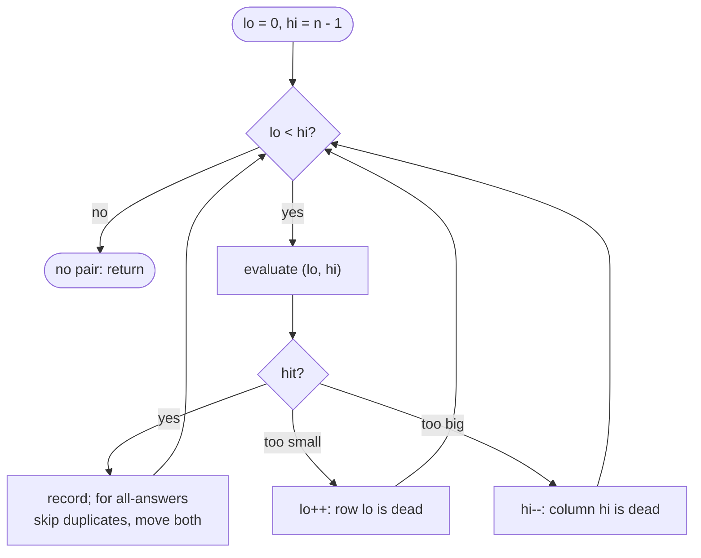

# Two Pointers

> [!abstract] In one sentence
> Keep two indices and move exactly one of them per step according to a rule that guarantees the discarded candidates could never beat what remains, so that n² pairs are examined in at most 2n moves — the rule is what you must be able to justify, and the sortedness or monotonicity of the input is what makes it exist.

**Map:** [[Topics MOC]] → [[DSA Dashboard]]

> [!question] Predict before you read
> Sorted array, target sum, `lo` at the left end and `hi` at the right. `nums[lo] + nums[hi]` is too small, so you move `lo` right. Why is it safe never to pair `nums[lo]` with anything again — what exactly has been ruled out?

## Why this exists

The brute force for "a pair with property P" tries all n(n − 1)/2 pairs. When the input is sorted (or can be sorted in n log n), or when some quantity changes monotonically as an index moves, you can start from an extreme pair and move one pointer per step such that every move eliminates a whole set of pairs at once. [[Binary Search]] uses the same monotonicity to discard half; two pointers discards a row or a column.

The signals: **sorted array** (given or cheap to obtain), **pair / triplet with a sum**, **palindrome**, **in place with O(1) extra space** (remove, dedupe, partition, move zeros), **container / water / widest span**, and on linked lists **cycle**, **middle**, **k-th from the end**.

## The idea from zero

Sorted `[1, 3, 4, 6, 8, 11]`, target 10. Put `lo` on the smallest and `hi` on the largest. The sum is 12, too big: nothing paired with 11 can work, because every other element is ≤ 8 and 1 + 11 is already too big — so the whole *column* of pairs ending at 11 is dead, and `hi` moves. Now 1 + 8 = 9, too small: 1 paired with anything remaining is even smaller, so the whole *row* of pairs starting at 1 is dead, and `lo` moves.

> [!example] Pair sums for [1,3,4,6,8,11], target 10: the walk kills a row or a column per step
> ![[Two Pointers — Pair sums for -1,3,4,6,8,11-, target 10- the walk kills a row or a column per step.excalidraw]]
> [[Two Pointers — Pair sums for -1,3,4,6,8,11-, target 10- the walk kills a row or a column per step.excalidraw|Open in Excalidraw]] — 12 > 10 kills column 11; 9 < 10 kills row 1; 11 kills column 8; 9 kills row 3; 4 + 6 = 10 found in five steps instead of fifteen pairs. Each step removes a row or a column, so at most n - 1 steps: that is the whole proof, and the sentence to say to the interviewer

%% excalidraw-spec
{"kind": "grid", "title": "Pair sums for [1,3,4,6,8,11], target 10: the walk kills a row or a column per step", "col_labels": ["1", "3", "4", "6", "8", "11"], "row_labels": ["1", "3", "4", "6", "8", "11"], "rows": [ ["", "4", "5", "7", "9", "12"], ["", "", "7", "9", "11", "14"], ["", "", "", "10", "12", "15"], ["", "", "", "", "14", "19"], ["", "", "", "", "", "19"], ["", "", "", "", "", ""] ], "highlight": [ [0, 5], [0, 4], [1, 4], [1, 3], [2, 3] ], "arrows": [ [ [0, 5], [0, 4] ], [ [0, 4], [1, 4] ], [ [1, 4], [1, 3] ], [ [1, 3], [2, 3] ] ], "caption": "12 > 10 kills column 11; 9 < 10 kills row 1; 11 kills column 8; 9 kills row 3; 4 + 6 = 10 found in five steps instead of fifteen pairs. Each step removes a row or a column, so at most n - 1 steps: that is the whole proof, and the sentence to say to the interviewer"}
%%

> [!example] The same walk on the array
> ![[Two Pointers — The same walk on the array.excalidraw]]
> [[Two Pointers — The same walk on the array.excalidraw|Open in Excalidraw]] — lo moved twice (sum too small), hi moved twice (sum too big); they stop at 4 + 6

%% excalidraw-spec
{"kind": "array", "title": "The same walk on the array", "values": [1, 3, 4, 6, 8, 11], "pointers": {"lo": 2, "hi": 3}, "highlight": [2, 3], "caption": "lo moved twice (sum too small), hi moved twice (sum too big); they stop at 4 + 6"}
%%

## The mechanism

**Opposite ends.** Invariant: *if an answer exists, it lies within `[lo, hi]`*. Each step evaluates the current pair and moves the pointer whose side can no longer improve. For a sum, the smaller side moves when the sum is too small. For [[LC 11 Container With Most Water]] the *shorter* line moves: with `h[lo] < h[hi]`, any container `(lo, j)` for `j < hi` has width smaller than now and height at most `h[lo]`, so it cannot beat the current one — `lo` is finished. For [[LC 42 Trapping Rain Water]] keep `leftMax` and `rightMax`; the side with the smaller max is settled, because the water above it is bounded by its own max (the other side's max is at least as high), so add `max − h` there and move inward.

**Same direction (read / write).** Invariant: *`[0, write)` is the output built so far, and `read` scans ahead.* Dedupe a sorted array by copying `nums[read]` only when it differs from `nums[write − 1]`; move zeros by writing non-zeros forward and filling the tail; the Dutch-flag partition keeps three regions with `lo`, `mid`, `hi`. The output never overtakes the input, so it is in place.

**Fast and slow.** On a linked list, `slow` moves one node and `fast` two. If there is a cycle, `fast` enters it first and then closes the gap on `slow` by exactly one node per step, so they meet; if there is none, `fast` hits `null`. The same gap idea gives the middle (`fast` at the end means `slow` at the middle) and the k-th from the end (start `fast` k ahead, move both until `fast` is null). The reset trick for the cycle *start* — move one pointer to the head and advance both one step at a time — is [[LC 287 Find the Duplicate Number]]'s whole solution.

> [!example] Floyd's tortoise and hare on a list whose tail loops back to node 2
> ![[Two Pointers — Floyd's tortoise and hare on a list whose tail loops back to node 2.excalidraw]]
> [[Two Pointers — Floyd's tortoise and hare on a list whose tail loops back to node 2.excalidraw|Open in Excalidraw]] — once both are inside the loop the gap shrinks by one per step, so they must meet; without a loop fast reaches null

%% excalidraw-spec
{"kind": "list", "title": "Floyd's tortoise and hare on a list whose tail loops back to node 2", "nodes": ["1", "2", "3", "4", "5", "6"], "pointers": {"slow": 3, "fast": 5}, "cycle_to": 1, "caption": "once both are inside the loop the gap shrinks by one per step, so they must meet; without a loop fast reaches null"}
%%

**Three pointers (k-sum).** Sort. Fix `i`, then run opposite-end pointers on `[i + 1, n − 1]` for the target `−nums[i]`. Skip duplicate values of `i` (`i > 0 && nums[i] == nums[i − 1]`) and, after recording a triple, advance `lo` past equal values. That turns 3Sum into n × O(n) = O(n²) with no set of triples needed.



> [!example]- Excalidraw version — the same diagram as an editable canvas
> ![[Two Pointers — The mechanism.excalidraw]]
> [[Two Pointers — The mechanism.excalidraw|Open in Excalidraw]] — needs the Excalidraw plugin (see [[Plugins to Install]]).

## Java template

```java
import java.util.*;

class Solution {
    public int[] twoSum(int[] numbers, int target) {           // sorted input, 1-based answer as LC 167 asks
        int lo = 0, hi = numbers.length - 1;
        while (lo < hi) {
            int sum = numbers[lo] + numbers[hi];               // fits int: values are bounded in the problem
            if (sum == target) return new int[]{lo + 1, hi + 1};
            if (sum < target) lo++; else hi--;                 // exactly one pointer moves per step
        }
        return new int[]{-1, -1};
    }
}
```

**Time** O(n) · **Space** O(1) — the read/write dedupe is the same loop shape: `if (nums[read] != nums[write - 1]) nums[write++] = nums[read];`

```java
import java.util.*;

class Solution {
    public List<List<Integer>> threeSum(int[] nums) {
        Arrays.sort(nums);
        List<List<Integer>> out = new ArrayList<>();
        for (int i = 0; i + 2 < nums.length; i++) {
            if (nums[i] > 0) break;                                   // sorted: no triple can sum to 0 any more
            if (i > 0 && nums[i] == nums[i - 1]) continue;            // skip a repeated first element
            int lo = i + 1, hi = nums.length - 1;
            while (lo < hi) {
                int sum = nums[i] + nums[lo] + nums[hi];
                if (sum < 0) lo++;
                else if (sum > 0) hi--;
                else {
                    out.add(List.of(nums[i], nums[lo], nums[hi]));
                    lo++;
                    while (lo < hi && nums[lo] == nums[lo - 1]) lo++;   // skip repeated second elements
                    hi--;
                }
            }
        }
        return out;
    }
}
```

**Time** O(n²) after the O(n log n) sort · **Space** O(1) beyond the output (sorting may use O(log n))

```java
import java.util.*;

class Solution {
    public int trap(int[] h) {
        int lo = 0, hi = h.length - 1, leftMax = 0, rightMax = 0, water = 0;
        while (lo < hi) {
            if (h[lo] < h[hi]) {                       // left side is the lower wall: its water is bounded by leftMax
                leftMax = Math.max(leftMax, h[lo]);
                water += leftMax - h[lo];
                lo++;
            } else {
                rightMax = Math.max(rightMax, h[hi]);
                water += rightMax - h[hi];
                hi--;
            }
        }
        return water;
    }
}
```

**Time** O(n) · **Space** O(1) — versus O(n) for the prefix-max/suffix-max arrays version

## Complexity

| Family | Time | Space | Why |
|---|---|---|---|
| opposite ends on sorted input | O(n), plus O(n log n) if you must sort | O(1) | each step moves one pointer inward; at most n − 1 steps |
| read / write in place | O(n) | O(1) | `read` visits each index once |
| fast / slow on a list | O(n) | O(1) | `fast` makes at most n/2 + cycle-length steps |
| 3Sum, and k-sum generally | O(n²), O(n^(k−1)) | O(1) extra | n choices of `i`, each an O(n) two-pointer pass; recurse for k > 3 |

## The canonical shapes

| Shape | Recognition cue | One-line solution | Problem |
|---|---|---|---|
| Palindrome check | "is it a palindrome, ignoring non-letters" | `lo`/`hi` skip non-alphanumerics, compare lowercase | [[LC 125 Valid Palindrome]] |
| Sorted pair sum | "sorted array, two numbers sum to target" | opposite ends, move the side that fixes the sum | [[LC 167 Two Sum II Input Array Is Sorted]] |
| Triplets | "all unique triplets summing to 0" | sort, fix `i`, two-pointer, dedupe | [[LC 15 3Sum]] |
| Widest container | "max area between two lines" | opposite ends, move the shorter line | [[LC 11 Container With Most Water]] |
| Water between walls | "how much water is trapped" | left/right running max, settle the smaller side | [[LC 42 Trapping Rain Water]] |
| Cycle / middle / k-th from end | linked list, "cycle", "middle", "remove n-th from end" | fast and slow with a gap | [[LC 141 Linked List Cycle]], [[LC 19 Remove Nth Node From End of List]], [[LC 143 Reorder List]] |
| Duplicate as a cycle | "array of n + 1 values in 1..n, find the repeat, O(1) space" | treat `i → nums[i]` as a list, Floyd with the reset phase | [[LC 287 Find the Duplicate Number]] |

## Worked example

[[LC 11 Container With Most Water]] on `h = [1, 8, 6, 2, 5, 4, 8, 3, 7]`.

| lo | hi | min(h) × width | best | move |
|---|---|---|---|---|
| 0 | 8 | 1 × 8 = 8 | 8 | h[0] = 1 is shorter: lo++ |
| 1 | 8 | 7 × 7 = 49 | 49 | h[8] = 7 is shorter: hi-- |
| 1 | 7 | 3 × 6 = 18 | 49 | hi-- |
| 1 | 6 | 8 × 5 = 40 | 49 | equal heights: either side; hi-- |
| 1 | 5, 4, 3, 2 | 16, 15, 4, 6 | 49 | hi-- each time; the pointers meet |

> [!example] The best container found at lo = 1, hi = 8
> ![[Two Pointers — The best container found at lo = 1, hi = 8.excalidraw]]
> [[Two Pointers — The best container found at lo = 1, hi = 8.excalidraw|Open in Excalidraw]] — min(8, 7) * (8 - 1) = 49. Why moving the shorter line is safe: at (0, 8) the height is capped by h[0] = 1, so any container keeping index 0 with a smaller width is worse — index 0 is finished. Eight moves, 36 pairs never examined

%% excalidraw-spec
{"kind": "array", "title": "The best container found at lo = 1, hi = 8", "values": [1, 8, 6, 2, 5, 4, 8, 3, 7], "pointers": {"lo": 1, "hi": 8}, "highlight": [1, 8], "caption": "min(8, 7) * (8 - 1) = 49. Why moving the shorter line is safe: at (0, 8) the height is capped by h[0] = 1, so any container keeping index 0 with a smaller width is worse — index 0 is finished. Eight moves, 36 pairs never examined"}
%%

## Pitfalls

> [!warning] The mistakes people make
> - **Forgetting to sort.** Opposite-end pointers on unsorted data are simply wrong; sort first (and say the n log n), or use a hash map ([[Arrays & Hashing]]) when order must be preserved.
> - **A step that moves nothing.** Every branch of the loop must move a pointer, or it spins forever. `while (lo < hi)` with an `else` that only records a hit is the classic.
> - **`<` versus `<=`.** Pairs need `lo < hi`; a palindrome or a partition may need `lo <= hi`. Decide from whether the pointers may refer to the same element.
> - **Dedupe in the wrong place.** In 3Sum skip `i` only against `i − 1` (not `i + 1`), and skip `lo` duplicates *after* recording a hit, not before — otherwise `[-1, -1, 2]` is lost.
> - **Palindrome and list details.** `Character.isLetterOrDigit` and `toLowerCase`, and a string of only punctuation is a palindrome; on lists guard `while (fast != null && fast.next != null)` — both, in that order.
> - **Moving the wrong side.** Container: move the *shorter*; trapping: settle the side with the smaller *running max*. Moving the taller side can only shrink the answer.

## Variations & follow-ups

**k-sum** recurses: fix one element, solve (k − 1)-sum on the suffix, two-pointer at k = 2; the dedupe rule is the same at every level. **Closest sum** keeps the best |sum − target| instead of stopping. **Two sorted arrays** — merge, intersection, median — walk one pointer per array. **Squares of a sorted array** fills the output from the back, biggest absolute value first. **Partition** generalises dedupe: quicksort's partition and Dutch flag are read/write pointers with a pivot. **Cycle start** is Floyd's second phase (reset one pointer to the head, move both by one), and the proof is a short modular-arithmetic argument worth being able to sketch.

## Interview script

Say the invariant and the move rule before coding: "the answer, if it exists, lies between `lo` and `hi`; when the sum is too small I move `lo`, because `nums[lo]` paired with anything left is smaller still — each step discards a full row or column, so it is O(n)." For 3Sum add: "I sort first, fix the smallest element, and dedupe at both levels so the output has no repeats without a set."

What the interviewer is checking: that you can justify the move rule (not just recite it), that you know when sortedness is required and what it costs, that every loop branch moves a pointer, and that duplicates are handled deliberately. Follow-ups: "what if the array is not sorted?", "return all pairs, not one — how do you avoid duplicates?", "can you do it in O(1) space?", "extend to 4Sum".

## Spot the bug

```java
// snippet
for (int i = 0; i + 2 < nums.length; i++) {
    if (i + 1 < nums.length && nums[i] == nums[i + 1]) continue;   // "skip duplicates"
    int lo = i + 1, hi = nums.length - 1;
    // ... two-pointer search for -nums[i] ...
}
```

> [!example]- The fix
> Skipping `i` when `nums[i] == nums[i + 1]` throws away the *first* copy of a value, so `[-1, -1, 2]` is never found: at `i = 0` the loop skips, and at `i = 1` the only `-1` left is `nums[1]` itself. Compare backwards — `if (i > 0 && nums[i] == nums[i - 1]) continue;` — which skips the *later* copies and keeps the first, so a triple may still use two equal values from different positions.

## Related

### Prerequisites
- [[Arrays & Hashing]] — the hash-map alternative when the array must stay unsorted
- [[Sorting]] — the n log n you pay to make the pointers legal

### Builds on this
- [[Sliding Window]] (two pointers moving the same way with a window invariant), [[Linked Lists]] (fast/slow pointers, k-th from end, reorder), [[Binary Search]] (the other way to exploit monotonicity)
- [[DSA Patterns in Java]], [[Java Collections Cheat Sheet]] (`List.of`, `Character` helpers), [[Java Pitfalls in Interviews]]

### Problems that use it
- [[LC 125 Valid Palindrome]], [[LC 167 Two Sum II Input Array Is Sorted]], [[LC 15 3Sum]], [[LC 11 Container With Most Water]], [[LC 42 Trapping Rain Water]]
- [[LC 141 Linked List Cycle]], [[LC 19 Remove Nth Node From End of List]], [[LC 143 Reorder List]], [[LC 287 Find the Duplicate Number]]

## Personal understanding

> [!question] Explain it without the note
> Write your own explanation here, from memory, then compare with the sections above and note what you missed.

### Mastery checklist
- [ ] I can state the idea in one sentence
- [ ] I can re-derive the mechanism on a whiteboard
- [ ] I can name when NOT to use it
- [ ] I have solved three problems with it without hints
- [ ] I can explain it to a colleague in two minutes

## Open questions
- [ ] Write the modular-arithmetic proof that Floyd's reset phase lands on the cycle start, in five lines, without looking it up; and explain in one sentence why, in trapping rain water, comparing `h[lo]` and `h[hi]` is equivalent to comparing `leftMax` and `rightMax`.
