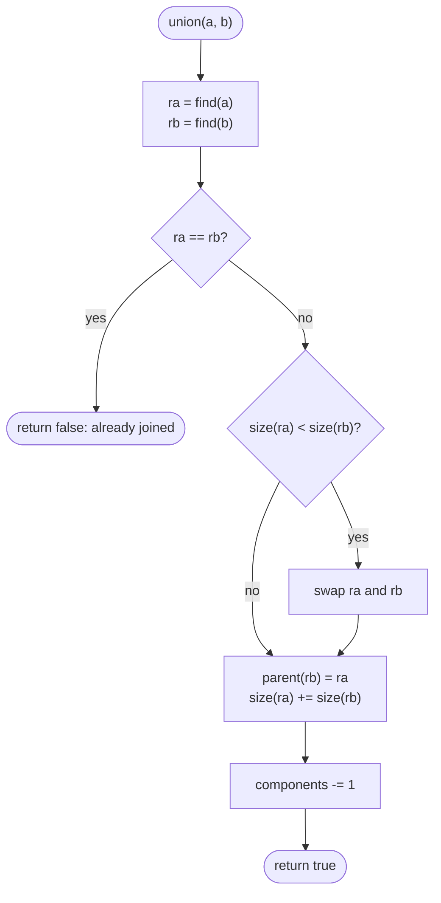

# Union-Find

> [!abstract] In one sentence
> Union-Find answers "are a and b in the same group?" and "merge the groups of a and b" with a single `parent[]` array where each group is a tree pointing at its root, and two small tricks — flatten paths as you walk them, attach the smaller tree under the larger — make every operation effectively O(1), so connectivity can be maintained while edges keep arriving.

**Map:** [[Topics MOC]] → [[DSA Dashboard]]

> [!question] Predict before you read
> You have n nodes and edges arrive one by one; after each edge you must say how many connected components exist. A DFS per edge costs O(n + E) each time. What is the minimum information you need to keep between edges so that each new edge costs almost nothing?

## Why this exists

[[Graphs]] gives you DFS and BFS for connectivity, and they are the right tool when the graph is fixed and you traverse it once. They are the wrong tool when the graph *changes* while questions are being asked: edges added one at a time, "after this edge, how many groups?", "does this edge close a cycle?", "merge these two accounts". Each DFS starts from scratch; Union-Find keeps the groups and updates them in near-constant time per edge.

The signals in a statement are **connected components counted as edges are added**, **redundant / extra edge**, **is this a valid tree**, **merge groups / accounts / equivalences**, **minimum spanning tree** (Kruskal, in [[Advanced Graphs]]), and any problem where you want to process items *sorted by some threshold* and ask when two things become connected. It is also the natural answer when you only have an **edge list** and do not want to build an adjacency list at all.

You will recognise it at work as the data structure behind "which hosts are in the same network partition", deduplicating user records that share an email or a phone number, and the cluster membership in a gossip protocol — groups that only ever merge.

## The idea from zero

Five elements `0..4`, each in its own group. Represent a group by one of its members, the **root**, and give each element a `parent` pointer; a root points at itself. At the start every element is a root.

> [!example] Start: five singleton sets
> ![[Union-Find — Start- five singleton sets.excalidraw]]
> [[Union-Find — Start- five singleton sets.excalidraw|Open in Excalidraw]] — parent[i] = i for every i; each element is the root of its own tree

%% excalidraw-spec
{"kind": "forest", "title": "Start: five singleton sets", "parent": {"0": "0", "1": "1", "2": "2", "3": "3", "4": "4"}, "caption": "parent[i] = i for every i; each element is the root of its own tree"}
%%

**find(x)**: follow `parent` from `x` until you reach an element that is its own parent. That element is the root, and two elements are in the same group exactly when `find` returns the same root.

**union(a, b)**: find both roots; if they differ, make one root point at the other. The two trees become one tree and the two groups one group. Do `union(0, 1)` and `union(2, 3)`:

> [!example] After union(0,1) and union(2,3)
> ![[Union-Find — After union(0,1) and union(2,3).excalidraw]]
> [[Union-Find — After union(0,1) and union(2,3).excalidraw|Open in Excalidraw]] — roots 0, 2 and 4; find(1) = 0, find(3) = 2; the groups are {0,1}, {2,3}, {4}

%% excalidraw-spec
{"kind": "forest", "title": "After union(0,1) and union(2,3)", "parent": {"0": "0", "1": "0", "2": "2", "3": "2", "4": "4"}, "rank": {"0": 1, "2": 1}, "caption": "roots 0, 2 and 4; find(1) = 0, find(3) = 2; the groups are {0,1}, {2,3}, {4}"}
%%

Now `union(1, 3)`: `find(1)` walks `1 → 0`, `find(3)` walks `3 → 2`; the roots `0` and `2` differ, so link one under the other. Which one goes under matters for speed, not correctness.

> [!example] After union(1,3): root 2 attached under root 0
> ![[Union-Find — After union(1,3)- root 2 attached under root 0.excalidraw]]
> [[Union-Find — After union(1,3)- root 2 attached under root 0.excalidraw|Open in Excalidraw]] — find(3) now walks 3 -> 2 -> 0; the groups are {0,1,2,3} and {4}

%% excalidraw-spec
{"kind": "forest", "title": "After union(1,3): root 2 attached under root 0", "parent": {"0": "0", "1": "0", "2": "0", "3": "2", "4": "4"}, "rank": {"0": 2}, "caption": "find(3) now walks 3 -> 2 -> 0; the groups are {0,1,2,3} and {4}"}
%%

That is the whole structure: an `int[] parent`. No adjacency list, no visited array, no recursion over neighbours. Everything else is about keeping the trees shallow so that `find` stays short.

## The mechanism

### Why plain linking is not enough

Link roots carelessly — always `parent[rootA] = rootB` — and a sequence like `union(1,2)`, `union(2,3)`, `union(3,4)` builds a chain. `find(1)` then walks the whole chain: O(n) per operation, no better than a DFS.

> [!example] Degenerate chain from careless unions
> ![[Union-Find — Degenerate chain from careless unions.excalidraw]]
> [[Union-Find — Degenerate chain from careless unions.excalidraw|Open in Excalidraw]] — find(1) walks 1 -> 2 -> 3 -> 4: linear time, exactly what we are trying to avoid

%% excalidraw-spec
{"kind": "forest", "title": "Degenerate chain from careless unions", "parent": {"1": "2", "2": "3", "3": "4", "4": "4"}, "caption": "find(1) walks 1 -> 2 -> 3 -> 4: linear time, exactly what we are trying to avoid"}
%%

Two independent fixes, and you use both.

### Union by rank (or size)

Keep a `rank[]` (an upper bound on tree height) or `size[]` (number of elements). When linking two roots, attach the **shorter** (or smaller) tree under the taller (or larger). With rank, the height grows only when two trees of equal rank are joined, and the new rank is one more. A tree of rank r has at least 2^r elements, so the height is at most log₂ n and every `find` is O(log n) — guaranteed, with no other trick.

### Path compression

While `find(x)` walks up to the root, it learns the root of every element on the path. Spend the knowledge: point every one of them **directly** at the root. The next `find` on any of them is one step. The recursive form does it in one line (`parent[x] = find(parent[x])`); the iterative form walks to the root once, then walks the path again rewriting pointers. A cheaper cousin, *path halving* (`parent[x] = parent[parent[x]]` as you go), gives the same bound with one pass.

> [!example] After find(3) with path compression
> ![[Union-Find — After find(3) with path compression.excalidraw]]
> [[Union-Find — After find(3) with path compression.excalidraw|Open in Excalidraw]] — 3 pointed at 2 before; now it points straight at the root 0. rank stays 2 (it is an upper bound, not the exact height)

%% excalidraw-spec
{"kind": "forest", "title": "After find(3) with path compression", "parent": {"0": "0", "1": "0", "2": "0", "3": "0", "4": "4"}, "rank": {"0": 2}, "caption": "3 pointed at 2 before; now it points straight at the root 0. rank stays 2 (it is an upper bound, not the exact height)"}
%%

### The inverse Ackermann bound, in one paragraph

With both tricks, a sequence of m operations on n elements costs O(m · α(n)) in total, where α is the inverse Ackermann function — a function that grows so slowly that α(n) ≤ 4 for any n that fits in a computer. You do not need the proof (it is Tarjan's, and it is hard); you need the intuition. Union by rank alone caps every path at log n. Path compression then makes each long walk *pay for itself*: a walk of k steps rewrites k − 1 pointers, and each rewritten pointer jumps to a strictly higher-rank node, which can only happen a bounded number of times per element. Long walks are rare because every long walk destroys the conditions that made it long. In an interview say "amortised near-constant, inverse Ackermann" and move on; if pressed, give the log n bound from rank alone, which is easy to justify.



> [!example]- Excalidraw version — the same diagram as an editable canvas
> ![[Union-Find — The inverse Ackermann bound, in one paragraph.excalidraw]]
> [[Union-Find — The inverse Ackermann bound, in one paragraph.excalidraw|Open in Excalidraw]] — needs the Excalidraw plugin (see [[Plugins to Install]]).


### Three things you get for free

**Component count.** Start at n; every union that returns true (two different roots) reduces it by one. [[LC 323 Number of Connected Components in an Undirected Graph]] is exactly this loop.

**Cycle detection on an undirected edge list.** An edge whose two ends already share a root would close a cycle. [[LC 684 Redundant Connection]] returns the first such edge; [[LC 261 Graph Valid Tree]] is "no such edge and exactly one component" (equivalently, n − 1 edges and no cycle).

**Kruskal's MST.** Sort edges by weight, union each in order, keep those whose union returns true — [[LC 1584 Min Cost to Connect All Points]] in [[Advanced Graphs]].

### When DSU beats DFS, and when it does not

| Use Union-Find when | Use DFS / BFS when |
|---|---|
| edges arrive over time and you answer between arrivals | the graph is fixed and traversed once |
| the input is an edge list and you never need neighbours | you need the actual path, distances, or an order |
| you process items sorted by a threshold and ask when two become connected | the graph is directed (DSU only models undirected connectivity) |
| you merge equivalence classes (accounts, variables, emails) | you need to *remove* edges (DSU cannot un-union; reverse the operations offline instead) |

## Java template

Union by size with iterative two-pass compression — the version to type from memory.

```java
import java.util.*;

class DSU {
    private final int[] parent, size;
    private int components;

    DSU(int n) {
        parent = new int[n];
        size = new int[n];
        components = n;
        for (int i = 0; i < n; i++) { parent[i] = i; size[i] = 1; }   // everyone is its own root
    }

    int find(int x) {                       // iterative, two-pass path compression
        int root = x;
        while (parent[root] != root) root = parent[root];
        while (parent[x] != root) {        // second pass: point the whole path at the root
            int next = parent[x];
            parent[x] = root;
            x = next;
        }
        return root;
    }

    boolean union(int a, int b) {           // true if a and b were in different sets
        int ra = find(a), rb = find(b);
        if (ra == rb) return false;
        if (size[ra] < size[rb]) { int t = ra; ra = rb; rb = t; }   // smaller tree goes under the larger
        parent[rb] = ra;
        size[ra] += size[rb];
        components--;
        return true;
    }

    boolean connected(int a, int b) { return find(a) == find(b); }
    int components() { return components; }
    int sizeOf(int x) { return size[find(x)]; }
}
```

**Time** O(α(n)) amortised per operation · **Space** O(n)

The recursive, rank-based variant is shorter and equally acceptable; its only risk is recursion depth on a long chain *before* compression has happened, which union by rank prevents.

```java
import java.util.*;

class DSURank {
    private final int[] parent, rank;

    DSURank(int n) {
        parent = new int[n];
        rank = new int[n];
        for (int i = 0; i < n; i++) parent[i] = i;
    }

    int find(int x) {
        if (parent[x] != x) parent[x] = find(parent[x]);   // compress on the way back up
        return parent[x];
    }

    boolean union(int a, int b) {
        int ra = find(a), rb = find(b);
        if (ra == rb) return false;
        if (rank[ra] < rank[rb]) { int t = ra; ra = rb; rb = t; }
        parent[rb] = ra;
        if (rank[ra] == rank[rb]) rank[ra]++;                // only equal heights grow the tree
        return true;
    }
}
```

**Time** O(α(n)) amortised · **Space** O(n)

Cycle detection on an edge list, inline, with 1-indexed nodes.

```java
import java.util.*;

class Solution {
    public int[] findRedundantConnection(int[][] edges) {
        int n = edges.length;                         // nodes are 1..n, so allocate n + 1
        int[] parent = new int[n + 1];
        for (int i = 0; i <= n; i++) parent[i] = i;
        for (int[] e : edges) {
            int ra = find(parent, e[0]), rb = find(parent, e[1]);
            if (ra == rb) return e;                   // both ends already connected: this edge closes the cycle
            parent[ra] = rb;
        }
        return new int[0];
    }
    private int find(int[] parent, int x) {
        while (parent[x] != x) { parent[x] = parent[parent[x]]; x = parent[x]; }   // path halving
        return x;
    }
}
```

**Time** O(E · α(n)) · **Space** O(n)

## Complexity

| Operation | Time | Why |
|---|---|---|
| find, no tricks | O(n) worst | a chain of n elements |
| find, union by rank only | O(log n) | a tree of rank r holds at least 2^r elements |
| find, path compression only | O(log n) amortised | each compression halves future work on that path |
| find, both | O(α(n)) amortised, ≤ 4 in practice | Tarjan's bound |
| union | one or two finds plus O(1) | linking roots is constant |
| initialise | O(n) | fill the parent array |
| Kruskal | O(E log E) | the sort dominates, the DSU is almost free |

Space is O(n) for the parent array plus O(n) for rank or size — no adjacency list at all, which is why DSU is also the memory-light answer on edge-list inputs.

## The canonical shapes

| Shape | Recognition cue | One-line solution | Problems |
|---|---|---|---|
| Count components | "number of connected components", edge list given | start with n, subtract one per successful union | [[LC 323 Number of Connected Components in an Undirected Graph]] |
| Find the cycle-closing edge | "redundant connection", "remove one edge to make a tree" | union each edge in order; the first edge whose ends share a root is the answer | [[LC 684 Redundant Connection]] |
| Is it a tree | "valid tree" | n − 1 edges, no union fails, one component | [[LC 261 Graph Valid Tree]] |
| Kruskal | "min cost to connect", "minimum spanning tree" | sort edges, union, keep successes | [[LC 1584 Min Cost to Connect All Points]] |
| Threshold sweep | "smallest t such that the corners are connected" | sort cells by value, union neighbours as they become allowed, stop when connected | [[LC 778 Swim in Rising Water]] (alternative to binary search) |
| Grid regions | "number of islands", especially "after each added land cell" | map `(r, c)` to `r * cols + c`, union with land neighbours | [[LC 200 Number of Islands]] (DFS is the usual answer; DSU wins for the online version) |

## Worked example

[[LC 684 Redundant Connection]] with edges `[1,2]`, `[1,3]`, `[2,3]` on nodes `1..3`.

| Edge | find(a), find(b) | Action | parent after |
|---|---|---|---|
| [1,2] | 1, 2 | different: link 1 under 2 | {1: 2, 2: 2, 3: 3} |
| [1,3] | 2, 3 | different: link 2 under 3 | {1: 2, 2: 3, 3: 3} |
| [2,3] | 3, 3 | same root: this edge closes a cycle | return [2,3] |

> [!example] State when [2,3] arrives
> ![[Union-Find — State when -2,3- arrives.excalidraw]]
> [[Union-Find — State when -2,3- arrives.excalidraw|Open in Excalidraw]] — find(2) = 3 and find(3) = 3: both ends are already in one tree, so the edge is redundant

%% excalidraw-spec
{"kind": "forest", "title": "State when [2,3] arrives", "parent": {"1": "2", "2": "3", "3": "3"}, "caption": "find(2) = 3 and find(3) = 3: both ends are already in one tree, so the edge is redundant"}
%%

The answer is the *last* edge in input order that closes a cycle; the problem guarantees exactly one extra edge, so the first failure is also the last. Note the 1-indexing: the parent array is sized n + 1 and index 0 is simply unused. In the solution above the first union made `1 → 2` rather than `2 → 1` — without rank, orientation is arbitrary, and path halving in `find` keeps the walks short anyway.

## Pitfalls

> [!warning] The mistakes people make
> - **Linking elements instead of roots.** `parent[a] = b` merges nothing when `a` is not a root; it detaches `a` from its old group. Always `parent[find(a)] = find(b)`.
> - **Comparing before finding.** `parent[a] == parent[b]` is not "same group"; only `find(a) == find(b)` is.
> - **Off-by-one on 1-indexed nodes.** Allocate `n + 1` and ignore index 0, or subtract 1 everywhere — pick one and say it.
> - **Recursive find on a huge, uncompressed chain.** If you skip union by rank and link arbitrarily, the first `find` on a 10⁵-long chain can overflow the stack. Use the iterative find, or keep rank.
> - **Treating rank as the exact height.** After compression, rank is only an upper bound; never "recompute" it.
> - **Using DSU on a directed graph.** It models undirected connectivity only; a directed cycle needs the coloured DFS from [[Graphs]].
> - **Expecting to delete.** There is no un-union. For "remove edges one by one and report components", reverse time: start from the final graph and *add* edges back.
> - **Forgetting the component counter** and then running a second pass counting roots — correct but a sign you did not plan the state.

## Variations & follow-ups

**Union by size vs rank.** Both give the bound; size also answers "how big is the group of x", which problems like "largest component" need.

**Weighted DSU.** Store an offset from each node to its parent and combine offsets during compression; answers "is a == b + 3 consistent with the equations so far". Recognise the name (used in "evaluate division" style problems); do not expect to code it cold.

**Offline queries.** Sort both the edges and the queries by threshold and sweep, unioning edges as they become allowed and answering each query when its threshold is reached — the DSU version of "binary search on the answer".

**Grid DSU.** Flatten `(r, c)` to one integer; union with the four neighbours that are land. Count components as cells are added — the online "number of islands".

**Persistent / rollback DSU.** Union by rank *without* compression can be undone by remembering what was changed; appears in divide-and-conquer on time. Name only.

## Interview script

The cue is an edge list plus questions about connectivity, especially as edges arrive. Say: "I only need to know which group each node is in, and groups only merge — that is Union-Find." Then:

1. State the representation: "a `parent` array, roots point at themselves, `find` walks to the root."
2. State the two optimisations and the bound: "union by size and path compression; amortised inverse Ackermann, effectively constant."
3. Map the problem onto the two operations: what does a successful union mean here (one fewer component, no cycle, a kept MST edge), and what does a failed one mean (a redundant edge)?
4. Code the class first, then the four-line loop that uses it. Mention 0- vs 1-indexing as you write `new int[n + 1]`.
5. Complexity: "O(E · α(n)), effectively O(E)", plus the sort if there is one.

What the interviewer is checking: that `union` links roots, that you can explain *why* compression and rank help, that you know the structure cannot delete edges, and that you can compare it with DFS honestly (same big-O for a fixed graph; DSU wins online and on edge-list inputs). Follow-ups: "what is the worst case without path compression?", "how would you count the size of each component?", "can you detect a cycle in a directed graph with it?" (no).

## Spot the bug

```java
// snippet
boolean union(int a, int b) {
    int ra = find(a), rb = find(b);
    if (ra == rb) return false;
    parent[a] = b;          // link
    return true;
}
```

> [!example]- The fix
> `parent[a] = b` re-points the *element* `a`, not its root. If `a` was not a root, everything that hung under `ra` stays in the old group while `a` alone moves — and if `a` was a root with children, those children are now orphaned from `b`'s group. The line must be `parent[ra] = rb;` (and, with union by size, swap first so that the smaller root goes under the larger and update `size[ra] += size[rb]`).

## Related

### Prerequisites
- [[Arrays & Hashing]] — the whole structure is one array
- [[Trees]] — each group is a tree pointing at its root
- [[Graphs]] — the DFS alternative and the undirected cycle test it replaces

### Builds on this
- [[Advanced Graphs]] — Kruskal's MST and the threshold-sweep alternative to binary search
- [[Greedy]] — Kruskal is a greedy algorithm whose correctness rests on the cut property

### Problems that use it
- [[LC 684 Redundant Connection]]
- [[LC 323 Number of Connected Components in an Undirected Graph]]
- [[LC 261 Graph Valid Tree]]
- [[LC 1584 Min Cost to Connect All Points]]
- [[LC 778 Swim in Rising Water]] — the sweep alternative
- [[LC 200 Number of Islands]] — DSU as the alternative to flood fill
- [[DSA Patterns in Java]] — the Union-Find class in the template vault

## Personal understanding

> [!question] Explain it without the note
> Write your own explanation here, from memory, then compare with the sections above and note what you missed.

### Mastery checklist
- [ ] I can state the idea in one sentence
- [ ] I can re-derive the mechanism on a whiteboard
- [ ] I can name when NOT to use it
- [ ] I have solved three problems with it without hints
- [ ] I can explain it to a colleague in two minutes

## Open questions
- [ ] On 10⁶ random unions, how much slower is the no-rank, no-compression version than the full one, measured — and does path halving alone get most of the benefit?
- [ ] Which of my work systems keep "groups that only merge", and would a DSU replace a repeated graph traversal there?
