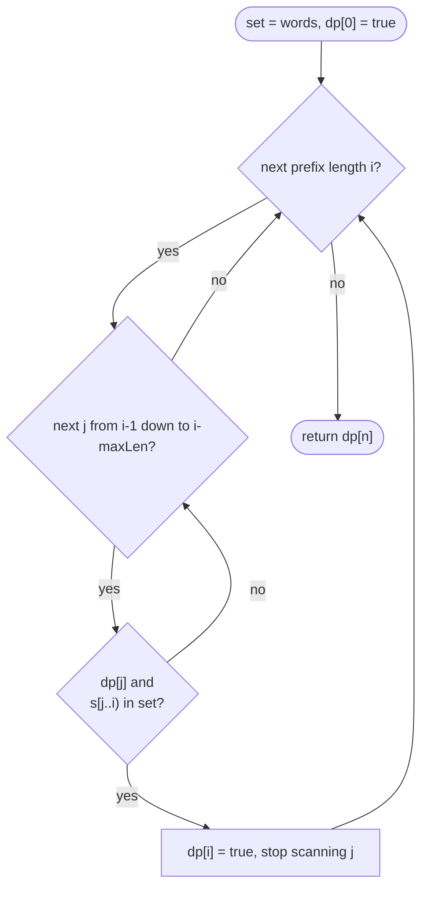

# LC 139 Word Break

> [!abstract] In one sentence
> Ask where the *last* word of a segmentation starts: the prefix of length `i` is breakable iff for some `j < i` the prefix of length `j` is breakable and `s[j..i)` is in the dictionary — `dp[0] = true` for the empty prefix, and only the last `maxLen` start positions can matter.

**Map:** [[NeetCode 150 MOC]] → [[DSA Dashboard]] · Pattern: [[Dynamic Programming]]

> [!question] Predict before you read
> `s = "catsandog"`, dictionary `["cats", "dog", "sand", "and", "cat"]`. Greedy "always take the longest matching word" reads `cats`, `and`, then fails on `og`. Is the string genuinely unbreakable, or did greedy pick wrong? Decide, then find a string where greedy fails but a segmentation exists.

## Problem

Given a string `s` and a list of words `wordDict`, decide whether `s` can be written as a sequence of dictionary words (each word may be reused any number of times, words are concatenated with nothing in between).

Example: `s = "leetcode"`, dict `["leet", "code"]` → `true`. Example: `s = "applepenapple"`, dict `["apple", "pen"]` → `true` (reuse). Example: `s = "catsandog"`, dict `["cats", "dog", "sand", "and", "cat"]` → `false` — both `cats|and` and `cat|sand` leave `og`.

Constraints that matter: 1 ≤ s.length ≤ 300, 1 ≤ dict size ≤ 1000, word length ≤ 20, lowercase letters, dictionary words are distinct. n = 300 means O(n²) substring checks are fine, and L ≤ 20 means the "last 20 characters" pruning is a real saving.

## Clarifying questions

1. Can a word be reused? — Yes, unlimited.
2. Do I return a boolean or the segmentation? — Boolean here; all segmentations is Word Break II (exponential output).
3. Any characters beyond lowercase letters, any empty words? — Lowercase only, no empty words.
4. How large is the dictionary relative to `s`? — Up to 1000 words of length ≤ 20; put them in a `HashSet` and check substrings, rather than scanning the dictionary per position.

## Brute force

Backtracking: from position `start`, try every prefix `s[start..end)` that is a word and recurse on `end`. For `s = "aaaaab"` with dict `["a", "aa", "aaa"]` the recursion explores every composition of the `a`s — exponential — and fails each time at the final `b`. The waste is that "can the suffix from `start` be broken?" is recomputed for every path reaching `start`; there are only n + 1 distinct `start` values.

## The key insight

A segmentation of the prefix `s[0..i)` has a last word `s[j..i)`; everything before it is a segmentation of the prefix `s[0..j)`. So breakability of a prefix depends only on breakability of shorter prefixes plus one dictionary lookup — the same "cut off the last piece" argument as [[LC 91 Decode Ways]], with pieces of any dictionary length instead of one or two digits. Because `dp[j]` is a boolean, you need *some* valid `j`, not the best one, and you can stop at the first. Greedy longest-match fails because the right cut can be shorter: `s = "aaab"`, dict `["aaa", "aa", "ab"]` — greedy takes `aaa` and dies on `b`; `aa|ab` works. Recognition cue: "can the string be split into pieces from a set", "number of ways to split", "minimum cuts".

## Optimal approach

1. State: `dp[i]` = can `s[0..i)` be segmented.
2. Base: `dp[0] = true` — the empty prefix is a segmentation of zero words.
3. Transition: `dp[i] = OR over j in [max(0, i − maxLen), i) of dp[j] && set.contains(s.substring(j, i))`; break on the first success.
4. Order: increasing `i`; every `dp[j]` read has `j < i`.
5. Answer: `dp[n]`.



> [!example]- Excalidraw version — the same diagram as an editable canvas
> ![[LC 139 Word Break — Optimal approach.excalidraw]]
> [[LC 139 Word Break — Optimal approach.excalidraw|Open in Excalidraw]] — needs the Excalidraw plugin (see [[Plugins to Install]]).

Scanning `j` downwards from `i − 1` tests short last words first; either direction is correct, the bound `i − maxLen` is what saves time.

## Walkthrough

`s = "catsand"`, dict `["cats", "cat", "sand", "and"]`, `maxLen = 4`.

> [!example] dp[i] = can the first i characters of catsand be split
> ![[LC 139 Word Break — dp-i- = can the first i characters of catsand be split.excalidraw]]
> [[LC 139 Word Break — dp-i- = can the first i characters of catsand be split.excalidraw|Open in Excalidraw]] — dp[7]: j=4 gives dp[4] && 'and' in set; j=3 gives dp[3] && 'sand' in set; either suffices

%% excalidraw-spec
{"kind": "grid", "title": "dp[i] = can the first i characters of catsand be split", "col_labels": ["i=0", "1 c", "2 a", "3 t", "4 s", "5 a", "6 n", "7 d"], "row_labels": ["dp"], "rows": [ [1, 0, 0, 1, 1, 0, 0, 1] ], "highlight": [ [0, 7] ], "arrows": [ [ [0, 4], [0, 7] ], [ [0, 3], [0, 7] ], [ [0, 0], [0, 3] ] ], "caption": "dp[7]: j=4 gives dp[4] && 'and' in set; j=3 gives dp[3] && 'sand' in set; either suffices"}
%%

| i | j tried (within maxLen) | word `s[j..i)` | dp[j] | dp[i] |
|---|---|---|---|---|
| 1 | 0 | `c` | true | false |
| 2 | 1, 0 | `a`, `ca` | — | false |
| 3 | 2, 1, 0 | `t`, `at`, `cat` ✓ | dp[0] true | **true** |
| 4 | 3, 2, 1, 0 | `s`, `ts`, `ats`, `cats` ✓ | dp[0] true | **true** |
| 5 | 4, 3, 2, 1 | `a`, `sa`, `tsa`, `atsa` | — | false |
| 6 | 5, 4, 3, 2 | `n`, `an`, `san`, `tsan` | — | false |
| 7 | 6, 5, 4 | `d`, `nd`, `and` ✓ | dp[4] true | **true** |

Note `i = 7` stops at `j = 4` and never tests `sand` — the first witness is enough.

## Java solution

```java
import java.util.*;

class Solution {
    public boolean wordBreak(String s, List<String> wordDict) {
        Set<String> set = new HashSet<>(wordDict);
        int maxLen = 0;
        for (String w : wordDict) maxLen = Math.max(maxLen, w.length());
        int n = s.length();
        boolean[] dp = new boolean[n + 1];
        dp[0] = true;                                           // empty prefix: a segmentation of zero words
        for (int i = 1; i <= n; i++) {
            for (int j = i - 1; j >= 0 && i - j <= maxLen; j--) {   // last word is s[j..i); it cannot be longer than maxLen
                if (dp[j] && set.contains(s.substring(j, i))) {
                    dp[i] = true;
                    break;                                       // one witness is enough for a boolean
                }
            }
        }
        return dp[n];
    }
}
```

**Time** O(n · L²) for L = longest word (L start positions per `i`, each substring + hash O(L)), plus O(total dictionary characters) to build the set · **Space** O(n + dictionary)

Top-down, memoised on the suffix start — the form that extends to Word Break II:

```java
// snippet
Boolean[] memo;                                                  // memo[start] = can s[start..n) be split; null = unknown
boolean canBreak(String s, int start, Set<String> set, int maxLen) {
    if (start == s.length()) return true;
    if (memo[start] != null) return memo[start];
    for (int end = start + 1; end <= s.length() && end - start <= maxLen; end++) {
        if (set.contains(s.substring(start, end)) && canBreak(s, end, set, maxLen)) return memo[start] = true;
    }
    return memo[start] = false;
}
// memo = new Boolean[n]; answer = canBreak(s, 0, set, maxLen). Same O(n · L²); recursion depth ≤ n = 300
```

Dictionary-driven inner loop, useful when the dictionary is tiny and `s` is long:

```java
// snippet
for (int i = 1; i <= n; i++)
    for (String w : wordDict)                                    // try each word as the last piece
        if (w.length() <= i && dp[i - w.length()] && s.startsWith(w, i - w.length())) { dp[i] = true; break; }
// O(n · W · L) with W words; startsWith avoids allocating substrings
```

## Why it works

State: `dp[i]` is true iff `s[0..i)` is a concatenation of dictionary words. Transition: if such a concatenation exists its last word is `s[j..i)` for some `j`, and the part before is a concatenation for `s[0..j)`, so `dp[j]` is true — conversely `dp[j]` plus a dictionary word `s[j..i)` builds a segmentation of length `i`. The OR over `j` is therefore exact, and restricting `j ≥ i − maxLen` loses nothing because no word is longer. Base: `dp[0] = true`. Order: increasing `i`, because `dp[i]` reads only smaller indices.

## Edge cases

- `s` is itself one dictionary word — `dp[n]` via `j = 0`.
- No word matches the first character — `dp[1..n]` all false.
- Reuse required, `"aaaa"` with `["a"]` — true; the set is consulted, not consumed.
- Dictionary word longer than `s` — ignored by `i − j ≤ maxLen` and by `substring` bounds.
- Single character `s = "a"`, dict `["a"]` → true; dict `["b"]` → false.
- Overlapping candidates, `catsand` — the first witness wins; the result is the same whichever cut is found.

## Common mistakes

> [!warning] Pitfalls
> - **`dp[0] = false`** — nothing can ever become true; the empty prefix must count.
> - **Checking `set.contains(s.substring(0, i))` only** — that tests one word, not a segmentation; the `dp[j]` factor is the whole point.
> - **Scanning the dictionary list for every `(j, i)`** — O(n² · W) with `equals` on each; use a `HashSet`.
> - **Backtracking without a memo** — passes most tests, times out on `"aaaa…ab"`.
> - **Off-by-one between prefix lengths and character indices** — `dp[i]` covers `s[0..i)`; `substring(j, i)` is exclusive at `i`.
> - **Forgetting the `maxLen` bound** — still correct, but O(n²) substrings of length up to 300 instead of 20; mention it as an optimisation even if you skip it.

## Variants & follow-ups

- Word Break II (LC 140) — return every sentence: memoised recursion returning `List<String>` per start index; exponential output, so the DP only prunes dead suffixes.
- Count the segmentations — `+=` instead of OR: `dp[i] += dp[j]` for each matching word.
- Fewest words / fewest cuts — `min` instead of OR; [[LC 131 Palindrome Partitioning]] is the same shape with "is a palindrome" as the dictionary test.
- Dictionary as a trie — walk the trie from `j` instead of hashing substrings; see [[LC 208 Implement Trie Prefix Tree]].
- Concatenated Words (LC 472) — word break where the dictionary is the word list itself, excluding the word being tested.

## Interview script

1. Restate: can `s` be split into dictionary words, reuse allowed.
2. Brute force: backtracking over cut positions, exponential on adversarial inputs.
3. Insight: condition on the last word; `dp[i] = OR_j dp[j] && s[j..i) in dict`; `dp[0] = true`.
4. Approach: hash set, `maxLen` bound on the last word, boolean array, break on the first witness.
5. Complexity: O(n · L²) time, O(n) space beyond the set.
6. Tests: `leetcode`, `applepenapple`, `catsandog`, `"a"` with `["b"]`, long `aaa…b`.

The interviewer is checking that you define `dp[0]`, that you use a set rather than scanning the list, and that you can convert the boolean DP into the counting or min-cut version on request.

## Related

- [[Dynamic Programming]] — segmentation shape
- [[DP Pattern Catalogue]] — row 5, segmentation
- [[LC 91 Decode Ways]] — pieces of length 1 or 2 with guards
- [[LC 131 Palindrome Partitioning]] — the same cut structure with a palindrome test and all partitions returned
- [[LC 208 Implement Trie Prefix Tree]] — the dictionary structure for the trie variant
- [[DSA Patterns in Java]] — memo → table skeleton
- [[Java Collections Cheat Sheet]] — `HashSet` constructor from a list, `substring`, `startsWith(prefix, offset)`

## Attempt log

| Date | Result | Minutes | What I got wrong |
|---|---|---|---|
| | | | |

### Mastery checklist
- [ ] Solved without hints in under 25 minutes
- [ ] Stated complexity before coding
- [ ] Handled every edge case above
- [ ] Code compiled first time
- [ ] Can do the follow-up variant (count segmentations; Word Break II)

## Open questions
- [ ]
