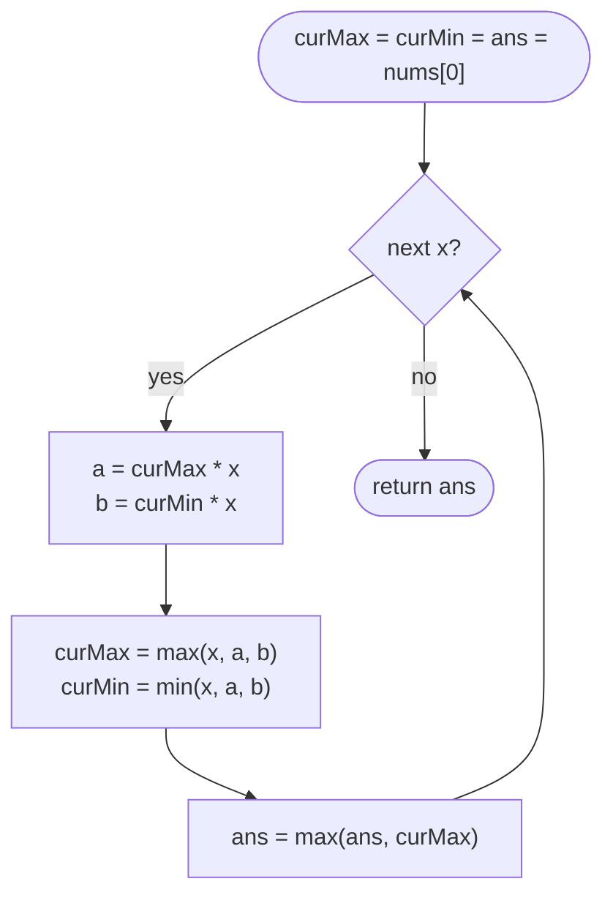

# LC 152 Maximum Product Subarray

> [!abstract] In one sentence
> The largest product of a subarray ending at `i` is either `nums[i]` alone, or `nums[i]` times the largest product ending at `i − 1`, or — when `nums[i]` is negative — `nums[i]` times the *smallest* product ending at `i − 1`; so carry both extremes forward and the answer is the best largest-ending-here seen.

**Map:** [[NeetCode 150 MOC]] → [[DSA Dashboard]] · Pattern: [[Dynamic Programming]]

> [!question] Predict before you read
> Kadane keeps one running value for sums. For `[-2, 3, -4]` the answer is 24 (the whole array). Which single running value could possibly produce 24 after seeing `-2, 3`? Decide what second value the state needs before reading on.

## Problem

Given an integer array `nums`, return the largest product of any contiguous non-empty subarray.

Example: `[2, 3, -2, 4]` → `6` (`[2, 3]`; the whole array gives −48). Example: `[-2, 0, -1]` → `0` — the two negatives are separated by a zero, so no subarray contains both.

Constraints that matter: 1 ≤ n ≤ 2 · 10⁴, −10 ≤ nums[i] ≤ 10, and the product of any prefix or suffix is guaranteed to fit in a 32-bit `int`. That guarantee is why the solution uses `int`; without it you would need `long` or a sign-and-magnitude trick.

## Clarifying questions

1. Must the subarray be non-empty? — Yes; the answer for `[-3]` is −3, not 0 or 1.
2. Can the product overflow? — The statement guarantees it fits in `int`; say that you would use `long` otherwise.
3. Are zeros present? — Possibly; a zero splits the array, since no subarray across it can beat the zero itself... except that `0` may *be* the answer, as in `[-2, 0, -1]`.
4. Contiguous subarray, not subsequence? — Contiguous; a subsequence version would let you pick all negatives in pairs.

## Brute force

Every subarray: O(n²) pairs `(l, r)` with a running product, O(n²) time — 4 · 10⁸ multiplications at n = 2 · 10⁴, too slow. The waste is that the products ending at `r` for different `l` are recomputed from scratch, when the best of them is determined by one number from the previous position — if you also remember the worst.

## The key insight

Kadane's recurrence `best ending at i = max(x, x + best ending at i − 1)` works for sums because adding `x` preserves order. Multiplying by `x` preserves order only when `x > 0`; a negative `x` *reverses* it, so the largest product ending at `i` may come from the smallest product ending at `i − 1`. Carrying both the maximum and the minimum product ending here makes the state closed: each new pair is computed from the old pair and `x`. A zero makes both products 0, and the "start fresh with `x`" candidate restarts the run at the next element. Recognition cue: "maximum subarray" plus an operator where a sign flip can turn the worst into the best.

## Optimal approach

1. State: `curMax`, `curMin` = largest and smallest product of a subarray ending at the current index.
2. Base: both equal `nums[0]`; answer starts at `nums[0]`.
3. Transition for `x = nums[i]`: `newMax = max(x, curMax·x, curMin·x)`, `newMin = min(x, curMax·x, curMin·x)` — compute both from the *old* pair before overwriting.
4. Order: left to right; `ans = max(ans, curMax)` after each step.



> [!example]- Excalidraw version — the same diagram as an editable canvas
> ![[LC 152 Maximum Product Subarray — Optimal approach.excalidraw]]
> [[LC 152 Maximum Product Subarray — Optimal approach.excalidraw|Open in Excalidraw]] — needs the Excalidraw plugin (see [[Plugins to Install]]).

Three candidates, not two: `x` alone (restart after a zero or a bad prefix), extend the max, extend the min. Computing `a` and `b` first avoids using the already-updated `curMax` when computing `curMin`.

## Walkthrough

`[2, 3, -2, 4, -1]`, whose answer is the whole array, 48.

> [!example] max and min product ending at i for 2, 3, -2, 4, -1
> ![[LC 152 Maximum Product Subarray — max and min product ending at i for 2, 3, -2, 4, -1.excalidraw]]
> [[LC 152 Maximum Product Subarray — max and min product ending at i for 2, 3, -2, 4, -1.excalidraw|Open in Excalidraw]] — x = -1 flips: max[4] = min[3] * -1 = 48, min[4] = max[3] * -1 = -4

%% excalidraw-spec
{"kind": "grid", "title": "max and min product ending at i for 2, 3, -2, 4, -1", "col_labels": ["x=2", "x=3", "x=-2", "x=4", "x=-1"], "row_labels": ["max", "min"], "rows": [ [2, 6, -2, 4, 48], [2, 3, -12, -48, -4] ], "highlight": [ [0, 4] ], "arrows": [ [ [1, 3], [0, 4] ], [ [0, 3], [1, 4] ] ], "caption": "x = -1 flips: max[4] = min[3] * -1 = 48, min[4] = max[3] * -1 = -4"}
%%

| i | x | candidates (x, max·x, min·x) | curMax | curMin | ans |
|---|---|---|---|---|---|
| 0 | 2 | — | 2 | 2 | 2 |
| 1 | 3 | 3, 6, 6 | 6 | 3 | 6 |
| 2 | −2 | −2, −12, −6 | −2 | −12 | 6 |
| 3 | 4 | 4, −8, −48 | 4 | −48 | 6 |
| 4 | −1 | −1, −4, 48 | 48 | −4 | 48 |

At `i = 2` the max drops to −2 while the min stores −12 "for later"; at `i = 4` that stored negative is what becomes the answer. A sums-Kadane would have thrown it away.

## Java solution

```java
import java.util.*;

class Solution {
    public int maxProduct(int[] nums) {
        int curMax = nums[0], curMin = nums[0], ans = nums[0];
        for (int i = 1; i < nums.length; i++) {
            int x = nums[i];
            int a = curMax * x, b = curMin * x;          // extend the best and the worst run with x
            curMax = Math.max(x, Math.max(a, b));        // x alone restarts after a zero or a losing prefix
            curMin = Math.min(x, Math.min(a, b));        // the worst run may become the best on the next negative
            ans = Math.max(ans, curMax);
        }
        return ans;
    }
}
```

**Time** O(n) · **Space** O(1)

Top-down, with the state as a pair — the memo returns `{max, min}` for "ending at i":

```java
// snippet
int[][] memo;                                            // memo[i] = {maxEndingAt i, minEndingAt i}; null = unknown
int[] ending(int[] nums, int i) {
    if (i == 0) return new int[]{nums[0], nums[0]};
    if (memo[i] != null) return memo[i];
    int[] prev = ending(nums, i - 1);
    int a = prev[0] * nums[i], b = prev[1] * nums[i];
    return memo[i] = new int[]{Math.max(nums[i], Math.max(a, b)), Math.min(nums[i], Math.min(a, b))};
}
// memo = new int[n][]; answer = max over i of ending(nums, i)[0]. O(n) time, O(n) space + n stack frames
```

Full tables, which make the "two rows" picture literal:

```java
// snippet
int[] maxEnd = new int[n], minEnd = new int[n];
maxEnd[0] = minEnd[0] = nums[0];
int ans = nums[0];
for (int i = 1; i < n; i++) {
    int x = nums[i];
    maxEnd[i] = Math.max(x, Math.max(maxEnd[i - 1] * x, minEnd[i - 1] * x));
    minEnd[i] = Math.min(x, Math.min(maxEnd[i - 1] * x, minEnd[i - 1] * x));
    ans = Math.max(ans, maxEnd[i]);
}
return ans;                                              // O(n) time, O(n) space; the rolling pair above is the same thing
```

## Why it works

State: `(curMax, curMin)` for subarrays ending at `i`. Transition: any subarray ending at `i` is `x` alone or a subarray ending at `i − 1` extended by `x`; multiplying the set of products ending at `i − 1` by `x` maps its maximum and minimum onto the extremes of the new set (same order for `x > 0`, swapped for `x < 0`, all zero for `x = 0`), so the three candidates contain both extremes. Base: `nums[0]`. Order: left to right. The answer is the maximum of `curMax` over all `i` because the optimal subarray ends *somewhere*.

## Edge cases

- Single element, including a negative — returns it (non-empty requirement).
- `[-2, 0, -1]` — after the 0 both runs are 0; `-1` restarts with −1; answer stays 0.
- `[0, 2]` — `ans` starts at 0, becomes 2.
- All negatives, even count `[-2, -3]` — 6 via the min; odd count `[-2, -3, -4]` — 12 from `[-3, -4]`, found because `x` alone restarts.
- Ones and minus ones only — the max is 1 when any even-length negative stretch exists, else 1 if a 1 exists, else −1.

## Common mistakes

> [!warning] Pitfalls
> - **Updating `curMax` first and then using it in `curMin`** — compute `a` and `b` (or swap when `x < 0`) before assigning.
> - **Two candidates instead of three** — dropping `x` alone makes `[0, 2]` return 0: after the zero every product is 0 and nothing restarts the run.
> - **Initialising `ans = 0`** — `[-3]` must return −3; start from `nums[0]`.
> - **Using plain Kadane** — `[-2, 3, -4]` returns 3 instead of 24.
> - **Starting the loop at `i = 0` with `curMax = curMin = 1`** — works here only because the `x` candidate exists; be able to say why.
> - **Overflow worries without reading the constraints** — the statement guarantees `int`; say so, and say you would use `long` if it did not.

## Variants & follow-ups

- Prefix–suffix scan — the answer is the max over all prefix products and all suffix products (resetting to 1 after a zero), because the optimal subarray is bounded by a zero or an array end on one side and the first negative-sign fix on the other; two passes, same O(n)/O(1), no DP vocabulary.
- Return the subarray — track the start index when the max run restarts.
- Maximum sum subarray — [[LC 53 Maximum Subarray]], the no-sign-flip version.
- Product mod a prime, or `long` products — the max/min trick still works if no overflow; with overflow you track sign and `log` magnitude instead.
- Maximum length of a subarray with positive product (LC 1567) — same two-state idea with lengths instead of values.

## Interview script

1. Restate: contiguous, non-empty, largest product.
2. Brute force: all O(n²) subarrays with running products.
3. Insight: Kadane breaks because a negative flips the ordering; keep the max *and* the min product ending here.
4. Approach: three candidates per element, update both, track the global max; zeros reset naturally.
5. Complexity: O(n) time, O(1) space.
6. Tests: `[2,3,-2,4]`, `[-2,0,-1]`, `[-2]`, `[-2,3,-4]`, `[0,2]`.

The interviewer is checking that you explain the sign flip rather than recite "keep max and min", that you handle zero without a special case, and that you do not forget the restart candidate.

## Related

- [[Dynamic Programming]] — "running best with a sign flip"
- [[DP Pattern Catalogue]] — row 3, Kadane family
- [[LC 53 Maximum Subarray]] — the sum version, one running value
- [[LC 121 Best Time to Buy and Sell Stock]] — another "best ending here" scan
- [[LC 198 House Robber]] — two rolling values of a different kind
- [[DSA Patterns in Java]] — Kadane template
- [[Java Pitfalls in Interviews]] — `int` overflow in products

## Attempt log

| Date | Result | Minutes | What I got wrong |
|---|---|---|---|
| | | | |

### Mastery checklist
- [ ] Solved without hints in under 25 minutes
- [ ] Stated complexity before coding
- [ ] Handled every edge case above
- [ ] Code compiled first time
- [ ] Can do the follow-up variant (prefix–suffix scan; return the subarray)

## Open questions
- [ ]
