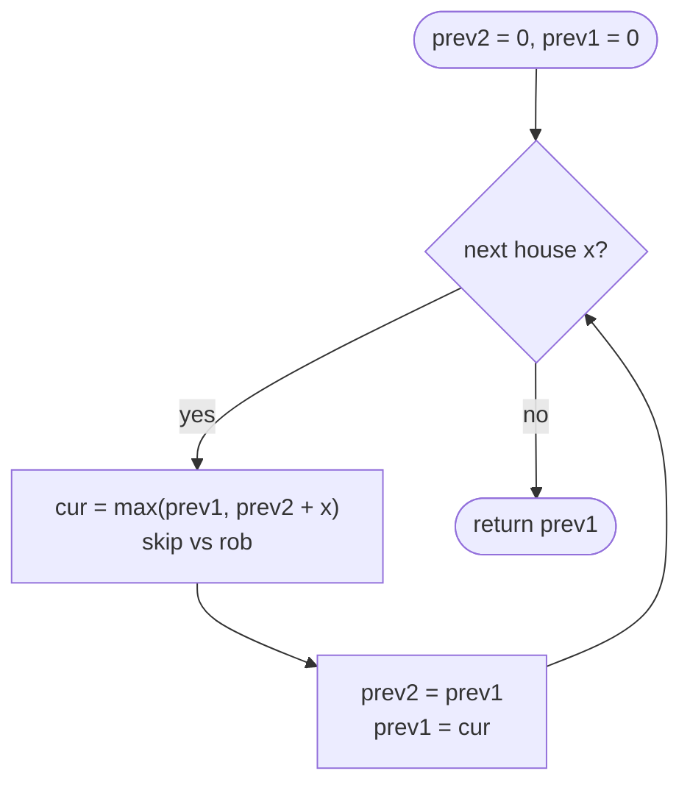

# LC 198 House Robber

> [!abstract] In one sentence
> For each house the only decision is rob or skip; robbing forbids the previous house, so the best total up to house i is `max(skip: best up to i − 1, rob: nums[i] + best up to i − 2)` — two running values are all the state you need.

**Map:** [[NeetCode 150 MOC]] → [[DSA Dashboard]] · Pattern: [[Dynamic Programming]]

> [!question] Predict before you read
> `[2, 7, 9, 3, 1]`. Greedy "take the biggest, cross out its neighbours" picks 9, then 2, then 1 for 12, which happens to be optimal. Find a 4-element array where that greedy loses, before reading on.

## Problem

You are given non-negative integers `nums`, the cash in a row of houses. You may rob any subset of houses as long as no two robbed houses are adjacent. Return the maximum total.

Example: `[1, 2, 3, 1]` → `4` (houses 0 and 2). Example: `[2, 7, 9, 3, 1]` → `12` (houses 0, 2, 4).

Constraints that matter: 1 ≤ n ≤ 100, 0 ≤ nums[i] ≤ 400 — the sum fits in `int`; the small n means even O(n²) would pass, so the point is the clean O(n)/O(1) solution.

## Clarifying questions

1. Can values be zero? — Yes; robbing a zero house is harmless but never necessary.
2. Is the row linear, not circular? — Linear here; circular is [[LC 213 House Robber II]].
3. Do I return the amount or the houses? — The amount; a `choice` array recovers the houses.
4. Is "no two adjacent" the only constraint? — Yes; gaps of any size ≥ 1 are fine.

## Brute force

Enumerate all 2ⁿ subsets, discard those with adjacent picks, take the best sum: O(2ⁿ · n). Slightly smarter recursion `rob(i) = max(rob(i + 1), nums[i] + rob(i + 2))` is still O(2ⁿ) without memo — `rob(i)` is recomputed for every path reaching index `i`. The waste is the same as climbing stairs: only n distinct subproblems exist.

## The key insight

Condition on the last house. Either you skip it (best is whatever you got from the first `i − 1`) or you rob it (then `i − 1` is forbidden, and the best from the first `i − 2` is independent of this choice). The two sub-answers are *independent* of each other, which is why `max` of two previously computed values is exact. Greedy fails because one large house can block two neighbours whose sum is larger: `[4, 5, 4, 1]` — largest-first takes 5, blocks both 4s, adds 1 for 6, while 4 + 4 = 8 is optimal. The DP never commits; it carries both "best with" and "best without" forward. Recognition cue: "choose elements, no two adjacent, maximise sum".

## Optimal approach

1. State: `dp[i]` = max loot using houses `0..i`.
2. Base: `dp[0] = nums[0]`, `dp[1] = max(nums[0], nums[1])`.
3. Transition: `dp[i] = max(dp[i − 1], dp[i − 2] + nums[i])`.
4. Order: increasing `i`; only two previous values are read, so keep `prev2`, `prev1`.



> [!example]- Excalidraw version — the same diagram as an editable canvas
> ![[LC 198 House Robber — Optimal approach.excalidraw]]
> [[LC 198 House Robber — Optimal approach.excalidraw|Open in Excalidraw]] — needs the Excalidraw plugin (see [[Plugins to Install]]).

Starting both at 0 (two imaginary empty houses before the row) removes the special base cases.

## Walkthrough

`[2, 7, 9, 3, 1]`.

> [!example] dp[i] = best loot from houses 0..i
> ![[LC 198 House Robber — dp-i- = best loot from houses 0..i.excalidraw]]
> [[LC 198 House Robber — dp-i- = best loot from houses 0..i.excalidraw|Open in Excalidraw]] — dp[4] = max(dp[3], dp[2] + 1) = max(11, 12) = 12; amber = houses robbed

%% excalidraw-spec
{"kind": "array", "title": "dp[i] = best loot from houses 0..i", "values": [2, 7, 11, 11, 12], "pointers": {"i-2": 2, "i-1": 3, "i": 4}, "highlight": [0, 2, 4], "caption": "dp[4] = max(dp[3], dp[2] + 1) = max(11, 12) = 12; amber = houses robbed"}
%%

| i | nums[i] | skip = dp[i-1] | rob = dp[i-2] + nums[i] | dp[i] |
|---|---|---|---|---|
| 0 | 2 | 0 | 0 + 2 | 2 |
| 1 | 7 | 2 | 0 + 7 | 7 |
| 2 | 9 | 7 | 2 + 9 | 11 |
| 3 | 3 | 11 | 7 + 3 | 11 |
| 4 | 1 | 11 | 11 + 1 | 12 |

## Java solution

```java
import java.util.*;

class Solution {
    public int rob(int[] nums) {
        int prev2 = 0, prev1 = 0;                   // best up to i-2, best up to i-1 (empty prefix = 0)
        for (int x : nums) {
            int cur = Math.max(prev1, prev2 + x);   // skip this house, or rob it and keep best of i-2
            prev2 = prev1;
            prev1 = cur;
        }
        return prev1;
    }
}
```

**Time** O(n) · **Space** O(1)

Top-down, which is how you discover the recurrence:

```java
// snippet
int[] memo;                                          // memo[i] = best loot from houses i..n-1; -1 = unknown
int robFrom(int[] nums, int i) {
    if (i >= nums.length) return 0;
    if (memo[i] != -1) return memo[i];
    return memo[i] = Math.max(robFrom(nums, i + 1), nums[i] + robFrom(nums, i + 2));
}
// memo = new int[n]; Arrays.fill(memo, -1); answer = robFrom(nums, 0). O(n) time, O(n) space
```

Full table:

```java
// snippet
int[] dp = new int[n + 1];                           // dp[i] = best loot from the first i houses
dp[1] = nums[0];
for (int i = 2; i <= n; i++) dp[i] = Math.max(dp[i - 1], dp[i - 2] + nums[i - 1]);
return dp[n];
```

## Why it works

State: `dp[i]` = maximum over all valid subsets of houses `0..i`. Transition: any optimal subset for `0..i` either excludes house `i` — then it is a valid subset of `0..i − 1` and cannot beat `dp[i − 1]` — or includes it — then it excludes `i − 1`, and its remainder is a valid subset of `0..i − 2` that cannot beat `dp[i − 2]`. Both bounds are achievable, so `max` is exact. Base: the empty prefix yields 0. Order: increasing `i`. This is optimal substructure plus overlapping subproblems; greedy lacks the former's guarantee.

## Edge cases

- One house — returns `nums[0]`.
- Two houses — `max(nums[0], nums[1])`.
- All zeros — 0.
- Alternating large/small — the DP picks every other house as expected.
- Strictly increasing `[1, 2, 3, 4, 5]` — 9 (houses 0, 2, 4).

## Common mistakes

> [!warning] Pitfalls
> - **Robbing from `dp[i − 1]`** (`dp[i] = dp[i − 1] + nums[i]` in the rob branch) — that robs two adjacent houses. The rob branch must read `i − 2`.
> - **Alternating-pattern greedy** ("rob all even or all odd indices") — `[2, 1, 1, 9, 1]`: evens give 4, odds give 10, the DP gives 2 + 9 = 11. The optimal set can have gaps of 2.
> - **Largest-first greedy** — `[4, 5, 4, 1]` gives 6 instead of 8.
> - **Special-casing n = 1 and n = 2** separately instead of starting both variables at 0.
> - **Returning `max(prev1, prev2)`** — `prev1` is already the max; harmless but reveals uncertainty about the meaning of the state.

## Variants & follow-ups

- Circular street — [[LC 213 House Robber II]]: run twice, excluding the first or the last house.
- Binary tree of houses (House Robber III) — DFS returning `(withRoot, withoutRoot)`.
- Minimum gap of k instead of 1 — `dp[i] = max(dp[i − 1], dp[i − k − 1] + nums[i])`.
- Return the houses — keep a boolean `took[i]` and walk back from the end.
- Delete-and-earn (LC 740) — bucket values into a frequency array, then this exact DP.

## Interview script

1. Restate: non-adjacent subset with maximum sum.
2. Brute force: all subsets, exponential.
3. Insight: last-house decision; skip → `dp[i − 1]`, rob → `nums[i] + dp[i − 2]`; the two are independent.
4. Approach: two running variables starting at 0; loop; return the last. Show the memoised form if asked how you got there.
5. Complexity: O(n) time, O(1) space.
6. Tests: single house, two houses, `[2,7,9,3,1]`.

The interviewer is checking that you define the state as a prefix optimum, that you explain why max of the two branches is exact, and that you do not reach for a greedy.

## Related

- [[Dynamic Programming]] — take-or-skip shape
- [[DP Pattern Catalogue]]
- [[LC 213 House Robber II]] — the circular variant
- [[LC 70 Climbing Stairs]] — the same two-back dependency with a different operator
- [[LC 416 Partition Equal Subset Sum]] — take-or-skip over amounts (0/1 knapsack)
- [[DSA Patterns in Java]] — memo → table skeleton

## Attempt log

| Date | Result | Minutes | What I got wrong |
|---|---|---|---|
| | | | |

### Mastery checklist
- [ ] Solved without hints in under 25 minutes
- [ ] Stated complexity before coding
- [ ] Handled every edge case above
- [ ] Code compiled first time
- [ ] Can do the follow-up variant (circular; tree)

## Open questions
- [ ]
