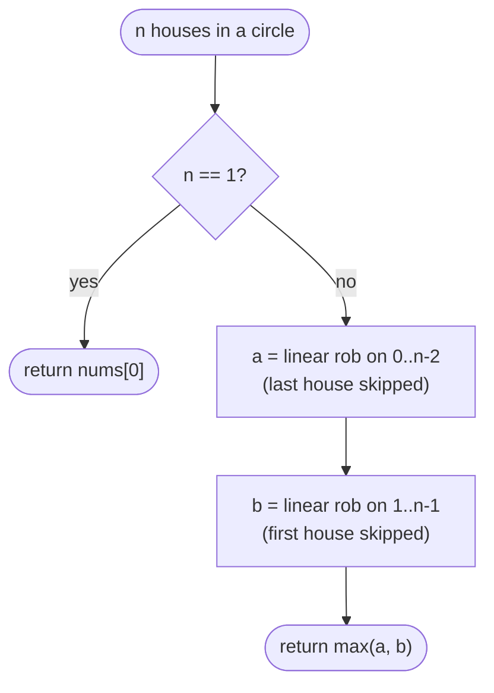

# LC 213 House Robber II

> [!abstract] In one sentence
> A circle differs from a line in exactly one adjacency — first and last — so any valid plan skips house 0 or skips house n − 1 (or both), and the answer is the better of the two linear sub-problems that each drop one end.

**Map:** [[NeetCode 150 MOC]] → [[DSA Dashboard]] · Pattern: [[Dynamic Programming]]

> [!question] Predict before you read
> Why is it *not* enough to run the linear DP once and then subtract something if both ends were robbed? What information does the linear DP throw away that you would need?

## Problem

Same as [[LC 198 House Robber]] — non-negative values, no two adjacent houses — except the houses form a circle, so the first and last houses are also adjacent.

Example: `[2, 3, 2]` → `3` (robbing 0 and 2 is now illegal). Example: `[1, 2, 3, 1]` → `4`. Example: `[1, 2, 3]` → `3`.

Constraints that matter: 1 ≤ n ≤ 100, values ≤ 1000. `n = 1` is a special case: a single house is adjacent to nothing, and both sub-ranges would be empty.

## Clarifying questions

1. With n = 1, is the single house robbable? — Yes; return `nums[0]`.
2. With n = 2, are the two houses adjacent on both sides? — Yes; return `max` of the two.
3. Is the circular adjacency the *only* new constraint? — Yes.
4. Can I reuse the linear solution as a helper? — Yes, and you should.

## Brute force

All subsets with the extra check that indices 0 and n − 1 are not both chosen: O(2ⁿ · n). Alternatively, the linear DP with a boolean "did I rob house 0" carried in the state doubles the table; that works but is heavier than necessary.

## The key insight

The circle adds exactly one edge (0, n − 1). In any valid plan, house 0 or house n − 1 is skipped. If house 0 is skipped the remaining houses `1..n − 1` are a plain line; if house n − 1 is skipped, `0..n − 2` is a plain line. The optimum is the max of those two linear optima, and each is [[LC 198 House Robber]]. Recognition cue: "circular" or "first and last are neighbours" on top of a linear DP you know.

## Optimal approach

1. If `n == 1` return `nums[0]`.
2. `a = robLinear(nums, 0, n − 2)`; `b = robLinear(nums, 1, n − 1)`.
3. Return `max(a, b)`.
4. `robLinear` is the two-variable take-or-skip loop over the index range.



> [!example]- Excalidraw version — the same diagram as an editable canvas
> ![[LC 213 House Robber II — Optimal approach.excalidraw]]
> [[LC 213 House Robber II — Optimal approach.excalidraw|Open in Excalidraw]] — needs the Excalidraw plugin (see [[Plugins to Install]]).

## Walkthrough

`[1, 2, 3, 1]`.

> [!example] Two linear runs over the circle [1, 2, 3, 1]
> ![[LC 213 House Robber II — Two linear runs over the circle -1, 2, 3, 1-.excalidraw]]
> [[LC 213 House Robber II — Two linear runs over the circle -1, 2, 3, 1-.excalidraw|Open in Excalidraw]] — run A on indices 0..2 gives 1 + 3 = 4; run B on 1..3 gives max(2, 3, 2+1) = 3; answer 4

%% excalidraw-spec
{"kind": "array", "title": "Two linear runs over the circle [1, 2, 3, 1]", "values": [1, 2, 3, 1], "pointers": {"run A end": 2, "run B start": 1}, "highlight": [0, 2], "caption": "run A on indices 0..2 gives 1 + 3 = 4; run B on 1..3 gives max(2, 3, 2+1) = 3; answer 4"}
%%

| Run | Range | prev2 / prev1 trace | Result |
|---|---|---|---|
| A | `[1, 2, 3]` | (0,0) → (0,1) → (1,2) → (2,4) | 4 |
| B | `[2, 3, 1]` | (0,0) → (0,2) → (2,3) → (3,3) | 3 |

`max(4, 3) = 4`.

## Java solution

```java
import java.util.*;

class Solution {
    public int rob(int[] nums) {
        int n = nums.length;
        if (n == 1) return nums[0];                       // both sub-ranges would be empty
        return Math.max(robLinear(nums, 0, n - 2),        // skip the last house
                        robLinear(nums, 1, n - 1));       // skip the first house
    }

    private int robLinear(int[] nums, int from, int to) {
        int prev2 = 0, prev1 = 0;
        for (int i = from; i <= to; i++) {
            int cur = Math.max(prev1, prev2 + nums[i]);
            prev2 = prev1;
            prev1 = cur;
        }
        return prev1;
    }
}
```

**Time** O(n) · **Space** O(1)

The single-pass alternative carries "house 0 was robbed" in the state — two interleaved DPs; useful to know, not to prefer:

```java
// snippet
// dp0[i] = best over 0..i with house 0 NOT robbed; dp1[i] = best with house 0 robbed (so i-1 chain starts at 2)
int[] dp0 = new int[n], dp1 = new int[n];
dp1[0] = nums[0];                                     // dp0[0] = 0
dp0[1] = nums[1]; dp1[1] = nums[0];
for (int i = 2; i < n; i++) {
    dp0[i] = Math.max(dp0[i - 1], dp0[i - 2] + nums[i]);
    dp1[i] = Math.max(dp1[i - 1], dp1[i - 2] + nums[i]);
}
return Math.max(dp0[n - 1], dp1[n - 2]);              // dp1 may not take house n-1
```

## Why it works

Let `S` be any valid set of houses on the circle. Since 0 and n − 1 are adjacent, `S` omits at least one of them. If `S` omits n − 1, `S ⊆ {0..n − 2}` and respects linear adjacency there, so `sum(S) ≤ robLinear(0, n − 2)`. Symmetrically for omitting 0. Both bounds are attained by some valid circular set (the linear optimum on a range that excludes one end is automatically valid on the circle). Hence the optimum is exactly `max` of the two. The linear helper is correct by the argument in [[LC 198 House Robber]].

## Edge cases

- `n = 1` — handled explicitly.
- `n = 2` — run A sees `[nums[0]]`, run B sees `[nums[1]]`; max of the two.
- `n = 3` — `[2, 3, 2]` → runs `[2,3]` = 3 and `[3,2]` = 3; the illegal 2 + 2 never appears.
- All equal values — either run gives the alternating sum.

## Common mistakes

> [!warning] Pitfalls
> - **Forgetting `n = 1`** — both ranges are empty and the code returns 0 instead of `nums[0]`.
> - **Running the linear DP once and "fixing up"** — the linear result does not tell you whether both ends were used, and the second-best plan is not recoverable from a single max.
> - **Off-by-one in the ranges** — `0..n − 2` and `1..n − 1`, inclusive on both ends; `Arrays.copyOfRange` is exclusive on the right if you use it.
> - **Copying the array twice** when passing index bounds costs nothing — minor, but say you avoided it.

## Variants & follow-ups

- Linear version: [[LC 198 House Robber]].
- Houses on a tree (House Robber III) — post-order DFS returning a pair.
- Two extra forbidden pairs (a "circle with a chord") — case split on each extra edge, 2 runs per edge; beyond a couple of edges it becomes graph DP.
- Return the chosen houses — run the linear DP with a `took` array in whichever range won.
- The same "reduce a cycle to two lines" trick appears in circular subarray maximum (LC 918).

## Interview script

1. Restate: non-adjacent max sum on a circle; first and last are neighbours.
2. Brute force: subsets with the extra check.
3. Insight: one of the two end houses must be skipped; each case is the linear problem.
4. Approach: helper over an index range, call it twice, max; handle n = 1.
5. Complexity: O(n) time, O(1) space.
6. Tests: n = 1, 2, 3; `[1,2,3,1]`.

The interviewer is checking that you spot the reduction instead of inventing a new DP, and that you handle the degenerate sizes.

## Related

- [[Dynamic Programming]] — take-or-skip shape
- [[DP Pattern Catalogue]]
- [[LC 198 House Robber]] — the helper this problem reuses
- [[LC 70 Climbing Stairs]] — the same two-back dependency
- [[LC 152 Maximum Product Subarray]] — another problem where you carry two running answers
- [[DSA Patterns in Java]]

## Attempt log

| Date | Result | Minutes | What I got wrong |
|---|---|---|---|
| | | | |

### Mastery checklist
- [ ] Solved without hints in under 25 minutes
- [ ] Stated complexity before coding
- [ ] Handled every edge case above
- [ ] Code compiled first time
- [ ] Can do the follow-up variant (tree version)

## Open questions
- [ ]
