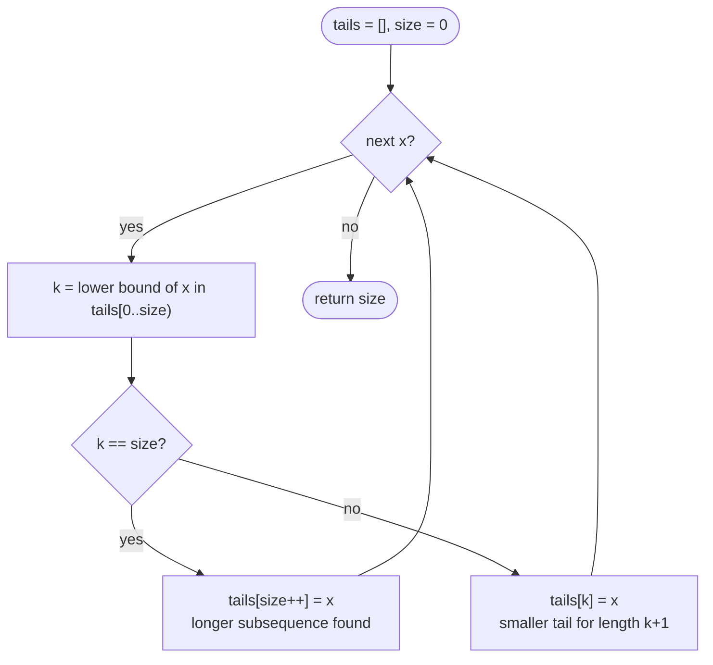

# LC 300 Longest Increasing Subsequence

> [!abstract] In one sentence
> The longest increasing subsequence ending at `i` extends the best one ending at some earlier `j` with `nums[j] < nums[i]` (`dp[i] = 1 + max dp[j]`, answer = max over `i`), and the O(n log n) refinement keeps, for every length, only the smallest tail that can end a subsequence of that length, so each new number binary-searches into exactly one slot.

**Map:** [[NeetCode 150 MOC]] → [[DSA Dashboard]] · Pattern: [[Dynamic Programming]]

> [!question] Predict before you read
> For `[10, 9, 2, 5, 3, 7, 101, 18]` the fast method ends with `tails = [2, 3, 7, 18]`, which happens to be a valid increasing subsequence. Run the same method on `[3, 4, 1]` in your head: what is `tails` at the end, and is it a subsequence of the input?

## Problem

Given an integer array `nums`, return the length of its longest strictly increasing subsequence — a subsequence keeps relative order but need not be contiguous.

Example: `[10, 9, 2, 5, 3, 7, 101, 18]` → `4` (`2, 3, 7, 101` or `2, 5, 7, 18`). Example: `[0, 1, 0, 3, 2, 3]` → `4`. Example: `[7, 7, 7, 7]` → `1` (strict).

Constraints that matter: 1 ≤ n ≤ 2500, −10⁴ ≤ nums[i] ≤ 10⁴. n = 2500 makes O(n²) ≈ 6 · 10⁶ comfortably fast — the follow-up asks for O(n log n), and that is the version interviewers actually want to see.

## Clarifying questions

1. Strictly increasing or non-decreasing? — Strictly; equal elements cannot both be used (changes the binary search from lower bound to upper bound).
2. Subsequence, not subarray? — Subsequence: you may skip elements.
3. Length only, or the subsequence itself? — Length; reconstruction needs a parent array (and the fast method needs extra bookkeeping).
4. How big is `n`? — 2500; say O(n²) passes and offer O(n log n).

## Brute force

Every subsequence is a subset: 2ⁿ of them, check each for increasing order — O(2ⁿ · n). Recursion "at index `i`, with the previous chosen value `prev`, take or skip" has state `(i, prev)` and is also exponential without a memo. The waste is that "the longest increasing subsequence starting at `i`" (or ending at `i`) does not depend on how you got there — only on `i`.

## The key insight

Fix the *last* element. Any increasing subsequence ending at `i` is either `nums[i]` alone or an increasing subsequence ending at some `j < i` with `nums[j] < nums[i]`, extended by `nums[i]`. So `dp[i] = 1 + max dp[j]` over valid `j`, and the answer is the largest `dp[i]`, because the optimal subsequence ends somewhere — not necessarily at the last index. For the faster version, note that among all increasing subsequences of a given length only the one with the *smallest tail* matters for future extension; keeping those tails in `tails[]` (which is sorted, by an exchange argument) turns "find the best `j`" into a binary search. Recognition cue: "longest subsequence with a pairwise order condition" — increasing, decreasing, divisible, chain of envelopes.

## Optimal approach

Patience version:

1. State: `tails[k]` = the smallest last element of any increasing subsequence of length `k + 1` seen so far; `tails` is strictly increasing.
2. For each `x`: binary-search the first index `k` with `tails[k] ≥ x` (lower bound).
3. If `k == size`, `x` extends the longest subsequence: append. Otherwise `tails[k] = x` — a subsequence of length `k + 1` now ends with a smaller value, which can only help.
4. Answer: `size`.



> [!example]- Excalidraw version — the same diagram as an editable canvas
> ![[LC 300 Longest Increasing Subsequence — Optimal approach.excalidraw]]
> [[LC 300 Longest Increasing Subsequence — Optimal approach.excalidraw|Open in Excalidraw]] — needs the Excalidraw plugin (see [[Plugins to Install]]).

The O(n²) table is the one you should be able to *derive*; the patience array is the one you should be able to *explain*.

## Walkthrough

`[10, 9, 2, 5, 3, 7, 101, 18]`.

> [!example] dp[i] = longest increasing subsequence ending at i
> ![[LC 300 Longest Increasing Subsequence — dp-i- = longest increasing subsequence ending at i.excalidraw]]
> [[LC 300 Longest Increasing Subsequence — dp-i- = longest increasing subsequence ending at i.excalidraw|Open in Excalidraw]] — dp[6] = 1 + max(dp[j] : nums[j] < 101) = 1 + dp[5] = 4; the answer is the max cell, not the last

%% excalidraw-spec
{"kind": "grid", "title": "dp[i] = longest increasing subsequence ending at i", "col_labels": ["10", "9", "2", "5", "3", "7", "101", "18"], "row_labels": ["dp"], "rows": [ [1, 1, 1, 2, 2, 3, 4, 4] ], "highlight": [ [0, 6] ], "arrows": [ [ [0, 5], [0, 6] ], [ [0, 4], [0, 5] ], [ [0, 2], [0, 4] ] ], "caption": "dp[6] = 1 + max(dp[j] : nums[j] < 101) = 1 + dp[5] = 4; the answer is the max cell, not the last"}
%%

Patience array for the same input, `lb` = lower-bound index:

| x | tails before | lb | action | tails after |
|---|---|---|---|---|
| 10 | `[]` | 0 | append | `[10]` |
| 9 | `[10]` | 0 | replace | `[9]` |
| 2 | `[9]` | 0 | replace | `[2]` |
| 5 | `[2]` | 1 | append | `[2, 5]` |
| 3 | `[2, 5]` | 1 | replace | `[2, 3]` |
| 7 | `[2, 3]` | 2 | append | `[2, 3, 7]` |
| 101 | `[2, 3, 7]` | 3 | append | `[2, 3, 7, 101]` |
| 18 | `[2, 3, 7, 101]` | 3 | replace | `[2, 3, 7, 18]` |

For `[3, 4, 1]`: `[3]`, `[3, 4]`, then `1` replaces index 0 giving `[1, 4]` — length 2 is right, but `1, 4` is not a subsequence of the input. `tails` records *lengths*, not a witness.

## Java solution

```java
import java.util.*;

class Solution {
    public int lengthOfLIS(int[] nums) {                       // O(n log n): patience sorting
        int[] tails = new int[nums.length];                    // tails[k] = smallest tail of an increasing subsequence of length k+1
        int size = 0;
        for (int x : nums) {
            int lo = 0, hi = size;                             // lower bound: first k with tails[k] >= x
            while (lo < hi) {
                int mid = lo + (hi - lo) / 2;
                if (tails[mid] < x) lo = mid + 1; else hi = mid;
            }
            tails[lo] = x;                                     // lo == size appends; otherwise lowers an existing tail
            if (lo == size) size++;
        }
        return size;
    }

    public int lengthOfLISQuadratic(int[] nums) {              // O(n²): the recurrence you derive first
        int n = nums.length, best = 1;
        int[] dp = new int[n];
        Arrays.fill(dp, 1);                                    // every element is a subsequence of length 1
        for (int i = 1; i < n; i++) {
            for (int j = 0; j < i; j++) {
                if (nums[j] < nums[i]) dp[i] = Math.max(dp[i], dp[j] + 1);
            }
            best = Math.max(best, dp[i]);                      // the optimum can end anywhere
        }
        return best;
    }
}
```

**Time** O(n log n) patience · O(n²) table · **Space** O(n) either way

Top-down form of the table — memo on "longest increasing subsequence *starting* at i":

```java
// snippet
int[] memo;                                                    // memo[i] = LIS length starting at i; 0 = unknown
int lisFrom(int[] nums, int i) {
    if (memo[i] != 0) return memo[i];
    int best = 1;
    for (int j = i + 1; j < nums.length; j++)
        if (nums[j] > nums[i]) best = Math.max(best, 1 + lisFrom(nums, j));
    return memo[i] = best;
}
// memo = new int[n]; answer = max over i of lisFrom(nums, i). O(n²) time, O(n) space + up to n stack frames
```

`Arrays.binarySearch(tails, 0, size, x)` can replace the hand-written loop: a negative return `r` means insertion point `−r − 1`; a non-negative return is an exact match, which for *strict* LIS is also the index to overwrite.

## Why it works

State (table): `dp[i]` = length of the longest strictly increasing subsequence ending exactly at `i`. Transition: drop the last element of such a subsequence and you get an increasing subsequence ending at some `j < i` with `nums[j] < nums[i]`, so `dp[i] ≤ 1 + max dp[j]`; appending `nums[i]` to the best such `j` achieves it. Base: `dp[i] = 1`. Order: increasing `i`. Patience: the invariant "`tails[k]` is the minimum possible tail of a length-`k + 1` increasing subsequence, and `tails` is sorted" is preserved by each lower-bound replacement (a smaller tail never hurts future extension, and an append is justified because `x` is greater than every current tail); its length therefore equals the LIS length.

## Edge cases

- Single element — 1.
- All equal `[7, 7, 7]` — lower bound finds index 0 every time; `size` stays 1.
- Strictly decreasing — every `x` replaces `tails[0]`; answer 1.
- Already sorted — every `x` appends; answer n.
- Negative numbers — comparisons only, no arithmetic on values.
- Duplicates inside an otherwise increasing array `[1, 2, 2, 3]` — 3; the second `2` overwrites itself.

## Common mistakes

> [!warning] Pitfalls
> - **Returning `dp[n − 1]`** — the LIS need not end at the last element; return the max over `dp`.
> - **Upper bound instead of lower bound** — `tails[k] > x` turns strict into non-decreasing and `[7, 7, 7]` returns 3.
> - **Reading `tails` as the answer subsequence** — it is not; it is a tableau of minimal tails.
> - **`dp` initialised to 0** — the "`+ 1`" then undercounts by one everywhere.
> - **Binary-searching the whole `tails` array** including unused slots (zeros) — bound the search by `size`.
> - **Greedy "extend whenever larger than the last picked"** — `[5, 6, 1, 2, 3, 4]` returns 2 instead of 4.

## Variants & follow-ups

- Return the subsequence — table version: `parent[i]`, walk back from the best `i`; patience version: store for each element the index it replaced and the predecessor, then reconstruct.
- Non-decreasing — upper bound in the binary search; `dp` condition `≤`.
- Longest decreasing — negate, or search from the right.
- Russian Doll Envelopes (LC 354) — sort by width ascending and height *descending*, then LIS on heights.
- Number of LIS (LC 673) — a count array alongside `dp` in the O(n²) version.
- Two dimensions, strictly increasing path — [[LC 329 Longest Increasing Path in a Matrix]] is LIS on a DAG instead of a line.
- Longest common subsequence — [[LC 1143 Longest Common Subsequence]]; LIS of a permutation can be computed as LCS with its sorted copy and vice versa.

## Interview script

1. Restate: longest strictly increasing subsequence, elements may be skipped.
2. Brute force: all subsequences, exponential.
3. Insight: fix the last element; `dp[i] = 1 + max dp[j]` for smaller earlier values; answer is the max over `i`.
4. Approach: write the O(n²) table, then say: only the smallest tail per length matters, keep them sorted, binary-search each element — O(n log n).
5. Complexity: O(n²) / O(n log n) time, O(n) space.
6. Tests: the example, all equal, strictly decreasing, `[3, 4, 1]` to show `tails` is not a witness.

The interviewer is checking that you take the max over all `i`, that you can state what `tails[k]` means precisely, and that you know lower vs upper bound decides strict vs non-strict.

## Related

- [[Dynamic Programming]] — "best ending here, any earlier j"
- [[DP Pattern Catalogue]] — row 4
- [[Binary Search]] — lower-bound template used by the patience array
- [[LC 329 Longest Increasing Path in a Matrix]] — LIS on a grid DAG
- [[LC 1143 Longest Common Subsequence]] — the two-sequence cousin
- [[DSA Patterns in Java]] — LIS and binary-search templates
- [[Java Collections Cheat Sheet]] — `Arrays.binarySearch` return-value convention

## Attempt log

| Date | Result | Minutes | What I got wrong |
|---|---|---|---|
| | | | |

### Mastery checklist
- [ ] Solved without hints in under 25 minutes
- [ ] Stated complexity before coding
- [ ] Handled every edge case above
- [ ] Code compiled first time
- [ ] Can do the follow-up variant (O(n log n); reconstruct the subsequence)

## Open questions
- [ ]
