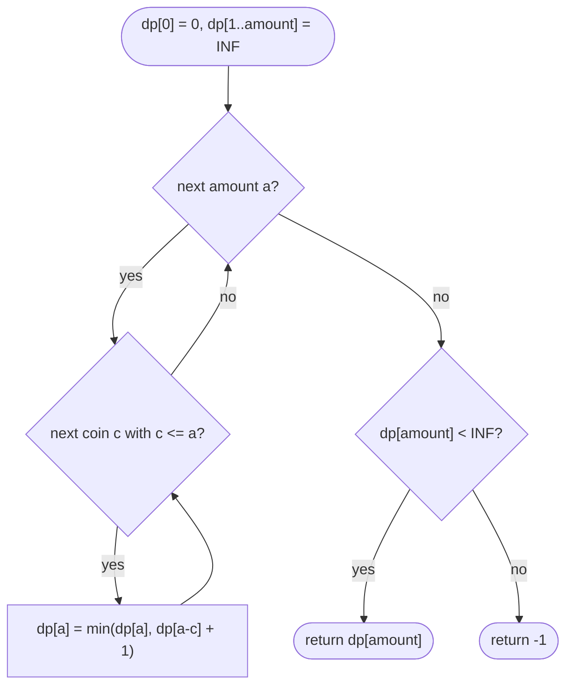

# LC 322 Coin Change

> [!abstract] In one sentence
> Whatever the optimal pile for amount `a` is, removing one coin `c` from it leaves an optimal pile for `a − c`, so `dp[a] = 1 + min over coins c ≤ a of dp[a − c]`, filled from 0 upwards with `dp[0] = 0` and `amount + 1` standing in for "impossible".

**Map:** [[NeetCode 150 MOC]] → [[DSA Dashboard]] · Pattern: [[Dynamic Programming]]

> [!question] Predict before you read
> Coins `[1, 3, 4]`, amount `6`. Largest-coin-first gives `4 + 1 + 1`, three coins. Is three optimal? Decide before reading, then find the general reason greedy is not safe for arbitrary denominations.

## Problem

You are given coin denominations `coins` and a target `amount`. Each denomination can be used any number of times. Return the fewest coins whose values sum to exactly `amount`, or `−1` if no combination does.

Example: `coins = [1, 2, 5], amount = 11` → `3` (`5 + 5 + 1`). Example: `coins = [2], amount = 3` → `−1`. Example: `coins = [1], amount = 0` → `0`.

Constraints that matter: 1 ≤ coins.length ≤ 12, 1 ≤ coins[i] ≤ 2³¹ − 1, 0 ≤ amount ≤ 10⁴. Amount is small, so an O(amount · coins) table is 120 000 cells; coin values are huge, so `a − c` must be guarded against going negative and `c` compared as an `int` without adding anything to it.

## Clarifying questions

1. Unlimited supply of each coin? — Yes; that is what makes it *unbounded* knapsack (each coin once would be [[LC 416 Partition Equal Subset Sum]]-style 0/1).
2. Can `amount` be 0? — Yes, answer 0 with zero coins.
3. Can coins be larger than `amount`, or duplicated? — Both possible; large coins are simply never used, duplicates change nothing.
4. Fewest coins or number of ways? — Fewest; counting the ways is [[LC 518 Coin Change II]] and has a different loop order.

## Brute force

Try every coin as the first coin and recurse on the remaining amount: `f(a) = 1 + min f(a − c)`. Without memoisation the recursion tree has branching factor `coins.length` and depth up to `amount / min(coins)`, so it is exponential — and `f(a)` for a given `a` is recomputed once per path reaching it. There are only `amount + 1` distinct arguments. BFS over amounts (each level adds one coin) finds the answer without a table but visits the same states.

## The key insight

Optimal substructure: take an optimal pile for `a` and remove any coin `c` from it; the rest must be an optimal pile for `a − c`, otherwise swapping in a better pile for `a − c` would improve the original. So `dp[a]` only needs the `dp` values of smaller amounts, one per coin, and the minimum is exact. Greedy fails because a large coin can force a bad remainder — `[1, 3, 4]` with `6`: taking `4` leaves `2`, which costs two `1`s, while `3 + 3` uses two coins. The DP keeps every remainder's optimum, so no single choice can trap it. Recognition cue: "fewest / minimum number of items to reach a total, unlimited reuse".

## Optimal approach

1. State: `dp[a]` = fewest coins that sum to exactly `a`; `INF = amount + 1` means impossible (no valid answer exceeds `amount`, and `INF + 1` cannot overflow).
2. Base: `dp[0] = 0`.
3. Transition: for each `a` from 1 to `amount`, `dp[a] = min over coins c ≤ a of dp[a − c] + 1`.
4. Order: increasing `a`; `dp[a − c]` is always smaller than `a`, so it is final when read. Coins may be the inner or the outer loop here — for a *minimum* the order does not matter, only reachability.
5. Answer: `dp[amount]` if it is less than `INF`, else `−1`.



> [!example]- Excalidraw version — the same diagram as an editable canvas
> ![[LC 322 Coin Change — Optimal approach.excalidraw]]
> [[LC 322 Coin Change — Optimal approach.excalidraw|Open in Excalidraw]] — needs the Excalidraw plugin (see [[Plugins to Install]]).

The 2-D view, `dp[i][a]` = fewest coins for `a` using the first `i` denominations, has the transition `min(dp[i−1][a], dp[i][a − c_i] + 1)` — the second term reads the *same* row, so the row collapses into one array filled upwards. That is the difference from 0/1 knapsack, which reads the previous row and therefore fills downwards.

## Walkthrough

`coins = [1, 3, 4], amount = 6`.

> [!example] dp[a] = fewest coins for amount a, coins 1, 3, 4
> ![[LC 322 Coin Change — dp-a- = fewest coins for amount a, coins 1, 3, 4.excalidraw]]
> [[LC 322 Coin Change — dp-a- = fewest coins for amount a, coins 1, 3, 4.excalidraw|Open in Excalidraw]] — dp[6] = 1 + min(dp[5] via 1, dp[3] via 3, dp[2] via 4) = 1 + min(2, 1, 2) = 2

%% excalidraw-spec
{"kind": "grid", "title": "dp[a] = fewest coins for amount a, coins 1, 3, 4", "col_labels": ["a=0", "a=1", "a=2", "a=3", "a=4", "a=5", "a=6"], "row_labels": ["dp"], "rows": [ [0, 1, 2, 1, 1, 2, 2] ], "highlight": [ [0, 6] ], "arrows": [ [ [0, 5], [0, 6] ], [ [0, 3], [0, 6] ], [ [0, 2], [0, 6] ] ], "caption": "dp[6] = 1 + min(dp[5] via 1, dp[3] via 3, dp[2] via 4) = 1 + min(2, 1, 2) = 2"}
%%

| a | candidates `dp[a − c] + 1` | dp[a] | pile |
|---|---|---|---|
| 1 | c=1: dp[0]+1 = 1 | 1 | 1 |
| 2 | c=1: dp[1]+1 = 2 | 2 | 1+1 |
| 3 | c=1: 3 · c=3: dp[0]+1 = 1 | 1 | 3 |
| 4 | c=1: 2 · c=3: 2 · c=4: dp[0]+1 = 1 | 1 | 4 |
| 5 | c=1: 2 · c=3: 3 · c=4: 2 | 2 | 4+1 |
| 6 | c=1: 3 · c=3: dp[3]+1 = 2 · c=4: 3 | 2 | 3+3 |

Greedy's `4 + 1 + 1` is the `c = 4` candidate at `a = 6`, which the `min` rejects.

## Java solution

```java
import java.util.*;

class Solution {
    public int coinChange(int[] coins, int amount) {
        int INF = amount + 1;                            // no real answer can exceed amount (all 1s), so this is "impossible"
        int[] dp = new int[amount + 1];
        Arrays.fill(dp, INF);
        dp[0] = 0;                                       // zero coins make amount 0
        for (int a = 1; a <= amount; a++) {
            for (int c : coins) {
                if (c <= a && dp[a - c] + 1 < dp[a]) {   // c <= a guards the index; INF + 1 cannot overflow
                    dp[a] = dp[a - c] + 1;
                }
            }
        }
        return dp[amount] == INF ? -1 : dp[amount];
    }
}
```

**Time** O(amount · k) for k coins · **Space** O(amount)

Top-down, which is how you discover the recurrence; the memo is indexed by the remaining amount:

```java
// snippet
int[] memo;                                              // memo[a] = fewest coins for a; 0 = unknown, -1 = impossible
int fewest(int[] coins, int a) {
    if (a == 0) return 0;
    if (memo[a] != 0) return memo[a];
    int best = Integer.MAX_VALUE;
    for (int c : coins) {
        if (c <= a) {
            int sub = fewest(coins, a - c);
            if (sub != -1) best = Math.min(best, sub + 1);
        }
    }
    return memo[a] = (best == Integer.MAX_VALUE ? -1 : best);
}
// memo = new int[amount + 1]; answer = fewest(coins, amount). O(amount · k) time, O(amount) space + stack depth up to amount
```

The recursion depth is `amount / min(coins)`, up to 10⁴ frames for coin `1` — fine on LeetCode's stack, but the table is the version to write.

## Why it works

State: `dp[a]` is the true minimum for amount `a` (or `INF`). Transition: an optimal pile for `a` contains some last coin `c`; the remaining coins form a pile for `a − c` of size `dp[a] − 1`, which cannot be smaller than `dp[a − c]`, and conversely `dp[a − c] + 1` is achievable — so the minimum over `c` is exact. Base: `dp[0] = 0`. Order: increasing `a`, so every `dp[a − c]` read is already final. Unreachable amounts stay `INF` and propagate as `INF + 1 > INF`, never winning a `min`.

## Edge cases

- `amount = 0` — loop body never runs, returns `dp[0] = 0`.
- No coin divides into the amount, `coins = [2], amount = 3` — `dp[3]` stays `INF`, returns −1.
- A coin equal to the amount — `dp[amount] = 1` via `dp[0]`.
- Coins larger than `amount` — skipped by `c <= a`; never dereferences a negative index.
- Huge coin values near `Integer.MAX_VALUE` — compared, never added; the only addition is `dp[..] + 1` on values ≤ `INF`.
- Duplicate denominations — harmless, the same candidate twice.

## Common mistakes

> [!warning] Pitfalls
> - **`Integer.MAX_VALUE` as the impossible marker** — `dp[a − c] + 1` overflows to `Integer.MIN_VALUE` and wins the `min`. Use `amount + 1`, or guard with `if (dp[a − c] != INF)`.
> - **Greedy by largest coin** — correct for canonical systems like `[1, 5, 10, 25]`, wrong for `[1, 3, 4]` and most interview inputs.
> - **Forgetting `c <= a`** — `ArrayIndexOutOfBoundsException` on `dp[a − c]`.
> - **Returning `dp[amount]` without translating `INF` to −1.**
> - **Confusing this with [[LC 518 Coin Change II]]** — here loop order is free because `min` is order-independent; for *counting* the coins must be the outer loop or you count permutations.
> - **Memo initialised to 0 and `0` used as "unknown" while `dp[0] = 0` is a real value** — the snippet handles it by returning before the memo check for `a == 0`; copy that or use `−2` for unknown.

## Variants & follow-ups

- Number of combinations — [[LC 518 Coin Change II]]: same table, `+=` instead of `min`, coins outer.
- Which coins? — keep `choice[a] = c` when `dp[a]` improves and walk back from `amount`.
- Each coin at most once — fill amounts *downwards* per coin ([[LC 416 Partition Equal Subset Sum]] shape).
- Perfect Squares (LC 279) — identical with coins `1, 4, 9, …`.
- BFS formulation — amounts are nodes, coins are edges of weight 1; the first time `amount` is dequeued is the answer. Same complexity, sometimes faster because it stops early.

## Interview script

1. Restate: fewest coins summing exactly to `amount`, unlimited reuse, −1 if impossible.
2. Brute force: recurse over the first coin, exponential; greedy fails on `[1, 3, 4]`, `6`.
3. Insight: removing one coin from an optimal pile leaves an optimal pile — `dp[a] = 1 + min dp[a − c]`.
4. Approach: array of size `amount + 1` filled with `amount + 1`, `dp[0] = 0`, amounts upwards, coins inside, translate `INF` to −1.
5. Complexity: O(amount · k) time, O(amount) space.
6. Tests: `[1,2,5] / 11`, `[2] / 3`, `[1] / 0`, `[1,3,4] / 6`.

The interviewer is checking that you justify why the min is exact, that you choose an impossible marker that cannot overflow, and that you know why loop order matters for counting but not here.

## Related

- [[Dynamic Programming]] — "amount with reusable items" shape
- [[DP Pattern Catalogue]] — row 7, unbounded knapsack
- [[LC 518 Coin Change II]] — the counting twin; loop order becomes essential
- [[LC 416 Partition Equal Subset Sum]] — 0/1 knapsack: each item once, amounts downwards
- [[LC 70 Climbing Stairs]] — the same shape with coins `{1, 2}` and a sum instead of a min
- [[DSA Patterns in Java]] — knapsack templates
- [[Java Collections Cheat Sheet]] — `Arrays.fill`

## Attempt log

| Date | Result | Minutes | What I got wrong |
|---|---|---|---|
| | | | |

### Mastery checklist
- [ ] Solved without hints in under 25 minutes
- [ ] Stated complexity before coding
- [ ] Handled every edge case above
- [ ] Code compiled first time
- [ ] Can do the follow-up variant (reconstruct the coins; count combinations)

## Open questions
- [ ]
