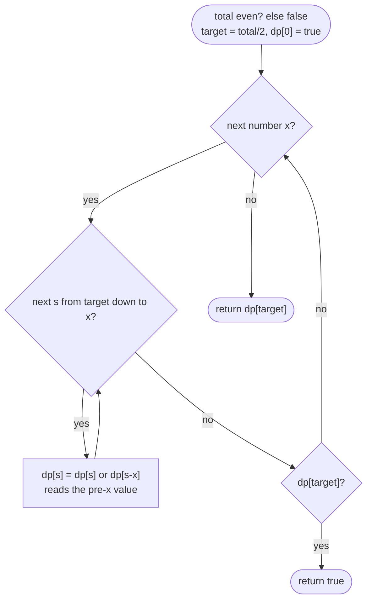

# LC 416 Partition Equal Subset Sum

> [!abstract] In one sentence
> Splitting into two equal-sum halves is the same as finding one subset that sums to `total / 2`, and "which sums are reachable using each number at most once" is a boolean array that you update per number from the top down — `dp[s] |= dp[s − x]` — so a sum reached *with* `x` can never be reused to reach a bigger sum with `x` again.

**Map:** [[NeetCode 150 MOC]] → [[DSA Dashboard]] · Pattern: [[Dynamic Programming]]

> [!question] Predict before you read
> `nums = [3]`, target `6`. Run `for s = x..target: dp[s] |= dp[s − x]` *upwards* once for `x = 3` and read off `dp[6]`. It comes out `true`. Why, and which direction of the loop fixes it?

## Problem

Given an array of positive integers, decide whether it can be split into two subsets with equal sums (every element goes to exactly one side).

Example: `[1, 5, 11, 5]` → `true` (`{1, 5, 5}` and `{11}`). Example: `[1, 2, 3, 5]` → `false` (total 11 is odd). Example: `[2, 2, 3, 5]` → `false` (total 12, no subset sums to 6).

Constraints that matter: 1 ≤ n ≤ 200, 1 ≤ nums[i] ≤ 100, so total ≤ 20 000 and target ≤ 10 000; O(n · target) = 2 · 10⁶ boolean updates. All values positive means a running sum never needs an offset.

## Clarifying questions

1. Must every element be used? — Yes, each goes to one of the two subsets; that is why "one subset summing to half" is equivalent.
2. Are values positive? — Yes (1..100); with zeros or negatives the parity shortcut and the array bounds change.
3. Can a subset be empty? — Only if the other is too, which needs total 0 — impossible here.
4. Do I return the partition? — No, just a boolean; a reconstruction needs the 2-D table or a parent trail.

## Brute force

Each element goes left or right: 2ⁿ assignments, O(2ⁿ · n) — n = 200 is hopeless. Recursion `can(i, remaining)` with take/skip is exponential too, but its state is just `(i, remaining)`: at most `n · (target + 1)` distinct calls, and that is the memo.

## The key insight

Two conditions: the total must be even, and some subset must sum to `target = total / 2` (the rest then sums to the other half automatically). The second is subset sum, the boolean form of 0/1 knapsack: process numbers one at a time and maintain the set of reachable sums. Adding number `x` turns every reachable `s` into reachable `s + x`. Written on one array, you must update from high `s` to low `s`: `dp[s] |= dp[s − x]` reads `dp[s − x]`, which must still be the *previous* number's value — if you went upwards you would read a cell already updated with `x` and use `x` twice (`[3]` reaching 6). Recognition cue: "each element used at most once", "partition", "subset with a given sum", "assign + or −".

## Optimal approach

1. `total = sum`; if odd return `false`; `target = total / 2`.
2. State: `dp[s]` = can some subset of the numbers processed so far sum to exactly `s`; `dp[0] = true`.
3. For each `x`: for `s` from `target` down to `x`: `dp[s] = dp[s] || dp[s − x]`.
4. Early exit when `dp[target]` becomes true; otherwise return `dp[target]` at the end.



> [!example]- Excalidraw version — the same diagram as an editable canvas
> ![[LC 416 Partition Equal Subset Sum — Optimal approach.excalidraw]]
> [[LC 416 Partition Equal Subset Sum — Optimal approach.excalidraw|Open in Excalidraw]] — needs the Excalidraw plugin (see [[Plugins to Install]]).

Downwards is the whole difference between 0/1 knapsack and unbounded knapsack ([[LC 322 Coin Change]] goes upwards precisely because coins may repeat).

## Walkthrough

`[2, 3, 5]`, total 10, target 5. Each row is the reachable-sum array after processing one more number.

> [!example] Reachable sums after each number of 2, 3, 5 (target 5)
> ![[LC 416 Partition Equal Subset Sum — Reachable sums after each number of 2, 3, 5 (target 5).excalidraw]]
> [[LC 416 Partition Equal Subset Sum — Reachable sums after each number of 2, 3, 5 (target 5).excalidraw|Open in Excalidraw]] — row +3, s=5: dp[5] = dp[5] (skip 3) or dp[2] (take 3 on top of 2) = true; the loop can stop here

%% excalidraw-spec
{"kind": "grid", "title": "Reachable sums after each number of 2, 3, 5 (target 5)", "col_labels": ["s=0", "s=1", "s=2", "s=3", "s=4", "s=5"], "row_labels": ["start", "+2", "+3", "+5"], "rows": [ [1, 0, 0, 0, 0, 0], [1, 0, 1, 0, 0, 0], [1, 0, 1, 1, 0, 1], [1, 0, 1, 1, 0, 1] ], "highlight": [ [2, 5] ], "arrows": [ [ [1, 2], [2, 5] ], [ [1, 5], [2, 5] ] ], "caption": "row +3, s=5: dp[5] = dp[5] (skip 3) or dp[2] (take 3 on top of 2) = true; the loop can stop here"}
%%

| x | s visited (downwards) | cells that flip to true |
|---|---|---|
| 2 | 5, 4, 3, 2 | `dp[2]` ← `dp[0]` |
| 3 | 5, 4, 3 | `dp[5]` ← `dp[2]`, `dp[3]` ← `dp[0]` |
| 5 | (early exit) | — |

With an *upwards* loop for `x = 2` you would set `dp[2]` from `dp[0]`, then `dp[4]` from the freshly set `dp[2]` — using the single `2` twice.

## Java solution

```java
import java.util.*;

class Solution {
    public boolean canPartition(int[] nums) {
        int total = 0;
        for (int x : nums) total += x;
        if (total % 2 != 0) return false;                 // two equal halves need an even total
        int target = total / 2;
        boolean[] dp = new boolean[target + 1];           // dp[s] = some subset of the numbers so far sums to s
        dp[0] = true;                                     // the empty subset
        for (int x : nums) {
            for (int s = target; s >= x; s--) {           // downwards: dp[s - x] still refers to subsets without x
                dp[s] = dp[s] || dp[s - x];
            }
            if (dp[target]) return true;                  // early exit; the remaining numbers go to the other side
        }
        return dp[target];
    }
}
```

**Time** O(n · target) · **Space** O(target)

Top-down, the form you discover first — memo on `(index, remaining)`:

```java
// snippet
Boolean[][] memo;                                          // memo[i][rem] = can nums[i..] reach rem; null = unknown
boolean can(int[] nums, int i, int rem) {
    if (rem == 0) return true;
    if (i == nums.length || rem < 0) return false;
    if (memo[i][rem] != null) return memo[i][rem];
    return memo[i][rem] = can(nums, i + 1, rem - nums[i]) || can(nums, i + 1, rem);   // take, then skip
}
// memo = new Boolean[n][target + 1]; answer = can(nums, 0, target). O(n · target) time and space
```

The 2-D table, which makes the "previous row" explicit and is the one to draw when teaching knapsack:

```java
// snippet
boolean[][] dp = new boolean[n + 1][target + 1];           // dp[i][s] = first i numbers can reach s
dp[0][0] = true;
for (int i = 1; i <= n; i++) {
    int x = nums[i - 1];
    for (int s = 0; s <= target; s++) {
        dp[i][s] = dp[i - 1][s] || (s >= x && dp[i - 1][s - x]);   // skip x, or take x from the previous row
    }
}
return dp[n][target];                                      // O(n · target) time and space; row i reads only row i-1
```

Bitset form, the fastest in practice: `java.math.BigInteger bits = BigInteger.ONE; for (int x : nums) bits = bits.or(bits.shiftLeft(x)); return bits.testBit(target);` — one shift-or per number does the whole inner loop.

## Why it works

State: after processing the first `i` numbers, `dp[s]` is true iff some subset of them sums to `s`. Transition: a subset of the first `i` numbers either omits `nums[i]` (a subset of the first `i − 1` with sum `s`) or includes it (a subset of the first `i − 1` with sum `s − x`); the OR of the two previous-row cells is therefore exact. Base: `dp[0] = true`, nothing else. Order: numbers in any order, sums *downwards* within a number so that every `dp[s − x]` read is still the previous row. Correctness of the reduction: if a subset sums to `total / 2`, its complement sums to the other `total / 2`.

## Edge cases

- Odd total — immediate `false`, no table.
- Single element — total is `x`, target `x / 2`; `dp[target]` stays false (or `x` is odd). Returns `false`, correct since the other side would be empty.
- One element equals the sum of all others, `[1, 2, 3, 6]` — target 6, hit when `x = 6` sees `dp[0]`.
- Many large values — `target` ≤ 10 000 keeps the array small regardless of n.
- All equal, even count — true; odd count with an odd value — false by parity.
- Early exit — once `dp[target]` is true no later number can unset it, so returning immediately is safe.

## Common mistakes

> [!warning] Pitfalls
> - **Inner loop upwards** — uses an element twice; `[3]` with target 6 returns true. The direction *is* the 0/1 constraint.
> - **Forgetting `dp[0] = true`** — nothing ever becomes reachable.
> - **Looping `s` down to 0 instead of `x`** — `dp[s − x]` with a negative index; the bound `s ≥ x` is the guard.
> - **Checking `total / 2` with integer division before testing parity** — `[1, 2]` has total 3, `target = 1` is reachable, wrong answer `true`.
> - **Greedy "put each number on the lighter side"** — `[1, 5, 11, 5]` puts 1 left, 5 right, 11 left, 5 right: 12 vs 10, and reports false.
> - **`memo` as `boolean[][]`** — you cannot tell "false" from "not computed"; use `Boolean[][]` or an `int` code.

## Variants & follow-ups

- Assign `+` or `−` to hit a target — [[LC 494 Target Sum]] is this problem with counting instead of OR (`P = (total + target) / 2`).
- Minimum difference partition (Last Stone Weight II, LC 1049) — fill the same array, then the best reachable `s ≤ total / 2` gives `total − 2s`.
- Count subsets with sum `s` — `int` array, `dp[s] += dp[s − x]`, still downwards.
- Reconstruct the subset — keep the 2-D table and walk back: if `dp[i − 1][s]` is true go up, else take `nums[i − 1]` and go to `s − x`.
- k equal-sum subsets (LC 698) — no longer polynomial; backtracking with a bitmask over elements.
- Unlimited copies of each number — becomes [[LC 322 Coin Change]] / [[LC 518 Coin Change II]] with the loop reversed.

## Interview script

1. Restate: split into two subsets of equal sum; equivalently find a subset summing to half.
2. Brute force: 2ⁿ assignments.
3. Insight: reachable-sums set grows one number at a time; boolean array, update downwards so each number is used once.
4. Approach: parity check, `dp[0] = true`, two loops, early exit.
5. Complexity: O(n · target) time, O(target) space.
6. Tests: `[1,5,11,5]`, `[1,2,3,5]`, `[2,2,3,5]`, `[3]` (direction check), `[1,2]`.

The interviewer is checking that you justify the loop direction, that you call it 0/1 knapsack and can produce the 2-D table on request, and that you see the reduction to subset sum before touching code.

## Related

- [[Dynamic Programming]] — the subset-sum shape and the bridge to 2-D
- [[2-D Dynamic Programming]] — knapsack section: `(items considered, capacity left)`
- [[DP Pattern Catalogue]] — row 8, 0/1 knapsack
- [[LC 494 Target Sum]] — the same table, counting instead of boolean
- [[LC 322 Coin Change]] — unbounded: the loop direction flips
- [[LC 198 House Robber]] — take-or-skip with a different constraint
- [[DSA Patterns in Java]] — knapsack templates
- [[Java Pitfalls in Interviews]] — `boolean[][]` cannot mark "unknown"

## Attempt log

| Date | Result | Minutes | What I got wrong |
|---|---|---|---|
| | | | |

### Mastery checklist
- [ ] Solved without hints in under 25 minutes
- [ ] Stated complexity before coding
- [ ] Handled every edge case above
- [ ] Code compiled first time
- [ ] Can do the follow-up variant (target sum counting; minimum difference)

## Open questions
- [ ]
