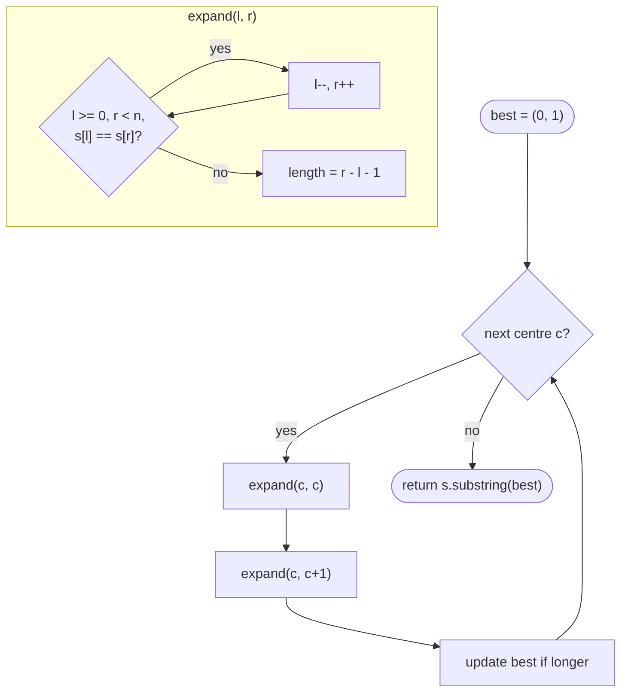

# LC 5 Longest Palindromic Substring

> [!abstract] In one sentence
> Instead of testing every substring, start from every possible centre and grow while the two ends agree — a palindrome of length L implies palindromes of length L − 2, L − 4, … around the same centre, so the growth never needs to restart.

**Map:** [[NeetCode 150 MOC]] → [[DSA Dashboard]] · Pattern: [[Dynamic Programming]]

> [!question] Predict before you read
> How many centres does a string of length n have, if palindromes can be even-length (`"abba"`) as well as odd (`"aba"`)?

## Problem

Given a string `s`, return the longest substring that reads the same forwards and backwards. If several have the maximal length, any one is accepted.

Example: `"babad"` → `"bab"` (or `"aba"`). Example: `"cbbd"` → `"bb"`.

Constraints that matter: 1 ≤ n ≤ 1000, digits and letters only. n² = 10⁶ is fine; n³ = 10⁹ is not.

## Clarifying questions

1. Even-length palindromes count? — Yes; `"bb"` is the answer for `"cbbd"`.
2. Case-sensitive? — Yes, as given.
3. Return the substring or its length? — The substring; track start and length.
4. Ties? — Any of the longest is fine.

## Brute force

For every pair `(i, j)` check whether `s[i..j]` is a palindrome by scanning inward: O(n²) pairs × O(n) check = O(n³). The waste: checking `s[i..j]` repeats the inner work already done for `s[i+1..j−1]`.

## The key insight

A palindrome is defined by its centre and its radius. Fix the centre and grow outward: if `s[l] == s[r]` the span `[l, r]` is a palindrome *given* `[l + 1, r − 1]` was, which you have just verified. There are n single-character centres and n − 1 between-character centres, each expanded in O(n), so O(n²) total with no table. The DP table `dp[i][j] = s[i] == s[j] && dp[i+1][j−1]` expresses the same dependence explicitly and is what you need when the palindrome check feeds another DP ([[LC 131 Palindrome Partitioning]]). Recognition cue: "palindromic substring" — expand from centres; "palindromic *subsequence*" — that is LCS-style 2-D DP instead.

## Optimal approach

1. For each index `c` from 0 to n − 1: expand `(c, c)` for odd length and `(c, c + 1)` for even.
2. `expand(l, r)`: while `l ≥ 0`, `r < n`, `s[l] == s[r]`: `l--`, `r++`. Palindrome is `s[l+1..r−1]`, length `r − l − 1`.
3. Keep the best `(start, length)`.
4. Return `s.substring(start, start + length)`.



> [!example]- Excalidraw version — the same diagram as an editable canvas
> ![[LC 5 Longest Palindromic Substring — Optimal approach.excalidraw]]
> [[LC 5 Longest Palindromic Substring — Optimal approach.excalidraw|Open in Excalidraw]] — needs the Excalidraw plugin (see [[Plugins to Install]]).

## Walkthrough

`s = "babad"`. Centres and the radius reached:

| Centre | Type | Expansion stops at | Palindrome | Length |
|---|---|---|---|---|
| 0 | odd | l=−1 | "b" | 1 |
| 0,1 | even | b≠a | "" | 0 |
| 1 | odd | s[0]=b equals s[2]=b, then l=−1 | "bab" | 3 |
| 2 | odd | s[1]=a equals s[3]=a, then s[0]=b vs s[4]=d | "aba" | 3 |
| 3 | odd | s[2]=b vs s[4]=d | "a" | 1 |
| 4 | odd | r=5 leaves the string | "d" | 1 |

Best stays at the first length-3 hit: `"bab"`.

> [!example] Expanding from centre 1 in b a b a d
> ![[LC 5 Longest Palindromic Substring — Expanding from centre 1 in b a b a d.excalidraw]]
> [[LC 5 Longest Palindromic Substring — Expanding from centre 1 in b a b a d.excalidraw|Open in Excalidraw]] — s[0] == s[2] so the radius grows to 1; the next step leaves the string

%% excalidraw-spec
{"kind": "array", "title": "Expanding from centre 1 in b a b a d", "values": ["b", "a", "b", "a", "d"], "pointers": {"l": 0, "c": 1, "r": 2}, "highlight": [0, 1, 2], "caption": "s[0] == s[2] so the radius grows to 1; the next step leaves the string"}
%%

## Java solution

```java
import java.util.*;

class Solution {
    private int bestStart = 0, bestLen = 1;

    public String longestPalindrome(String s) {
        for (int c = 0; c < s.length(); c++) {
            expand(s, c, c);                            // odd length: single-character centre
            expand(s, c, c + 1);                        // even length: centre between c and c+1
        }
        return s.substring(bestStart, bestStart + bestLen);
    }

    private void expand(String s, int l, int r) {
        while (l >= 0 && r < s.length() && s.charAt(l) == s.charAt(r)) { l--; r++; }
        int len = r - l - 1;                            // the loop overshoots by one on each side
        if (len > bestLen) { bestLen = len; bestStart = l + 1; }
    }
}
```

**Time** O(n²) · **Space** O(1)

The table version — `dp[i][j]` is true iff `s[i..j]` is a palindrome — filled by increasing length so `dp[i+1][j−1]` is ready:

```java
// snippet
boolean[][] dp = new boolean[n][n];
int start = 0, best = 1;
for (int len = 1; len <= n; len++)
    for (int i = 0; i + len - 1 < n; i++) {
        int j = i + len - 1;
        dp[i][j] = s.charAt(i) == s.charAt(j) && (len <= 2 || dp[i + 1][j - 1]);
        if (dp[i][j] && len > best) { best = len; start = i; }
    }
return s.substring(start, start + best);
// O(n^2) time, O(n^2) space
```

Top-down memo of the same predicate, useful when another recursion asks "is s[i..j] a palindrome" many times:

```java
// snippet
Boolean[][] memo = new Boolean[n][n];
boolean isPal(String s, int i, int j) {
    if (i >= j) return true;
    if (memo[i][j] != null) return memo[i][j];
    return memo[i][j] = s.charAt(i) == s.charAt(j) && isPal(s, i + 1, j - 1);
}
```

## Why it works

Every palindrome has a unique centre: index `c` if its length is odd, the gap `(c, c + 1)` if even. For a fixed centre, palindromes are nested — if `s[l..r]` is one then `s[l+1..r−1]` is one — so the set of palindromes around a centre is exactly the radii `0..R` for some maximal `R`, and the expansion loop finds `R` by stopping at the first mismatch or boundary. Checking all 2n − 1 centres therefore sees every palindrome, and the longest is recorded. The table version is the same statement as a recurrence: state `dp[i][j]`, transition from `dp[i+1][j−1]`, base length ≤ 2, order by increasing length.

## Edge cases

- `n = 1` — `bestLen` starts at 1, returns the string.
- All identical `"aaaa"` — every expansion reaches the boundary; answer is the whole string, found from the middle centres.
- No repeated characters `"abc"` — every palindrome has length 1; the first character is returned.
- Even-length answer `"cbbd"` — found by the `(1, 2)` centre.

## Common mistakes

> [!warning] Pitfalls
> - **Only odd centres** — `"cbbd"` returns `"c"`.
> - **Length arithmetic after the loop** — the loop exits with `l` and `r` one past the palindrome on each side; the length is `r − l − 1` and the start is `l + 1`.
> - **Filling the table by `i` then `j` increasing** — `dp[i+1][j−1]` is not yet computed; iterate `i` downward or by length.
> - **Building substrings inside the loop** — `substring` is O(length); record indices, build once at the end.

## Variants & follow-ups

- Count all palindromic substrings — same expansion, add the radius to a counter: [[LC 647 Palindromic Substrings]].
- Cut into the fewest palindromes / enumerate all cuts — [[LC 131 Palindrome Partitioning]] uses the table as a precomputed predicate.
- Longest palindromic *subsequence* (LC 516) — LCS of `s` and its reverse, 2-D DP.
- O(n) with Manacher's algorithm — recognise the name, do not derive it in an interview unless asked.
- Shortest palindrome by prepending (LC 214) — KMP on `s + "#" + reverse(s)`.

## Interview script

1. Restate: longest contiguous palindrome; even lengths allowed.
2. Brute force: all substrings with an O(n) check, O(n³).
3. Insight: 2n − 1 centres; grow while ends match; nested palindromes share a centre.
4. Approach: expand helper, two calls per index, track start and length, substring once. Mention the dp table and when you would prefer it.
5. Complexity: O(n²) time, O(1) space; Manacher's O(n) exists.
6. Tests: single char, `"cbbd"`, `"aaaa"`, `"abc"`.

The interviewer is checking that you handle even centres, that you get the index arithmetic right, and that you know the table form for when the predicate is reused.

## Related

- [[Dynamic Programming]] — palindromes section
- [[Two Pointers]] — the expansion is two pointers moving outward
- [[LC 647 Palindromic Substrings]] — count instead of longest
- [[LC 131 Palindrome Partitioning]] — uses the table as a predicate
- [[LC 125 Valid Palindrome]] — the inward two-pointer check
- [[Java Collections Cheat Sheet]] — `substring`, `charAt`

## Attempt log

| Date | Result | Minutes | What I got wrong |
|---|---|---|---|
| | | | |

### Mastery checklist
- [ ] Solved without hints in under 25 minutes
- [ ] Stated complexity before coding
- [ ] Handled every edge case above
- [ ] Code compiled first time
- [ ] Can do the follow-up variant (count all; table form)

## Open questions
- [ ]
