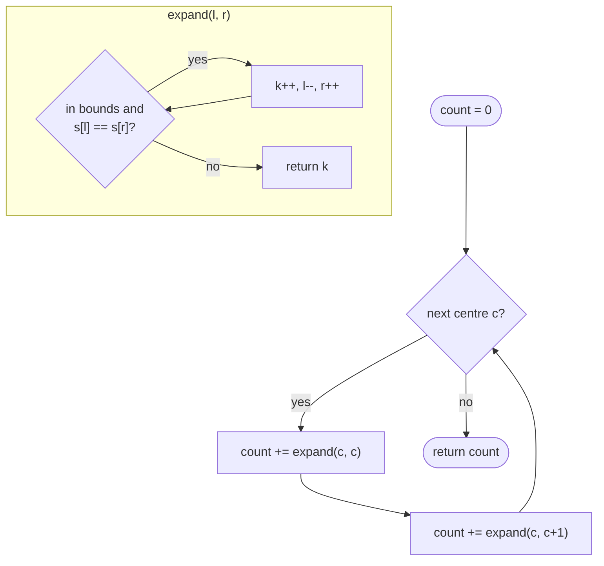

# LC 647 Palindromic Substrings

> [!abstract] In one sentence
> Expanding from a centre, each step where the ends still match is one distinct palindrome (the same centre, one larger radius), so the count is simply the total number of successful steps over all 2n − 1 centres.

**Map:** [[NeetCode 150 MOC]] → [[DSA Dashboard]] · Pattern: [[Dynamic Programming]]

> [!question] Predict before you read
> `"aaa"` has 6 palindromic substrings. Without listing them, how do you get 6 from "3 odd centres and 2 even centres"?

## Problem

Given a string `s`, count the substrings that are palindromes. Substrings at different positions count separately even if their text is identical.

Example: `"abc"` → `3` (a, b, c). Example: `"aaa"` → `6` (a, a, a, aa, aa, aaa).

Constraints that matter: 1 ≤ n ≤ 1000, lowercase letters. The answer is at most n(n + 1)/2 ≈ 5 × 10⁵, so `int` is fine.

## Clarifying questions

1. Do identical substrings at different positions count separately? — Yes.
2. Single characters count? — Yes; the answer is at least n.
3. Return the count, not the list? — The count.
4. Even-length palindromes? — Yes.

## Brute force

Check all n(n + 1)/2 substrings with an O(n) palindrome test: O(n³), about 1.7 × 10⁸ for n = 1000 — borderline, and wasteful because the test for `s[i..j]` redoes the test for `s[i+1..j−1]`.

## The key insight

Identical to [[LC 5 Longest Palindromic Substring]]: palindromes around a centre are nested, so the number of palindromes with that centre equals the maximal radius reached (plus one for odd centres, counting the single character). Count each successful expansion step. Recognition cue: "how many palindromic substrings" — the same loop with `count++` in place of `max`.

## Optimal approach

1. For each `c`: `count += expand(c, c)` and `count += expand(c, c + 1)`.
2. `expand(l, r)` increments a local counter each time `s[l] == s[r]` within bounds, then moves outward; returns the counter.
3. Return the total.



> [!example]- Excalidraw version — the same diagram as an editable canvas
> ![[LC 647 Palindromic Substrings — Optimal approach.excalidraw]]
> [[LC 647 Palindromic Substrings — Optimal approach.excalidraw|Open in Excalidraw]] — needs the Excalidraw plugin (see [[Plugins to Install]]).

## Walkthrough

`s = "aaa"`.

| Centre | Type | Successful steps | Palindromes found |
|---|---|---|---|
| 0 | odd | 1 | "a" |
| 0,1 | even | 1 | "aa" |
| 1 | odd | 2 | "a", "aaa" |
| 1,2 | even | 1 | "aa" |
| 2 | odd | 1 | "a" |

Total 1 + 1 + 2 + 1 + 1 = 6.

> [!example] dp[i][j] = s[i..j] is a palindrome, for aaa (1 = true)
> ![[LC 647 Palindromic Substrings — dp-i--j- = s-i..j- is a palindrome, for aaa (1 = true).excalidraw]]
> [[LC 647 Palindromic Substrings — dp-i--j- = s-i..j- is a palindrome, for aaa (1 = true).excalidraw|Open in Excalidraw]] — the count is the number of true cells on or above the diagonal: 6; dp[0][2] needs dp[1][1]

%% excalidraw-spec
{"kind": "grid", "title": "dp[i][j] = s[i..j] is a palindrome, for aaa (1 = true)", "col_labels": ["", "j=0", "j=1", "j=2"], "row_labels": ["i=0", "i=1", "i=2"], "rows": [ [1, 1, 1], [0, 1, 1], [0, 0, 1] ], "highlight": [ [0, 2] ], "caption": "the count is the number of true cells on or above the diagonal: 6; dp[0][2] needs dp[1][1]"}
%%

## Java solution

```java
import java.util.*;

class Solution {
    public int countSubstrings(String s) {
        int count = 0;
        for (int c = 0; c < s.length(); c++) {
            count += expand(s, c, c);                   // odd-length palindromes centred at c
            count += expand(s, c, c + 1);               // even-length palindromes centred between c and c+1
        }
        return count;
    }

    private int expand(String s, int l, int r) {
        int k = 0;
        while (l >= 0 && r < s.length() && s.charAt(l) == s.charAt(r)) {
            k++;                                        // each widening is one more palindrome
            l--; r++;
        }
        return k;
    }
}
```

**Time** O(n²) · **Space** O(1)

Table form, filled by increasing `j` and decreasing `i` so that `dp[i+1][j−1]` is ready:

```java
// snippet
boolean[][] dp = new boolean[n][n];
int count = 0;
for (int i = n - 1; i >= 0; i--)
    for (int j = i; j < n; j++) {
        dp[i][j] = s.charAt(i) == s.charAt(j) && (j - i < 2 || dp[i + 1][j - 1]);
        if (dp[i][j]) count++;
    }
return count;
// O(n^2) time, O(n^2) space
```

Memoised predicate (top-down), same recurrence:

```java
// snippet
Boolean[][] memo = new Boolean[n][n];
boolean pal(String s, int i, int j) {
    if (i >= j) return true;
    if (memo[i][j] != null) return memo[i][j];
    return memo[i][j] = s.charAt(i) == s.charAt(j) && pal(s, i + 1, j - 1);
}
// count = number of (i, j) with pal(i, j); same O(n^2)
```

## Why it works

Each palindromic substring has exactly one centre and one radius, so the map (centre, radius) → substring is a bijection onto the set we are counting. For a fixed centre the valid radii form a prefix `0..R` because palindromes nest; the expansion loop runs exactly `R + 1` successful iterations (odd) or `R` (even, where radius 0 is the empty string and is not counted because the loop needs `s[c] == s[c+1]` to count once). Summing over centres counts every palindrome exactly once. The table version is the recurrence `dp[i][j] = (s[i] == s[j]) ∧ dp[i+1][j−1]`, base `j − i < 2`, order so that the inner cell is final.

## Edge cases

- `n = 1` — one odd centre, count 1.
- All distinct — exactly n.
- All identical — n(n + 1)/2.
- `"abba"` — odd centres give 4, the middle even centre gives 2 (`bb`, `abba`): 6.

## Common mistakes

> [!warning] Pitfalls
> - **Counting only after the loop** (adding the final radius) is the same thing for odd centres but it is easier to get wrong than incrementing inside the loop; do the latter.
> - **Skipping even centres** — `"aa"` returns 2 instead of 3.
> - **Table filled in the wrong order** — `i` ascending with `j` ascending reads an unfilled `dp[i+1][j−1]` (false by default), undercounting silently.
> - **Deduplicating by text** — the problem counts positions, not distinct strings.

## Variants & follow-ups

- Longest instead of count — [[LC 5 Longest Palindromic Substring]].
- Count *distinct* palindromic substrings — needs a palindromic tree (eertree) or suffix automaton; recognise, do not derive.
- Minimum cuts into palindromes (LC 132) — precompute this table, then a 1-D DP over cut positions.
- Count palindromic *subsequences* — 2-D interval DP, different recurrence.

## Interview script

1. Restate: count palindromic substrings by position; singles count.
2. Brute force: O(n³).
3. Insight: 2n − 1 centres, nested palindromes; each successful widening is one palindrome.
4. Approach: expand helper returning the count; sum over centres. Mention the table and its fill order.
5. Complexity: O(n²), O(1) space.
6. Tests: `"abc"`, `"aaa"`, `"abba"`.

The interviewer is checking that you can move from "longest" to "count" without changing the structure, and that you get the even centres.

## Related

- [[Dynamic Programming]] — palindromes section
- [[LC 5 Longest Palindromic Substring]] — same loop, different aggregate
- [[LC 131 Palindrome Partitioning]] — uses the table as a predicate
- [[LC 125 Valid Palindrome]] — the basic check
- [[DSA Patterns in Java]]

## Attempt log

| Date | Result | Minutes | What I got wrong |
|---|---|---|---|
| | | | |

### Mastery checklist
- [ ] Solved without hints in under 25 minutes
- [ ] Stated complexity before coding
- [ ] Handled every edge case above
- [ ] Code compiled first time
- [ ] Can do the follow-up variant (minimum palindrome cuts)

## Open questions
- [ ]
