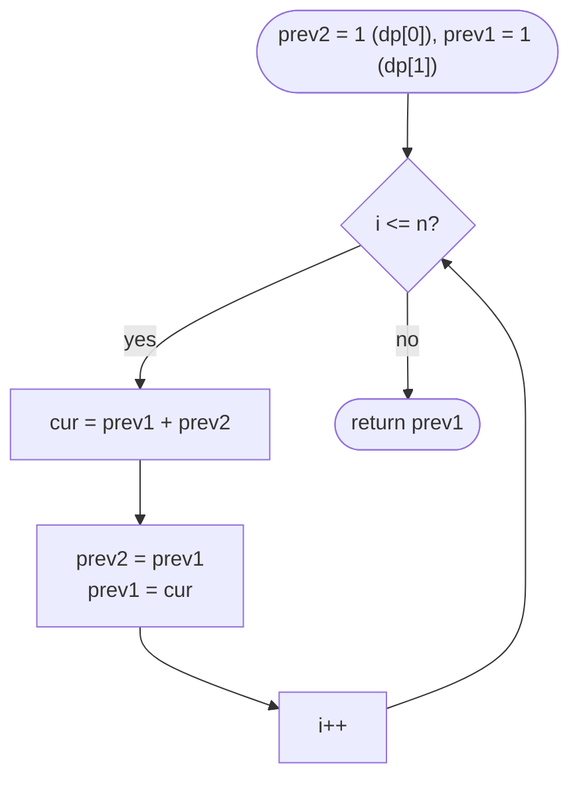

# LC 70 Climbing Stairs

> [!abstract] In one sentence
> Think about the *last* move: every way to stand on step n ends with a 1-step from n − 1 or a 2-step from n − 2, and those two sets never overlap, so `ways(n) = ways(n − 1) + ways(n − 2)` — Fibonacci with a notebook.

**Map:** [[NeetCode 150 MOC]] → [[DSA Dashboard]] · Pattern: [[Dynamic Programming]]

> [!question] Predict before you read
> For n = 45 the plain recursion makes about 1.8 billion calls. How many *distinct* arguments does it ever see, and what does that tell you about where the time goes?

## Problem

A staircase has `n` steps. Each move climbs 1 or 2 steps. Count the distinct sequences of moves that reach the top.

Example: `n = 2` → `2` (1+1, 2). Example: `n = 3` → `3` (1+1+1, 1+2, 2+1).

Constraints that matter: 1 ≤ n ≤ 45. The answer for 45 is 1 836 311 903, which fits in an `int` (just: `Integer.MAX_VALUE` is 2 147 483 647). For n = 46 it would not.

## Clarifying questions

1. Is 1+2 different from 2+1? — Yes, order matters; we count sequences, not multisets.
2. What is `ways(0)`? — 1 (the empty sequence); it makes the recurrence work without special cases.
3. Can the answer overflow? — Not within n ≤ 45; say you would switch to `long` or take a modulus otherwise.
4. Are steps of size 3 allowed? — No; but the follow-up often adds a set of allowed step sizes.

## Brute force

Enumerate every sequence of 1s and 2s that sums to n by recursion: `ways(n) = ways(n − 1) + ways(n − 2)` with no cache. Time O(2ⁿ) — the call tree has about φⁿ nodes (φ ≈ 1.618). The waste is pure repetition: `ways(3)` is computed twice inside `ways(5)`, `ways(2)` three times; the number of distinct subproblems is only n + 1.

## The key insight

The last move determines a clean partition: sequences ending with a 1-step are in bijection with the ways to reach n − 1, sequences ending with a 2-step with the ways to reach n − 2. Add them. Once you see that `ways(i)` depends only on the two previous values, you can fill a table from 0 up, and then notice you only ever need the last two values. Recognition cue: "number of ways to reach / build / tile, moves of fixed sizes".

## Optimal approach

1. State: `dp[i]` = number of ways to reach step `i`.
2. Base: `dp[0] = 1`, `dp[1] = 1`.
3. Transition: `dp[i] = dp[i − 1] + dp[i − 2]` for `i ≥ 2`.
4. Order: increasing `i`; keep only two variables since the transition looks back two cells.



> [!example]- Excalidraw version — the same diagram as an editable canvas
> ![[LC 70 Climbing Stairs — Optimal approach.excalidraw]]
> [[LC 70 Climbing Stairs — Optimal approach.excalidraw|Open in Excalidraw]] — needs the Excalidraw plugin (see [[Plugins to Install]]).

## Walkthrough

n = 5.

> [!example] dp[i] = ways to reach step i, n = 5
> ![[LC 70 Climbing Stairs — dp-i- = ways to reach step i, n = 5.excalidraw]]
> [[LC 70 Climbing Stairs — dp-i- = ways to reach step i, n = 5.excalidraw|Open in Excalidraw]] — dp[5] = dp[4] + dp[3] = 5 + 3 = 8

%% excalidraw-spec
{"kind": "array", "title": "dp[i] = ways to reach step i, n = 5", "values": [1, 1, 2, 3, 5, 8], "pointers": {"i-2": 3, "i-1": 4, "i": 5}, "highlight": [5], "caption": "dp[5] = dp[4] + dp[3] = 5 + 3 = 8"}
%%

| i | dp[i-2] | dp[i-1] | dp[i] | the sequences counted |
|---|---|---|---|---|
| 2 | 1 | 1 | 2 | 11, 2 |
| 3 | 1 | 2 | 3 | 111, 12, 21 |
| 4 | 2 | 3 | 5 | 1111, 112, 121, 211, 22 |
| 5 | 3 | 5 | 8 | the five above + 1, the three for n=3 + 2 |

## Java solution

```java
import java.util.*;

class Solution {
    public int climbStairs(int n) {
        int prev2 = 1, prev1 = 1;                 // dp[0], dp[1]
        for (int i = 2; i <= n; i++) {
            int cur = prev1 + prev2;              // last move was a 1-step or a 2-step
            prev2 = prev1;
            prev1 = cur;
        }
        return prev1;
    }
}
```

**Time** O(n) · **Space** O(1)

Top-down with a memo — the version to write first in an interview so the recurrence is visible, then collapse it:

```java
// snippet
int[] memo = new int[n + 1];
Arrays.fill(memo, -1);
int ways(int i) {
    if (i <= 1) return 1;                         // base: one way to be on step 0 or 1
    if (memo[i] != -1) return memo[i];
    return memo[i] = ways(i - 1) + ways(i - 2);
}
// O(n) time, O(n) space for memo + recursion stack
```

Full table (bottom-up, before space optimisation):

```java
// snippet
int[] dp = new int[n + 1];
dp[0] = 1;
dp[1] = 1;
for (int i = 2; i <= n; i++) dp[i] = dp[i - 1] + dp[i - 2];
return dp[n];
```

## Why it works

State `dp[i]` is the count of valid move sequences summing to `i`. Transition: every such sequence has a last move of 1 or 2, giving a bijection with sequences summing to `i − 1` or `i − 2`; the two cases are disjoint and exhaustive, so adding counts each sequence exactly once. Base: `dp[0] = 1` (the empty sequence), `dp[1] = 1`. Order: increasing `i` means both operands are already final. The two-variable form is correct because `dp[i]` reads only `dp[i − 1]` and `dp[i − 2]`.

## Edge cases

- `n = 1` — loop does not run; returns `prev1 = 1`.
- `n = 2` — one iteration; 2.
- `n = 45` — 1 836 311 903, fits in `int`; the sum `dp[44] + dp[43]` never exceeds it.
- `n = 0` is not in the constraints; the code would return 1, which is the sensible convention.

## Common mistakes

> [!warning] Pitfalls
> - **Base case `dp[0] = 0`.** Then `dp[2] = 1`, wrong. Standing at the bottom is one way, not zero.
> - **Starting the loop at `i = 1`** with the two-variable form — the shifts go out of sync; start at 2.
> - **Plain recursion without memo** passes small tests and times out at n ≈ 40; always say why.
> - **Confusing with `n` choose something** — the combinatorial closed form (sum over k of C(n − k, k)) exists but is slower to derive and easy to get wrong.

## Variants & follow-ups

- Steps of sizes from a set `S` — `dp[i] = Σ dp[i − s]` for `s ∈ S, s ≤ i`; this is the coin-change *permutations* count.
- Minimum cost version — [[LC 746 Min Cost Climbing Stairs]]: replace `+` with `min` and add the cost.
- Count with constraints on which digits are legal — [[LC 91 Decode Ways]] is this recurrence with guards.
- Return the count modulo 10⁹ + 7 — apply `%` on every addition.
- O(log n) with matrix exponentiation of `[ [1,1], [1,0] ]` — mention, do not implement.

## Interview script

1. Restate: count sequences of 1- and 2-steps summing to n.
2. Brute force: enumerate recursively, exponential, because subproblems repeat.
3. Insight: condition on the last move; `ways(n) = ways(n−1) + ways(n−2)`.
4. Approach: memoise, then tabulate, then keep two variables. Name state, transition, base, order.
5. Complexity: O(n) time, O(1) space.
6. Tests: n = 1, 2, 3, 45.

The interviewer is checking that you can articulate the recurrence as a partition on the last decision, and that you know the memo → table → O(1) progression rather than reciting Fibonacci.

## Related

- [[Dynamic Programming]] — the four versions of this exact problem are the topic note's template
- [[DP Pattern Catalogue]] — linear-step pattern
- [[LC 746 Min Cost Climbing Stairs]] — same recurrence with min instead of sum
- [[LC 91 Decode Ways]] — same recurrence with validity guards
- [[LC 198 House Robber]] — take-or-skip, the next 1-D shape
- [[DSA Patterns in Java]] — memo → table skeleton

## Attempt log

| Date | Result | Minutes | What I got wrong |
|---|---|---|---|
| | | | |

### Mastery checklist
- [ ] Solved without hints in under 25 minutes
- [ ] Stated complexity before coding
- [ ] Handled every edge case above
- [ ] Code compiled first time
- [ ] Can do the follow-up variant (arbitrary step set)

## Open questions
- [ ]
