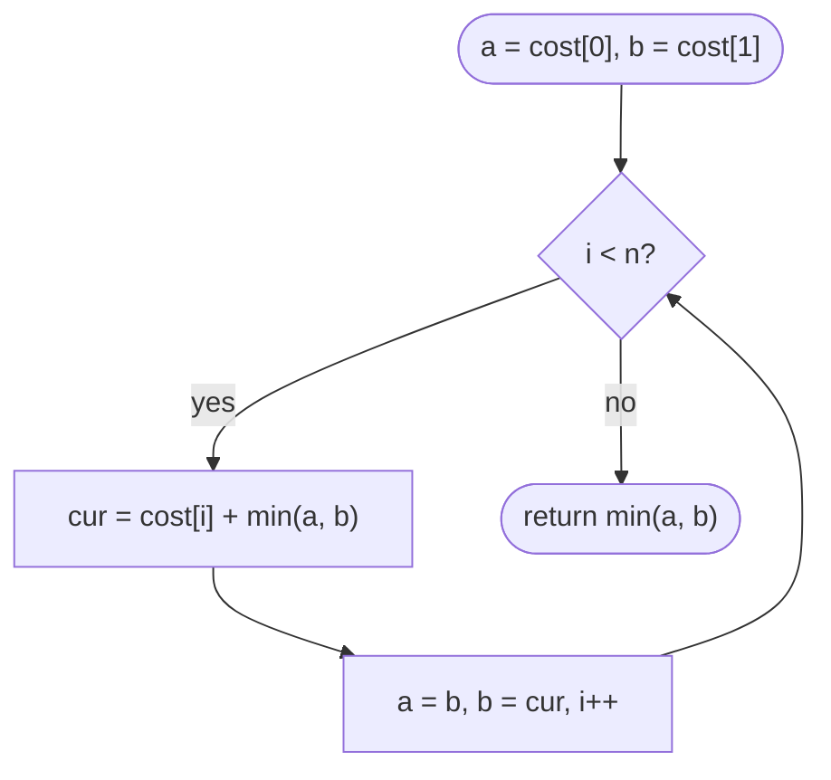

# LC 746 Min Cost Climbing Stairs

> [!abstract] In one sentence
> Define `dp[i]` as the minimum you have paid once you are standing on step i and ready to leave it; then `dp[i] = cost[i] + min(dp[i − 1], dp[i − 2])`, the first two steps are free to stand on, and the top is reached from either of the last two steps.

**Map:** [[NeetCode 150 MOC]] → [[DSA Dashboard]] · Pattern: [[Dynamic Programming]]

> [!question] Predict before you read
> `cost = [10, 15, 20]`. The answer is 15, not 10. Which step do you never stand on, and what does that say about where "the top" is?

## Problem

`cost[i]` is the price of stepping *off* step `i`; once paid you may move 1 or 2 steps up. You can start on step 0 or step 1. Return the minimum total cost to reach the top, which is the floor just beyond the last step.

Example: `[10, 15, 20]` → `15` (start on 1, pay 15, jump two to the top).
Example: `[1, 100, 1, 1, 1, 100, 1, 1, 100, 1]` → `6` (start on 0, then 2, 4, 6, 7, 9, top).

Constraints that matter: 2 ≤ n ≤ 1000, 0 ≤ cost ≤ 999. Sums fit in `int` easily.

## Clarifying questions

1. Is the cost paid when leaving a step or when landing on it? — When leaving (stepping off). Equivalent to paying on arrival as long as the top is free.
2. Where is "the top"? — Index `n`, one past the last element; no cost there.
3. Can I start on step 1 without paying for step 0? — Yes; both starts are free.
4. Must I use both step sizes? — No; any sequence of 1s and 2s.

## Brute force

Recursively try both moves from each start: `go(i) = cost[i] + min(go(i + 1), go(i + 2))` with `go(n) = go(n − 1 or n) = 0` at the top. Exponential, O(2ⁿ), because `go(i)` is recomputed for every path that passes through `i`. With n = 1000 that is unthinkable; memoisation collapses it to n states.

## The key insight

It is [[LC 70 Climbing Stairs]] with `+` replaced by `min` and a cost added. The only design decision is what `dp[i]` means: choose "minimum cost paid to *stand on* step `i`" (not yet having paid `cost[i]`), or "minimum cost paid having *left* step `i`". The second makes the answer `min(dp[n − 1], dp[n − 2])`; the first makes it `dp[n]` with the top as a virtual free step. Either works; pick one and say it aloud. Recognition cue: "minimum cost to reach the end, moves of fixed sizes".

## Optimal approach

Using "cost paid to reach *and be ready to leave* step `i`" = `cost[i]` included:

1. State: `dp[i] = cost[i] + min(dp[i − 1], dp[i − 2])`.
2. Base: `dp[0] = cost[0]`, `dp[1] = cost[1]` (free starts).
3. Answer: `min(dp[n − 1], dp[n − 2])` — the top is reached by a final 1- or 2-step.
4. Space: two variables.



> [!example]- Excalidraw version — the same diagram as an editable canvas
> ![[LC 746 Min Cost Climbing Stairs — Optimal approach.excalidraw]]
> [[LC 746 Min Cost Climbing Stairs — Optimal approach.excalidraw|Open in Excalidraw]] — needs the Excalidraw plugin (see [[Plugins to Install]]).

## Walkthrough

`cost = [1, 100, 1, 1, 1, 100, 1, 1, 100, 1]`.

> [!example] dp[i] = cheapest cost having left step i
> ![[LC 746 Min Cost Climbing Stairs — dp-i- = cheapest cost having left step i.excalidraw]]
> [[LC 746 Min Cost Climbing Stairs — dp-i- = cheapest cost having left step i.excalidraw|Open in Excalidraw]] — answer = min(dp[8], dp[9]) = 6; amber = the steps on the optimal route

%% excalidraw-spec
{"kind": "array", "title": "dp[i] = cheapest cost having left step i", "values": [1, 100, 2, 3, 3, 103, 4, 5, 104, 6], "pointers": {"n-2": 8, "n-1": 9}, "highlight": [0, 2, 4, 6, 7, 9], "caption": "answer = min(dp[8], dp[9]) = 6; amber = the steps on the optimal route"}
%%

| i | cost[i] | dp[i-2] | dp[i-1] | dp[i] |
|---|---|---|---|---|
| 2 | 1 | 1 | 100 | 2 |
| 3 | 1 | 100 | 2 | 3 |
| 4 | 1 | 2 | 3 | 3 |
| 5 | 100 | 3 | 3 | 103 |
| 6 | 1 | 3 | 103 | 4 |
| 9 | 1 | 5 | 104 | 6 |

## Java solution

```java
import java.util.*;

class Solution {
    public int minCostClimbingStairs(int[] cost) {
        int n = cost.length;
        int a = cost[0], b = cost[1];                  // dp[i-2], dp[i-1]: cost paid having left that step
        for (int i = 2; i < n; i++) {
            int cur = cost[i] + Math.min(a, b);        // arrive from i-1 or i-2, then pay to leave i
            a = b;
            b = cur;
        }
        return Math.min(a, b);                         // the top is one step past n-1 or two past n-2
    }
}
```

**Time** O(n) · **Space** O(1)

Top-down from the top, with the "virtual free top step" view:

```java
// snippet
Integer[] memo = new Integer[n + 1];                    // memo[i] = min cost to reach the top from step i
int from(int i) {
    if (i >= n) return 0;                               // standing on the top costs nothing
    if (memo[i] != null) return memo[i];
    return memo[i] = cost[i] + Math.min(from(i + 1), from(i + 2));
}
// answer = Math.min(from(0), from(1)); O(n) time, O(n) space
```

Full table with the top as index `n`:

```java
// snippet
int[] dp = new int[n + 1];                              // dp[i] = min cost to *stand on* i (cost[i] not yet paid)
dp[0] = 0; dp[1] = 0;
for (int i = 2; i <= n; i++)
    dp[i] = Math.min(dp[i - 1] + cost[i - 1], dp[i - 2] + cost[i - 2]);
return dp[n];
```

## Why it works

State: `dp[i]` = minimum cost paid on any route that ends by stepping off `i`. Transition: the route arrived at `i` from `i − 1` or `i − 2`, each with its own optimal sub-cost, and sub-routes are independent (no constraint links an earlier choice to a later one beyond position), so `min` over the two plus `cost[i]` is optimal — optimal substructure. Base: standing on 0 or 1 is free, so `dp[0] = cost[0]`, `dp[1] = cost[1]`. Order: increasing `i`. The top is not a step with a cost, so the answer is the cheaper of leaving from `n − 1` or `n − 2`.

## Edge cases

- `n = 2` — loop skipped; `min(cost[0], cost[1])`.
- All zeros — answer 0.
- A very expensive first step `[999, 0, 0]` — start on 1; answer 0.
- Expensive last step `[0, 0, 999]` — jump over it from step 1; `min(dp[1], dp[2]) = 0`.

## Common mistakes

> [!warning] Pitfalls
> - **Returning `dp[n − 1]`** — forces you to step off the last step; `[0, 0, 999]` would give 999 instead of 0.
> - **Mixing the two state definitions** ("to stand on" versus "having left") — pick one; the base cases and the answer line differ.
> - **Base `dp[1] = cost[0] + cost[1]`** — step 1 is a free start, not reached from step 0.
> - **Loop bound `i <= n`** with the "having left" definition indexes `cost[n]` out of bounds.

## Variants & follow-ups

- Return the route — keep a `choice[i]` (came from `i − 1` or `i − 2`) and walk back.
- Steps of up to k at a time — `dp[i] = cost[i] + min(dp[i − 1..i − k])`, a sliding-window minimum with a monotonic deque for O(n).
- Count the number of cheapest routes — a second array `ways[i]`.
- The count version: [[LC 70 Climbing Stairs]]. Take-or-skip with a gap: [[LC 198 House Robber]].

## Interview script

1. Restate: pay to leave a step, move 1 or 2, free starts at 0 or 1, top is beyond the last step.
2. Brute force: recursion over both moves, exponential.
3. Insight: climbing stairs with min; define `dp[i]` precisely and say where the top is.
4. Approach: two variables, loop from 2, answer `min` of the last two. Mention the memo version.
5. Complexity: O(n) time, O(1) space.
6. Tests: `[10,15,20]`, n = 2, expensive last step.

The interviewer is checking that you state the DP meaning in a full sentence and get the off-by-one at the top right.

## Related

- [[Dynamic Programming]] — the linear-step shape
- [[DP Pattern Catalogue]]
- [[LC 70 Climbing Stairs]] — the count version
- [[LC 198 House Robber]] — take-or-skip with a forced gap
- [[LC 322 Coin Change]] — minimum over several "step sizes"
- [[DSA Patterns in Java]] — memo and table skeletons

## Attempt log

| Date | Result | Minutes | What I got wrong |
|---|---|---|---|
| | | | |

### Mastery checklist
- [ ] Solved without hints in under 25 minutes
- [ ] Stated complexity before coding
- [ ] Handled every edge case above
- [ ] Code compiled first time
- [ ] Can do the follow-up variant (up to k steps with a deque)

## Open questions
- [ ]
