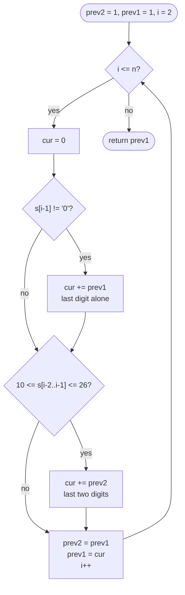

# LC 91 Decode Ways

> [!abstract] In one sentence
> The last letter of any decoding was written either as the last digit alone (legal unless it is `0`) or as the last two digits (legal iff they read 10–26), and the two cases never overlap, so `dp[i] = [s[i-1] != '0'] · dp[i-1] + [10 ≤ s[i-2..i-1] ≤ 26] · dp[i-2]` — climbing stairs with guards.

**Map:** [[NeetCode 150 MOC]] → [[DSA Dashboard]] · Pattern: [[Dynamic Programming]]

> [!question] Predict before you read
> `"226"` has three decodings (BZ, VF, BBF). How many does `"2101"` have? Count them by hand before reading on — a `0` can only live inside a `10` or a `20`.

## Problem

A message of capital letters was encoded by replacing `A..Z` with `1..26` and concatenating the digits. Given the digit string `s`, count how many distinct letter strings could have produced it. A grouping is only valid if every piece is a number from 1 to 26 written without a leading zero.

Example: `"12"` → `2` (`AB`, `L`). Example: `"226"` → `3` (`BZ`, `VF`, `BBF`). Example: `"06"` → `0` — `06` is not a code and `0` on its own is not a letter.

Constraints that matter: 1 ≤ n ≤ 100, digits only, and the tests guarantee the answer fits in a 32-bit `int` (a string of a hundred `1`s would otherwise have fib(101) decodings). The guarantee means you count in `int` without a modulus.

## Clarifying questions

1. Can the string start with `0`? — It can appear in tests; the answer is then 0.
2. Is `0` ever a letter by itself, or can a code have a leading zero (`01`)? — No and no; `0` is legal only as the second digit of `10` or `20`.
3. Do I return the count or the decodings themselves? — The count; listing them is exponential (it is a backtracking problem then).
4. Is the answer guaranteed to fit in an `int`? — Yes, so no modular arithmetic.

## Brute force

Recurse on the position: `decode(i)` tries to consume one digit (if not `0`) and two digits (if 10–26) and adds the two counts. Without memoisation it is O(2ⁿ): `decode(i)` is recomputed once for every way of reaching index `i`, which is itself a fibonacci-sized number. There are only n + 1 distinct calls (`i` from 0 to n), so almost all of that work is repetition.

## The key insight

Condition on how the *last* letter was encoded. Either it is the last digit by itself — legal exactly when that digit is not `0` — or it is the last two digits together — legal exactly when they read 10 to 26. The two cases are disjoint (a decoding ends in a one-digit letter or a two-digit letter, never both) and exhaustive, so the counts add. That makes `dp[i]` depend only on `dp[i-1]` and `dp[i-2]`, the [[LC 70 Climbing Stairs]] recurrence, with the two guards switching each term on or off. Recognition cue: "count the ways" plus a choice of consuming 1 or 2 units at every step, with validity rules on the units.

## Optimal approach

1. State: `dp[i]` = number of decodings of the prefix `s[0..i)`.
2. Base: `dp[0] = 1` (the empty prefix has exactly one decoding: nothing), `dp[1] = 1` unless `s[0] == '0'`, then 0.
3. Transition: `dp[i] = (s[i-1] != '0' ? dp[i-1] : 0) + (10 ≤ value(s[i-2..i-1]) ≤ 26 ? dp[i-2] : 0)`.
4. Order: increasing `i`; only two previous values are read, so keep `prev2`, `prev1`.



> [!example]- Excalidraw version — the same diagram as an editable canvas
> ![[LC 91 Decode Ways — Optimal approach.excalidraw]]
> [[LC 91 Decode Ways — Optimal approach.excalidraw|Open in Excalidraw]] — needs the Excalidraw plugin (see [[Plugins to Install]]).

`dp[0] = 1` is not a convention, it is the reason `"12"` counts the single letter `L`: the two-digit branch at `i = 2` reads `dp[0]`.

## Walkthrough

`"226"`. Positions `i` are prefix lengths, so `dp[3]` is the answer.

> [!example] dp[i] = decodings of the first i digits of 226
> ![[LC 91 Decode Ways — dp-i- = decodings of the first i digits of 226.excalidraw]]
> [[LC 91 Decode Ways — dp-i- = decodings of the first i digits of 226.excalidraw|Open in Excalidraw]] — dp[3] = dp[2] (6 alone) + dp[1] (26 together) = 2 + 1 = 3

%% excalidraw-spec
{"kind": "grid", "title": "dp[i] = decodings of the first i digits of 226", "col_labels": ["i=0 (empty)", "i=1 (2)", "i=2 (22)", "i=3 (226)"], "row_labels": ["dp"], "rows": [ [1, 1, 2, 3] ], "highlight": [ [0, 3] ], "arrows": [ [ [0, 2], [0, 3] ], [ [0, 1], [0, 3] ] ], "caption": "dp[3] = dp[2] (6 alone) + dp[1] (26 together) = 2 + 1 = 3"}
%%

| i | last digit | one-digit legal? | last two digits | two-digit legal? | dp[i] |
|---|---|---|---|---|---|
| 0 | — | — | — | — | 1 |
| 1 | 2 | yes → + dp[0] = 1 | — | — | 1 |
| 2 | 2 | yes → + dp[1] = 1 | 22 | yes → + dp[0] = 1 | 2 |
| 3 | 6 | yes → + dp[2] = 2 | 26 | yes → + dp[1] = 1 | 3 |

For `"2101"` the same table gives `dp = [1, 1, 2, 1, 1]`: at `i = 3` the digit `0` kills the one-digit branch and `10` rescues the two-digit one; at `i = 4` the pair `01` is illegal, so only the single `1` counts. One decoding: `B J A`.

## Java solution

```java
import java.util.*;

class Solution {
    public int numDecodings(String s) {
        int n = s.length();
        if (s.charAt(0) == '0') return 0;             // dp[1] would be 0 and nothing can recover from it
        int prev2 = 1, prev1 = 1;                      // dp[i-2], dp[i-1]; dp[0] = 1 (empty prefix), dp[1] = 1
        for (int i = 2; i <= n; i++) {
            int cur = 0;
            if (s.charAt(i - 1) != '0') cur += prev1;  // last digit alone is a letter 1..9
            int two = (s.charAt(i - 2) - '0') * 10 + (s.charAt(i - 1) - '0');
            if (two >= 10 && two <= 26) cur += prev2;  // last two digits form 10..26 (rules out 01..09)
            prev2 = prev1;
            prev1 = cur;
        }
        return prev1;
    }
}
```

**Time** O(n) · **Space** O(1)

Top-down, which is how you discover the recurrence — the memo is indexed by the suffix start:

```java
// snippet
Integer[] memo;                                        // memo[i] = decodings of s[i..n); null = unknown
int ways(String s, int i) {
    if (i == s.length()) return 1;                     // everything consumed: one complete decoding
    if (s.charAt(i) == '0') return 0;                  // a zero can never start a letter
    if (memo[i] != null) return memo[i];
    int r = ways(s, i + 1);                            // s[i] alone (it is 1..9 here)
    if (i + 1 < s.length() && Integer.parseInt(s.substring(i, i + 2)) <= 26) r += ways(s, i + 2);
    return memo[i] = r;
}
// memo = new Integer[n]; answer = ways(s, 0). O(n) time, O(n) space plus the recursion stack
```

Full table, if the interviewer wants to see `dp[]` on the board:

```java
// snippet
int[] dp = new int[n + 1];
dp[0] = 1;
dp[1] = s.charAt(0) == '0' ? 0 : 1;
for (int i = 2; i <= n; i++) {
    if (s.charAt(i - 1) != '0') dp[i] += dp[i - 1];
    int two = Integer.parseInt(s.substring(i - 2, i));
    if (two >= 10 && two <= 26) dp[i] += dp[i - 2];
}
return dp[n];
```

## Why it works

State: `dp[i]` counts decodings of the length-`i` prefix. Transition: every decoding of the prefix ends with a letter spelled by one digit or by two; stripping that letter leaves a decoding of the prefix of length `i − 1` or `i − 2`, and the map is a bijection onto those shorter decodings whenever the guard holds, so the counts add exactly. Base: `dp[0] = 1`, the empty message. Order: increasing `i`, because each value reads the two before it. There is no "max" here, only a sum, so the question is not optimal substructure but that the two cases partition the set of decodings.

## Edge cases

- `"0"` — the leading-zero check returns 0.
- `"10"` — `dp[2]`: one-digit branch off (`0`), two-digit branch on → 1 (`J`).
- `"100"` — `dp[3]`: `0` alone illegal, `00` illegal → 0, as it should be.
- `"27"` — `27 > 26`, so only the one-digit branch → 1 (`BG`).
- Single digit `"7"` — the loop never runs; returns `prev1 = 1`.
- `"1111111111"` (ten ones) — 89, fibonacci-sized, still `int`.

## Common mistakes

> [!warning] Pitfalls
> - **Treating `0` as a letter** — `"0"` and `"30"` must give 0; the one-digit branch needs `!= '0'`.
> - **Accepting `01`–`09` as two-digit codes** — the check is `10 ≤ two ≤ 26`, not just `two ≤ 26`. Parsing `"06"` gives 6, which passes `≤ 26`.
> - **`dp[0] = 0`** — then `"12"` returns 1 instead of 2; the empty prefix has one decoding.
> - **Indexing `s[i]` when the state is a prefix length** — `dp[i]` reads `s.charAt(i - 1)` and `s.charAt(i - 2)`; mixing the two conventions is the classic off-by-one here.
> - **Forgetting the leading-zero case** in the O(1)-space version: with `prev1` hard-coded to 1 and no check, `"01"` returns 1.

## Variants & follow-ups

- Decode Ways II (LC 639) — `*` stands for any digit 1–9; same recurrence with weighted counts and `mod 1e9+7`.
- Return every decoding — backtracking that builds strings; the count is exponential, so the DP cannot be used.
- Alphabet of size k — the two-digit guard becomes `10 ≤ two ≤ k`; for k ≥ 100 you need a three-digit branch.
- [[LC 139 Word Break]] — the same "cut the last piece" shape, but the pieces are dictionary words of any length.
- [[LC 70 Climbing Stairs]] and [[LC 746 Min Cost Climbing Stairs]] — the guard-free ancestors.

## Interview script

1. Restate: count groupings of the digits into codes 1–26, no leading zeros.
2. Brute force: recurse on one or two digits, exponential because suffixes are recomputed.
3. Insight: the last letter is one digit or two; disjoint cases, so the counts add; `dp[i]` depends on `dp[i-1]` and `dp[i-2]` with guards.
4. Approach: `dp[0] = 1`, loop prefix lengths, two guards, two rolling variables.
5. Complexity: O(n) time, O(1) space.
6. Tests: `"12"`, `"226"`, `"06"`, `"10"`, `"100"`, `"27"`.

The interviewer is checking that you say "`dp[0] = 1`" with a reason, that you state both guards precisely (`!= '0'` and `10..26`), and that you test the zero cases without being prompted.

## Related

- [[Dynamic Programming]] — linear-step shape with validity guards
- [[DP Pattern Catalogue]] — row 1, "linear step"
- [[LC 70 Climbing Stairs]] — the recurrence without guards
- [[LC 746 Min Cost Climbing Stairs]] — same dependency, min instead of sum
- [[LC 139 Word Break]] — segmentation: the piece can be any dictionary word
- [[DSA Patterns in Java]] — memo → table skeleton
- [[Java Collections Cheat Sheet]] — `charAt`, `substring`, `Integer.parseInt`, `c - '0'`

## Attempt log

| Date | Result | Minutes | What I got wrong |
|---|---|---|---|
| | | | |

### Mastery checklist
- [ ] Solved without hints in under 25 minutes
- [ ] Stated complexity before coding
- [ ] Handled every edge case above
- [ ] Code compiled first time
- [ ] Can do the follow-up variant (`*` wildcard with modulus)

## Open questions
- [ ]
