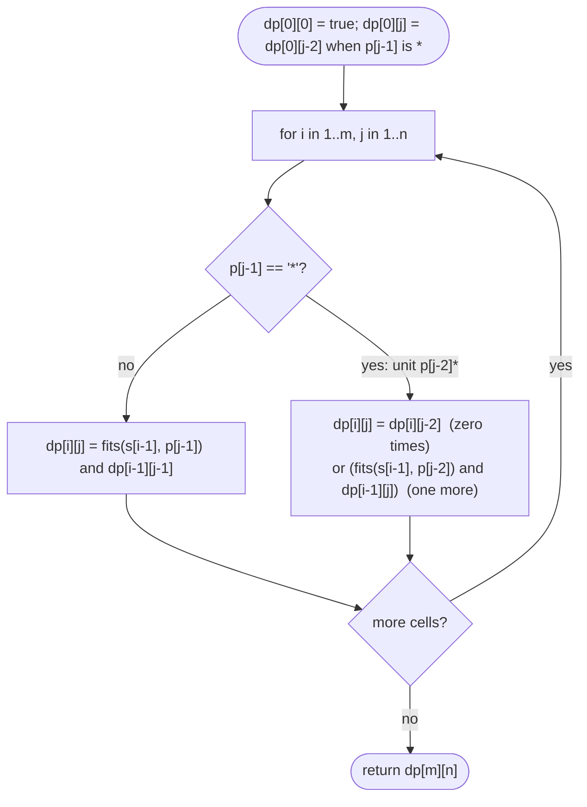

# LC 10 Regular Expression Matching

> [!abstract] In one sentence
> Treat `x*` as one unit with exactly two moves — skip it entirely, or let it swallow one more character when that character fits — and every match question for a text prefix and a pattern prefix reduces to one or two smaller prefix questions, so a boolean table over prefixes decides the whole pattern.

**Map:** [[NeetCode 150 MOC]] → [[DSA Dashboard]] · Pattern: [[2-D Dynamic Programming]]

> [!question] Predict before you read
> `s = "aab"`, `p = "c*a*b"`. `c*` must match zero characters. What are the two things `a*` can do at each step, and which cells of a prefix table would each choice look up?

## Problem

Implement matching of a string `s` against a pattern `p` where `.` matches any single character and `*` matches zero or more of the preceding element. The match must cover the entire `s`.

- `s = "aa"`, `p = "a"` → `false`
- `s = "aa"`, `p = "a*"` → `true`
- `s = "ab"`, `p = ".*"` → `true`
- `s = "aab"`, `p = "c*a*b"` → `true`

Constraints that matter: lengths up to 20 (so even exponential passes, but the DP is what is graded); `*` is always preceded by a valid character; `s` is lowercase letters, `p` lowercase letters plus `.` and `*`.

## Clarifying questions

1. Is `*` guaranteed to have a preceding element? — Yes; `p` never starts with `*` and never has `**`.
2. Does `.*` mean "any sequence"? — Yes: zero or more of any character.
3. Full match, not substring search? — Full match.
4. Can `s` be empty? — Yes; then only patterns that can match zero characters (`a*b*`) succeed.

## Brute force

Recursive matching with backtracking: at `(i, j)`, if `p[j+1] == '*'`, try zero occurrences (`match(i, j+2)`) or, if `s[i]` fits `p[j]`, one more (`match(i+1, j)`); otherwise consume one on each side. Exponential in the number of stars without memoisation. The waste: `(i, j)` pairs repeat; there are only `(m+1)(n+1)`.

## The key insight

Let `dp[i][j]` = whether `s[0..i)` matches `p[0..j)`. Look at the last pattern element. If `p[j−1]` is not a star: match iff `i > 0`, `p[j−1]` fits `s[i−1]` (`.` or equal), and `dp[i−1][j−1]`. If `p[j−1] == '*'`, the unit is `p[j−2]*`: either it matches zero characters — `dp[i][j−2]` — or `s[i−1]` fits `p[j−2]` and the star keeps matching after eating it — `dp[i−1][j]` (note `j`, not `j−2`: the star stays available). The second case elegantly covers "one or more" by repeated application. Base: `dp[0][0] = true`; `dp[0][j] = dp[0][j−2]` when `p[j−1] == '*'` (patterns like `a*b*` match empty), else `false`.

## Optimal approach

1. Allocate `dp[m+1][n+1]`, `dp[0][0] = true`; for `j ≥ 2` with `p[j−1] == '*'`: `dp[0][j] = dp[0][j−2]`.
2. For `i = 1..m`, `j = 1..n`: if `p[j−1] == '*'`: `dp[i][j] = dp[i][j−2] || (fits(s[i−1], p[j−2]) && dp[i−1][j])`; else `dp[i][j] = fits(s[i−1], p[j−1]) && dp[i−1][j−1]`, where `fits(c, q) = q == '.' || q == c`.
3. Return `dp[m][n]`.



> [!example]- Excalidraw version — the same diagram as an editable canvas
> ![[LC 10 Regular Expression Matching — Optimal approach.excalidraw]]
> [[LC 10 Regular Expression Matching — Optimal approach.excalidraw|Open in Excalidraw]] — needs the Excalidraw plugin (see [[Plugins to Install]]).

## Walkthrough

`s = "aab"` (rows), `p = "c*a*b"` (columns):

> [!example] Boolean table for s = aab, p = c*a*b (T = true, F = false)
> ![[LC 10 Regular Expression Matching — Boolean table for s = aab, p = c-a-b (T = true, F = false).excalidraw]]
> [[LC 10 Regular Expression Matching — Boolean table for s = aab, p = c-a-b (T = true, F = false).excalidraw|Open in Excalidraw]] — dp[3][5]: 'b' fits 'b' and dp[2][4] (aa vs c*a*) is true

%% excalidraw-spec
{"kind": "grid", "title": "Boolean table for s = aab, p = c*a*b (T = true, F = false)", "col_labels": ["", "\"\"", "c", "c*", "a", "a*", "b"], "row_labels": ["", "\"\"", "a", "aa", "aab"], "rows": [ ["T", "F", "T", "F", "T", "F"], ["F", "F", "F", "T", "T", "F"], ["F", "F", "F", "F", "T", "F"], ["F", "F", "F", "F", "F", "T"] ], "highlight": [ [4, 6] ], "arrows": [ [ [3, 5], [4, 6] ] ], "caption": "dp[3][5]: 'b' fits 'b' and dp[2][4] (aa vs c*a*) is true"}
%%

Reading `dp[2][4]` (`aa` vs `c*a*`): star unit `a*`; zero times → `dp[2][2]` (`aa` vs `c*`) = F; one more → `a` fits `a` and `dp[1][4]` (`a` vs `c*a*`) = T → T.

## Java solution

```java
import java.util.*;

class Solution {
    public boolean isMatch(String s, String p) {
        int m = s.length(), n = p.length();
        boolean[][] dp = new boolean[m + 1][n + 1];
        dp[0][0] = true;
        for (int j = 2; j <= n; j++) {
            if (p.charAt(j - 1) == '*') dp[0][j] = dp[0][j - 2];      // x* can match the empty string
        }
        for (int i = 1; i <= m; i++) {
            for (int j = 1; j <= n; j++) {
                char pc = p.charAt(j - 1);
                if (pc == '*') {
                    char unit = p.charAt(j - 2);
                    dp[i][j] = dp[i][j - 2]                               // zero occurrences of the unit
                            || (fits(s.charAt(i - 1), unit) && dp[i - 1][j]);   // one more occurrence
                } else {
                    dp[i][j] = fits(s.charAt(i - 1), pc) && dp[i - 1][j - 1];
                }
            }
        }
        return dp[m][n];
    }

    private boolean fits(char c, char q) {
        return q == '.' || q == c;
    }
}
```

**Time** O(mn) · **Space** O(mn), reducible to O(n)

Top-down from the front, the form that mirrors the recursive definition:

```java
// snippet — memoised: does s[i..] match p[j..]?
Boolean[][] memo;
boolean match(String s, String p, int i, int j) {
    if (j == p.length()) return i == s.length();
    if (memo[i][j] != null) return memo[i][j];
    boolean first = i < s.length() && (p.charAt(j) == '.' || p.charAt(j) == s.charAt(i));
    boolean res;
    if (j + 1 < p.length() && p.charAt(j + 1) == '*')
        res = match(s, p, i, j + 2) || (first && match(s, p, i + 1, j));   // zero, or one more
    else
        res = first && match(s, p, i + 1, j + 1);
    return memo[i][j] = res;
}
```

## Why it works

State: whether a text prefix matches a pattern prefix depends on nothing outside those prefixes, because matching proceeds left to right and `*` only refers to its own preceding element. Transition for a non-star element: it must consume exactly the last text character. Transition for a star unit `x*`: in any successful match, the unit matches some count `c ≥ 0` of characters; if `c = 0` the prefix matches without it (`dp[i][j−2]`); if `c ≥ 1`, the last text character is one of those `c` and fits `x`, and the remaining text prefix matches the same pattern prefix with the unit matching `c − 1` characters (`dp[i−1][j]`). Both directions hold, so the disjunction is exact. Base: empty matches empty; a non-empty text never matches an empty pattern; an empty text matches a pattern only if every unit is a star unit matching zero times. Order: row-major; each cell uses `(i, j−2)`, `(i−1, j)`, `(i−1, j−1)`, all earlier.

## Edge cases

- `s = ""`, `p = "a*b*c*"` → true; `p = "a"` → false.
- `p = ".*"` matches anything, including empty.
- `s = "aaa"`, `p = "a*a"` → true (star takes two, the final `a` matches the last).
- `s = "ab"`, `p = ".*c"` → false (must end with `c`).
- `s = "mississippi"`, `p = "mis*is*p*."` → false (classic test).
- Pattern longer than text with trailing star units: `s = "a"`, `p = "ab*"` → true.

## Common mistakes

> [!warning] What goes wrong
> - In the star case using `dp[i−1][j−2]` for "one more": that commits to exactly one occurrence; the correct cell is `dp[i−1][j]` so the star can keep going.
> - Forgetting the `dp[0][j]` row for star units: `a*` must match the empty string.
> - Treating `*` as a standalone wildcard (that is LC 44 Wildcard Matching, where `*` matches any sequence by itself).
> - Checking `fits(s[i−1], p[j−1])` in the star case instead of `fits(s[i−1], p[j−2])` (the unit's character, not the star).
> - Off-by-one between `dp` indices and `charAt` indices.
> - Greedy matching (consume as much as possible) without backtracking: fails on `a*a`.

## Variants & follow-ups

- Wildcard matching (LC 44): `?` single, `*` any sequence: `dp[i][j] = dp[i−1][j] || dp[i][j−1]` for `*`.
- Add `+` (one or more): `dp[i][j] = fits && (dp[i−1][j−1] || dp[i−1][j])` for `x+`.
- Character classes `[abc]`: extend `fits`.
- Return the matched groups: backtracking with recorded choices.
- Streaming / very long `s`: compile to an NFA and simulate with a set of states, O(m·n) time but O(n) space.

## Interview script

Restate: "full match of `s` against `p` with `.` and `x*`, where `*` applies to the preceding element." Brute force: "recursive backtracking: at a star, try zero or one-more; exponential without memo." Insight: "prefix DP; a star unit has two moves — skip it (`dp[i][j−2]`) or eat one more character when it fits (`dp[i−1][j]`, same `j`); a plain element is just the diagonal with a fit check." Approach: "table `(m+1)×(n+1)`, base row for star units matching empty, fill row-major, answer `dp[m][n]`." Complexity: "O(mn) time, O(mn) or O(n) space." Tests: "empty text, `.*`, `a*a`, `mississippi`, pattern longer than text." If they push: "LC 44 changes the star rule to `dp[i−1][j] || dp[i][j−1]`; an NFA simulation gives O(n) space for streaming."

## Related

- Pattern: [[2-D Dynamic Programming]] (boolean string DP), [[DP Pattern Catalogue]]
- Prerequisites: [[LC 72 Edit Distance]], [[LC 115 Distinct Subsequences]] (prefix tables)
- Siblings: [[LC 97 Interleaving String]] (boolean prefix table with two sources)
- Java: [[DSA Patterns in Java]] (2-D DP template), [[Java Pitfalls in Interviews]] (`charAt` off-by-one, `Boolean[][]` memo vs `boolean[][]`)

## Attempt log

| Date | Result | Minutes | What I got wrong |
|---|---|---|---|
| | | | |

### Mastery checklist
- [ ] Solved without hints in under 25 minutes
- [ ] Stated complexity before coding
- [ ] Handled every edge case above
- [ ] Code compiled first time
- [ ] Can do the follow-up variant

## Open questions
- [ ] Prove that `dp[i−1][j]` in the star case covers "two or more" occurrences without a loop. Where does the induction happen?
- [ ] Write LC 44 (wildcard) by changing only the star branch, and explain why its star does not need the `fits` check.
