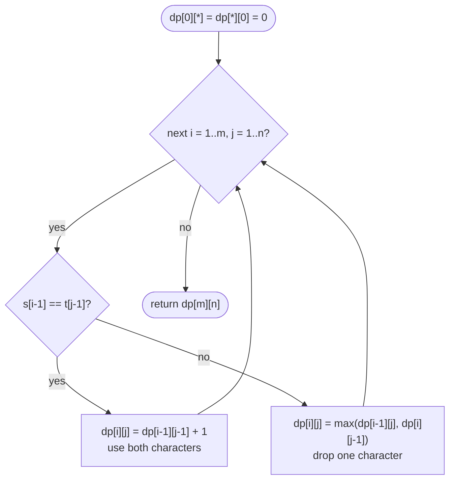

# LC 1143 Longest Common Subsequence

> [!abstract] In one sentence
> Compare the last characters of two prefixes: if they match, they both belong to an optimal common subsequence and the answer is `1 + dp[i − 1][j − 1]`; if not, at least one of them is not in it, so the answer is `max(dp[i − 1][j], dp[i][j − 1])` — a table over prefix pairs with zeros along the top and left.

**Map:** [[NeetCode 150 MOC]] → [[DSA Dashboard]] · Pattern: [[2-D Dynamic Programming]]

> [!question] Predict before you read
> `LCS("abcde", "ace") = 3`. Now take any string `s` and compute `LCS(s, reverse(s))`. What well-known quantity about `s` is that — and why does the diagonal-on-match rule make it work?

## Problem

Given two strings `text1` and `text2`, return the length of their longest common subsequence — a sequence of characters that appears in both strings in the same relative order, not necessarily contiguously. Return 0 if there is none.

Example: `"abcde"`, `"ace"` → `3` (`ace`). Example: `"abc"`, `"abc"` → `3`. Example: `"abc"`, `"def"` → `0`.

Constraints that matter: 1 ≤ lengths ≤ 1000, lowercase letters. A 1001 × 1001 `int` table is 4 MB and 10⁶ cells — fine; the two-row version is the answer to "can you do better on memory".

## Clarifying questions

1. Subsequence, not substring? — Subsequence; characters may be skipped on both sides. (Longest common *substring* is a different table where a mismatch resets to 0.)
2. Length or the subsequence itself? — Length; reconstruction walks the table backwards.
3. Case sensitivity, alphabet? — Lowercase only; only equality is used, so it does not matter.
4. Can either string be empty? — Not by the constraints, but the table's zero row and column handle it anyway.

## Brute force

Enumerate the 2ᵐ subsequences of the shorter string and test each for being a subsequence of the other (O(n) with two pointers): O(2ᵐ · n). Recursion on index pairs `(i, j)` — match → advance both, else try advancing either — is also exponential without a memo, but only `(m + 1)(n + 1)` distinct pairs exist. The waste is recomputing the same pair of suffixes along different paths.

## The key insight

Look at the last characters of the two prefixes. If `s[i − 1] == t[j − 1]`, some optimal common subsequence ends with that character — if an optimal one does not use it, swap its last character for this pair and the length is unchanged — so the answer is `1 + LCS(shorter prefixes)`. If they differ, an optimal common subsequence cannot end with both of them, so at least one can be dropped from consideration: `max(LCS(s minus last, t), LCS(s, t minus last))`. That is three neighbours — diagonal, up, left — and nothing else. Recognition cue: "two strings/sequences", "subsequence", "align", "edit".

## Optimal approach

1. State: `dp[i][j]` = LCS length of `s[0..i)` and `t[0..j)`.
2. Base: `dp[0][j] = dp[i][0] = 0` — an empty prefix shares nothing.
3. Transition: match → `dp[i − 1][j − 1] + 1`; else `max(dp[i − 1][j], dp[i][j − 1])`.
4. Order: `i` outer, `j` inner, both increasing; each cell needs the row above and the cell to its left.
5. Answer: `dp[m][n]`.



> [!example]- Excalidraw version — the same diagram as an editable canvas
> ![[LC 1143 Longest Common Subsequence — Optimal approach.excalidraw]]
> [[LC 1143 Longest Common Subsequence — Optimal approach.excalidraw|Open in Excalidraw]] — needs the Excalidraw plugin (see [[Plugins to Install]]).

On a match you do *not* also take the max with up and left — they can never exceed the diagonal + 1, and checking them only hides your understanding.

## Walkthrough

`s = "abcde"` (rows), `t = "ace"` (columns).

> [!example] LCS table for abcde (rows) and ace (columns)
> ![[LC 1143 Longest Common Subsequence — LCS table for abcde (rows) and ace (columns).excalidraw]]
> [[LC 1143 Longest Common Subsequence — LCS table for abcde (rows) and ace (columns).excalidraw|Open in Excalidraw]] — matches e/e, c/c, a/a each step diagonally and add 1; mismatches copy the larger of up and left

%% excalidraw-spec
{"kind": "grid", "title": "LCS table for abcde (rows) and ace (columns)", "col_labels": ["", "a", "c", "e"], "row_labels": ["", "a", "b", "c", "d", "e"], "rows": [ [0, 0, 0, 0], [0, 1, 1, 1], [0, 1, 1, 1], [0, 1, 2, 2], [0, 1, 2, 2], [0, 1, 2, 3] ], "highlight": [ [5, 3] ], "arrows": [ [ [4, 2], [5, 3] ], [ [2, 1], [3, 2] ], [ [0, 0], [1, 1] ] ], "caption": "matches e/e, c/c, a/a each step diagonally and add 1; mismatches copy the larger of up and left"}
%%

Reading the table: row `b` equals row `a` because `b` matches nothing in `ace`; the 2 first appears at `(c, c)` and spreads right; the final 3 at `(e, e)` is `dp[4][2] + 1`. Walking back from `(5, 3)` along diagonals on matches and towards the larger neighbour on mismatches spells `e`, `c`, `a` — the subsequence reversed.

| cell | characters | rule | value |
|---|---|---|---|
| (1, 1) | a / a | diagonal + 1 | 1 |
| (3, 2) | c / c | diagonal + 1 = dp[2][1] + 1 | 2 |
| (3, 3) | c / e | max(dp[2][3] = 1, dp[3][2] = 2) | 2 |
| (5, 3) | e / e | diagonal + 1 = dp[4][2] + 1 | 3 |

## Java solution

```java
import java.util.*;

class Solution {
    public int longestCommonSubsequence(String text1, String text2) {
        int m = text1.length(), n = text2.length();
        int[][] dp = new int[m + 1][n + 1];                       // dp[i][j] = LCS of text1[0..i) and text2[0..j); row/col 0 stay 0
        for (int i = 1; i <= m; i++) {
            for (int j = 1; j <= n; j++) {
                if (text1.charAt(i - 1) == text2.charAt(j - 1)) {
                    dp[i][j] = dp[i - 1][j - 1] + 1;              // both last characters join the subsequence
                } else {
                    dp[i][j] = Math.max(dp[i - 1][j], dp[i][j - 1]);   // drop one of the two last characters
                }
            }
        }
        return dp[m][n];
    }
}
```

**Time** O(m · n) · **Space** O(m · n)

Top-down, memo on the pair of prefix lengths — the recurrence written as it was discovered:

```java
// snippet
int[][] memo;                                                     // memo[i][j] = LCS of s[i..) and t[j..); -1 = unknown
int lcs(String s, String t, int i, int j) {
    if (i == s.length() || j == t.length()) return 0;
    if (memo[i][j] != -1) return memo[i][j];
    int r = s.charAt(i) == t.charAt(j)
          ? 1 + lcs(s, t, i + 1, j + 1)
          : Math.max(lcs(s, t, i + 1, j), lcs(s, t, i, j + 1));
    return memo[i][j] = r;
}
// memo = new int[m][n] filled with -1; answer = lcs(s, t, 0, 0). O(m · n) time and space; depth up to m + n = 2000
```

Two rows, O(min(m, n)) space — put the shorter string on the columns:

```java
// snippet
int[] prev = new int[n + 1], cur = new int[n + 1];                // prev = row i-1, cur = row i
for (int i = 1; i <= m; i++) {
    for (int j = 1; j <= n; j++) {
        cur[j] = text1.charAt(i - 1) == text2.charAt(j - 1) ? prev[j - 1] + 1 : Math.max(prev[j], cur[j - 1]);
    }
    int[] tmp = prev; prev = cur; cur = tmp;                     // swap, do not allocate; cur's stale values are all overwritten
}
return prev[n];                                                   // O(m · n) time, O(n) space
```

## Why it works

State: `dp[i][j]` is the exact LCS length of the two prefixes. Transition: when the last characters match, an optimal common subsequence can be assumed to end with them (exchange argument), so `dp[i][j] = dp[i − 1][j − 1] + 1`; when they differ, any common subsequence of the prefixes omits at least one of the two last characters and is therefore a common subsequence of one of the shortened pairs, so the max of the two is both an upper bound and achievable. Base: zeros. Order: row-major, since each cell reads `(i − 1, j − 1)`, `(i − 1, j)`, `(i, j − 1)` — all earlier.

## Edge cases

- Identical strings — the diagonal fills with 1, 2, 3, …; answer `m`.
- Disjoint alphabets — every cell is `max(0, 0) = 0`.
- One string is a subsequence of the other — answer is its length.
- Repeated characters `"aaaa"`, `"aa"` — 2; the diagonal rule never double-counts because each match consumes one character from each side.
- Maximum sizes 1000 × 1000 — 10⁶ cells, well within limits; the recursive version is near the comfortable stack depth and is the one to avoid in production.

## Common mistakes

> [!warning] Pitfalls
> - **Indexing `s.charAt(i)` with a prefix-length `i`** — the cell `(i, j)` compares `charAt(i − 1)` and `charAt(j − 1)`.
> - **Taking `max` of all three on a match** — correct but signals you do not know the diagonal dominates.
> - **Confusing with longest common substring** — substring resets to 0 on mismatch and takes the global max; subsequence carries the max forward.
> - **Two-row version reading `cur[j − 1]` from the wrong row** — left neighbour is in the *current* row, up and diagonal in the previous one.
> - **Memo default 0 used as "unknown"** — 0 is a real answer; fill with −1 or use `Integer[][]`.
> - **Swapping the strings and then returning `dp[n][m]` from the wrong array** — after swapping, be consistent about which is rows.

## Variants & follow-ups

- Print the subsequence — walk back from `(m, n)`: diagonal on a match, else move to the larger of up/left; O(m + n) after the table.
- Longest palindromic subsequence (LC 516) — `LCS(s, reverse(s))`.
- Shortest common supersequence (LC 1092) — `m + n − LCS`, with the reconstruction interleaving the unmatched characters.
- Minimum deletions to make the strings equal (LC 583) — `m + n − 2 · LCS`.
- Weighted edits — [[LC 72 Edit Distance]] replaces "drop one" with costed insert/delete/replace.
- Counting rather than optimising — [[LC 115 Distinct Subsequences]] sums the branches instead of taking the max.
- Hirschberg's algorithm — O(min(m, n)) space *with* reconstruction, by divide and conquer on the middle row; name it, do not code it.

## Interview script

1. Restate: longest subsequence common to both strings, order preserved, gaps allowed.
2. Brute force: all subsequences of one string, exponential.
3. Insight: compare last characters; match → diagonal + 1; mismatch → max of dropping either.
4. Approach: `(m + 1) × (n + 1)` table with a zero border, row-major fill, return the corner; offer two rows for O(n) space.
5. Complexity: O(m · n) time, O(m · n) or O(min(m, n)) space.
6. Tests: `abcde/ace`, identical, disjoint, `aaaa/aa`.

The interviewer is checking that you can argue the exchange step on a match, that you explain why a mismatch only needs two neighbours, and that you can reconstruct the subsequence or reduce the space when asked.

## Related

- [[2-D Dynamic Programming]] — two-sequence alignment section
- [[DP Pattern Catalogue]] — row 10
- [[LC 72 Edit Distance]] — same cells, costs instead of lengths
- [[LC 115 Distinct Subsequences]] — same cells, counting instead of max
- [[LC 97 Interleaving String]] — same table, boolean with a third string
- [[LC 300 Longest Increasing Subsequence]] — the one-sequence cousin
- [[DSA Patterns in Java]] — 2-D DP skeleton and two-row trick
- [[Java Collections Cheat Sheet]] — `charAt`, `StringBuilder.reverse` for the palindrome variant

## Attempt log

| Date | Result | Minutes | What I got wrong |
|---|---|---|---|
| | | | |

### Mastery checklist
- [ ] Solved without hints in under 25 minutes
- [ ] Stated complexity before coding
- [ ] Handled every edge case above
- [ ] Code compiled first time
- [ ] Can do the follow-up variant (reconstruct the subsequence; two-row space)

## Open questions
- [ ]
