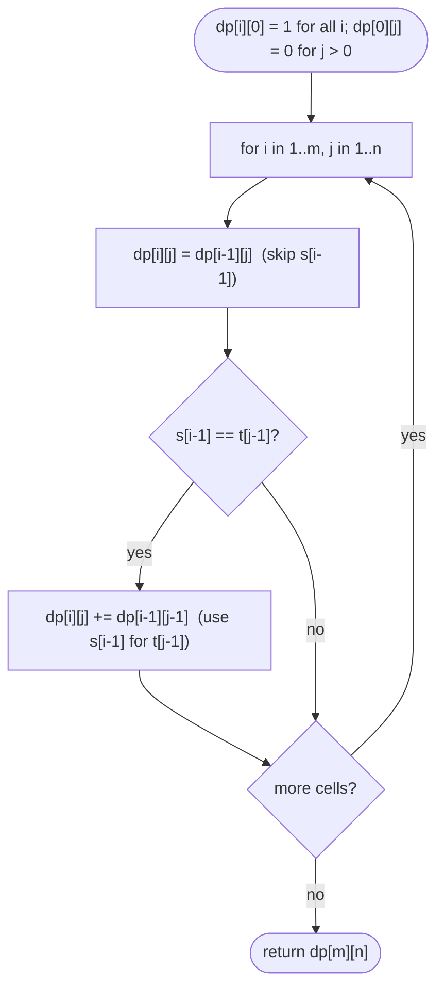

# LC 115 Distinct Subsequences

> [!abstract] In one sentence
> For each character of `s` you either skip it or, if it equals the next needed character of `t`, use it; counting both choices at every prefix pair turns the exponential enumeration of subsequences into an `(m+1)×(n+1)` table of sums — the same grid as edit distance, but with addition and a "one way to match nothing" base case.

**Map:** [[NeetCode 150 MOC]] → [[DSA Dashboard]] · Pattern: [[2-D Dynamic Programming]]

> [!question] Predict before you read
> `s = "bbb"`, `t = "bb"`. How many distinct index choices in `s` spell `t`? Now think about which cells of a prefix table would hold 1, 2 and 3, and why "skip" and "use" never double-count a choice.

## Problem

Given strings `s` and `t`, return the number of distinct subsequences of `s` that equal `t` (a subsequence keeps relative order and deletes some characters; two subsequences are distinct if they use different index sets).

- `s = "rabbbit"`, `t = "rabbit"` → `3`
- `s = "babgbag"`, `t = "bag"` → `5`
- `s = "abc"`, `t = ""` → `1` (the empty subsequence)

Constraints that matter: lengths up to 1000, so O(mn) = 10⁶ cells; the answer fits in a 32-bit signed integer by the problem's promise, but intermediate cells might not without care — use `long` or trust the promise and say so.

## Clarifying questions

1. Distinct by index set, not by resulting string? — By index set (the resulting strings are all equal to `t` anyway).
2. Empty `t`? — Exactly one way (choose nothing).
3. `t` longer than `s`? — Zero ways.
4. Overflow? — The statement guarantees the final answer fits in `int`; intermediate values are bounded by the final answer's monotone growth along a row, so `int` is safe here, but `long` costs nothing.

## Brute force

Enumerate all `2^m` subsequences of `s` and count those equal to `t`. Or recursion `count(i, j)` = ways to match `t[j..]` inside `s[i..]`: skip `s[i]` always, use it when `s[i] == t[j]` — exponential without memo. The waste: `(i, j)` pairs repeat enormously; there are only `(m+1)(n+1)` of them.

## The key insight

Let `dp[i][j]` = number of subsequences of `s[0..i)` equal to `t[0..j)`. The last character of the `s`-prefix, `s[i−1]`, is either not used — contributing `dp[i−1][j]` — or used as the match for `t[j−1]`, which is only possible when `s[i−1] == t[j−1]` and contributes `dp[i−1][j−1]`. These two cases are disjoint (different index sets) and exhaustive, so `dp[i][j] = dp[i−1][j] + (s[i−1] == t[j−1] ? dp[i−1][j−1] : 0)`. Base: `dp[i][0] = 1` (one way to pick nothing), `dp[0][j] = 0` for `j > 0`.

## Optimal approach

1. If `n > m` return 0 (optional shortcut).
2. Allocate `dp[m+1][n+1]`; set `dp[i][0] = 1` for all `i`.
3. For `i = 1..m`, `j = 1..n`: `dp[i][j] = dp[i−1][j]`; if `s[i−1] == t[j−1]` add `dp[i−1][j−1]`.
4. Return `dp[m][n]`.
5. Space: one row of `n+1`, iterating `j` from right to left so `dp[i−1][j−1]` is still the old value when read.



> [!example]- Excalidraw version — the same diagram as an editable canvas
> ![[LC 115 Distinct Subsequences — Optimal approach.excalidraw]]
> [[LC 115 Distinct Subsequences — Optimal approach.excalidraw|Open in Excalidraw]] — needs the Excalidraw plugin (see [[Plugins to Install]]).

## Walkthrough

`s = "babgbag"` (rows), `t = "bag"` (columns):

> [!example] Counting table for s = babgbag, t = bag
> ![[LC 115 Distinct Subsequences — Counting table for s = babgbag, t = bag.excalidraw]]
> [[LC 115 Distinct Subsequences — Counting table for s = babgbag, t = bag.excalidraw|Open in Excalidraw]] — dp[7][3] = dp[6][3] (skip the last g) + dp[6][2] (use it) = 1 + 4 = 5

%% excalidraw-spec
{"kind": "grid", "title": "Counting table for s = babgbag, t = bag", "col_labels": ["", "\"\"", "b", "a", "g"], "row_labels": ["", "\"\"", "b", "a", "b", "g", "b", "a", "g"], "rows": [ [1, 0, 0, 0], [1, 1, 0, 0], [1, 1, 1, 0], [1, 2, 1, 0], [1, 2, 1, 1], [1, 3, 1, 1], [1, 3, 4, 1], [1, 3, 4, 5] ], "highlight": [ [8, 4] ], "arrows": [ [ [7, 4], [8, 4] ], [ [7, 3], [8, 4] ] ], "caption": "dp[7][3] = dp[6][3] (skip the last g) + dp[6][2] (use it) = 1 + 4 = 5"}
%%

Reading `dp[6][2]` (`babgba` vs `ba`) = 4: the four index pairs `(0,1)`, `(0,5)`, `(2,5)`, `(4,5)`.

## Java solution

```java
import java.util.*;

class Solution {
    public int numDistinct(String s, String t) {
        int m = s.length(), n = t.length();
        if (n > m) return 0;
        long[][] dp = new long[m + 1][n + 1];               // long: counts add up fast
        for (int i = 0; i <= m; i++) dp[i][0] = 1;          // one way to form the empty t: pick nothing
        for (int i = 1; i <= m; i++) {
            for (int j = 1; j <= n; j++) {
                dp[i][j] = dp[i - 1][j];                    // s[i-1] not used
                if (s.charAt(i - 1) == t.charAt(j - 1)) {
                    dp[i][j] += dp[i - 1][j - 1];           // s[i-1] used to match t[j-1]
                }
            }
        }
        return (int) dp[m][n];
    }
}
```

**Time** O(mn) · **Space** O(mn), reducible to O(n)

Top-down, which many find easier to derive at the whiteboard:

```java
// snippet — memoised recursion: ways to match t[j..] inside s[i..]
Long[][] memo;
long ways(String s, String t, int i, int j) {
    if (j == t.length()) return 1;                       // t exhausted: one way (done)
    if (i == s.length()) return 0;                       // s exhausted first: no way
    if (memo[i][j] != null) return memo[i][j];
    long r = ways(s, t, i + 1, j);                       // skip s[i]
    if (s.charAt(i) == t.charAt(j)) r += ways(s, t, i + 1, j + 1);   // use s[i]
    return memo[i][j] = r;
}
```

One-row version — iterate `j` from right to left so the diagonal is read before it is overwritten:

```java
// snippet — O(n) space
long[] row = new long[n + 1]; row[0] = 1;
for (int i = 1; i <= m; i++)
    for (int j = n; j >= 1; j--)                          // right to left: row[j-1] is still dp[i-1][j-1]
        if (s.charAt(i - 1) == t.charAt(j - 1)) row[j] += row[j - 1];
return (int) row[n];
```

## Why it works

State: the count for a prefix pair depends only on the prefixes, since a subsequence of `s[0..i)` equal to `t[0..j)` is determined by its index set inside that prefix. Transition: partition the index sets by whether they contain index `i−1`. Sets without it are exactly the subsequences of `s[0..i−1)` equal to `t[0..j)` (`dp[i−1][j]`); sets with it must use `i−1` as the match for `t[j−1]` (the last needed character, because order is preserved), possible only when the characters agree, and the remaining indices form a subsequence of `s[0..i−1)` equal to `t[0..j−1)` (`dp[i−1][j−1]`). The partition is disjoint and exhaustive, so the counts add. Base: the empty target is matched exactly once (empty index set); a non-empty target cannot be matched by an empty source. Order: row by row, `j` increasing (table) or decreasing (single row).

## Edge cases

- `t` empty → 1.
- `s` empty, `t` non-empty → 0.
- `t` longer than `s` → 0 (shortcut or falls out of the table).
- All characters equal (`s = "aaaa"`, `t = "aa"`) → `C(4, 2) = 6`: the table computes binomials.
- No matching characters → 0 everywhere except column 0.
- `s == t` → 1.

## Common mistakes

> [!warning] What goes wrong
> - Base case `dp[0][0] = 1` only, forgetting `dp[i][0] = 1` for every `i`: the first column must be all ones.
> - Writing `dp[i][j] = dp[i−1][j−1]` in the match case instead of *adding* it to the skip count — that is the LCS/edit-distance reflex, and it undercounts.
> - In the one-row version iterating `j` left to right: `row[j−1]` has already become `dp[i][j−1]`, double counting.
> - `int` overflow in intermediate cells on adversarial inputs: use `long`, or rely on the statement's guarantee and say you are relying on it.
> - Confusing "distinct subsequences" (index sets) with "distinct resulting strings".

## Variants & follow-ups

- Number of distinct subsequences of `s` (any), LC 940: `dp[i] = 2·dp[i−1] − dp[last[c]−1]`.
- Is `t` a subsequence of `s` (LC 392): two pointers, no DP.
- Count subsequences modulo `10⁹ + 7`: add `% MOD` after each addition.
- Minimum deletions to make `s` equal `t` as a subsequence: `m − n` if possible, else impossible.
- Count matches with wildcards in `t`: extend the match condition, as in [[LC 10 Regular Expression Matching]].

## Interview script

Restate: "count index-distinct subsequences of `s` that spell `t`." Brute force: "enumerate `2^m` subsequences, or recurse skip/use without memo — exponential." Insight: "prefix table: the last character of `s` is either skipped — inherit `dp[i−1][j]` — or, if it equals the last needed character, used — add `dp[i−1][j−1]`; the two cases are disjoint, so the counts add." Approach: "first column all ones, fill row by row, answer `dp[m][n]`; one row with right-to-left `j` if space matters; `long` for safety." Complexity: "O(mn) time, O(n) space." Tests: "empty `t`, `t` longer than `s`, all-equal characters (binomial), no matches." If they push: "modular counting is a one-line change; LC 392 is the boolean version with two pointers."

## Related

- Pattern: [[2-D Dynamic Programming]] (string DP, counting), [[DP Pattern Catalogue]]
- Prerequisites: [[LC 1143 Longest Common Subsequence]] (prefix-pair tables), [[LC 72 Edit Distance]]
- Siblings: [[LC 10 Regular Expression Matching]] (boolean prefix table with special characters), [[LC 97 Interleaving String]]
- Java: [[DSA Patterns in Java]] (2-D DP and the right-to-left row trick), [[Java Pitfalls in Interviews]] (`long` for counts)

## Attempt log

| Date | Result | Minutes | What I got wrong |
|---|---|---|---|
| | | | |

### Mastery checklist
- [ ] Solved without hints in under 25 minutes
- [ ] Stated complexity before coding
- [ ] Handled every edge case above
- [ ] Code compiled first time
- [ ] Can do the follow-up variant

## Open questions
- [ ] For `s = "aaaa"`, `t = "aa"`, show that the table reproduces Pascal's triangle. Which cell is `C(4, 2)`?
- [ ] Why does the one-row trick need right-to-left for this problem but left-to-right for unbounded knapsack ([[LC 518 Coin Change II]])?
