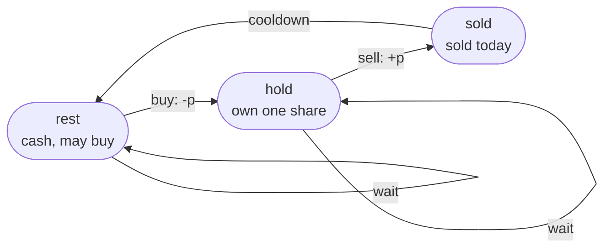

# LC 309 Best Time to Buy and Sell Stock with Cooldown

> [!abstract] In one sentence
> Model the trader as a machine with three modes — `hold` (own a share), `sold` (sold today, locked out tomorrow), `rest` (cash, free to buy) — and carry the best balance per mode day by day; each mode's new value reads only yesterday's values, so three variables replace a `days × modes` table.

**Map:** [[NeetCode 150 MOC]] → [[DSA Dashboard]] · Pattern: [[2-D Dynamic Programming]]

> [!question] Predict before you read
> Prices `[1, 2, 3, 0, 2]`. Without a cooldown the best profit is 4 (buy 1 sell 3, buy 0 sell 2). With a one-day cooldown after every sale the answer is 3. Which trade has to change, and why does selling *earlier* at 2 beat selling at 3?

## Problem

You are given daily prices. You may hold at most one share at a time, buy and sell as many times as you like, but after selling you must wait one day before buying again (the cooldown). Return the maximum profit.

Example: `[1, 2, 3, 0, 2]` → `3` (buy 1, sell 2, cooldown, buy 0, sell 2). Example: `[1]` → `0`.

Constraints that matter: 1 ≤ n ≤ 5000, 0 ≤ price ≤ 1000. Profit fits in `int` comfortably; n = 5000 makes a recursive memo close to the stack-depth zone, so the iterative state machine is the version to write.

## Clarifying questions

1. Can I buy and sell on the same day? — Buying then selling the same day earns 0 and is pointless; the model does not need it.
2. Is the cooldown exactly one day, after every sale? — Yes; after selling on day `i` the earliest buy is day `i + 2`.
3. At most one share at a time? — Yes; you must sell before buying again.
4. Can I end holding a share? — Allowed but never optimal; the answer takes the max of the two cash modes.

## Brute force

Try every sequence of actions: each day buy, sell, or do nothing subject to the rules — 3ⁿ sequences. A recursion `best(day, holding)` already compresses that to O(n · 2) *states*, but without a memo it still branches at every day and revisits `(day, holding)` exponentially often. The memo is the DP; the state machine is the memo made explicit.

## The key insight

The future depends only on today's mode, not on the history of trades. There are three modes worth distinguishing: holding a share, having sold today (tomorrow is a forced rest), and resting with cash. Each mode's best balance on day `i` comes from a fixed set of (mode on day `i − 1`, action) pairs: you hold today because you held yesterday or you bought today from `rest`; you are in `sold` because you held yesterday and sold today; you `rest` because you rested yesterday or sold yesterday. Those three equations are the whole algorithm. The cooldown is encoded by the fact that `hold` is reachable only from `rest`, never from `sold`. Recognition cue: "cooldown", "transaction fee", "at most k transactions" — a per-day rule that depends on what you did last.

## Optimal approach

1. State: `hold[i]`, `sold[i]`, `rest[i]` = best balance at the end of day `i` in that mode.
2. Base (day 0): `hold = −prices[0]`, `sold = 0` (impossible, but 0 is harmless because it only feeds `rest`), `rest = 0`.
3. Transition for price `p` on day `i`:
   `hold = max(hold, rest − p)` · `sold = hold_prev + p` · `rest = max(rest, sold_prev)` — all right-hand sides use day `i − 1` values.
4. Order: increasing day; keep the three previous values in locals before updating.
5. Answer: `max(sold, rest)` on the last day.



> [!example]- Excalidraw version — the same diagram as an editable canvas
> ![[LC 309 Best Time to Buy and Sell Stock with Cooldown — Optimal approach.excalidraw]]
> [[LC 309 Best Time to Buy and Sell Stock with Cooldown — Optimal approach.excalidraw|Open in Excalidraw]] — needs the Excalidraw plugin (see [[Plugins to Install]]).

The missing edge `sold → hold` *is* the cooldown. Add it back and you have the no-cooldown problem; charge a fee on the `sell` edge and you have LC 714.

## Walkthrough

`[1, 2, 3, 0, 2]`, best balance per mode per day.

> [!example] Best balance per mode for prices 1, 2, 3, 0, 2
> ![[LC 309 Best Time to Buy and Sell Stock with Cooldown — Best balance per mode for prices 1, 2, 3, 0, 2.excalidraw]]
> [[LC 309 Best Time to Buy and Sell Stock with Cooldown — Best balance per mode for prices 1, 2, 3, 0, 2.excalidraw|Open in Excalidraw]] — sold on day 4 = hold on day 3 + 2 = 3; that hold came from rest on day 2, which came from the sale on day 1

%% excalidraw-spec
{"kind": "grid", "title": "Best balance per mode for prices 1, 2, 3, 0, 2", "col_labels": ["p=1", "p=2", "p=3", "p=0", "p=2"], "row_labels": ["hold", "sold", "rest"], "rows": [ [-1, -1, -1, 1, 1], [0, 1, 2, -1, 3], [0, 0, 1, 2, 2] ], "highlight": [ [1, 4] ], "arrows": [ [ [0, 3], [1, 4] ], [ [2, 2], [0, 3] ], [ [1, 1], [2, 2] ] ], "caption": "sold on day 4 = hold on day 3 + 2 = 3; that hold came from rest on day 2, which came from the sale on day 1"}
%%

| day | p | hold = max(hold, rest − p) | sold = hold_prev + p | rest = max(rest, sold_prev) |
|---|---|---|---|---|
| 0 | 1 | −1 (buy) | 0 (placeholder) | 0 |
| 1 | 2 | max(−1, 0 − 2) = −1 | −1 + 2 = 1 | max(0, 0) = 0 |
| 2 | 3 | max(−1, 0 − 3) = −1 | −1 + 3 = 2 | max(0, 1) = 1 |
| 3 | 0 | max(−1, 1 − 0) = 1 | −1 + 0 = −1 | max(1, 2) = 2 |
| 4 | 2 | max(1, 2 − 2) = 1 | 1 + 2 = 3 | max(2, −1) = 2 |

The `sold = 2` on day 2 (sell at 3) is real, but it leads to `rest = 2` on day 3 and nothing better; the path that wins sells at 2, rests on day 2, buys at 0 on day 3 using `rest = 1`, and sells at 2.

## Java solution

```java
import java.util.*;

class Solution {
    public int maxProfit(int[] prices) {
        int hold = -prices[0];                       // own a share bought on day 0
        int sold = 0;                                // "sold today" is impossible on day 0; 0 only ever feeds rest
        int rest = 0;                                // cash, allowed to buy
        for (int i = 1; i < prices.length; i++) {
            int p = prices[i];
            int prevHold = hold, prevSold = sold, prevRest = rest;   // all transitions read yesterday's values
            hold = Math.max(prevHold, prevRest - p);                 // keep holding, or buy today (only from rest: the cooldown)
            sold = prevHold + p;                                     // sell today
            rest = Math.max(prevRest, prevSold);                     // keep resting, or finish the cooldown after a sale
        }
        return Math.max(sold, rest);                 // ending while holding a share is never better
    }
}
```

**Time** O(n) · **Space** O(1)

Top-down, with the cooldown expressed as "skip a day after selling" — memo on `(day, holding)`:

```java
// snippet
Integer[][] memo;                                     // memo[i][h] = best profit from day i on, h = 1 if holding; null = unknown
int best(int[] p, int i, int holding) {
    if (i >= p.length) return 0;
    if (memo[i][holding] != null) return memo[i][holding];
    int skip = best(p, i + 1, holding);               // do nothing today
    int act = holding == 1
            ? p[i] + best(p, i + 2, 0)                // sell, then the cooldown day is jumped over
            : -p[i] + best(p, i + 1, 1);              // buy
    return memo[i][holding] = Math.max(skip, act);
}
// memo = new Integer[n][2]; answer = best(prices, 0, 0). O(n) time, O(n) space, recursion depth up to n = 5000
```

Full table, which is the `days × modes` grid above as arrays:

```java
// snippet
int[] hold = new int[n], sold = new int[n], rest = new int[n];
hold[0] = -prices[0];
for (int i = 1; i < n; i++) {
    hold[i] = Math.max(hold[i - 1], rest[i - 1] - prices[i]);
    sold[i] = hold[i - 1] + prices[i];
    rest[i] = Math.max(rest[i - 1], sold[i - 1]);
}
return Math.max(sold[n - 1], rest[n - 1]);           // O(n) time, O(n) space; each row reads only the previous row
```

## Why it works

State: for each day and mode, the maximum balance over all legal action sequences ending in that mode. Transition: the legal predecessors of each mode are exactly the edges of the machine — `hold` from `hold` (wait) or `rest` (buy), `sold` from `hold` (sell), `rest` from `rest` (wait) or `sold` (cooldown over) — and the best sequence into a mode is the best sequence into a predecessor plus one action, so the max over predecessors is exact. Base: day 0 values. Order: increasing day, since each row reads only the previous row. Optimality of ending in cash: a final `hold` balance is `rest − p ≤ rest`, so `max(sold, rest)` covers it.

## Edge cases

- One day — loop never runs, returns `max(0, 0) = 0`.
- Strictly decreasing prices — `hold` improves (cheaper buys) but `sold` stays ≤ 0; answer 0.
- Two days `[1, 2]` — `sold = 1`, answer 1.
- `[2, 1, 4]` — buy at 1 not 2 (`hold` takes `rest − 1 = −1`), sell at 4 → 3.
- Prices containing 0 — buying at 0 is free; the table handles it, no special case.
- Cooldown making a trade impossible, `[1, 2, 1, 2]` — sell at day 1, rest day 2, cannot buy day 2's 1; answer is 1, not 2.

## Common mistakes

> [!warning] Pitfalls
> - **Updating `hold` and then using the new `hold` in `sold`** — that sells a share bought the same day. Snapshot yesterday's values first.
> - **Letting `hold` read from `sold`** — removes the cooldown; `[1, 2, 1, 2]` returns 2.
> - **Two modes only (`hold` / `cash`) with `cash` reading from `hold` of the previous day** — the cooldown needs the `sold` mode or the `i + 2` jump; two modes cannot express "sold yesterday".
> - **Initialising `sold` to `Integer.MIN_VALUE` and then adding to it** — overflow. The 0 placeholder is safe because the only reader is `rest[1] = max(rest[0], sold[0])` and `rest[0]` is already 0, so the fake value never wins a max.
> - **Returning `rest` only** — if the last action is a sale, `sold` holds the answer.
> - **Greedy "sell whenever the price rises"** — ignores the lock-out; the example shows it can be wrong.

## Variants & follow-ups

- No cooldown, unlimited trades (LC 122) — two modes; greedy sum of positive deltas also works.
- Transaction fee (LC 714) — subtract the fee on the sell edge; two modes suffice.
- At most k transactions (LC 188) — add a dimension for transactions used: `dp[i][k][mode]`.
- One transaction only — [[LC 121 Best Time to Buy and Sell Stock]], a running minimum.
- Cooldown of c days — `hold` reads `rest` from `c` days back, or keep a window of `sold` values.
- Same "mode per index" shape without money — [[LC 198 House Robber]] is a two-mode machine (robbed / not robbed) in disguise.

## Interview script

1. Restate: unlimited trades, one share at a time, one idle day after each sale, maximise profit.
2. Brute force: all action sequences, 3ⁿ.
3. Insight: the future depends only on today's mode; three modes; cooldown = `sold` cannot go straight to `hold`.
4. Approach: three rolling values, snapshot yesterday, update, answer `max(sold, rest)`; draw the state diagram.
5. Complexity: O(n) time, O(1) space.
6. Tests: `[1,2,3,0,2]`, `[1]`, decreasing, `[1,2,1,2]` (cooldown bites).

The interviewer is checking that you can draw the machine and read the transitions off it, that you snapshot before updating, and that you can add a fee or a transaction limit without starting over.

## Related

- [[2-D Dynamic Programming]] — state machine section
- [[DP Pattern Catalogue]] — row 12
- [[LC 121 Best Time to Buy and Sell Stock]] — one transaction, running minimum
- [[LC 198 House Robber]] — two-mode machine over an index
- [[LC 55 Jump Game]] — reachability over days, greedy rather than DP
- [[DSA Patterns in Java]] — memo → table skeleton

## Attempt log

| Date | Result | Minutes | What I got wrong |
|---|---|---|---|
| | | | |

### Mastery checklist
- [ ] Solved without hints in under 25 minutes
- [ ] Stated complexity before coding
- [ ] Handled every edge case above
- [ ] Code compiled first time
- [ ] Can do the follow-up variant (transaction fee; at most k transactions)

## Open questions
- [ ]
