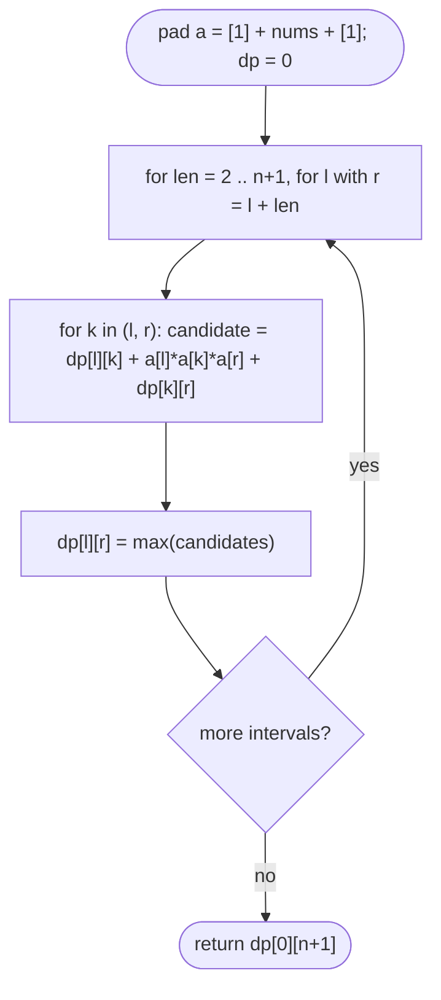

# LC 312 Burst Balloons

> [!abstract] In one sentence
> Choosing the balloon to burst *first* ruins the subproblems because its neighbours' neighbours change; choosing the balloon to burst *last* within an interval fixes its two neighbours to the interval's own boundaries, which makes the left and right sides independent — that reversal is the whole trick behind interval DP.

**Map:** [[NeetCode 150 MOC]] → [[DSA Dashboard]] · Pattern: [[2-D Dynamic Programming]]

> [!question] Predict before you read
> `[3, 1, 5, 8]`. If balloon `5` is the *last* one you burst among all four, what are its left and right neighbours at that moment, and why does that make "best for `[3, 1]`" and "best for `[8]`" independent problems?

## Problem

`n` balloons with numbers `nums[i]`. Bursting balloon `i` earns `nums[i−1] * nums[i] * nums[i+1]` coins (out-of-range neighbours count as 1); after bursting, `i−1` and `i+1` become adjacent. Return the maximum coins obtainable by bursting all balloons.

- `[3,1,5,8]` → `167` (burst 1, then 5, then 3, then 8: 15 + 120 + 24 + 8)
- `[1,5]` → `10`

Constraints that matter: `n ≤ 300`, so O(n³) = 2.7·10⁷ is fine; values up to 100, products up to `10⁶`, sums fit in `int`.

## Clarifying questions

1. Must every balloon be burst? — Yes; the answer is for all `n`.
2. Are boundaries worth 1? — Yes; pad the array with `1` at both ends.
3. Can values be 0? — Yes (LeetCode allows 0); the recurrence is unaffected.
4. Need the order, or just the total? — The total; the order is recoverable by storing the argmax `k`.

## Brute force

Try every order: `n!` permutations. Memoising on the *set* of remaining balloons gives `2^n` states, still hopeless at 300. The waste: the "burst first" view makes a balloon's score depend on neighbours that are themselves decided by earlier choices, so no small state describes a subproblem.

## The key insight

Pad: `a = [1] + nums + [1]`. Define `dp[l][r]` = max coins from bursting every balloon strictly between indices `l` and `r` (exclusive ends), assuming `a[l]` and `a[r]` are still standing. Pick the balloon `k` in `(l, r)` that bursts **last** inside this interval. When it bursts, everything between `l` and `k` and between `k` and `r` is already gone, so its neighbours are exactly `a[l]` and `a[r]`: it earns `a[l] * a[k] * a[r]`. Before that, the two sides `(l, k)` and `(k, r)` were burst independently (they never interact because `k` separates them and is standing throughout): `dp[l][k] + dp[k][r]`. Hence `dp[l][r] = max over k in (l, r) of dp[l][k] + a[l]·a[k]·a[r] + dp[k][r]`, with `dp[l][l+1] = 0` (nothing between). Answer `dp[0][n+1]`.

## Optimal approach

1. Build `a` of length `n + 2` with `a[0] = a[n+1] = 1`.
2. For interval length `len = 2 .. n+1` (distance `r − l`): for each `l` with `r = l + len ≤ n + 1`: `dp[l][r] = max over k = l+1 .. r−1` of `dp[l][k] + a[l]*a[k]*a[r] + dp[k][r]`.
3. Return `dp[0][n+1]`.
4. Order matters: shorter intervals first, because `(l, k)` and `(k, r)` are shorter than `(l, r)`.



> [!example]- Excalidraw version — the same diagram as an editable canvas
> ![[LC 312 Burst Balloons — Optimal approach.excalidraw]]
> [[LC 312 Burst Balloons — Optimal approach.excalidraw|Open in Excalidraw]] — needs the Excalidraw plugin (see [[Plugins to Install]]).

## Walkthrough

`nums = [3, 1, 5, 8]`, `a = [1, 3, 1, 5, 8, 1]` (indices 0–5). Length-2 intervals hold single balloons: `dp[0][2] = 1·3·1 = 3`, `dp[1][3] = 3·1·5 = 15`, `dp[2][4] = 1·5·8 = 40`, `dp[3][5] = 5·8·1 = 40`. Length 3, e.g. `dp[0][3]` (balloons 3, 1 between `a[0]=1` and `a[3]=5`): last = 3 → `0 + 1·3·5 + dp[1][3] = 15 + 15 = 30`; last = 1 → `dp[0][2] + 1·1·5 + 0 = 3 + 5 = 8` → `30`. Continue up to `dp[0][5] = 167` with last balloon `8` (`k = 4`): `dp[0][4] + 1·8·1 + 0 = 159 + 8`.

> [!example] dp[l][r] for a = [1,3,1,5,8,1] (rows l, columns r; only r > l + 1 is used)
> ![[LC 312 Burst Balloons — dp-l--r- for a = -1,3,1,5,8,1- (rows l, columns r; only r - l + 1 is used).excalidraw]]
> [[LC 312 Burst Balloons — dp-l--r- for a = -1,3,1,5,8,1- (rows l, columns r; only r - l + 1 is used).excalidraw|Open in Excalidraw]] — dp[0][5] = 167 comes from k = 4 (balloon 8 last): dp[0][4] + 1*8*1 + dp[4][5] = 159 + 8 + 0

%% excalidraw-spec
{"kind": "grid", "title": "dp[l][r] for a = [1,3,1,5,8,1] (rows l, columns r; only r > l + 1 is used)", "col_labels": ["", "r=1", "r=2", "r=3", "r=4", "r=5"], "row_labels": ["", "l=0", "l=1", "l=2", "l=3", "l=4"], "rows": [ [0, 3, 30, 159, 167], ["", 0, 15, 135, 159], ["", "", 0, 40, 48], ["", "", "", 0, 40], ["", "", "", "", 0] ], "highlight": [ [1, 5] ], "arrows": [ [ [1, 4], [1, 5] ] ], "caption": "dp[0][5] = 167 comes from k = 4 (balloon 8 last): dp[0][4] + 1*8*1 + dp[4][5] = 159 + 8 + 0"}
%%

## Java solution

```java
import java.util.*;

class Solution {
    public int maxCoins(int[] nums) {
        int n = nums.length;
        int[] a = new int[n + 2];
        a[0] = 1; a[n + 1] = 1;
        for (int i = 0; i < n; i++) a[i + 1] = nums[i];      // pad with virtual 1-balloons at both ends
        int[][] dp = new int[n + 2][n + 2];                    // dp[l][r]: best for balloons strictly between l and r
        for (int len = 2; len <= n + 1; len++) {               // interval length r - l, shorter first
            for (int l = 0; l + len <= n + 1; l++) {
                int r = l + len;
                int best = 0;
                for (int k = l + 1; k < r; k++) {              // k = the balloon burst LAST inside (l, r)
                    int coins = dp[l][k] + a[l] * a[k] * a[r] + dp[k][r];
                    if (coins > best) best = coins;
                }
                dp[l][r] = best;
            }
        }
        return dp[0][n + 1];
    }
}
```

**Time** O(n³) · **Space** O(n²)

Top-down form, often easier to explain:

```java
// snippet — memoised: best(l, r) over open interval (l, r)
Integer[][] memo;
int best(int[] a, int l, int r) {
    if (r - l < 2) return 0;                                  // nothing strictly between
    if (memo[l][r] != null) return memo[l][r];
    int res = 0;
    for (int k = l + 1; k < r; k++)
        res = Math.max(res, best(a, l, k) + a[l] * a[k] * a[r] + best(a, k, r));
    return memo[l][r] = res;
}
```

## Why it works

State: `dp[l][r]` is well defined because, as long as `a[l]` and `a[r]` are standing, the balloons strictly inside `(l, r)` form a contiguous group whose bursting order never interacts with anything outside. Transition: every bursting order of the inside has some last balloon `k`; at that moment the inside is empty except `k`, so its neighbours are `a[l]` and `a[r]` and its score is fixed. All earlier bursts happened inside `(l, k)` or `(k, r)`, and since `k` stood throughout, each side's bursts had neighbours only within its own side plus `k` or the outer boundary — exactly the subproblems `dp[l][k]` and `dp[k][r]`. Maximising over `k` covers every order. Base: no balloon inside → 0. Order: by interval length, so both sub-intervals are already computed. `n` balloons → `O(n²)` intervals × `O(n)` choices of `k`.

## Edge cases

- Single balloon `[5]` → 5 (`1·5·1`).
- Two balloons `[1, 5]` → burst 1 first (5) then 5 (5) = 10; the DP finds it as `k = 2` last: `dp[0][2] + 1·5·1 + 0 = 5 + 5`.
- Zeros inside (`[0, 1, 0]`): bursting a 0 earns 0; the recurrence still picks the right last balloon.
- All ones: every burst earns 1, total `n`.
- Maximum sizes: 300 balloons → ~4.5 million `k` iterations, instant.

## Common mistakes

> [!warning] What goes wrong
> - Defining `dp[l][r]` on a closed interval and multiplying by `nums[l−1]` and `nums[r+1]` with manual bounds checks: workable but error-prone; the padded open-interval form avoids every special case.
> - Choosing `k` as the *first* balloon to burst: the recurrence is then wrong because the two sides stay coupled.
> - Iterating intervals in the wrong order (by `l` then `r` ascending without length): `dp[k][r]` may not be computed yet when `k > l`.
> - Off-by-one in `len`: the loop must reach `len = n + 1` to cover `(0, n+1)`.
> - Using `int` for the product when values could exceed 100 in a variant: `100³ = 10⁶` is safe here, but `1000³` is not.

## Variants & follow-ups

- Minimum cost to merge stones / matrix chain multiplication: same "last operation in an interval" shape.
- Remove boxes (LC 546): interval DP with an extra dimension (count of same-coloured boxes attached).
- Strange printer (LC 664), palindrome removal (LC 1246): interval DP where the last action spans the interval.
- Minimum score triangulation of a polygon (LC 1039): `dp[l][r] = min over k of dp[l][k] + a[l]·a[k]·a[r] + dp[k][r]` — literally the same recurrence with min.
- Recover the order: store `arg k` per interval and output `k` after recursively ordering the sides.

## Interview script

Restate: "burst all balloons, each earns the product with its current neighbours, maximise the total." Brute force: "all orders, `n!`; subsets as state give `2^n` — both hopeless." Insight: "fix the balloon that bursts *last* inside an interval: its neighbours are then the interval boundaries, which decouples the two sides; pad with 1s so the boundaries always exist." Approach: "`dp[l][r]` over open intervals, fill by increasing length, `dp[l][r] = max_k dp[l][k] + a[l]a[k]a[r] + dp[k][r]`, answer `dp[0][n+1]`." Complexity: "O(n³) time, O(n²) space." Tests: "one balloon, two balloons, zeros, all ones." If they push: "matrix-chain multiplication and polygon triangulation are the same recurrence with min; storing the argmax recovers the order."

## Related

- Pattern: [[2-D Dynamic Programming]] (interval DP), [[DP Pattern Catalogue]]
- Prerequisites: [[LC 1143 Longest Common Subsequence]], [[LC 72 Edit Distance]] (getting used to 2-D tables)
- Siblings: [[LC 329 Longest Increasing Path in a Matrix]] (DFS + memo on a grid), [[LC 10 Regular Expression Matching]]
- Java: [[DSA Patterns in Java]] (interval DP template)

## Attempt log

| Date | Result | Minutes | What I got wrong |
|---|---|---|---|
| | | | |

### Mastery checklist
- [ ] Solved without hints in under 25 minutes
- [ ] Stated complexity before coding
- [ ] Handled every edge case above
- [ ] Code compiled first time
- [ ] Can do the follow-up variant

## Open questions
- [ ] Write matrix-chain multiplication with the same loop structure. What plays the role of `a[l]·a[k]·a[r]`?
- [ ] Why does "burst first" fail even with memoisation on `(l, r)`? Construct a 3-balloon counter-example where the sides interact.
