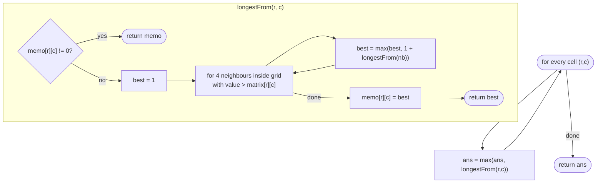

# LC 329 Longest Increasing Path in a Matrix

> [!abstract] In one sentence
> Because every step must go to a strictly larger value you can never return to a cell, so "longest path starting here" is a well-defined function of the cell alone — compute it once per cell with DFS and a memo table and take the maximum.

**Map:** [[NeetCode 150 MOC]] → [[DSA Dashboard]] · Pattern: [[2-D Dynamic Programming]] · [[DP Pattern Catalogue]]

> [!question] Predict before you read
> Grid DFS normally needs a visited set to avoid walking in circles. Why does this problem need none — and what single word in the statement guarantees that? What would break if "increasing" allowed equal values?

## Problem

Given an `m × n` integer matrix, return the length (number of cells) of the longest path such that each step moves to a 4-neighbour with a strictly greater value. You may start anywhere; moving diagonally or off the grid is not allowed.

Example: `[ [9,9,4], [6,6,8], [2,1,1] ]` → `4` (`1 → 2 → 6 → 9`).
Example: `[ [3,4,5], [3,2,6], [2,2,1] ]` → `4` (`3 → 4 → 5 → 6`).
Example: `[ [1] ]` → `1`.

Constraints that matter: 1 ≤ m, n ≤ 200 (40 000 cells), values in `[0, 2³¹ − 1]`. The recursion in the memoised DFS can be as deep as the longest path — up to 40 000 on a spiral of increasing values — which is a real `StackOverflowError` risk in Java and the reason to also know the iterative (Kahn) version.

## Clarifying questions

1. Strictly increasing, or non-decreasing? — Strictly. With equal values allowed, plateaus create cycles and the whole approach changes (components of equal cells would need to be contracted first).
2. Length counts cells, not steps? — Cells; a single cell is a path of length 1.
3. Can values be negative or huge? — Non-negative here, but the solution only compares values, so any `int` works.
4. Must the path start at a minimum? — No, but the longest one always does start at a cell with no smaller neighbour; the memo makes that irrelevant.

## Brute force

From every cell, DFS along increasing neighbours and record the maximum depth: no visited set is needed (strictly increasing values cannot revisit), but the same suffix of a path is re-walked from every cell that leads into it. On a grid where many cells feed into one long increasing chain this is exponential in the worst case (each cell branches up to 3 ways and nothing is shared) — a known-TLE on the 200 × 200 tests. The waste is pure recomputation: "longest path from cell X" does not depend on how you reached X.

## The key insight

The implicit graph (edge `u → v` iff `v` is a 4-neighbour with a strictly larger value) is a DAG, so the longest path from a node is a DAG longest-path problem: `best(u) = 1 + max(best(v))` over out-neighbours, with `best(u) = 1` when there are none. That is a recursive formula over a finite acyclic state space, which is the definition of a DP; memoise it per cell and the whole grid costs O(m · n). The reason no visited set is needed is the same reason the memo is safe: there are no cycles, so no cell is ever "in progress" when it is asked for again. Recognition cue: "longest / count paths with a strictly monotone condition on a grid" — memoised DFS, or topological order.

## Optimal approach

1. `memo[r][c] = 0` for all cells (0 means "not computed"; real answers are ≥ 1).
2. `longestFrom(r, c)`: if memoised, return it; else `best = 1`; for each 4-neighbour with a strictly larger value, `best = max(best, 1 + longestFrom(neighbour))`; store and return.
3. The answer is the maximum of `longestFrom` over all cells.



> [!example]- Excalidraw version — the same diagram as an editable canvas
> ![[LC 329 Longest Increasing Path in a Matrix — Optimal approach.excalidraw]]
> [[LC 329 Longest Increasing Path in a Matrix — Optimal approach.excalidraw|Open in Excalidraw]] — needs the Excalidraw plugin (see [[Plugins to Install]]).

## Walkthrough

First example. The memo holds, for each cell, the longest increasing path *starting* there; the shaded cells are the path `1 → 2 → 6 → 9`.

> [!example] Longest Increasing Path: memo = longest path starting at each cell
> ![[LC 329 Longest Increasing Path in a Matrix — Longest Increasing Path- memo = longest path starting at each cell.excalidraw]]
> [[LC 329 Longest Increasing Path in a Matrix — Longest Increasing Path- memo = longest path starting at each cell.excalidraw|Open in Excalidraw]] — values were 9 9 4 / 6 6 8 / 2 1 1; e.g. memo(2,1)=4 because its neighbour (2,0)=2 has memo 3

%% excalidraw-spec
{"kind": "grid", "title": "Longest Increasing Path: memo = longest path starting at each cell", "col_labels": ["c0", "c1", "c2"], "row_labels": ["r0", "r1", "r2"], "rows": [ [1, 1, 2], [2, 2, 1], [3, 4, 2] ], "highlight": [ [2, 1], [2, 0], [1, 0], [0, 0] ], "arrows": [ [ [2, 1], [2, 0] ], [ [2, 0], [1, 0] ], [ [1, 0], [0, 0] ] ], "caption": "values were 9 9 4 / 6 6 8 / 2 1 1; e.g. memo(2,1)=4 because its neighbour (2,0)=2 has memo 3"}
%%

| Call | Larger neighbours | Recursive results | `memo` |
|---|---|---|---|
| (0,0)=9 | none | – | 1 |
| (1,0)=6 | (0,0)=9 | 1 | 1 + 1 = 2 |
| (2,0)=2 | (1,0)=6 | 2 | 1 + 2 = 3 |
| (1,2)=8 | none | – | 1 |
| (1,1)=6 | (0,1)=9, (1,2)=8 | 1, 1 | 2 |
| (2,1)=1 | (1,1)=6, (2,0)=2 | 2, 3 | 1 + 3 = 4 |
| (2,2)=1 | (1,2)=8 | 1 | 2 |

The outer scan reaches (2,1) after most of the memo is filled, so its call is almost free. Maximum over the memo: 4.

## Java solution

```java
import java.util.*;

class Solution {
    private static final int[][] DIRS = {{1, 0}, {-1, 0}, {0, 1}, {0, -1}};
    private int[][] matrix, memo;
    private int m, n;

    public int longestIncreasingPath(int[][] matrix) {
        this.matrix = matrix; m = matrix.length; n = matrix[0].length;
        memo = new int[m][n];                                   // 0 = not computed; real answers are >= 1
        int best = 0;
        for (int r = 0; r < m; r++)
            for (int c = 0; c < n; c++) best = Math.max(best, longestFrom(r, c));
        return best;
    }

    private int longestFrom(int r, int c) {
        if (memo[r][c] != 0) return memo[r][c];
        int best = 1;                                           // the cell on its own
        for (int[] d : DIRS) {
            int nr = r + d[0], nc = c + d[1];
            if (nr < 0 || nc < 0 || nr >= m || nc >= n || matrix[nr][nc] <= matrix[r][c]) continue;
            best = Math.max(best, 1 + longestFrom(nr, nc));     // strictly uphill: no cycle, no visited set
        }
        memo[r][c] = best;
        return best;
    }
}
```

**Time** O(m · n) — each cell's value is computed once and each computation inspects four neighbours · **Space** O(m · n) for the memo plus recursion depth up to the longest path (worst case m · n)

The iterative equivalent processes cells in topological order of the DAG. Reverse the edges mentally: a cell's "out-degree" is the number of strictly larger neighbours; cells with out-degree 0 are local maxima and end every path. Peel them off layer by layer; the number of layers is the longest path.

```java
// snippet — Kahn-style peeling; the number of layers removed equals the longest path length
int[][] outdeg = new int[m][n];                                   // count of strictly larger neighbours
Deque<int[]> queue = new ArrayDeque<>();
// fill outdeg; enqueue every cell with outdeg 0 (a local maximum)
int layers = 0;
while (!queue.isEmpty()) {
    for (int k = queue.size(); k > 0; k--) {
        int[] cell = queue.poll();
        for (int[] d : DIRS) {                                    // smaller neighbours point INTO cell
            int nr = cell[0] + d[0], nc = cell[1] + d[1];
            if (inside(nr, nc) && matrix[nr][nc] < matrix[cell[0]][cell[1]] && --outdeg[nr][nc] == 0)
                queue.offer(new int[]{nr, nc});
        }
    }
    layers++;
}
return layers;
```

Same O(m · n), no recursion, and it makes the DAG structure explicit — this is the version to reach for when the interviewer raises the stack-depth question or asks "can you do it without recursion".

## Why it works

- **State:** a cell `(r, c)`; `best(r, c)` = longest strictly increasing path starting there.
- **Transition:** `best(r, c) = 1 + max best(nb)` over neighbours with a larger value, or `1` if there are none.
- **Base:** local maxima (no larger neighbour) have `best = 1`; the recursion bottoms out there because values strictly increase along every call chain, so the chain is finite.
- **Order:** top-down memoisation discovers the order automatically; the Kahn version makes it explicit (decreasing "height" layers).
The formula is exhaustive and sound for the same reason as any DAG longest path: an optimal path from `u` is `u` followed by an optimal path from its successor, and the memo stores the optimum per node because the optimum does not depend on the path taken to reach the node — which is exactly what a cycle would destroy.

## Edge cases

- `1 × 1` → 1.
- All cells equal → no edges at all; every cell is a local maximum; answer 1.
- Strictly increasing row (`1 2 3 … n`) → one chain, answer `n`, recursion depth `n`.
- Spiral of increasing values on 200 × 200 → path length 40 000, recursion depth 40 000: the DFS version may overflow the default stack; use the Kahn version or raise the stack by running in a `Thread` with a larger stack size.
- Values at `Integer.MAX_VALUE` → comparisons only, no arithmetic on values, so no overflow.

## Common mistakes

> [!warning] Pitfalls
> - **Adding a visited set "for safety"** — with memoisation it is unnecessary, and if you mark a cell visited on entry and never unmark it, sibling branches are cut off and the answer is too small.
> - **Memo sentinel of −1 with `int[][]` initialised by `Arrays.fill`** — fine, but forgetting the fill leaves zeros that look like "computed"; here 0 is safe as the sentinel *because* real answers are ≥ 1.
> - **`<` instead of `<=` in the neighbour skip** — allows equal steps, creates cycles, and the recursion never terminates on a plateau.
> - **Starting DFS only from local minima** — correct in principle but you still need the memo; the scan over all cells is simpler and costs nothing extra.
> - **Computing `1 + longestFrom` before the bounds check** — `ArrayIndexOutOfBoundsException` on the border.

## Variants & follow-ups

- Longest increasing *subsequence* on a 1-D array → [[LC 300 Longest Increasing Subsequence]]: different structure (not adjacent), O(n log n) with patience sorting.
- Count the number of strictly increasing paths (LeetCode 2328) → same DFS with sums instead of max, modulo 10⁹ + 7.
- Non-strict steps allowed → contract plateaus into single nodes first (flood fill equal regions), then run the same DAG DP on the contracted graph.
- Steps may also go to equal-or-lower cells but the *path* must be simple → NP-hard (longest simple path); say so.
- Reverse reachability from a boundary with a monotone condition → [[LC 417 Pacific Atlantic Water Flow]].
- What changes if you need the path itself? Store the best successor per cell in a second table and walk from the cell with the maximum memo.

## Interview script

1. Restate: longest path of strictly increasing 4-adjacent values; length in cells; any start.
2. Brute force: DFS from every cell, exponential because suffixes are recomputed.
3. Insight: strict increase → DAG → longest path from a cell is a function of the cell → memoise.
4. Approach: `memo[r][c]`, DFS returning `1 + max` over larger neighbours, scan all cells for the max; no visited set needed and say why. Offer Kahn peeling as the iterative form.
5. Complexity: O(m · n) time and space; recursion depth up to the longest path.
6. Tests: `1 × 1`, all equal, a single increasing row, the 3 × 3 example.

The interviewer is checking that you connect "strictly" to "acyclic" to "memoisable", that you do not add a visited set, and that you can handle the stack-depth follow-up with the topological version.

## Related

- [[2-D Dynamic Programming]] — grid DP where the order is not row-major
- [[DP Pattern Catalogue]] — "DP on a DAG" entry
- [[LC 417 Pacific Atlantic Water Flow]] — grid DFS with a monotone condition, where plateaus *do* occur
- [[LC 210 Course Schedule II]] — Kahn's algorithm in its native habitat
- [[LC 300 Longest Increasing Subsequence]] — the 1-D cousin
- [[Graphs]] — DAGs, DFS, topological order
- [[DSA Patterns in Java]] — DFS with memo on a grid, Kahn template
- [[Java Collections Cheat Sheet]] — `Math.max`, `ArrayDeque` for layer processing

## Attempt log

| Date | Result | Minutes | What I got wrong |
|---|---|---|---|
| | | | |

### Mastery checklist
- [ ] Solved without hints in under 25 minutes
- [ ] Stated complexity before coding
- [ ] Handled every edge case above
- [ ] Code compiled first time
- [ ] Can do the follow-up variant (Kahn peeling without recursion; counting paths)

## Open questions
- [ ]
