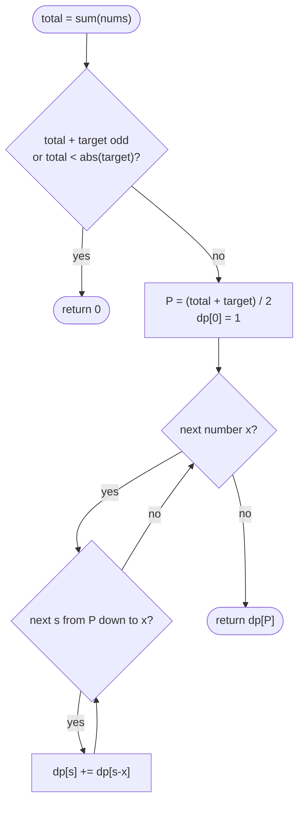

# LC 494 Target Sum

> [!abstract] In one sentence
> A sign assignment is a choice of which numbers get `+`; if that plus-set sums to `P` then `P − (total − P) = target`, so `P = (total + target) / 2` and the question becomes "how many subsets sum to `P`" — 0/1 knapsack counting, sums descending so each number is used once.

**Map:** [[NeetCode 150 MOC]] → [[DSA Dashboard]] · Pattern: [[2-D Dynamic Programming]]

> [!question] Predict before you read
> `[1, 1, 1, 1, 1]`, target 3 → 5 ways. Rewrite it as `P − N = 3`, `P + N = 5`, so `P = 4`. Why must `total + target` be even for any assignment to exist, and what is the answer for target −3?

## Problem

You are given non-negative integers `nums` and an integer `target`. Put a `+` or `−` in front of every number and evaluate the expression. Count the assignments whose value equals `target`.

Example: `[1, 1, 1, 1, 1]`, `target = 3` → `5` (one `−`, four `+`, five positions for the `−`). Example: `[1]`, `target = 1` → `1`.

Constraints that matter: 1 ≤ n ≤ 20, 0 ≤ nums[i] ≤ 1000, sum(nums) ≤ 1000, −1000 ≤ target ≤ 1000. n ≤ 20 means 2²⁰ ≈ 10⁶ brute force would pass; the point of the DP is the O(n · total) table and the reduction. Zeros are allowed and matter: each zero doubles the count.

## Clarifying questions

1. Must every number get a sign? — Yes, exactly one sign per number; no number is skipped.
2. Can `target` be negative, or larger than the total? — Both possible; negative is symmetric, larger than the total gives 0.
3. Are zeros allowed? — Yes; `+0` and `−0` are different assignments and both count.
4. Count or list the expressions? — Count.

## Brute force

Recurse over the index with a running sum: `count(i, sum)` branches `+nums[i]` and `−nums[i]`; 2ⁿ leaves, O(2ⁿ) time — acceptable for n = 20 but the state `(i, sum)` has only `n · (2 · total + 1)` distinct values, so almost every call repeats one. Memoising it (sum offset by `total` to index an array) is already the DP; the subset-sum trick halves the state space and removes the offset.

## The key insight

Let `P` be the set of numbers given `+` and `N` the rest. Then `sum(P) − sum(N) = target` and `sum(P) + sum(N) = total`, so `sum(P) = (total + target) / 2`. The assignment is determined by `P`, so the answer is the number of subsets with that sum. Two quick exits: if `total + target` is odd or negative (i.e. `|target| > total`), no assignment exists. Counting subsets with a given sum is [[LC 416 Partition Equal Subset Sum]] with `+=` instead of OR: process numbers one by one, `dp[s] += dp[s − x]` for `s` from `P` down to `x`, descending so that each number contributes at most once. Recognition cue: "assign + or − to each element", "split into two groups with a given difference".

## Optimal approach

1. `total = sum(nums)`; if `(total + target)` is odd or `total < |target|` return 0; `P = (total + target) / 2`.
2. State: `dp[s]` = number of subsets of the numbers processed so far with sum `s`; `dp[0] = 1`.
3. For each `x`: for `s` from `P` down to `x`: `dp[s] += dp[s − x]`.
4. Order: numbers in any order; sums descending within a number (0/1).
5. Answer: `dp[P]`.



> [!example]- Excalidraw version — the same diagram as an editable canvas
> ![[LC 494 Target Sum — Optimal approach.excalidraw]]
> [[LC 494 Target Sum — Optimal approach.excalidraw|Open in Excalidraw]] — needs the Excalidraw plugin (see [[Plugins to Install]]).

For `x = 0` the inner loop runs down to `s = 0` and does `dp[s] += dp[s]` — every count doubles, which is exactly the two signs a zero can take.

## Walkthrough

`[1, 1, 1, 1, 1]`, target 3, so `P = 4`. Each row is the count array after one more number.

> [!example] Subsets with sum s after each 1 of [1,1,1,1,1], P = 4
> ![[LC 494 Target Sum — Subsets with sum s after each 1 of -1,1,1,1,1-, P = 4.excalidraw]]
> [[LC 494 Target Sum — Subsets with sum s after each 1 of -1,1,1,1,1-, P = 4.excalidraw|Open in Excalidraw]] — dp[4] after the fifth 1 = dp[4] (skip it) + dp[3] (take it) = 1 + 4 = 5; the rows are Pascal's triangle

%% excalidraw-spec
{"kind": "grid", "title": "Subsets with sum s after each 1 of [1,1,1,1,1], P = 4", "col_labels": ["s=0", "s=1", "s=2", "s=3", "s=4"], "row_labels": ["start", "+1", "+1", "+1", "+1", "+1"], "rows": [ [1, 0, 0, 0, 0], [1, 1, 0, 0, 0], [1, 2, 1, 0, 0], [1, 3, 3, 1, 0], [1, 4, 6, 4, 1], [1, 5, 10, 10, 5] ], "highlight": [ [5, 4] ], "arrows": [ [ [4, 4], [5, 4] ], [ [4, 3], [5, 4] ] ], "caption": "dp[4] after the fifth 1 = dp[4] (skip it) + dp[3] (take it) = 1 + 4 = 5; the rows are Pascal's triangle"}
%%

| after number | dp (s = 0..4) | reading |
|---|---|---|
| 1st 1 | 1 1 0 0 0 | one subset of sum 1 |
| 2nd 1 | 1 2 1 0 0 | two ways to pick one of two |
| 3rd 1 | 1 3 3 1 0 | C(3, k) |
| 4th 1 | 1 4 6 4 1 | C(4, k) |
| 5th 1 | 1 5 10 10 5 | C(5, 4) = 5 subsets of size 4 |

Target −3 gives `P = 1` and the answer `dp[1] = 5` — the mirror image, as expected.

## Java solution

```java
import java.util.*;

class Solution {
    public int findTargetSumWays(int[] nums, int target) {
        int total = 0;
        for (int x : nums) total += x;
        if (total < Math.abs(target) || (total + target) % 2 != 0) return 0;   // no plus-set can exist
        int p = (total + target) / 2;                 // required sum of the numbers that receive '+'
        int[] dp = new int[p + 1];                    // dp[s] = subsets of the numbers so far with sum s
        dp[0] = 1;                                    // the empty subset
        for (int x : nums) {
            for (int s = p; s >= x; s--) {            // descending: dp[s - x] still excludes x
                dp[s] += dp[s - x];                   // subsets containing x = subsets of sum s - x without it
            }
        }
        return dp[p];
    }
}
```

**Time** O(n · P) · **Space** O(P)

Top-down on the original formulation — index and running sum, with the sum offset by `total` so it can index an array:

```java
// snippet
Integer[][] memo;                                     // memo[i][sum + total] = ways from index i with running sum; null = unknown
int count(int[] nums, int i, int sum, int target, int total) {
    if (i == nums.length) return sum == target ? 1 : 0;
    if (memo[i][sum + total] != null) return memo[i][sum + total];
    int r = count(nums, i + 1, sum + nums[i], target, total)
          + count(nums, i + 1, sum - nums[i], target, total);
    return memo[i][sum + total] = r;
}
// memo = new Integer[n][2 * total + 1]; answer = count(nums, 0, 0, target, total). O(n · total) time and space
```

The 2-D knapsack table, for drawing on a whiteboard:

```java
// snippet
int[][] dp = new int[n + 1][p + 1];                   // dp[i][s] = subsets of the first i numbers with sum s
dp[0][0] = 1;
for (int i = 1; i <= n; i++) {
    int x = nums[i - 1];
    for (int s = 0; s <= p; s++) {
        dp[i][s] = dp[i - 1][s] + (s >= x ? dp[i - 1][s - x] : 0);   // skip x / take x, both from the previous row
    }
}
return dp[n][p];                                      // O(n · P) time and space
```

## Why it works

Reduction: the map "assignment → plus-set" is a bijection between sign assignments and subsets, and an assignment evaluates to `target` iff its plus-set sums to `(total + target) / 2`. State: `dp[i][s]` counts subsets of the first `i` numbers with sum `s`. Transition: subsets either exclude `nums[i]` (counted by `dp[i − 1][s]`) or include it (in bijection with subsets of the first `i − 1` summing to `s − x`); disjoint, so add. Base: `dp[0][0] = 1`. Order: numbers in any order, sums descending within a number so the single array still reads the previous row. The parity and magnitude checks are not optimisations — without them `(total + target) / 2` silently truncates and counts the wrong subsets.

## Edge cases

- `target` beyond the total, `[1, 2]`, 5 — 0 by the magnitude check.
- Odd `total + target`, `[1, 2]`, 2 — 0 by parity (no assignment reaches an even value when total is odd... except the check is what decides, not intuition).
- Negative target — symmetric; `P` is smaller but the count equals the count for `+target`.
- Zeros, `[0, 0, 1]`, target 1 — 4: the single 1 is `+`, each 0 takes either sign.
- `target = total` — `P = total`, exactly one subset (everything); `target = −total` — `P = 0`, one subset (nothing) unless zeros multiply it.
- Single element `[1]`, target 1 → 1; target 0 → 0 (`total + target` odd).

## Common mistakes

> [!warning] Pitfalls
> - **Skipping the parity check** — `(total + target) / 2` truncates; `[1, 2]`, target 2 gives `P = 2` and answer 1 instead of 0.
> - **Skipping the `total < |target|` check** — negative `P` means a negative array size, `NegativeArraySizeException`.
> - **Inner loop ascending** — reuses a number (unbounded): `[1, 1]`, target 2 has `P = 2`; ascending sets `dp[2] = 1` after the *first* 1 alone and ends at 3 instead of 1.
> - **Inner loop `s ≥ 1` instead of `s ≥ x`** — breaks zeros: the doubling at `s = 0` is lost and the count is halved per zero.
> - **Memo keyed by `sum` without an offset** — negative running sums cannot index an array; offset by `total` or use a `HashMap`.
> - **Using `boolean` like [[LC 416 Partition Equal Subset Sum]]** — this problem counts; the OR becomes `+=`.

## Variants & follow-ups

- Existence instead of count — [[LC 416 Partition Equal Subset Sum]].
- Unlimited reuse — [[LC 518 Coin Change II]] (ascending loop).
- Numbers may be negative — the subset-sum trick still holds algebraically, but sums need an offset; use the `(i, sum)` memo.
- Minimum absolute difference of two groups — fill the reachable-sum array and scan for the best `s ≤ total / 2`.
- Target with `+`, `−` and `*` and parentheses — no longer knapsack; expression enumeration ([[LC 39 Combination Sum]]-style backtracking).
- Count assignments modulo 10⁹ + 7 for large n — same loops with `%`.

## Interview script

1. Restate: sign every number, count assignments evaluating to `target`.
2. Brute force: 2ⁿ assignments; memo on `(index, running sum)` with an offset.
3. Insight: plus-set determines everything; `sum(P) = (total + target) / 2`; parity and magnitude checks.
4. Approach: subset-count knapsack, one array, sums descending, `dp[0] = 1`.
5. Complexity: O(n · P) time, O(P) space.
6. Tests: the example, `[1]`/1, `[1, 2]`/2 (parity), `[0, 0, 1]`/1 (zeros), negative target.

The interviewer is checking that you derive the reduction rather than recall it, that you handle the two early exits and zeros, and that you can state why the loop is descending.

## Related

- [[2-D Dynamic Programming]] — knapsack section
- [[DP Pattern Catalogue]] — row 8, 0/1 knapsack
- [[LC 416 Partition Equal Subset Sum]] — the boolean version
- [[LC 518 Coin Change II]] — counting with reuse, ascending loop
- [[LC 39 Combination Sum]] — enumeration when the count is not enough
- [[DSA Patterns in Java]] — knapsack templates, memo with offset keys

## Attempt log

| Date | Result | Minutes | What I got wrong |
|---|---|---|---|
| | | | |

### Mastery checklist
- [ ] Solved without hints in under 25 minutes
- [ ] Stated complexity before coding
- [ ] Handled every edge case above
- [ ] Code compiled first time
- [ ] Can do the follow-up variant (negative numbers; minimum difference)

## Open questions
- [ ]
