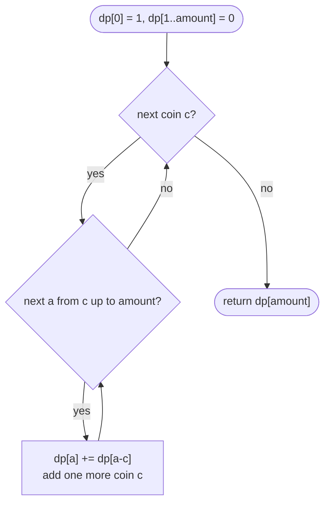

# LC 518 Coin Change II

> [!abstract] In one sentence
> Count combinations by deciding coins one denomination at a time: the number of ways to make `a` with the first `i` coins is the ways *without* coin `i` plus the ways with at least one more coin `i` (`dp[i][a − c]` on the same row), and because the outer loop fixes a canonical coin order, `{1, 2}` and `{2, 1}` collapse into one.

**Map:** [[NeetCode 150 MOC]] → [[DSA Dashboard]] · Pattern: [[2-D Dynamic Programming]]

> [!question] Predict before you read
> Coins `[1, 2]`, amount `3`. The answer is 2 (`1+1+1`, `1+2`). Swap the loops — amounts outer, coins inner, `dp[a] += dp[a − c]` — and work out what number comes out and what it is counting.

## Problem

Given coin denominations and an amount, count the number of *combinations* of coins that sum to the amount. Each denomination may be used any number of times; two selections that use the same multiset of coins are the same combination.

Example: `amount = 5, coins = [1, 2, 5]` → `4` (`5`, `2+2+1`, `2+1+1+1`, `1+1+1+1+1`). Example: `amount = 3, coins = [2]` → `0`. Example: `amount = 10, coins = [10]` → `1`.

Constraints that matter: 1 ≤ coins.length ≤ 300, 1 ≤ coins[i] ≤ 5000, all distinct, 0 ≤ amount ≤ 5000, and the answer is guaranteed to fit in a signed 32-bit `int`. The table is at most 300 × 5001 if you keep it 2-D; one array of 5001 if you roll it.

## Clarifying questions

1. Combinations or ordered sequences? — Combinations: `1+2` and `2+1` are one way. (Ordered is "Combination Sum IV", a different loop order.)
2. Unlimited supply of each coin? — Yes, unbounded.
3. Is `amount = 0` possible? — Yes, answer 1: the empty combination.
4. Does the count fit in an `int`? — The statement guarantees it; mention `long` or a modulus as the fallback.

## Brute force

Recursively choose the next coin and subtract it until the amount hits 0 — but that enumerates *sequences*, and `1+2` and `2+1` are both leaves. To count combinations you must impose an order: only pick coins with index ≥ the last index used. That recursion `ways(i, remaining)` is correct but exponential without a memo; its state space is only `coins.length × (amount + 1)`.

## The key insight

Count by denomination, not by coin. For the first `i` denominations and amount `a`, every combination either uses no coin of denomination `i` (then it is a combination of the first `i − 1`) or uses at least one (remove one copy and you have a combination of the first `i` denominations for `a − cᵢ`). Those two sets are disjoint and cover everything, so `dp[i][a] = dp[i − 1][a] + dp[i][a − cᵢ]`. The second term reads the *same* row — that is the "unbounded" part, the same as [[LC 322 Coin Change]] — and because row `i` is built only after row `i − 1` is complete, each multiset is counted exactly once, in the order the denominations appear. Recognition cue: "number of combinations / ways to make a total, items reusable, order does not matter".

## Optimal approach

1. State: `dp[a]` = combinations making `a` using the denominations processed so far.
2. Base: `dp[0] = 1`, all other 0.
3. For each coin `c` (outer loop): for `a` from `c` to `amount` (ascending): `dp[a] += dp[a − c]`.
4. Order: coins outer so that each combination is built in one canonical denomination order; amounts ascending so that `dp[a − c]` already includes the current coin (unbounded reuse).
5. Answer: `dp[amount]`.



> [!example]- Excalidraw version — the same diagram as an editable canvas
> ![[LC 518 Coin Change II — Optimal approach.excalidraw]]
> [[LC 518 Coin Change II — Optimal approach.excalidraw|Open in Excalidraw]] — needs the Excalidraw plugin (see [[Plugins to Install]]).

Contrast with [[LC 322 Coin Change]]: there the loop order is free because `min` is order-independent; here `+` over *sets* is not — the loops encode which sequences are considered the same.

## Walkthrough

`amount = 5, coins = [1, 2, 5]`. Each row is the array after one more denomination.

> [!example] Ways to make a with the first i coins of 1, 2, 5
> ![[LC 518 Coin Change II — Ways to make a with the first i coins of 1, 2, 5.excalidraw]]
> [[LC 518 Coin Change II — Ways to make a with the first i coins of 1, 2, 5.excalidraw|Open in Excalidraw]] — dp[3][5] = dp[2][5] (no coin 5) + dp[3][0] (one coin 5 plus ways for 0) = 3 + 1 = 4

%% excalidraw-spec
{"kind": "grid", "title": "Ways to make a with the first i coins of 1, 2, 5", "col_labels": ["a=0", "a=1", "a=2", "a=3", "a=4", "a=5"], "row_labels": ["no coins", "+1", "+2", "+5"], "rows": [ [1, 0, 0, 0, 0, 0], [1, 1, 1, 1, 1, 1], [1, 1, 2, 2, 3, 3], [1, 1, 2, 2, 3, 4] ], "highlight": [ [3, 5] ], "arrows": [ [ [2, 5], [3, 5] ], [ [3, 0], [3, 5] ] ], "caption": "dp[3][5] = dp[2][5] (no coin 5) + dp[3][0] (one coin 5 plus ways for 0) = 3 + 1 = 4"}
%%

| coin | a = 2 | a = 3 | a = 4 | a = 5 |
|---|---|---|---|---|
| after 1 | 1 (`1+1`) | 1 | 1 | 1 |
| after 2 | 2 (`+2`) | 2 (`2+1`) | 3 (`2+2`, `2+1+1`) | 3 |
| after 5 | 2 | 2 | 3 | 4 (`+5`) |

With the loops swapped, amount 3 and coins `[1, 2]` gives `dp[3] = dp[2] + dp[1] = 2 + 1 = 3`: it counts `1+1+1`, `1+2` *and* `2+1`.

## Java solution

```java
import java.util.*;

class Solution {
    public int change(int amount, int[] coins) {
        int[] dp = new int[amount + 1];              // dp[a] = combinations for a using the coins seen so far
        dp[0] = 1;                                   // the empty combination makes 0
        for (int c : coins) {                        // outer loop over denominations fixes a canonical order
            for (int a = c; a <= amount; a++) {      // ascending: dp[a - c] already counts combinations that use c
                dp[a] += dp[a - c];                  // "use one more c" on top of every way to make a - c
            }
        }
        return dp[amount];
    }
}
```

**Time** O(k · amount) for k coins · **Space** O(amount)

Top-down with the order baked into the state — the memo needs the coin index, or it would count sequences:

```java
// snippet
Integer[][] memo;                                     // memo[i][rem] = combinations for rem using coins[i..]; null = unknown
int ways(int[] coins, int i, int rem) {
    if (rem == 0) return 1;
    if (i == coins.length) return 0;                  // coins exhausted with amount left
    if (memo[i][rem] != null) return memo[i][rem];
    int r = ways(coins, i + 1, rem);                  // never use coins[i] again
    if (coins[i] <= rem) r += ways(coins, i, rem - coins[i]);   // use one more coins[i], stay at i
    return memo[i][rem] = r;
}
// memo = new Integer[k][amount + 1]; answer = ways(coins, 0, amount). O(k · amount) time and space
```

The 2-D table, which shows where the rolling array's two terms come from:

```java
// snippet
int[][] dp = new int[k + 1][amount + 1];              // dp[i][a] = ways for a using the first i coins
dp[0][0] = 1;
for (int i = 1; i <= k; i++) {
    int c = coins[i - 1];
    for (int a = 0; a <= amount; a++) {
        dp[i][a] = dp[i - 1][a] + (a >= c ? dp[i][a - c] : 0);   // skip the coin / use one more of it (same row)
    }
}
return dp[k][amount];                                 // O(k · amount) time and space
```

## Why it works

State: `dp[i][a]` counts multisets over the first `i` denominations with sum `a`. Transition: partition those multisets by whether they contain denomination `i`; the ones that do not are exactly the multisets over the first `i − 1`, and removing one coin `cᵢ` from the ones that do is a bijection onto multisets over the first `i` with sum `a − cᵢ`. Disjoint and exhaustive, so the counts add. Base: `dp[0][0] = 1`. Order: rows in coin order, amounts ascending within a row, so that `dp[i][a − cᵢ]` is final when read. Collapsing to one array is valid because row `i` reads row `i − 1` only at the same column `a`, which is the value still sitting in `dp[a]` before the update.

## Edge cases

- `amount = 0` — returns `dp[0] = 1` whatever the coins.
- Coins all larger than the amount — inner loops never run; 0 (or 1 for amount 0).
- Single coin equal to the amount — 1.
- Unreachable amount, `[2]`, 3 — odd columns stay 0.
- Large coin counts with a small amount — the inner loop is bounded by `amount`, so 300 coins cost 300 passes over a short array.
- Answer near 2³¹ — guaranteed to fit. The table only ever *adds*, and `int` addition is arithmetic modulo 2³², so even if some unrelated intermediate cell wrapped around, `dp[amount]` is still the true count modulo 2³², which equals the true count whenever it fits.

## Common mistakes

> [!warning] Pitfalls
> - **Amounts outer, coins inner** — counts ordered sequences (Combination Sum IV). The classic bug; `[1, 2]`, 3 → 3 instead of 2.
> - **Amounts descending** — turns it into 0/1 knapsack ([[LC 416 Partition Equal Subset Sum]] style): each coin used at most once.
> - **`dp[0] = 0`** — nothing is ever counted.
> - **Memo without the coin index** — `ways(rem)` alone counts sequences, since it may pick a smaller coin after a larger one.
> - **Thinking `min` and `+` are interchangeable** — [[LC 322 Coin Change]] tolerates either loop order; this problem does not. Say why: the sum ranges over *sets of combinations*, and the loop order defines the set.

## Variants & follow-ups

- Ordered sequences (Combination Sum IV, LC 377) — amounts outer, coins inner; the recursion has no coin index.
- Fewest coins — [[LC 322 Coin Change]].
- Each coin at most once — amounts descending; counting version of [[LC 416 Partition Equal Subset Sum]].
- Modular counting for huge answers — `dp[a] = (dp[a] + dp[a − c]) % MOD`.
- Combinations with a cap of `kᵢ` copies per coin — bounded knapsack; add an inner loop over copies or use the binary-splitting trick.
- Climbing stairs with step sizes `{1, 2}` where order matters — [[LC 70 Climbing Stairs]] is the *ordered* count, which is why its recurrence looks like the swapped loops.

## Interview script

1. Restate: count multisets of coins summing to `amount`; order irrelevant; unlimited supply.
2. Brute force: recursive enumeration, exponential, and it must not count `1+2` and `2+1` twice.
3. Insight: decide denominations one at a time; `dp[i][a] = dp[i − 1][a] + dp[i][a − c]`.
4. Approach: one array, coins outer, amounts ascending, `dp[0] = 1`; explain what swapping the loops would count.
5. Complexity: O(k · amount) time, O(amount) space.
6. Tests: `5 / [1,2,5]`, `3 / [2]`, `0 / anything`, `3 / [1,2]` (loop-order check).

The interviewer is checking that you can explain the loop order in terms of what is being counted, that you distinguish this from the minimum-coins problem, and that you know `dp[0] = 1` means "the empty combination".

## Related

- [[2-D Dynamic Programming]] — knapsack section
- [[DP Pattern Catalogue]] — row 7, unbounded knapsack
- [[LC 322 Coin Change]] — the minimum twin, loop order free
- [[LC 416 Partition Equal Subset Sum]] — 0/1 version: amounts descending
- [[LC 494 Target Sum]] — 0/1 counting with a sign trick
- [[LC 70 Climbing Stairs]] — ordered counting with steps `{1, 2}`
- [[DSA Patterns in Java]] — knapsack templates

## Attempt log

| Date | Result | Minutes | What I got wrong |
|---|---|---|---|
| | | | |

### Mastery checklist
- [ ] Solved without hints in under 25 minutes
- [ ] Stated complexity before coding
- [ ] Handled every edge case above
- [ ] Code compiled first time
- [ ] Can do the follow-up variant (ordered sequences; bounded copies)

## Open questions
- [ ]
